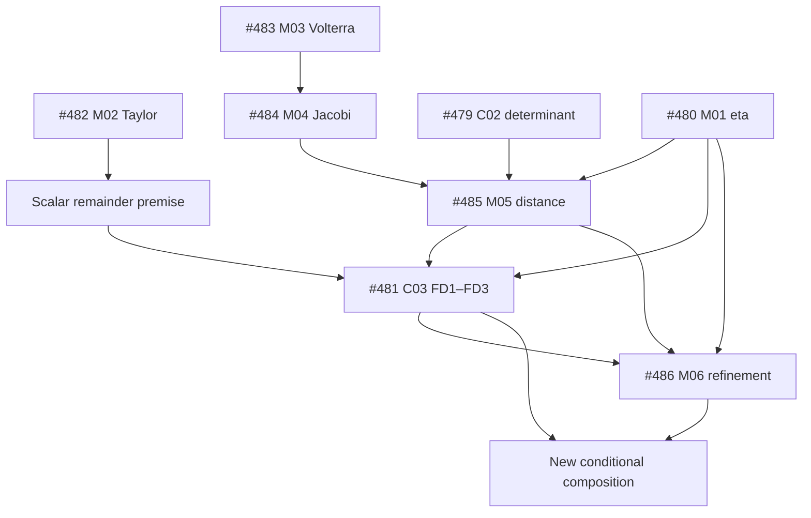

# HTT 후속 handoff — 과제 중심 도구 분업과 독립 검토
2026-10-08 / 기준 저장소: cosmosapjw-quantum/htt_base

## 1. 현재 위치

원격 `main`은 지난 검증과 같은 `f1007dd3e41c07eccd64024dd6b44fb5a40a3612`다. 이후 **#477–#505, 29개 PR / 32개 커밋**이 올라왔으며 조회 시점 모두 OPEN이다. 이들은 같은 main에서 각각 갈라진 브랜치다. 최신 #505만 받아서는 다른 28개 PR의 연구 결과를 얻지 못한다.

이 문서는 PR 본문, 게시된 RETURN·계약·독립 검토·입력 및 주요 Lean 의존 관계를 읽어 작성했다. 기존 엔진·증명을 이번에 다시 실행하지 않았다. 아래 PASS는 명시된 범위에 대한 **게시 기록의 판정**이며, 새 독립 수학 재감사나 main 병합 완료를 뜻하지 않는다. 현재 로컬 파일·미게시 결과는 직접 확인하지 못했다.

- #477의 CAS06 입력 준비부터 다시 시작할 필요는 없다. 새로운 유한 C01–C04 결과가 게시돼 있다.
- CAS07은 C02/C03와 M01–M06의 검증 결과가 쌓였다. 이를 **주어진 함수에 대한 조건부 해석적 합성정리**로 연결하는 것이 첫 과제로 적합하다.
- #497은 CAS15-C03의 일반 행렬/최소제곱 연결 4개가 미완료다.
- #503은 GL5×Nφ9 구면 quadrature의 164개 비상수 Cartesian 단항식 연결이 Lean에서 미완료다.
- #504/#505의 PORT-CAS01/02는 유한 성분 완료다. PORT-CAS03은 조사한 새 PR에 successor가 없으므로 기존 로컬 동치 증거 확인 후 남은 부분을 선택한다.
- 모든 결과의 물리·관측 적용과 scientific admission은 별도다.

새 분업 방식은 **하나의 명제 → 증명 의무별 분업 → 필요한 도구 실행 → 전체 합성 → 별도 고성능·고사고 독립 검토**다. 네 프로그램은 사용할 수 있는 도구이며, 네 번의 전체 중복 증명을 요구하지 않는다. author들 사이의 협업은 허용하고 공유한 결과를 명시한다. 독립성은 별도 reviewer의 역할·문맥·판정에서 확보한다. 같은 모델 계열의 별도 세션만으로 오류가 통계적으로 독립이라고 주장하지 않는다.

## 2. 첫 과제와 다음 순서

**첫 과제: CAS07 조건부 해석적 합성정리.** 이는 아래 이미 게시된 성분을 조합하는 새 과제다. 과거 parent 판정이나 미종결 C01 기록을 고쳐서 완료 처리하는 작업이 아니다.

| 순서 | 과제 | 완료 산출물 / 경계 |
|---|---|---|
| 1 | CAS07 조건부 합성 | 주어진 Jacobi 계와 C² scalar의 가정에서 거리·유한거리 오차 경계까지 연결된 증명과 검토 |
| 2 | CAS15-C03 잔여 연결 | 임의 Rhat 최소제곱 projection, mixed norm, rotated coercivity, Weyl ordered matching; 새 방식으로 검증한 별도 결과 |
| 3 | CAS16-C03 quadrature 연결 | radial/Fourier 결과를 Cartesian 단항식 정리로 연결; 기존 성공한 exact 계산 재사용 |
| 4 | CAS13 제한된 extremizer 합성 | C02의 실현 가능한 measure와 C03의 p=5,6 Hermite 부등식을 연결; 일반 실수 p>4는 별도 |
| 5 | PORT-CAS03 이후 | velocity-jet 정의/부호/단위와 기존 GR-CAS01 증명의 정확한 대응, 구현 함수 검증 |

이 순서는 이미 승인된 입력과 재사용 가능한 증거를 갖춘 과제를 먼저 끝내려는 **추천 실행 순서**다. 새 수학적 dependency를 주장하는 목록은 아니다. CAS07의 정확한 입력·증명 파일을 로컬에서 확보하지 못하면 그 결손을 적고 순서 2의 독립적인 과제로 진행한다. CAS12 C01/C02/C04는 명시적 연산자·측도·Thomson kernel·함수공간 등이 아직 미정이라 준비된 작업으로 취급하지 않는다.

### CAS07에서 합성할 명제

E=R²의 표준 Euclidean 내적과 induced operator norm을 사용한다. K≥0, L>0, c>0, M₂≥0이다. [0,L]에서 D의 도함수 D₁,D₂가 있고 D₂,R이 연속이며,

```text
D(0)=0,  D₁(0)=Id,  D₂(r)=−R(r)∘D(r),  ||R(r)||op≤K.
Z′=Z₁, Z₁′=Z₂이고 Z₂는 [0,L]에서 연속이며 |Z₂(r)|≤M₂.
끝점의 미분 의미는 원 M02의 within/ambient 가정을 정확히 따른다.
Z₀=Z(0),  H₀=c Z₁(0).
f_K(r)=r (K=0), sinh(sqrt(K)r)/sqrt(K) (K>0).
η(r)=f_K(r)/r−1 (r>0),  η_L=η(L)<1.
d_A(s)=sqrt(det D(s)),  t=min(L,d_A(s)/(1−η_L)).
```

증명할 결론은 모든 0<s≤L에 대해

```text
||D(s)||op ≤ f_K(s)
||D(s)−s Id||op ≤ f_K(s)−s
det D(s)>0
s(1−η(s)) ≤ d_A(s) ≤ s(1+η(s))

E(s)=|Z(s)−Z₀−H₀ d_A(s)/c|
E(s) ≤ M₂s²/2 + |H₀|sη(s)/c                             [FD1]
E(s) ≤ M₂d_A²/[2(1−η_L)²] + |H₀|d_Aη_L/[c(1−η_L)]    [FD2]
|c(Z(s)−Z₀)/d_A−H₀|
     ≤ cM₂s/[2(1−η(s))] + |H₀|η(s)/(1−η(s))             [FD3]

s≤t≤L,  0≤η(s)≤η(t)≤η_L<1
E(s) ≤ M₂t²/2 + |H₀|tη(t)/c ≤ FD2의 우변.
```

이것은 **주어진 함수의 조건부 해석적 정리**다. Jacobi/source field의 존재, 관측에서 Z₀나 곡률 상한을 식별하는 방법, 통계적 coverage, 전체 우주론 모델의 식별을 증명하지 않는다. D를 대칭·가환으로 제한해서는 안 된다. K의 단위는 길이⁻², M₂도 길이⁻², c는 길이/시간, H₀는 시간⁻¹, Z와 η는 무차원이다. Z₀=1을 넣지 않는다.

### 합성정리의 수학적 의존 관계



※ T는 위 설명을 위한 중간 전제 표시다. 새로 등록된 component ID가 아니다.

M04의 실제 Lean source는 M03를 import하고 적분 항등식을 증명한다. M02의 scalar 결과를 operator space에 옮기는 정당화는 실제 M04 정리에 포함된 범위를 읽고 확인한다. scalar lemma를 이름만 바꿔 Banach-space theorem으로 사용하지 않는다.

## 3. 다음 Local Codex에 전달할 전체 프롬프트

아래 블록 전체를 전달한다. 뒤의 PR 표와 경로 목록도 함께 제공하면 탐색량을 줄일 수 있다.

```text
[목표]
기존 /home/cosmosapjw/Dropbox/bianchi/htt_base에서 subagent-driven으로 남은 증명을 이어간다.
첫 결과물은 CAS07의 게시된 C02/C03/M01–M06을 재사용하여 만든
“주어진 Jacobi 계와 C² scalar에 대한 조건부 해석적 합성정리”다.
증명 의무, 실제 증명/도구 출력, 핵심 검증, 별도 독립 검토가 연결된 하나의 결과를 완성한다.
다음 과제는 CAS15-C03 잔여 연결, CAS16-C03 Cartesian quadrature 연결,
CAS13 p=5,6 제한된 extremizer 합성, PORT-CAS03의 미검증 부분 순으로 선택한다.

[완료 기준]
1. 시작 시 git status --short, 현재 branch/HEAD/tree, 미게시 결과를 확인한다.
   원격 main의 확인 기준은 f1007dd3e41c07eccd64024dd6b44fb5a40a3612다.
   #477–#505는 독립된 29개 OPEN PR이다. 최신 #505가 앞선 결과를 포함한다고 가정하지 않는다.
   원격이 전진했으면 변경분을 읽어 이번 인계와 조정한다.
2. 먼저 #479–#486의 전체 변경 이력과 필요한 증명을 기존 checkout의 작업 브랜치에 모은다.
   필요한 ref를 fetch한 뒤 실제 head SHA를 부록의 값과 비교한다.
   기존 로컬에 같은 결과가 있으면 ancestry/content를 확인해 한 번만 반영한다.
   사용자 변경을 보존하고, 파일이 겹치지 않는다는 사실만으로 통합 검증을 완료했다고 하지 않는다.
   #477/#491/#499를 나중에 가져올 때는 두 커밋 전체를 반영한다.
   특히 #491/#499의 마지막 커밋만 cherry-pick하면 원 증명이 빠진다.
3. 첫 과제의 수학적 입력은 아래와 같다.
   E=R², 표준 Euclidean 내적, induced operator norm.
   K≥0,L>0,c>0,M₂≥0.
   [0,L]에서 D,D₁,D₂,R은 원 M04 계약의 정확한 정칙성을 만족하고
   D(0)=0, D₁(0)=Id, D₂=−R∘D, ||R||op≤K.
   Z,Z₁,Z₂는 원 M02 계약의 정칙성과 |Z₂|≤M₂를 만족하며
   Z₀=Z(0), H₀=cZ₁(0).
   f_K(r)=r if K=0, sinh(sqrt(K)r)/sqrt(K) if K>0.
   η(r)=f_K(r)/r−1 for r>0; η_L=η(L)<1.
   주어진 함수에 대한 모든 0<s≤L의 norm/determinant/distance/FD1–FD3와
   t=min(L,d_A/(1−η_L)) refinement를 하나의 정확한 정리로 연결한다.
   수식은 C03와 M06의 ADMITTED_INPUTS.json을 기준으로 대조한다.
4. 각 결론을 가져오는 기존 theorem/file 또는 새 proof obligation과 연결한다.
   기존 theorem의 가정을 새 결론으로 순환 가정하지 않는다.
   특히 scalar remainder는 M02에서, distance/양의 분모는 M05/M01에서 유도한 뒤 C03에 넣는다.
   조합에 필요한 정칙성·전 구간 상한·유한차원 전환을 생략하지 않는다.
5. 도구별 전체 중복 증명 대신 한 과제 안에서 강점에 따라 분업한다.
   필요 역할만 만들고 파일 쓰기 소유자를 분리한다.
   기본 author 역할은 해석/가정 연결, 형식증명 통합, 기호대수/경계 검산이다.
   subagent는 서로의 명시된 보조정리와 결과를 공유할 수 있다.
   공유한 결과를 독립 재발견이나 독립 검증이라고 기록하지 않는다.
6. 핵심 합성 theorem을 실제 Lean kernel에서 컴파일하고 사용 axiom을 확인한다.
   기존 성분은 exact statement/input 대응이 확인되면 그대로 재사용한다.
   필요한 accepted Lean module/`.olean`이 로컬에 없으면 고정된 원 source를
   기존 pinned toolchain으로 빌드하는 최소 dependency compilation을 허용한다.
   이는 새 합성 build의 일부로 실제 실행을 기록하며 전체 도구 재검증으로 확대하지 않는다.
   새로 바뀐 부등식·분모·인덱스·구현 경로만 필요한 CAS/회귀 검사로 확인한다.
   K=0, H₀=0, M₂=0, min의 두 branch, η_L→1⁻ 경계,
   s=0에서 허용되는 원래 정리와 0<s에서만 허용되는 나눗셈을 분리한다.
   합성 증명의 일부만 형식화됐으면 정확히 그 부분만 formal로 보고한다.
7. author들이 결과를 완성한 뒤 새로운 문맥의 독립 reviewer 한 명에게 넘긴다.
   reviewer는 이 과제에서 작성·수정에 참여하지 않은 별도 agent/세션이어야 한다.
   현재 이용 가능한 높은 추론 성능의 모델과 지원되는 높은/최대 사고 모드를 명시적으로 선택한다.
   요청 설정과 실제 확인 가능한 실행 설정을 구분한다. 확인 불가능한 설정은 UNKNOWN이다.
   필요한 수준의 reviewer를 사용할 수 없으면 결과는 candidate/review pending으로 보존한다.
8. reviewer에게 목표 정리, 정의·가정, 기존 의존 정리의 정확한 범위,
   최종 diff/소스, 실제 실행 로그, 실패 기록을 제공한다.
   author의 자기평가나 이전 PASS를 정답으로 제시하지 않는다.
   reviewer는 먼저 정리와 dependency만 보고 핵심 논증·반례를 독립 검토한 뒤
   산출물의 증명/코드/로그를 감사한다.
   자기 답안과 문구가 다르다는 이유로 거부하지 말고 실제 논증의 타당성을 판정한다.
9. 정리–증명–코드 의미의 대응, hidden assumption, domain/branch/sign/unit,
   proof gap, numerical-only generalization, target-as-assumption을 검토한다.
   결함이 있으면 해당 부분을 수리하고 영향받는 검증만 다시 수행한다.
   reviewer가 그 finding과 영향을 받는 dependency를 닫으면 단위를 완료한다.
   이유 없이 reviewer를 바꾸거나 통과할 때까지 전체 검증을 반복하지 않는다.

[범위]
- 이후 새 과제는 이 과제 중심 분업·검토 절차를 따른다.
  이전의 네 독립 전체 실행 요구와 충돌하면 이번 명시적 지시를 미래 작업에 적용한다.
  이 절차 변경 자체를 다시 승인받느라 멈추지 않는다.
- 과거 계약, adjudication, 실패, 미완료 formal proof와 review 상태는 그대로 보존한다.
  새 결과는 동일한 수학 명제의 새 검증 계획/후속 결과로 기록한다.
  과거 CAS_4AXIS_PASS나 historical acceptance를 새 방식의 결과명으로 재사용하지 않는다.
  기존 validator가 요구하는 네 실행을 하지 않았는데 그 validator를 통과했다고 기록하지 않는다.
- 완료된 증명을 새 운영 방식에 맞추기 위해 다시 실행하지 않는다.
  새로운 수학적 finding, 의미 변경, 원본 증거 결손이 있는 부분만 다시 확인한다.
- CAS07 첫 과제는 C01의 과거 완료를 전제하지 않는 조건부 합성이다.
  기존 parent 전체나 물리적 광선/source field 존재까지 닫았다고 하지 않는다.
  C01 원문이 필요한 별도 목표는 로컬 원문부터 확인하고, 없으면 그 목표만 BLOCKED다.
- D의 대칭성/가환성, Z₀=1, 전 구간 존재·유일성,
  실제 관측 적격성·통계 coverage를 임의로 추가하거나 추론하지 않는다.
- 기준 signature는 (-,+,+,+), c와 필요한 물리 상수는 유지한다.
  Euclidean positive norm과 Lorentz norm을 혼동하지 않는다.
- 이번 작업은 증명과 그 구현 대응까지다. 실제 카탈로그 적합이나 새 관측 분석을 시작하지 않는다.
- 새로운 clone/worktree를 만들지 않고 기존 checkout을 사용한다.
  unrelated dirty/untracked 파일, 원 raw 실패 및 R9의 역사적 상태를 보존한다.

[권한]
- 관련 저장소/PR/문헌을 읽고 기존 checkout에서 필요한 증명·검증 코드·최소 상태 문서를 작성한다.
- 이 요청이 승인한 새 작업 방식은 활성 프로젝트 안내에 필요한 만큼만 반영한다.
  일반 프레임워크나 새로운 관리 계층을 만드는 작업으로 확대하지 않는다.
- 선택한 PR 전체 이력을 기존 checkout의 통합 작업 브랜치에 가져올 수 있다.
  main이나 원 PR 브랜치를 강제로 바꾸지 않는다. 원격 PR의 일괄 merge/close는 하지 않는다.
- 독립 검토와 필요한 검증을 마친 작업 파일만 명시적으로 stage/commit/non-force push하고
  다음 연구 결과 PR을 작성한다. 무관한 파일을 git add -A로 섞지 않는다.
- 원격 게시 확인은 ref/commit/provider 성공과 필요한 metadata로 마친다.
  복구/원본 충돌이 없으면 업로드 직후 동일 전체 파일을 다시 내려받지 않는다.

[도구]
- Wolfram/xAct: tensor/index/sign/frame/정규화 유도와 필요한 기하 항등식.
- SymPy: 합성에 새로 생긴 기호식, 분모·극한·분기 검산, 코드와 수식의 대응 및 반례 탐색.
- Sage/Singular: exact polynomial/ideal/rank/유리·대수적 계수 인증이 실제 필요한 부분.
- Lean/mathlib: 일반 quantifier, norm/projection/부등식, 적분 정리의 가정 연결과 핵심 합성 정리.
- 한 subagent가 필요에 따라 여러 도구를 사용할 수 있다.
  프로그램 수를 subagent 수로 고정하지 않고 매 과제에 네 도구 모두를 억지로 호출하지 않는다.
  수치 표본이나 CAS 출력의 true만으로 보편 정리를 인정하지 않는다.
- 도구 버전은 해당 증거와 결속된 기존 버전을 우선한다.
  소스가 변경되지 않은 성공한 결과의 재사용과 새 실행을 명확히 구분한다.
- reviewer에게도 필요한 코드 실행/원전 조회 권한을 주되 production file은 read-only로 둔다.
  설치된 도구·실제 실행 결과를 확인하기 전 가용성/PASS를 추정하지 않는다.

[필요 증거]
- 하나의 간결한 과제 계획: 정확한 명제, assumptions, 각 proof obligation,
  담당 subagent, 사용 도구, 재사용하는 정리, 새 검증, 완료 기준.
- 이 계획은 과제별 Markdown 한 표로 충분하다. 필요 없는 별도 ledger/receipt를 만들지 않는다.
- 핵심 결과마다 DERIVED / FORMALLY_CHECKED / EXACT_CAS_CHECKED /
  NUMERICALLY_CHECKED / IMPLEMENTATION_VERIFIED / UNRESOLVED를 정확한 범위와 함께 기록한다.
  여러 근거 유형을 하나의 PASS 단어로 합치지 않는다.
- 실제 commands, versions, exits, source identities, axiom check, 필요한 raw 실패.
  읽기만 한 과거 검토와 이번에 새로 실행한 검증을 분리한다.
- 별도 독립 review 보고서: reviewer 설정의 요청/관측 구분,
  직접 검토·실행한 범위, blocking finding, 수리 확인, 남은 조건.
- 최종 RETURN: 현재 branch/HEAD/tree, 사용 PR/head 목록, 새로 닫은 증명 의무,
  미해결 가정, 검증/검토/게시 상태, 다음 실제 수학 과제 하나.
  여러 PR의 과거 remaining_obligations를 그대로 복사해 이미 닫힌 형제 성분을 다시 미완료로 만들지 않는다.

[멈춤·이행 조건]
- 시작 상태와 필요한 원문을 확인하면 바로 첫 합성 증명에 착수한다.
  계획 문서만 반복해서 쓰지 않는다.
- 단위 완료는 모든 필요한 증명 의무가 근거에 연결되고
  요구된 핵심 실행이 성공하며 reviewer의 blocking finding이 없을 때다.
  reviewer PASS만으로 full theorem이나 과학적 해석을 승격하지 않는다.
- 입력이 실제로 없거나 정리의 가정이 실질적으로 바뀌어야 하면 그 단위의 정확한 결손만 기록한다.
  이용 가능한 독립적인 다음 과제는 계속한다.
- 새로운 수학적 반례가 나오면 해당 주장을 중단하고 최소 반례와 영향 범위를 보존한다.
  구현/환경/입력/증명 미완료를 수학적 반례와 구별한다.
- 첫 단위를 끝내면 CAS15-C03 잔여 연결로 이어간다.
  세션을 끝낼 때는 다음 명령/정리와 재사용 가능한 파일을 남긴다.
```

## 4. 독립 reviewer용 프롬프트

```text
이 과제의 독립 reviewer다. 저자 역할에 참여하지 않은 새 문맥에서 검토한다.
현재 선택 가능한 고성능 추론 모델과 높은/최대 사고 모드를 사용한다.
요청 설정과 실제 확인된 설정을 분리하고, 설정을 관측할 수 없다면 UNKNOWN으로 남긴다.

입력은 과제의 정확한 정의·가정·결론, 재사용 theorem의 범위와 source ref,
최종 소스/diff, 실제 실행 결과와 보존된 실패다. author의 자기평가를 근거로 쓰지 않는다.

먼저 정확한 명제와 dependency를 읽고 가장 약한 연결을 독립적으로 확인한다.
그 다음 코드·형식증명·CAS 출력을 읽어 명제와의 의미 대응을 확인한다.
이전 정리가 조건부라면 그 조건이 여기서 유도됐는지 또는 명시적 입력인지 구별한다.

CAS07 합성에서 특히 확인할 것:
- Euclidean two-plane induced norm이며 D의 대칭/가환을 가정하지 않았는가.
- operator-valued 적분 항등식과 scalar Taylor bound의 정칙성이 정확한가.
- eta, positive determinant, positive d_A와 분모 조건을 유도했는가.
- Z0는 절대 intercept로 남고 c와 단위가 정확한가.
- FD1/FD2/FD3 및 t의 두 min branch가 실제로 증명됐는가.
- K=0, H0=0, M2=0, s=0/0<s 및 eta_L=1 제외 경계가 정합적인가.
- 과거 C01을 숨은 전제로 쓰거나 주어진 D/Z의 존재까지 증명했다고 과장하지 않았는가.
- Lean theorem의 실제 가정이 문서보다 강하거나 결론이 약하지 않은가.
- 완료된 성분을 다시 돌렸다는 외관으로 새로운 빈틈을 가리지 않았는가.

필요한 핵심 검증은 직접 실행한다. 변경 없는 전체 campaign을 관성적으로 재실행하지 않는다.
문제마다 수학/가정/수치/구현/증거/환경을 분류하고 정확한 위치와 최소 수정안을 제시한다.
저자에게 원하는 verdict를 유도하지 않는다. 수정은 저자가 하고 너는 해당 finding의 종결을 검토한다.
기존 관리 기록의 종료 여부와 새로운 수학 증명의 타당성은 별개로 판정한다.

반환:
1. 검토한 정확한 명제와 source revision.
2. 직접 유도/실행/검사한 사항과 재사용한 증거.
3. blocking findings 및 비차단 한계.
4. 정리별 accepted / conditional / unresolved / refuted 판정과 이유.
5. 전체 후보의 scoped PASS / REPAIR_REQUIRED / BLOCKED.
6. 형식검증된 정확한 범위와 formal 밖에 남은 범위.
증거가 부족하면 부족하다고 적고, PASS나 “완전한 확실성”을 추정하지 않는다.
```

## 5. 첫 과제 입력 경로

공통 prefix `B`:
`docs/research_program/gr_statistics_loops_20260930/local_cas/GRSTAT-CAS-20260930-1308KST/CAS-07/`

각 경로에서 `ADMITTED_INPUTS.json`, `EXECUTION_CONTRACT.json`, `RETURN.json`, `review/REVIEW_REPORT.json`, `lean/`의 실제 theorem을 읽는다. 없거나 다른 이름이면 해당 PR의 파일 목록에서 정확한 원본을 찾으며 빈 내용을 생성하지 않는다.

| PR | B 아래 경로 |
|---|---|
| #479 | c02_input_aligned_v1_20261005/ |
| #480 | eta_monotonicity_input_aligned_v1_20261007/ |
| #481 | c03_input_aligned_v1_20261007/ |
| #482 | taylor_remainder_input_aligned_v1_20261007/ |
| #483 | volterra_scalar_majorant_v1_20261007/ |
| #484 | jacobi_matrix_majorant_v1_20261007/ |
| #485 | determinant_distance_bridge_v1_20261007/ |
| #486 | distance_t_refinement_v1_20261007/ |
| #490 | analytic_closure_v1_20261008/ — 역사적 parent 상태 설명용 |

#490은 일부 이후 로컬 RETURN의 PUBLISHED_R1 상태를 참조하지만 원 PR head의 RETURN에는 이전 상태 문자열이 남아 있다. 계약·검토 identity와 게시 commit을 각각 대조한다. 이 metadata 차이를 이유로 수학 계산을 다시 실행하지 않는다.

조사한 원격 snapshots에는 C01의 input-aligned successor 원문이 없었다. 이것은 사용자의 로컬에도 없다는 뜻은 아니다. 첫 합성정리는 C01을 전제로 삼지 않으므로, 그 기록을 복구하는 일이 첫 증명의 필수 선행 절차는 아니다.

## 6. 이후 과제의 핵심 경계

### CAS15-C03

[#497](https://github.com/cosmosapjw-quantum/htt_base/pull/497)의
`CAS-15/c03_commutator_inverse_v1_20261008/BLOCKER.json`에 네 증명 결손이 명시돼 있다.
현재 계약 SHA256은 `536b6e955deb1627fcad72a332fe63db2622792421202d5865c4650e6e7a46b9`다.
기존 blocked 판정은 그대로 두고 새 분업 결과의 정확한 범위를 따로 기록한다.

고정 입력은 실수 대칭 3×3 M,Mhat, skew W, 일반 실수 행렬 Rhat,
R=[M,W], ||Rhat−R||F≤epsilon_R, ||Mhat−M||op≤epsilon_M, ||W||F≤Wstar,
양의 perturbed gap deltahat과 skew 공간에서의 유일한 최소제곱 minimizer What이다.

핵심 연결의 유도 골격(아직 이 인계에서 kernel 검증한 결과는 아님):

```text
A(X)=[Mhat,X],  P=Frobenius orthogonal projection onto range(A).
A(What)=P Rhat,  A(W)∈range(A).
A(What−W)=P(Rhat−A(W)).
Rhat−A(W)=(Rhat−R)−[Mhat−M,W].

deltahat ||What−W||F
 ≤ ||A(What−W)||F
 ≤ epsilon_R + 2 epsilon_M Wstar.
```

따라서 목표 오차 경계의 arbitrary-Rhat 부분을 exact-fit 가정 없이 연결할 수 있다.
하지만 projection 정리, mixed operator/Frobenius 부등식, arbitrary rotated coercivity,
Weyl에 의한 ordered eigenvalue 비교를 각각 증명해야 한다.
eigenvalue 정렬을 선택하는 것과 perturbation bound를 가정하는 것은 다르다.
delta 또는 deltahat가 0인 경우 역수 경계를 사용하지 않는다.

### CAS16-C03

[#503](https://github.com/cosmosapjw-quantum/htt_base/pull/503)의 유한 target은 normalized GL5×Nφ9가 total degree≤8의 Cartesian monomial 165개를 정확히 적분한다는 명제다. Lean의 radial moments/Fourier modes/constant와 underresolution controls를 재사용하고, 남은 164개 비상수 항을 연결한다. 기존 CAS의 exact 인증을 보조 근거로 쓰되 전체 명제가 Lean에서 확인된 범위와 동일한지 분리한다. GL4의 μ⁸, Nφ8의 cos⁸ 반례는 유지한다. 이를 모든 차수의 quadrature theorem이나 collision norm으로 확대하지 않는다.

### CAS11·CAS12·CAS13

#496의 새 유한 Bregman v2는 과거 차단된 별도 v3의 재번호가 아니다.
새 premise `∇H(h)−∇H(g)=Vλ, Vᵀ(f−h)=0`와 과거 제안 `M(f−g)=0`를
같은 조건으로 취급하지 않는다. continuum Hessian/Taylor/integrability와 entropy는 남아 있다.

CAS12 C01/C02/C04의 입력 결손은 #499의
`CAS-12/remaining_components_readiness_20261008/RETURN.json`에서 확인한다.
CAS13의 #500/#501/#502는 각각 C03/C01/C02를 닫았으므로 각 오래된 RETURN의 형제 성분 미완료 목록을 현재 전체 상태로 복사하지 않는다. C02와 C03의 동일 moment/support 전제를 연결하면 p=5,6의 제한된 extremizer 합성 과제가 가능하지만, 그 조합은 아직 별도 완료된 정리로 확인되지 않았다.

## 7. 인계의 검증 범위

- 사실 확인: GitHub PR/head/state, main과의 관계, 게시된 계약·RETURN·검토 기록.
- 문서 검토: 별도 두 subagent가 CAS07의 가정·합성 범위와 PR/commit/CI 목록을 교차 확인했다. 이는 이 문서의 정합성 검토이며 새 수학 증명의 독립 완료 심사를 대체하지 않는다.
- 직접 추가 유도: CAS15 최소제곱 projection 오차식의 위 짧은 논증 골격.
- 이번에 하지 않은 일: 과학 엔진 재실행, 새 theorem kernel compile, 로컬 통합, PR merge, 독립 과학 최종 검토.
- 독립 reviewer는 오류 탐지와 scope 검토를 강화한다. 최종 신뢰도는 논증의 완결성, 프로그램이 확인한 명제와 문서의 일치, 실제 검증 범위로 결정된다.

## 8. 새 PR 전체 목록과 source pin

조회 시점 #477–#505는 모두 `OPEN`, base는 `main`이다. 아래 PASS/BLOCKED는 GitHub의 merge/approval 상태가 아니라 **게시된 연구·검토 기록의 범위별 판정**이다. GitHub review 승인을 받았다는 의미로 읽지 않는다.

| PR | 성분 | 게시 기록 | 다음 작업에서 지킬 범위 |
|---|---|---|---|
| [#477](https://github.com/cosmosapjw-quantum/htt_base/pull/477) | CAS06 C01–C04 | 유한 성분 PASS | whole-interval existence/uniqueness, IFT, DEC distinct germs 등은 남음 |
| [#478](https://github.com/cosmosapjw-quantum/htt_base/pull/478) | CAS03 C01 | 유한 성분 PASS | eigenkernel; IFT 아님. 실행 절차 편차는 원 기록 보존 |
| [#479](https://github.com/cosmosapjw-quantum/htt_base/pull/479) | CAS07 C02 | 유한 성분 PASS | 일반 실수 2×2 Euclidean operator norm → determinant/distance |
| [#480](https://github.com/cosmosapjw-quantum/htt_base/pull/480) | CAS07 M01 | 해석적 성분 PASS | eta monotonicity |
| [#481](https://github.com/cosmosapjw-quantum/htt_base/pull/481) | CAS07 C03 | 조건부 성분 PASS | FD1/FD2/FD3 대수; scalar remainder와 distance 전제는 합성 시 충족해야 함 |
| [#482](https://github.com/cosmosapjw-quantum/htt_base/pull/482) | CAS07 M02 | 해석적 성분 PASS | scalar Taylor integral remainder |
| [#483](https://github.com/cosmosapjw-quantum/htt_base/pull/483) | CAS07 M03 | 해석적 성분 PASS | 연속 scalar Volterra comparison |
| [#484](https://github.com/cosmosapjw-quantum/htt_base/pull/484) | CAS07 M04 | 해석적 성분 PASS | 주어진 2D Jacobi 계의 Volterra/norm 연결 |
| [#485](https://github.com/cosmosapjw-quantum/htt_base/pull/485) | CAS07 M05 | 해석적 성분 PASS | determinant/distance 연결 |
| [#486](https://github.com/cosmosapjw-quantum/htt_base/pull/486) | CAS07 M06 | 해석적 성분 PASS | t refinement |
| [#487](https://github.com/cosmosapjw-quantum/htt_base/pull/487) | CAS14 C01–C03 | 유한 성분 PASS | 관측 derivative calibration 아님 |
| [#488](https://github.com/cosmosapjw-quantum/htt_base/pull/488) | CAS15 C04 | 유한 성분 PASS | stacked commutant; transport C01–C03와 구별 |
| [#489](https://github.com/cosmosapjw-quantum/htt_base/pull/489) | CAS10 C02 | 유한 성분 PASS | mass-shell invariant |
| [#490](https://github.com/cosmosapjw-quantum/htt_base/pull/490) | CAS07 parent closeout | BLOCKED | 역사적 C01 closeout 미소비; 새로운 수학적 반례 아님 |
| [#491](https://github.com/cosmosapjw-quantum/htt_base/pull/491) | CAS03 C02 | 유한 성분 PASS | geodesic-family rapidity의 8개 rank strata |
| [#492](https://github.com/cosmosapjw-quantum/htt_base/pull/492) | CAS03 C03 | 유한 성분 PASS | H=0 inverse 및 nonzero-H truncation; 해석적 O(beta²)는 별도 |
| [#493](https://github.com/cosmosapjw-quantum/htt_base/pull/493) | CAS10 C01 v2 | 유한 성분 PASS | tuple separation; blocked v1 보존 |
| [#494](https://github.com/cosmosapjw-quantum/htt_base/pull/494) | CAS10 C03 v2 | 유한 성분 PASS | block rotation/KL 대수; 물리 law 아님 |
| [#495](https://github.com/cosmosapjw-quantum/htt_base/pull/495) | CAS10 C04 | 유한 성분 PASS | cutoff quintic extrema 1147/1152; mollifier로 확대 금지 |
| [#496](https://github.com/cosmosapjw-quantum/htt_base/pull/496) | CAS11 C01 v2 | 유한 성분 PASS | 새 Bregman three-point 계약; legacy v3와 구별 |
| [#497](https://github.com/cosmosapjw-quantum/htt_base/pull/497) | CAS15 C03 | BLOCKED / CAS_CONFLICT | CAS 3개 PASS; Lean MISALIGNED_ASSUMPTIONS; 일반 행렬 연결 4개 남음 |
| [#498](https://github.com/cosmosapjw-quantum/htt_base/pull/498) | CAS02 C04 | 유한 성분 PASS | inverse bound |
| [#499](https://github.com/cosmosapjw-quantum/htt_base/pull/499) | CAS12 C03 | 수리 후 유한 성분 PASS | Planck weight; C01/C02/C04 입력 준비 기록도 포함 |
| [#500](https://github.com/cosmosapjw-quantum/htt_base/pull/500) | CAS13 C03 | 유한 성분 PASS | p=5,6 Hermite certificates; measure 전제 조건부 |
| [#501](https://github.com/cosmosapjw-quantum/htt_base/pull/501) | CAS13 C01 | 유한 성분 PASS | p>4 power jets; integrated Taylor theorem 아님 |
| [#502](https://github.com/cosmosapjw-quantum/htt_base/pull/502) | CAS13 C02 | 유한 성분 PASS | two-node interior existence/uniqueness, positive weights 및 moment boundaries |
| [#503](https://github.com/cosmosapjw-quantum/htt_base/pull/503) | CAS16 C03 | BLOCKED | exact CAS 165개 확인; Lean 비상수 Cartesian monomial 164개 연결 남음 |
| [#504](https://github.com/cosmosapjw-quantum/htt_base/pull/504) | PORT-CAS01 | 유한 성분 PASS | Lorentz/mass-shell/intercept algebra; 관측 intercept 존재 아님 |
| [#505](https://github.com/cosmosapjw-quantum/htt_base/pull/505) | PORT-CAS02 | 유한 성분 PASS | null-form lift; eigenpair 가정. eigenline 존재/유일성·geodesicity 아님 |

각 head와 main의 merge-base는 위의 `f1007dd3…`이며 behind=0이다. #477/#491/#499는 ahead=2, 나머지는 ahead=1이다. 총 32개 커밋이다. 전체 PR 변경 경로 사이의 겹침은 관측되지 않았지만, 이것은 실제 통합·컴파일·정리 합성의 성공을 보장하지 않는다.

| PR | head branch | 정확한 head SHA | main 이후 커밋 수 |
|---|---|---|---:|
| #477 | `proof/cas06-scalar-codex-only-20261004` | `1a3755365bb72f4197292e4aa70fa71855744b8b` | 2 |
| #478 | `proof/cas03-c01-codex-only-20261005` | `f7f6231cf8c2511ca9ff2b52f9e1d2fa8e05f11d` | 1 |
| #479 | `proof/cas07-c02-codex-only-20261005` | `d5d129e529be0f432b4b4b433927ffe6dc329fac` | 1 |
| #480 | `proof/cas07-m01-codex-only-20261007` | `8b51db067a2eda3eba54a0e7635adc051f13e943` | 1 |
| #481 | `proof/cas07-c03-codex-only-20261007` | `11a6204d2439289ac1ff99f7a3b6d61c9959505d` | 1 |
| #482 | `proof/cas07-m02-taylor-20261007` | `6833d2469636652e3edea8040ace03998b86b930` | 1 |
| #483 | `proof/cas07-m03-volterra-20261007` | `52ec1537394754d92025b0b7dd05fae9ea6bad0a` | 1 |
| #484 | `proof/cas07-m04-jacobi-20261007` | `20fc02b187010e9fc5e9d6a3e6f98342a91c914a` | 1 |
| #485 | `proof/cas07-m05-determinant-20261007` | `45ec9b6e660f3c341538679e93a895c87f65c39f` | 1 |
| #486 | `proof/cas07-m06-t-refinement-20261008` | `23edaea4454c64d69b068b83cf2636b8f60dfe12` | 1 |
| #487 | `proof/cas14-vorticity-inverse-20261008` | `b3e99a1eb0d5be27c67315a848df7a487fc117d2` | 1 |
| #488 | `proof/cas15-c04-stacked-commutant-20261008` | `477f1154de5778bfed8451122d94e9d61733bb6a` | 1 |
| #489 | `proof/cas10-c02-mass-shell-20261008` | `063163156406eca58c7f16416fc8045c721ba444` | 1 |
| #490 | `proof/cas07-analytic-closure-status-20261008` | `2f4a84b7a993b3f967bfe41bc082b3517cddbf48` | 1 |
| #491 | `proof/cas03-c02-geodesic-family-20261008` | `23194c91b8ab67dad0187765a70201a33b1c53c0` | 2 |
| #492 | `proof/cas03-c03-inverse-truncation-20261008` | `8e839be158dfa43fefaa39d6d0a2a12016f23618` | 1 |
| #493 | `proof/cas10-c01-tuple-separation-20261008` | `d5bc8a7071a59226683d2f31848774d6fb2c9993` | 1 |
| #494 | `proof/cas10-c03-block-rotation-20261008` | `deffbcff612c886f1eaccf08586ce3163b99aedb` | 1 |
| #495 | `proof/cas10-c04-cutoff-extrema-20261008` | `e372106da49f8604ce1e1da0facef8b2ef074bd4` | 1 |
| #496 | `proof/cas11-c01-bregman-v2-20261008` | `329cd7021c199e2be96721de07cd465f450e165a` | 1 |
| #497 | `proof/cas15-c03-commutator-blocked-20261008` | `f6dde6fcd870e2c4676dc08209b4a89fa1bc8737` | 1 |
| #498 | `proof/cas02-c04-inverse-bound-20261008` | `c0365da5789ee5de1cb11c47be827e577f86ca3d` | 1 |
| #499 | `proof/cas12-c03-planck-weight-20261008` | `339b0c6dce9702708d7ad825484bd4fff7e1651a` | 2 |
| #500 | `proof/cas13-c03-hermite-certificates-20261008` | `175c1323b384bebc25f1c8edeb1b22d625c0b6c0` | 1 |
| #501 | `proof/cas13-c01-power-jet-20261008` | `00384ac123fb52e2093a4937235f63fd4f19fa99` | 1 |
| #502 | `proof/cas13-c02-two-node-20261008` | `42fc84b54b61dec71743029464d2cc9a44b21b19` | 1 |
| #503 | `proof/cas16-c03-quadrature-blocked-20261008` | `249fa16f5a83af80251e1e8350345c71b46ad546` | 1 |
| #504 | `proof/port-cas01-lorentz-20261008` | `3fd33b2e80d40a4e8856995e19e6d505ed73bacd` | 1 |
| #505 | `proof/port-cas02-null-form-20261008` | `b3f1d2596d01a071155bfa093c9c8e73e66f6abd` | 1 |

두 커밋 PR을 가져올 때 유의할 점:

- #477: 첫 커밋 `43e3f7278487f74d28e16b10657a157bd1eef3c3`와 표의 head 전체를 포함한다.
- #491: 첫 커밋 `dd6ac8bf05bd66b775a52b8a84445a8af1bdbc7d`에 원 증명이 있고 마지막 커밋은 Lean cache 제거다.
- #499: 첫 커밋 `20a15b77edc5db5afe50726711f13e3741e8f068`에 원 증명이 있고 마지막 커밋은 readiness RETURN이다.

최신 #505 head에서 [GitHub Actions run 37742670304](https://github.com/cosmosapjw-quantum/htt_base/actions/runs/37742670304)는 2026-10-08T07:25:30Z에 성공으로 완료됐다. Rust compile, Repository contracts, Python package smoke의 세 job이 성공했다. 이는 해당 PR의 CI 결과이며 다른 28개 PR의 누적 통합이나 모든 과학적 증명의 재검증 결과가 아니다. #503/#504의 조사한 Actions도 성공이었다.
