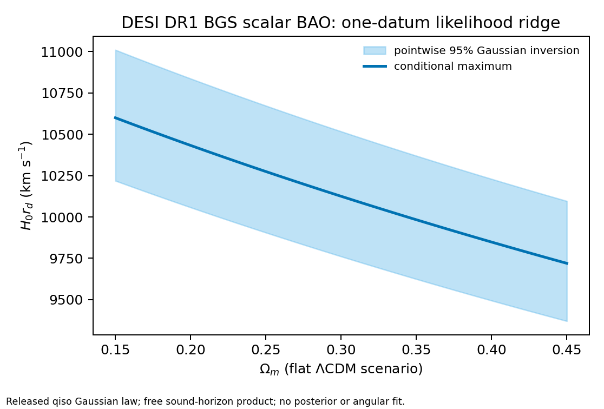
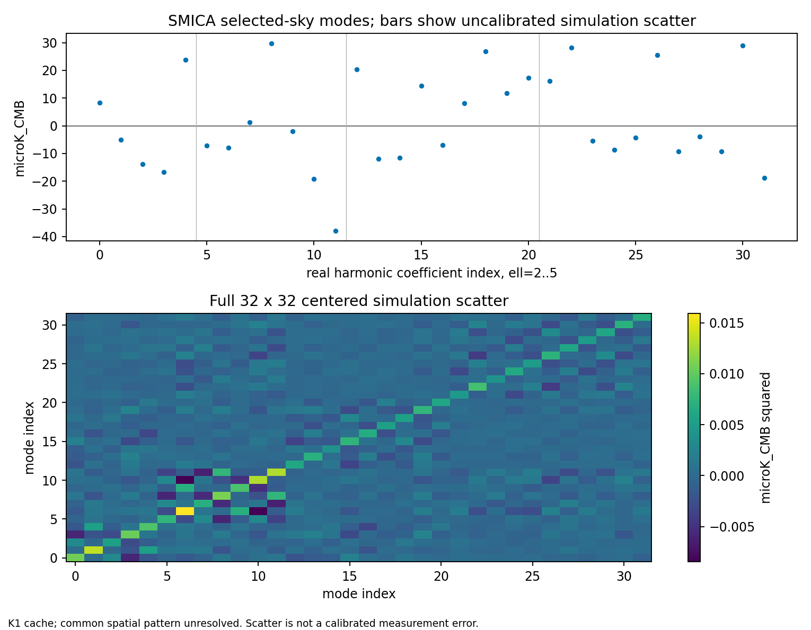

# HTT observational continuation: conditional results and open physical laws

Source files: `docs/observational_analysis_20261014/results/desi/analysis.json`, `docs/observational_analysis_20261014/results/report/report.json`, `docs/observational_analysis_20261014/results/oa06_smica_scatter_v2/result.json`, and `docs/observational_analysis_20261014/results/oa07_flatlcdm/result.json`. The existing OA00–OA04 report and its CF4/CMB figures are reused without re-running their inputs. These results preserve the published source identities and prior HOLD decisions.

## Actual conditional DESI result (OA07 partial)

The retained DESI DR1 BGS Bright `syst` product gives one released Gaussian scalar summary, `qiso=0.982880442 ± 0.018695108` at `z_eff=0.295234695` with `(D_V/r_d)_fid=8.062742860`. In the declared flat matter+Lambda FLRW background, `E(z)=sqrt(Omega_m(1+z)^3+1-Omega_m)` and `q_pred=[c/(H0*r_d)] [z I(z)^2/E(z)]^(1/3)/(D_V/r_d)_fid`, with `I(z)=integral_0^z dz/E(z)` and free positive `H0*r_d` in km/s. No sound-horizon calculation or external absolute-scale anchor is inserted.

At fixed `Omega_m=0.30`, the conditional maximum is `H0*r_d=10,125.27 km/s`; the pointwise 95% fixed-Gaussian inversion is `[9,761.37, 10,517.36] km/s`. Every tested `Omega_m` from 0.15 to 0.45 reaches the same maximum by moving `H0*r_d`. Thus this one datum does not identify `Omega_m`, `H0`, or `r_d` separately. The plotted band is **not** a posterior credible region or raw-catalogue coverage statement. The `syst` and overlapping alternative/full-shape products are not multiplied.

## Actual SMICA projection and simulation diagnostic (OA06 partial)

The K1 NSIDE64 cache observation and 300 FFP10 SMICA noise maps were each fit on the same 38,413 pixels (`common_mask>0.5`) with the same real `ell=0..5` design, retaining 32 `ell=2..5` coefficients. Injection recovery max absolute error was `4.44e-16 microK`; the centered 32×32 simulation-scatter matrix has condition number `27.44`. The mean pairwise selected-map spatial correlation is `0.1322`, the largest absolute simulation mean mode is `0.403 microK`, and first/second-half scatter matrices differ by `0.477` in relative Frobenius norm. A fixed common spatial pattern can produce these values even with independent draws. The simulation dependence and calibrated zero-mean measurement covariance remain unresolved. The earlier OA06 candidate file is preserved but superseded by this diagnosis.

## Previously accepted descriptive views (OA02–OA04)

The CF4 coverage figure uses published point summaries and fixed geometric assumptions; it is not an observed latent-distance fit. The CMB same-sky figure compares four reconstruction products and is not four independent skies.

## Joint inference boundary

OA05 remains HOLD: the grouped CF4 `DMzp,Vh` pairs lack a sourced selected-group likelihood with velocity error, group/flow covariance, shared calibration and absolute-scale prior, and finite-distance remainder. Table 3 method presence is not a modulus mixing weight. OA06 lacks full map response and foreground/systematic calibration; a physical dipole, angular mean, and omitted-mode control are additionally required for full-field F4. OA07's scalar response is conditional and provides no angular mode.

OA08 now has a typed adapter that retains the original `PUBLISHED_GAUSSIAN_SUMMARY_MODEL_WITH_FIXED_RELEASED_COVARIANCE` target and integrates a supplied shared latent once; its small mixed-law tests pass. An actual CF4/CMB/DESI joint law still needs the missing component responses and a sourced cross-product dependence model. OA09 therefore has no physical joint posterior. OA10 now accepts a typed, source-bound posterior draw measure while keeping the prior scenario-only API's POSTERIOR refusal; no actual OA09 draws exist to push through it. OA11's final physical report is consequently HOLD. This report records the ready conditional science and exact remaining inputs without promoting old proof or native-family status.

## Reproduction

`/home/cosmosapjw/venv/bin/python -B scripts/fit_desi_qiso_flatlcdm.py --output-dir NEW_DESI_DIR` and `/usr/bin/python -B scripts/fit_cmb_smica_noise_modes.py --output-dir NEW_CMB_DIR` generate the new results and standalone plots. `python scripts/build_observational_continuation_report.py --output-dir NEW_REPORT_DIR` regenerates this report from the named JSONs; run `pdflatex -interaction=nonstopmode -halt-on-error -output-directory=NEW_REPORT_DIR NEW_REPORT_DIR/conditional_report.tex` from the repository root. The supported environments and input identities are recorded in source results. No heavy physical fit was launched because its joint measurement law is absent.

Primary context: [DESI DR1 product documentation](https://data.desi.lbl.gov/doc/releases/dr1/vac/full-shape-bao-clustering/), [DESI BAO modelling](https://academic.oup.com/mnras/article/534/1/544/7750629), [Planck component separation](https://www.aanda.org/articles/aa/full_html/2020/09/aa33881-18/aa33881-18.html), and [CF4 group construction](https://inspirehep.net/files/0509066626daba3d8e951586c658a0a8).
