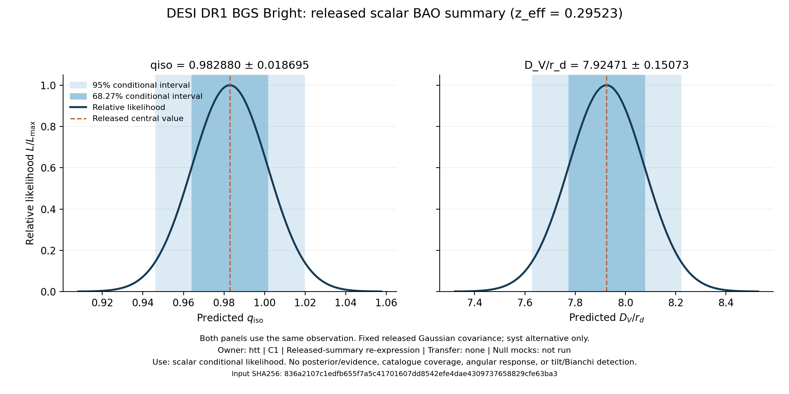
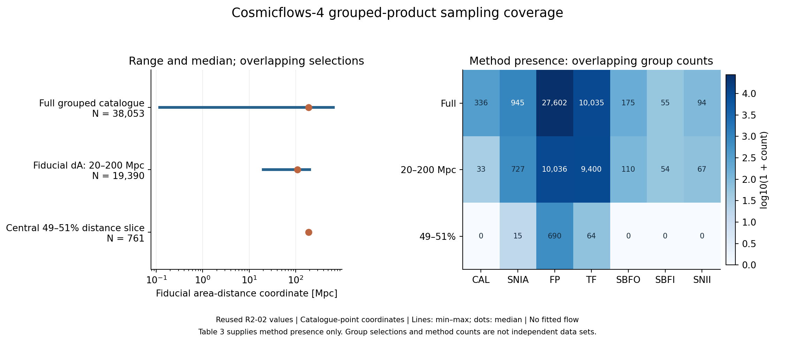
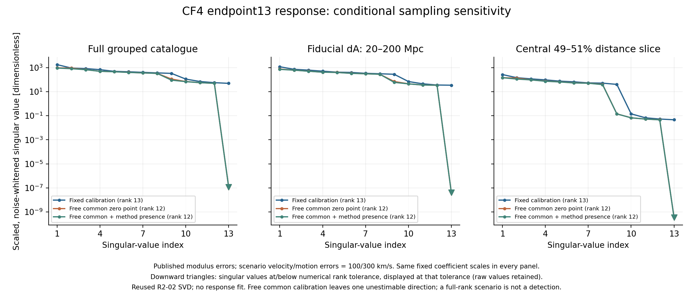
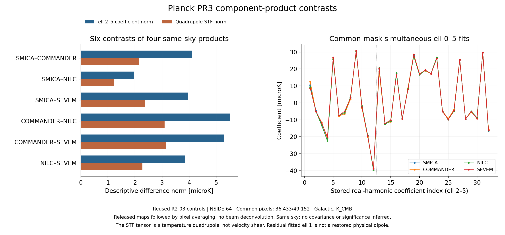

# Retained observations: released-summary result and descriptive diagnostics

DESI BGS Bright gives D_V/r_d = **7.924712 ± 0.150734** at z_eff = 0.295234695, conditional on its released Gaussian scalar summary.
The CF4 panels describe 38,053 grouped observations. The CMB panels compare four reconstructions of one sky.
This report assembles distinct scientific products; it performs no cross-probe likelihood multiplication or physical joint fit.

## Evidence reuse and computation

| Component | Input | Computation in this report | Scientific use |
|---|---|---|---|
| DESI | Supplied analysis.json from the original-H5 runner | Read scalar values and intervals; check affine consistency | Released-summary conditional likelihood |
| CF4 | Supplied R2-02 diagnostic | Plot stored coverage and singular values | Sampling and local conditional sensitivity |
| CMB | Supplied R2-03 diagnostic | Check stored norm consistency; convert K to microK; plot | Same-sky descriptive contrasts |

Input execution times, revisions and source hashes are preserved as inherited evidence in figure_data.json. They are not recorded as executions performed by this command.
The command newly creates the figures and this report. It does not claim a fresh raw-data audit, a repeated SVD/harmonic fit, or a fresh independent review of the underlying results.

## DESI scalar released-summary result

qiso = 0.982880442 ± 0.018695108; (D_V/r_d)_fid = 8.062742860. Both views encode one datum.

| Conditional coverage | qiso | D_V/r_d |
|---|---|---|
| 68.26895% | [0.96418533, 1.00157555] | [7.773978, 8.075446] |
| 95.00000% | [0.94623870, 1.01952218] | [7.629279, 8.220145] |



Intervals are pointwise Gaussian acceptance inversions in the positive prediction domain, not posterior credible intervals. A zero lower boundary, if present, is open.
The syst product is consumed once; its statistical-only alternative and raw catalogue are not additional independent factors. Historical R9 family allocation is unchanged.

## CF4 coverage and conditional sensitivity



The range plot shows the minimum, median and maximum fiducial area-distance coordinate. The method matrix counts groups with each method present; overlaps are allowed.
dL=10^((DMzp-25)/5); fiducial dA=dL/(1+Vh/c)^2; catalogue-point conditioning only. heliocentric Vh as supplied; J2000 sourceward; no CMB correction inferred.



All panels use endpoint13 coefficient order b0, Bx, By, Bz, H, Ax, Ay, Az, STF1..5. The first four fixed scales are 1000 km/s; the remaining nine are 100 km/s/Mpc.
These noise-whitened, scaled singular values depend on the declared velocity/motion error and calibration scenario. Values at or below each stored rank tolerance are displayed at that tolerance with downward triangles, while their unmodified values remain in figure_data.json.

| Sample | Groups | Fixed-calibration numerical rank | Free-common rank | Free-common + method-presence rank |
|---|---:|---:|---:|---:|
| Full grouped catalogue | 38,053 | 13 | 12 | 12 |
| Fiducial dA: 20–200 Mpc | 19,390 | 13 | 12 | 12 |
| Central 49–51% distance slice | 761 | 13 | 12 | 12 |

The scale-sensitive spectra diagnose how the selected response separates its coefficients. Numerical rank is not a calibrated physical identifiability or detection statement.
Actual CF4 posterior status remains `HOLD_MISSING_ALL_METHOD_SELECTION_AND_JOINT_COVARIANCE`. Remainder: UNKNOWN; physical provider refuses response/fit; OBS02 SVD remains local scenario sensitivity.

## CMB product contrasts



Real orthonormal harmonics: for each ell, Y(ell,0), sqrt(2) Re Y(ell,m), sqrt(2) Im Y(ell,m) for m=1..ell; Galactic source directions; K_CMB.

Each fit includes ell 0..5 simultaneously on the common mask; only ell 2..5 are plotted. The ell 2, 3, 4 and 5 blocks contain 5, 7, 9 and 11 coefficients.
The six pair contrasts share maps and sky. A contrast can diagnose reconstruction sensitivity but cannot determine common bias or yield six independent likelihood factors.
Neither coefficient norms nor temperature-quadrupole STF norms measure velocity shear. A fitted residual dipole is not the physical dipole needed by an absolute-temperature statistic.
CMB posterior status remains `HOLD_SHARED_SKY_CROSS_PRODUCT_MEASUREMENT_LAW`; full-field F4 status remains `HOLD_RELEASE_PROCESSOR_AND_PHYSICAL_DIPOLE_AND_OMITTED_MODES`.

## Inputs needed for physical inference

CF4 needs a selected source/count model or justified subset, a true-redshift/heliocentric-velocity convention and error law, shared group/flow covariance, calibrated aggregate-modulus zero-point law, an absolute-scale anchor, and a finite-distance remainder or named truncation scenario.
CMB physical inference needs the released-product response and common-sky measurement law. Absolute-temperature/F4 claims additionally need physical dipole and angular-mean inputs plus omitted-mode control. These are distinct from the temperature-coefficient diagnostics already shown.
A joint posterior additionally needs one common physical response and prior, cross-product dependence/overlap treatment, and one integration over each shared nuisance. No absent component is replaced by zero or independence.

## Provenance

| Consumed JSON | SHA256 | Bytes |
|---|---|---:|
| desi: `/home/cosmosapjw/Dropbox/bianchi/htt_base/docs/observational_analysis_20261014/results/desi/analysis.json` | `6e1b2cfbf0270769ebd2528c37603178859198c5bc97648e47425d71a94ae5f7` | 6406 |
| cf4: `/home/cosmosapjw/Dropbox/bianchi/htt_base/docs/observational_upgrade_r2/R2-02/raw/diagnostic.json` | `8e0dd8de2e6b4ec4ceb5e122401862ee71cff083de5a4907dd13ad0103f29c2e` | 317023 |
| cmb: `/home/cosmosapjw/Dropbox/bianchi/htt_base/docs/observational_upgrade_r2/R2-03/raw/diagnostic.json` | `414fcd3b6dca4496f268e855b5c2746553639d9a81d91d880f2ec455fa340e3c` | 15198 |

The source-report byte identities above were computed in this command. Upstream catalogue/map hashes and historical code revisions are inherited from those reports, not freshly recomputed.
Figure payloads, units and component-specific claim status are in [figure_data.json](figure_data.json); execution and figure identities are in [report.json](report.json).

```sh
/home/cosmosapjw/venv/bin/python /home/cosmosapjw/Dropbox/bianchi/htt_base/scripts/build_observational_diagnostic_report.py --desi-result /home/cosmosapjw/Dropbox/bianchi/htt_base/docs/observational_analysis_20261014/results/desi/analysis.json --cf4-result /home/cosmosapjw/Dropbox/bianchi/htt_base/docs/observational_upgrade_r2/R2-02/raw/diagnostic.json --cmb-result /home/cosmosapjw/Dropbox/bianchi/htt_base/docs/observational_upgrade_r2/R2-03/raw/diagnostic.json --output-dir /home/cosmosapjw/Dropbox/bianchi/htt_base/docs/observational_analysis_20261014/results/report
```

- CF4 coverage and conditional response sensitivity are descriptive, not a fitted observed flow or posterior.
- CF4 fiducial dA uses catalogue modulus and Vh/c; it is not an observed latent area distance.
- CF4 method-presence counts overlap and are not fractional calibration weights; selections overlap too.
- The CMB products share one sky. Their contrasts are not independent measurements, bias estimates, or significance.
- DESI results are conditional on its released fixed Gaussian scalar summary; no posterior or raw-catalogue coverage is claimed.
- No joint likelihood, joint posterior, native transfer, tilt detection, or family identification is produced.
