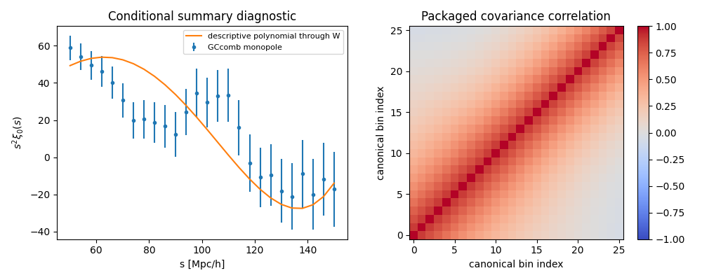
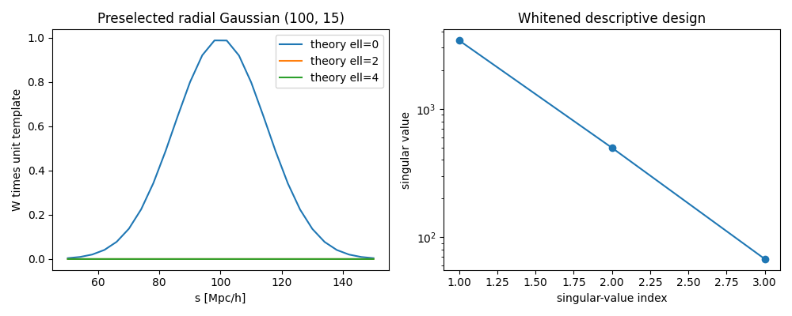

# OBS-05 DESI BGS matched summary diagnostic

Owners: obsstat owns the HDF5 reader, exact-bin matching, supplied-window feature extraction, and response diagnostics; HTT owns the descriptive GLS coefficients, conditional covariance, and residual summaries. Status: DIAGNOSTIC_ONLY, independent review pending. Transfer source: none (empirical DESI clustering summary and its packaged window). Source scope: DESI DR1 clustering **data_v1.2**, BGS_BRIGHT-21.5, GCcomb, z=0.1–0.4, packaged post-reconstruction correlation monopole. This does not bind the BGS_ANY catalogue or another release's randoms/n(z).

The official [DESI documentation](https://data.desi.lbl.gov/doc/releases/dr1/vac/full-shape-bao-clustering/) distinguishes the v1.2 BAO products and explains packaged observable/window/covariance files. It was checked on 2026-10-13. The local HDF5 SHA-256 matches the local official-named checksum list; that list's current remote authentication was not independently observed. Exact local source and list hashes appear in summary.json. No remote-authenticated checksum is claimed.

The reader concatenates blocks in stored label order and aligns data, covariance and window by **ell and exact bin edges**. Pair-weighted centroids are used to evaluate the prescribed descriptive functions, never as identity keys. The actual observed monopole has 26 bins [48,52] through [148,152] Mpc/h. The SPD covariance is 26×26. The 26×600 window has canonical ell=0,2,4 theory blocks with 200 bins [0,1] through [199,200] each.

The embedded theory values are all-zero placeholders. The code refuses these as a physical baseline. It fits only descriptive ell0 columns 1, s/100 and (s/100)^2, with zeros in the other theory blocks, through X=WJ. Covariance whitening gives rank 3 at machine-epsilon scaled SVD tolerance. Singular values are 3420.9869, 497.3202 and 67.4664. The coefficient estimate is (0.05302595, -0.08210060, 0.03089002). The residual quadratic norm is 55.37299 in a 23-dimensional residual space; no p-value or coverage is computed.

The controller selected the unit radial Gaussian centered at 100 Mpc/h with width 15 Mpc/h before this run; it was not ZIP-preregistered. It is separately injected into ell0/2/4 **through the supplied summary window**. Whitened response norms are approximately 909.8335, 0.0037113 and 0.0046210. After projecting out the descriptive design, they are 714.4914, 0.0036674 and 0.0043442. These are response diagnostics, with no fitted Gaussian amplitude or scan. They do not measure absolute sky orientation, imaging-mode removal, redshift shuffling, or catalogue selection response.

Statistical coefficient covariance is M C M^T conditional on fixed design and the supplied covariance. A deterministic bias b would shift the coefficients by M b; no physical remainder envelope is supplied, and none is folded into C. Known-C Gaussian law, covariance calibration and bias bounds have not been established. Confidence coverage and cosmological detection remain unclaimed.

Physical t(theta), fiducial cosmology/reconstruction/dilation conventions, physical Jacobian/priors, a catalogue low-mode forward injection and deterministic remainder inputs remain **HOLD**. The original OBS-05 physical-baseline and low-mode-response acceptance criteria therefore remain open.

Reproduce from the repository root:

```bash
/mnt/extdrive/workdir/external_fusion_round3_20260722_envs/lowell/bin/python tests/obsstat/test_obs05_desi_bgs_summary.py
/mnt/extdrive/workdir/external_fusion_round3_20260722_envs/lowell/bin/python scripts/obs05_desi_bgs_summary.py --output docs/observational_methods_20261013/OBS-05
python scripts/obs05_desi_bgs_summary.py --plot-json docs/observational_methods_20261013/OBS-05/summary.json --output docs/observational_methods_20261013/OBS-05
```

System pytest now reports three algebra tests passed and the optional HDF5 fixture skipped when h5py is unavailable. The supplied lowell Python ran all four tests, including mixed ordering/centroids. Before the repair, system pytest retained `ModuleNotFoundError: No module named 'h5py'` in that fixture (1 failed, 3 passed). The HDF5 environment has numpy/h5py, but lacks pytest/matplotlib; tests use unittest and plots use the existing Python plotting environment. The saved plotting warning concerns unavailable Axes3D; all four 2D PNG/PDF outputs were generated. Raw stdout/stderr are retained. No commit or publication was performed by this worker.

Evidence intake: package README, RESEARCH_REPORT_KO, ANALYSIS_DAG, NEXT_TASK, distance_lss workstream; current runtime; actual HDF5 schema/data; local checksum list; official DESI documentation. Kill-switches: bin/ell mismatch, duplicate identities, nonfinite inputs, asymmetric/non-SPD covariance and source/list checksum mismatch raise errors. Missing physical inputs prevent physical admission and do not prevent this conditional diagnostic.

| Claim | Owner | Status | Evidence | Boundary |
|---|---|---|---|---|
| Matched data/window/covariance reader | obsstat | IMPLEMENTED | four tests and real-file run | current candidate; independent review pending |
| Window feature extraction and radial summary-window response | obsstat | DIAGNOSTIC_ONLY | summary.json and generated figures | fixed summary/operator only |
| Descriptive GLS coefficient/covariance/residual summary | htt | DIAGNOSTIC_ONLY | summary.json | conditional on fixed summary/operator/covariance |
| Physical baseline and cosmological low-mode interpretation | htt | HOLD | missing inputs | no inferred replacement |




