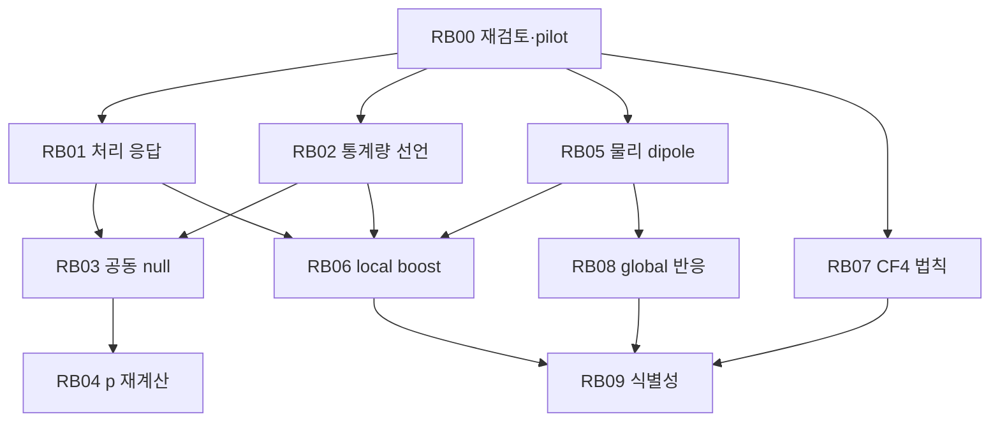
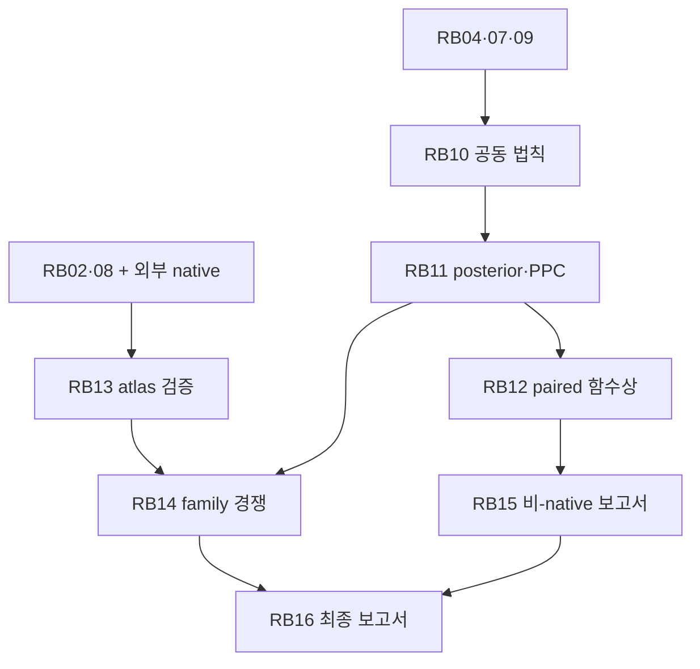

# 관측 reboot 개발 DAG와 PR 목록

기준은 `b2afb6e2`의 실제 코드·결과다. 이번 `PR-OBS-REBOOT`는 RB00의 유한 연구·구현 단위이고, 뒤의 22개 PR은 **계획 카드**다. GitHub PR 22개를 미리 열었다는 뜻이 아니다. 전체 PR 의존성은 canonical backlog, 이 파일과 `REBOOT_PLAN.json`은 실행할 과학 작업의 상세 계약이다.

## 실행 순서

RB15는 RB04·05·09·12를 요구한다. 그림은 주요 흐름만 표시하며 정확한 간선은 JSON과 아래 카드에 있다. Native atlas를 기다리는 RB13/14/16과 무관하게 준비된 통계·dipole·CF4·조건부 물리 분석은 계속한다.

## 하위 에이전트 운영

부모는 기존 checkout의 유일한 production writer다. 동시에 부모 포함 최대 4개 agent만 사용한다. 첫 준비 작업 RB01/RB02/RB05/RB07 가운데 서로 겹치지 않는 2–3개를 맡기고, 완료된 worker를 닫아 독립 reviewer 자리를 확보한다. Worker는 할당 경로의 작은 patch와 실행 근거를 반환하고 부모가 병합한다. 같은 파일을 병렬로 고치지 않는다. 이론 검토와 코드/수치 검토는 독립 검토 1회에서 서로 다른 질문으로 수행하고, 그림을 직접 읽어 오류를 고친다.

저비용 LLM은 `reboot_task_packet.py --task RBxx`가 출력하는 작업, 직접 선행 상태, 코드 경로와 수용 기준만 읽는다. 전체 679MB snapshot이나 증명 corpus를 프롬프트에 넣지 않는다. 잘못된 물리 법칙·불명확한 selection·단위/기준계 문제는 검토자에게 구체적인 반례/선택지와 함께 올린다. 단순 도구 실패나 UNKNOWN model identity를 과학적 불가능성으로 취급하지 않는다.

## PR 요약

| Task | PR | 제목 | 선행 | lane |
|---|---|---|---|---|
| RB00 | PR-OBS-REBOOT | Legacy reboot review, conditional pilot and executable statistics | OA_CONTINUATION_B2AF | solver_independent |
| RB01 | PR-REBOOT-01 | Reconcile Planck processing and release simulation response | RB00 | solver_independent |
| RB02 | PR-REBOOT-02 | Freeze the tensor feature family and the analysis-selection history | RB00 | solver_independent |
| RB03 | PR-REBOOT-03 | Build a release-matched joint sky null and nuisance family | RB01, RB02 | solver_independent |
| RB04 | PR-REBOOT-04 | Recompute calibrated SMICA morphology p and look-elsewhere sensitivity | RB03 | solver_independent |
| RB05 | PR-REBOOT-05 | Recover the physical dipole and observer-frame likelihood | RB00 | solver_independent |
| RB06 | PR-REBOOT-06 | Compute observer-boost response through the actual map pipeline | RB01, RB02, RB05 | solver_independent |
| RB07 | PR-REBOOT-07 | Fit CF4 with a selected multidepth observation law | RB00 | solver_independent |
| RB08 | PR-REBOOT-08 | Specify physical global-tilt response and external/native alternatives | RB05 | conditional_external |
| RB09 | PR-REBOOT-09 | Measure local/global identifiability with real responses | RB06, RB07, RB08 | solver_independent |
| RB10 | PR-REBOOT-10 | Assemble one joint physical likelihood with correct dependence | RB04, RB07, RB09 | solver_independent |
| RB11 | PR-REBOOT-11 | Run posterior, model competition and predictive checks | RB10 | solver_independent |
| RB12 | PR-REBOOT-12 | Generate paired tensor/MES/legacy posterior images | RB11 | solver_independent |
| RB13 | PR-REBOOT-13 | Intake native morphology atlas and equivalence classes | RB02, RB08 | native_dependent |
| RB14 | PR-REBOOT-14 | Test Bianchi morphology compatibility and family distinguishability | RB11, RB13 | native_dependent |
| RB15 | PR-REBOOT-15 | Publish the solver-independent scientific report and plots | RB04, RB05, RB09, RB12 | solver_independent |
| RB16 | PR-REBOOT-16 | Add the native-family result to the final report | RB14, RB15 | native_dependent |
| RB17 | PR-REBOOT-17 | Complete released ACT/Planck lensing follow-up analyses | RB00 | solver_independent |
| RB18 | PR-REBOOT-18 | Complete available CMB spectra/window/nuisance controls | RB00 | solver_independent |
| RB19 | PR-REBOOT-19 | Complete available polarization and same-sky controls | RB01, RB00 | solver_independent |
| RB20 | PR-REBOOT-20 | Complete distance-node and host-calibration analyses | RB00 | solver_independent |
| RB21 | PR-REBOOT-21 | Complete cached multidepth mock and calibration analyses | RB00 | solver_independent |
| RB22 | PR-REBOOT-22 | Close astrometry and remaining capability discovery goals | RB00 | solver_independent |

## RB00 / PR-OBS-REBOOT — Legacy reboot review, conditional pilot and executable statistics

Owner: HTT; 상태: completed_scoped; 선행: OA_CONTINUATION_B2AF; 자원: small.

실제 작업:
- Read legacy theory and actual historical p outputs; connect current b2af code to a revised plan.
- Implement and run finite-rank utility, synthetic error-rate campaign, real SMICA pilot and response laboratory.

수용 기준:
- Focused tests and scoped independent review pass.
- Persist actual data-source identities, outputs, plots and precise conditional interpretation.

수정/생성 경로:
- `scripts/calibrate_reboot_statistics.py`
- `scripts/run_smica_reboot_pilot.py`
- `scripts/analyze_reboot_identifiability.py`
- `docs/observational_reboot_20261014`

입력 의무:
- 이번 범위의 근거·실행은 DELIVERY와 결과 파일에 기록.

첫 행동: Use NEXT_TASK.json and execute RB01/RB02/RB05/RB07 in nonoverlapping work.

## RB01 / PR-REBOOT-01 — Reconcile Planck processing and release simulation response

Owner: OBSSTAT; 상태: pending; 선행: RB00; 자원: small.

실제 작업:
- Trace source FITS units, mask, beam/pixel transfer, downgrade order, monopole/dipole removal and every simulation transformation.
- Compare ell0..5 and higher fitted multipole limits on identical raw/reduced products; quantify omitted-mode leakage with forward injections.
- Test released noise mean against source-documented signal subtraction and residual systematic mechanism; never infer ensemble dependence from spatial map correlation.

수용 기준:
- Observation and null operator match with named response/covariance limitations.
- Raw-to-cache gate is separated from physical adequacy; numerical response/remainder documented.

수정/생성 경로:
- `scripts/fit_cmb_smica_noise_modes.py`
- `htt/obsstat/r7_cmb_product_response.py`
- `docs/observational_reboot_20261014/processing`

입력 의무:
- Existing K1 cache and accepted gate available; retrieve only missing original source products needed for a specific response test.

첫 행동: Read research/SMICA_SOURCE_AUDIT.md then inspect reducer paths and the active K1 gate; run a targeted higher-ell leakage comparison.

## RB02 / PR-REBOOT-02 — Freeze the tensor feature family and the analysis-selection history

Owner: OBSSTAT; 상태: pending; 선행: RB00; 자원: small.

실제 작업:
- Preserve full real ell2/3 tensors, optionally ell4/5, before scalarization.
- Define C_l vs D_l, Q/O contractions, alignment/chirality and residual dipole features with exact units and frame/parity.
- Register all masks, multipoles, tails, axes, depth cuts and selected analyses that will enter max calibration. Retrospective reuse of the same sky remains exploratory.

수용 기준:
- Coordinate, normalization and rotation tests pass; features computed identically for observation and simulations.
- Independent design/training/calibration splits and historical selection ledger stated; no fake preregistration.

수정/생성 경로:
- `htt/obsstat/morphology.py`
- `htt/obsstat/r7_cmb_product_response.py`
- `docs/observational_reboot_20261014/statistic_declaration.json`

입력 의무:
- Legacy source-specific normalization provenance; chosen finite feature/scan family.

첫 행동: Read LEGACY_REBOOT_REVIEW.md normalization table; write the finite statistic declaration and rotation/roundtrip tests.

## RB03 / PR-REBOOT-03 — Build a release-matched joint sky null and nuisance family

Owner: HTT; 상태: pending; 선행: RB01, RB02; 자원: profile_then_batch.

실제 작업:
- Use delivered signal+noise/systematics with correct common sky, foreground and fixed-weight response assumptions.
- Use each noise realization once across training/calibration or model cluster dependence explicitly; never manufacture iid sample size by cyclic reuse.
- Include a fixed nuisance grid or justified nuisance integration. For composite frequentist null use calibrated supremum/coverage-controlled nuisance treatment; plug-in nuisance fit is not automatically exact.
- Profile memory and runtime on a small batch before acquiring or launching a larger campaign.

수용 기준:
- Null simulation identities, seeds, cross-map pairing and independent units verified.
- Held-out injection/null coverage test supports the intended claim; insufficient simulations imply a resolution limit.

수정/생성 경로:
- `htt/htt/htt/infer/reboot_cmb_null.py`
- `scripts/build_reboot_cmb_null.py`
- `tests/htt/test_reboot_cmb_null.py`

입력 의무:
- Release source support, needed foreground/systematic scenarios; extra independent simulations or a declared lower-resolution test.

첫 행동: Implement the specific pipeline from RB01 under the RB02 declaration, extending the current disjoint SMICA pilot without noise reuse.

## RB04 / PR-REBOOT-04 — Recompute calibrated SMICA morphology p and look-elsewhere sensitivity

Owner: HTT; 상태: pending; 선행: RB03; 자원: profile_then_batch.

실제 작업:
- Run the frozen joint statistic family with fixed simulation count and conservative ties.
- Report marginal and global ranks, finite grid, q Monte Carlo intervals, numerical enclosure if needed, null/prior/systematic sensitivities and held-out FPR.
- Keep PPC p, frequentist rank p, posterior tail Pi and legacy power-index p distinct.

수용 기준:
- Every reported p links the exact null, feature family, full processing and independent unit.
- Global-null control is not relabeled strong FWER without subset-pivotality or another proof.
- Actual Planck scientific adequacy determined separately from mechanical test success.

수정/생성 경로:
- `scripts/calibrate_reboot_statistics.py`
- `scripts/run_smica_reboot_pilot.py`
- `docs/observational_reboot_20261014/results/calibrated_smica`

입력 의무:
- RB03 model-validity and coverage evidence; full scan family.

첫 행동: Run the retained rank CLI on the RB03 data package; generate table/ECDF/tail-resolution and mask/systematic panels.

## RB05 / PR-REBOOT-05 — Recover the physical dipole and observer-frame likelihood

Owner: HTT; 상태: pending; 선행: RB00; 자원: small.

실제 작업:
- Bind Planck solar-dipole measurement, T0, amplitude/direction covariance, calibration and frequency convention.
- Write beta_RO=beta_RM+beta_MO only at first order; use consistent exact composition when needed.
- Keep removed/reintroduced map dipole, residual cut-sky ell1, kinematic quadrupole and aberration/dipole-modulation measurements as different data products.

수용 기준:
- Dipole temperature-to-beta units and frame signs pass source-matched tests.
- Shared calibration/T0 uncertainty is integrated once; no residual ell1 promoted to measured physical beta.

수정/생성 경로:
- `htt/htt/htt/infer/reboot_dipole_law.py`
- `tests/htt/test_reboot_dipole_law.py`
- `docs/observational_reboot_20261014/dipole`

입력 의무:
- Primary dipole/T0 source and uncertainty model; bandpass convention for any second-order correction.

첫 행동: Read primary dipole source in PRIMARY_SOURCES.json; implement a source-bound likelihood and explicit map-removal adapter.

## RB06 / PR-REBOOT-06 — Compute observer-boost response through the actual map pipeline

Owner: OBSSTAT; 상태: pending; 선행: RB01, RB02, RB05; 자원: small.

실제 작업:
- Propagate Doppler and aberration responses plus kinematic quadrupole through mask/fit/beam/pixel operators.
- Check finite differences against analytic first-order response and bound second/higher-order terms.
- Track monopole, dipole and omitted multipole mixing rather than a hand-added template.

수용 기준:
- Boost-zero, axis rotation, sign and finite-difference convergence tests pass in declared beta range.
- Error envelope applies to actual response; no transfer-free global tilt inference.

수정/생성 경로:
- `htt/obsstat/boost_response.py`
- `htt/obsstat/processed_boost_error_envelope.py`
- `tests/obsstat/test_reboot_boost_response.py`

입력 의무:
- RB01 processor and RB05 dipole conventions.

첫 행동: Connect existing boost response to the actual selected-sky estimator; run derivative/remainder tests.

## RB07 / PR-REBOOT-07 — Fit CF4 with a selected multidepth observation law

Owner: HTT; 상태: pending; 선행: RB00; 자원: profile_then_batch.

실제 작업:
- Use raw DMzp/e_DMzp,Vh with latent distance, grouping, velocity covariance, calibration and absolute-scale anchor.
- Source a selection/population model or use a justified selected subset; if population completeness is unavailable, declare the conditioned estimand and sensitivity family.
- Model overlapping/nested depth bins jointly, including cross-depth flow/covariance and finite-distance response remainder.

수용 기준:
- Injection coverage, group leave-out and selection/calibration sensitivity are measured.
- No method-presence flag is interpreted as a modulus mixture weight; no point distance treated as latent-distance posterior.

수정/생성 경로:
- `htt/htt/htt/infer/reboot_cf4_selected_law.py`
- `tests/htt/test_reboot_cf4_selected_law.py`
- `docs/observational_reboot_20261014/results/cf4`

입력 의무:
- Selection/conditional target justification, calibration/group map, velocity uncertainty and flow covariance, scale prior, remainder scenario.

첫 행동: Reuse R2 CF4 geometry and OA05 audit; build the smallest scientifically justified subset law and execute it before scaling.

## RB08 / PR-REBOOT-08 — Specify physical global-tilt response and external/native alternatives

Owner: HTT; 상태: pending; 선행: RB05; 자원: research.

실제 작업:
- Fix matter/radiation/normal congruence, background/matter branch, epoch, boundary data and beta history.
- Derive the actual CMB and distance/velocity transfer map or connect an identified external provider with its validity range.
- Preserve separate deterministic-template and anisotropic-covariance branches; do not encode an arbitrary depth trend as a cosmological tilt.

수용 기준:
- Theory-to-code contract and derivative/limiting cases exist for each selected provider.
- Native missing state blocks native claims only; a sourced external transfer may deliver conditional results.

수정/생성 경로:
- `htt/htt/htt/infer/reboot_global_tilt_response.py`
- `docs/observational_reboot_20261014/physical_response`

입력 의무:
- Physical model, transfer provider/history, common frame and response remainder.

첫 행동: Read THEORY_REBOOT.md response equations; choose a calculable physical branch and instantiate a labelled provider without implementing the future native solver.

## RB09 / PR-REBOOT-09 — Measure local/global identifiability with real responses

Owner: HTT; 상태: pending; 선행: RB06, RB07, RB08; 자원: small.

실제 작업:
- Assemble shared local, global, calibration, foreground and survey response blocks under full covariance.
- Whiten, profile nuisance, apply fixed parameter scales, inspect singular values/principal angles and response-error bounds.
- If rank or conditioning is poor, return partial identification and identify a concrete additional depth/remote/polarization response.

수용 기준:
- Response ranks are compared on a fixed physical coordinate/support domain.
- Null/gauge modes and covariance support are explicit; no arbitrary ridge hides deterministic constraints.
- Observed failure is scoped to the selected responses, not promoted to universal no-go.

수정/생성 경로:
- `htt/htt/htt/infer/nuisance_rank.py`
- `scripts/analyze_reboot_identifiability.py`
- `docs/observational_reboot_20261014/results/physical_rank`

입력 의무:
- Validated local/global derivatives and covariance; error bounds if certified rank is claimed.

첫 행동: Replace the synthetic laboratory matrices with the RB06/07/08 providers, then run error-aware rank and power diagnostics.

## RB10 / PR-REBOOT-10 — Assemble one joint physical likelihood with correct dependence

Owner: HTT; 상태: pending; 선행: RB04, RB07, RB09; 자원: profile_then_batch.

실제 작업:
- Reuse the b2af PublishedGaussianSummaryBlock and real DESI scalar response without double-counting qiso and DV/rd.
- Integrate shared calibration/latent state once; include cross-data overlap or justify conditional factorization.
- Use only eligible component laws, with an explicit scoped joint target when one dataset remains unavailable.

수용 기준:
- Joint-vs-factorized and duplicated-summary negative controls pass.
- Proper priors and parameter domains are stated; no MIO diagnostic enters likelihood as extra evidence.

수정/생성 경로:
- `htt/htt/htt/infer/r7_joint_experiment.py`
- `htt/htt/htt/infer/r7_desi_law.py`
- `tests/r7/test_selected_joint_density.py`

입력 의무:
- Physical component laws and cross-product shared nuisance/overlap evidence.

첫 행동: Reuse current joint adapter tests, write the actual physical provider and verify density normalization on a tractable submodel.

## RB11 / PR-REBOOT-11 — Run posterior, model competition and predictive checks

Owner: HTT; 상태: pending; 선행: RB10; 자원: profile_then_batch.

실제 작업:
- Compare isotropic+local boost, local-flow/systematics and selected global-tilt alternatives with proper normalized priors.
- Run convergence, effective sample size, multi-start or chains, prior/transfer sensitivity, held-out prediction and PPC.
- Keep frequentist test inversion and posterior mass distinct; validate evidence separately if reported.

수용 기준:
- Actual posterior draw IDs/weights, convergence and posterior predictive fit stored.
- Numerical and model uncertainty are reported; unsupported latent physical sectors stay unavailable.

수정/생성 경로:
- `scripts/fit_reboot_joint.py`
- `htt/htt/htt/infer/posterior_predictive.py`
- `docs/observational_reboot_20261014/results/posterior`

입력 의무:
- RB10 law and validated sampler/evidence method for the actual model.

첫 행동: Profile a small model fit then run the bounded scientific inference and required diagnostics.

## RB12 / PR-REBOOT-12 — Generate paired tensor/MES/legacy posterior images

Owner: HTT; 상태: pending; 선행: RB11; 자원: small.

실제 작업:
- Reuse the b2af PosteriorDrawSource path preserving draw IDs and weights.
- Compute sample-by-functional tensor/vector arrays, anchor gauge/margin, Pi surfaces and depth paths from one physical state.
- Source-match MES coefficients and denominators; report undefined mass and exact domain/anchor assumptions.

수용 기준:
- Physical state/congruence, normalized functions and source draws remain paired.
- Pi is posterior exceedance under its law; p-values, evidence and F4 are never substituted.

수정/생성 경로:
- `htt/htt/htt/infer/conditional_legacy_pushforward.py`
- `htt/htt/htt/departure/posterior_pushforward.py`
- `docs/observational_reboot_20261014/results/tensor_images`

입력 의무:
- Actual RB11 draws, applicable MES/anchor premises, physical sector values.

첫 행동: Exercise existing posterior adapter using actual RB11 draw measure and generate support/Pi/depth plots.

## RB13 / PR-REBOOT-13 — Intake native morphology atlas and equivalence classes

Owner: BASS; 상태: pending; 선행: RB02, RB08; 자원: profile_then_batch.

실제 작업:
- Receive external native solver outputs; record solver/source/parameter/frame/basis and convergence evidence.
- Validate zero-tilt/isotropic and known-branch limits, mask/beam response, family-equivalence and parameter degeneracies.
- Retain external-transfer atlas as separately labelled conditional comparison; never relabel it native.

수용 기준:
- Native source and independent reference/accuracy checks satisfy existing family gates.
- Equivalence classes across orientation, nuisance and overlapping families are explicit.

수정/생성 경로:
- `htt/bass/los/family_backend_protocol.py`
- `docs/observational_reboot_20261014/native_atlas`

입력 의무:
- External native low-ell all-m T/E/B/template/covariance atlas and validation evidence.

첫 행동: Inspect existing atlas contract and prepare import tests while waiting for native outputs; do not implement native solver here.

## RB14 / PR-REBOOT-14 — Test Bianchi morphology compatibility and family distinguishability

Owner: HTT; 상태: pending; 선행: RB11, RB13; 자원: profile_then_batch.

실제 작업:
- Fit native templates/covariance under the same joint observation law and proper model priors.
- Calibrate family confusion/open-set rejection under isotropic, boosted, foreground/systematic and alternative-family injections.
- Where equivalence remains, report a morphology-compatible class rather than selecting a family label.

수용 기준:
- Held-out family recovery/confusion, null false-assignment and misspecification sensitivities are measured.
- Existing native/mask/covariance/equivalence gates are met before any family identification language.

수정/생성 경로:
- `htt/htt/htt/infer/local_global_discrimination.py`
- `docs/observational_reboot_20261014/results/family_competition`

입력 의무:
- RB13 admitted atlas and RB11 physical likelihood/posterior framework.

첫 행동: Run a declared family-confusion experiment before observed family comparison.

## RB15 / PR-REBOOT-15 — Publish the solver-independent scientific report and plots

Owner: HTT; 상태: pending; 선행: RB04, RB05, RB09, RB12; 자원: small.

실제 작업:
- Generate p/null-tail, dipole-frame, local/global rank, posterior/PPC, tensor/anchor and depth-path figures from source JSON.
- Write a Korean report plus reproducible PDF, source-to-figure inventory and evidence table.
- Perform one physics/math pass and one code/numerical pass within the scoped independent review; inspect plots and rendered pages.

수용 기준:
- Every number/plot has generated data, units, source and actual statistical interpretation.
- All ready non-native science is reported; native waiting does not stall the report.

수정/생성 경로:
- `scripts/build_reboot_scientific_report.py`
- `docs/observational_reboot_20261014/results/scientific_report`

입력 의무:
- Completed or explicitly scoped RB04/05/09/12 outputs; omitted products listed with precise reason.

첫 행동: Build from actual result files; inspect PNG/PDF pages, fix concrete defects, review, commit and push.

## RB16 / PR-REBOOT-16 — Add the native-family result to the final report

Owner: HTT; 상태: pending; 선행: RB14, RB15; 자원: small.

실제 작업:
- Integrate accepted family equivalence/competition results and uncertainty without erasing prior conditional reports.
- Publish the complete scientific report with exact unresolved assumptions and scope.

수용 기준:
- Scientific claims match admitted native evidence and observed experiment.
- No unresolved physical or calibration input is silently marked complete.

수정/생성 경로:
- `docs/observational_reboot_20261014/results/final_report`
- `docs/observational_reboot_20261014/DELIVERY.json`

입력 의무:
- RB14 evidence and final scoped review.

첫 행동: Extend the RB15 report with the native family table, confusion plots and interpretation.

## RB17 / PR-REBOOT-17 — Complete released ACT/Planck lensing follow-up analyses

Owner: HTT; 상태: pending; 선행: RB00; 자원: small.

실제 작업:
- Execute AO01 disjoint ACT in-band modulation ranks from 401 retained feature rows.
- Execute AO02/03 matched-window ACT and Planck bandpower amplitude/profile and covariance sensitivity; use joint covariance only when actually supplied.

수용 기준:
- Source/version/bin/window/correction conventions are bound.
- Feature rank and released-Gaussian amplitude results have independent-unit and covariance scope; no raw-QE claim or overlapping-product double counting.

수정/생성 경로:
- `scripts/reboot_lensing_followup.py`
- `tests/htt/test_reboot_lensing_followup.py`
- `docs/observational_reboot_20261014/results/lensing`

입력 의무:
- Actual compact paths and small arrays verified in inventory AO01–03; method corrections still require audit.

첫 행동: Read inventory AO01–03, choose the smallest complete new result, build a cache-only adapter and run it.

## RB18 / PR-REBOOT-18 — Complete available CMB spectra/window/nuisance controls

Owner: HTT; 상태: pending; 선행: RB00; 자원: profile_then_batch.

실제 작업:
- Execute AO04–07 SPT3G, ACT DR4, BK18 and Planck TT/TE/EE/BB/EB source-conditioned controls.
- Decode released ordering/windows/beam/calibration blocks before any likelihood; keep descriptive residuals when full covariance is absent.

수용 기준:
- C_l/D_l/unit/row-order and window contraction tests pass.
- All scientifically eligible branches generate residual/uncertainty figures; full likelihood claims require official parity.

수정/생성 경로:
- `scripts/reboot_spectra_followup.py`
- `tests/htt/test_reboot_spectra_followup.py`
- `docs/observational_reboot_20261014/results/spectra`

입력 의무:
- Inventory verifies compact payloads; complete method/nuisance/covariance semantics for each branch.

첫 행동: Read AO04–07 exact files and smallest decoder; execute finite reference and nuisance sensitivity per instrument.

## RB19 / PR-REBOOT-19 — Complete available polarization and same-sky controls

Owner: OBSSTAT; 상태: pending; 선행: RB01, RB00; 자원: profile_then_batch.

실제 작업:
- Execute AO08–10 CLASS DR1, Planck FFP10 QU and BeyondPlanck/Cosmoglobe low-mode and split/control analyses.
- Audit spin2/frame/unit/mask/transfer conventions; begin with small maps then sequential noise batches after profiling.

수용 기준:
- Spin convention and mask/transfer injection tests match the released products.
- Same-sky posterior chains/frequency maps are kept dependent; no native or primordial interpretation from map differences alone.

수정/생성 경로:
- `scripts/reboot_polarization_followup.py`
- `tests/obsstat/test_reboot_polarization_followup.py`
- `docs/observational_reboot_20261014/results/polarization`

입력 의무:
- Actual maps/noise archives exist per inventory; release transfer and estimator/source law must be matched.

첫 행동: Read AO08–10 and start with CLASS small maps or BeyondPlanck n8; reuse physical boost/processing contracts where applicable.

## RB20 / PR-REBOOT-20 — Complete distance-node and host-calibration analyses

Owner: HTT; 상태: pending; 선행: RB00; 자원: small.

실제 작업:
- Execute AO11 same-host JWST calibration/influence and AO13 Union3 compressed-node block/influence/offset profile.
- Resolve AO12 admitted JWST-SN row/covariance input contract through legitimate source mapping, preserving shared calibration and current admission consumer.

수용 기준:
- Each completed branch names actual host/node rows and common nuisance; same-host geometry cancellation is preserved.
- Missing observed-admission inputs remain explicit while other distance diagnostics finish.

수정/생성 경로:
- `scripts/reboot_distance_followup.py`
- `tests/htt/test_reboot_distance_followup.py`
- `docs/observational_reboot_20261014/results/distances`

입력 의무:
- Source archives and stored Union3 nodes/precision present; JWST-SN admission manifest remains branch-local obligation.

첫 행동: Read AO11–13, run stored-node sensitivity and source-bound host comparison, then acquire the missing row/admission inputs.

## RB21 / PR-REBOOT-21 — Complete cached multidepth mock and calibration analyses

Owner: HTT; 상태: pending; 선행: RB00; 자원: small.

실제 작업:
- Execute AO14 box/observer-blocked covariance, bias/response and effective-rank stability from 2048 preserved 36-vectors.
- Connect AO15 group/selection overlap to RB07 CF4 law; keep common-row calibration dependence.

수용 기준:
- Box/observer IDs and cross-depth dependence survive resampling; no 2048-IID assumption from row count.
- Return new stability/response figures and exact remaining selected-law/physical mapping obligations.

수정/생성 경로:
- `scripts/reboot_sdss_followup.py`
- `tests/r9/test_reboot_sdss_followup.py`
- `docs/observational_reboot_20261014/results/sdss`

입력 의무:
- 14MB cached features/moments and observed.json present; old raw locator does not force repeated full extraction.

첫 행동: Read AO14–15 and run a cache-only blocked covariance comparison before any fresh feature extraction.

## RB22 / PR-REBOOT-22 — Close astrometry and remaining capability discovery goals

Owner: HTT; 상태: pending; 선행: RB00; 자원: research.

실제 작업:
- Resolve AO16 Gaia source/rows/covariance and any actual astrometric response; source screening alone is not a measurement.
- Inspect currently unreviewed HSC/KiDS and remaining canonical pending/data-index candidates; add only a concrete nonduplicate calculable question.
- Map AO18 method/tensor opportunities into RB02/09/12, execute AO17 COSMOS-Web descriptive selection/depth controls and route AO19 raw-QE/20native to their actual missing inputs.

수용 기준:
- Every identified feasible candidate has a tested result or a specific external-dependency receipt; discovery gaps are explicit.
- Do not stop after the first ready lane or inflate a source audit into all-repository completion.

수정/생성 경로:
- `docs/observational_reboot_20261014/research/ANALYSIS_OPPORTUNITY_INVENTORY.json`
- `docs/observational_reboot_20261014/GOALS.json`
- `docs/observational_reboot_20261014/results/remaining_lanes`

입력 의무:
- Gaia rows and additional releases must be acquired/source-qualified; native/raw-QE inputs remain local to those branches.

첫 행동: Read AO16–20 plus inventory coverage_gaps; perform focused locator/source discovery, then implement and run each real next opportunity.

## 완료와 실패의 뜻

각 카드의 구현 완료, 검증 완료, 관측 실행, 과학적 수용, push는 별도 상태다. 새 provider가 필요한 경로는 현재 존재하는 것으로 표시하지 않았다. 필요한 외부 자료가 없으면 acquisition/정당한 조건부 모형/부분 식별 중 가능한 행동을 실행하고, 결과가 충분한 다음 카드를 계속한다. 현재 목표는 모든 준비된 작업을 결과와 보고서까지 연결하는 것이다. Bianchi identification은 적격 native atlas와 family-equivalence 검증이 실제로 준비되었을 때 평가하며, 사전 결론은 정하지 않는다.
