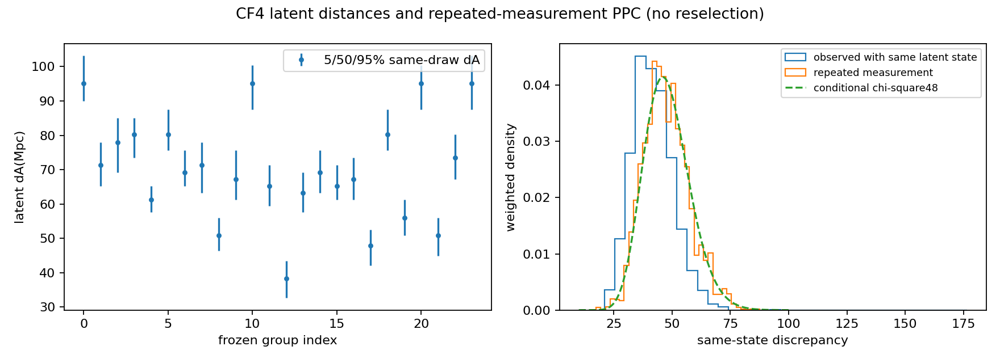

# CF4 same-posterior latent distances and PPC

2029 positive-weight of2048 retained importance draws. Original draw IDs/weights are preserved, including zero-weight statuses. Shared eta conditional uses observed f, not selection Z. dL=dA(1+ztrue)^2 holds on every applicable state.

Repeated-measurement weighted PPC exceedance=0.6780203876793768; observed mean discrepancy=41.70542745762374, replicated=47.55589115710186. This is a posterior predictive quantity, not a uniform null p or posterior exceedance Pi. Fresh selected-population prediction is a different target.

Declared CF4 population, widths, absolute calibration, selection and finite-distance polynomial are scenarios, not established empirical laws. Physical MES mapping is unavailable; unknown mass1, no physical sectors set to0.
