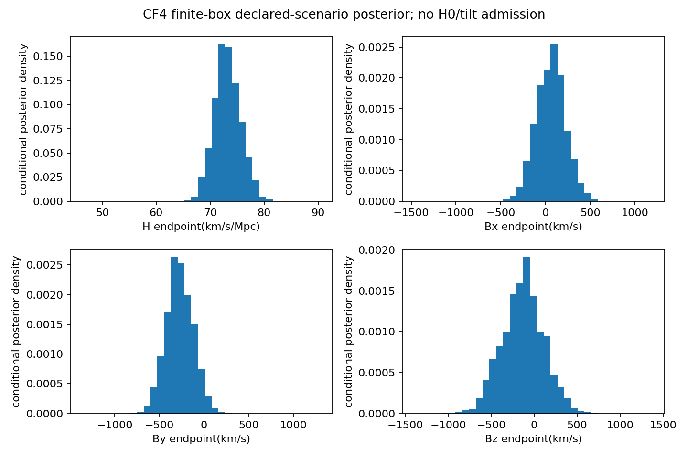

# CF4 conditional finite-box posterior

Proper independent uniform H[40,110]km/s/Mpc and B_each[-1500,1500]km/s, declared Gaussian selected law with one shared zero point. H is a heliocentric endpoint coefficient, not cosmological H0.

[
  {
    "draws": 1024,
    "inside_bounds": 1012,
    "ess": 569.0189424277572,
    "ess_fraction": 0.5556825609646067,
    "max_normalized_weight": 0.002748600528694169,
    "mean": [
      73.27662438835478,
      64.72818697442601,
      -270.0634192753668,
      -132.12817242255372
    ],
    "mean_mcse_proxy": [
      0.10390566060872827,
      6.850470385003021,
      6.358182503690646,
      10.041525125995877
    ]
  },
  {
    "draws": 2048,
    "inside_bounds": 2029,
    "ess": 1120.8271319463581,
    "ess_fraction": 0.5472788730206827,
    "max_normalized_weight": 0.0013917458228087456,
    "mean": [
      73.21617411839004,
      59.671080492872285,
      -272.8709745737752,
      -130.80592490921123
    ],
    "mean_mcse_proxy": [
      0.07289585233390648,
      4.937936333205744,
      4.510415267666367,
      7.193270637394316
    ]
  }
]

Final2048 draws/IDs and normalizedweights retained. Nested1024→2048 mean stability is a finite Monte Carlo diagnostic, not independent convergence proof/evidence.

Same-draw latent and repeated-measurement PPC: [report](../latent_v1/report.md). Population, selection, calibration, source motion and remainder are fixed scenario assumptions. Physical MES/shear/vorticity map unavailable; unknownmass1.
