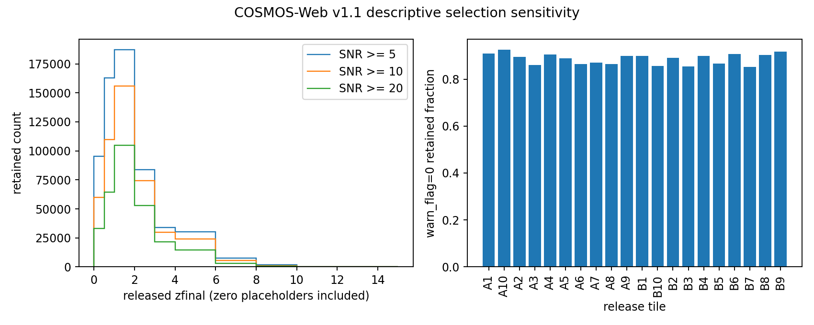

# COSMOS-Web selection controls

784016 rows scanned in 22.85s of batch processing, peak RSS 558.3MiB. warn_flag=0 count 694910; in-range released 0<=zfinal<=15 count 691790. FITS big-endian and logical flags decoded explicitly; row IDs and parallel release ordering checked.

selected retention is not completeness without injection/selection law
photo-z point/68% interval summaries, full 28GB PDF-z not read
no all-sky dipole/global tilt/posterior or independent host anchor

Source definitions: https://cosmos2025.iap.fr/catalog.html, https://cosmos2025.iap.fr/tutorials/catalog_usage_tutorial.html

Review semantic correction: legacy valid_z counters include zfinal=0 placeholders for stars/artifacts. flag_star describes image mask overlap, not LePHARE source type. These plots describe released numeric values, not a galaxy redshift distribution. Full scan counts are reused unchanged.
