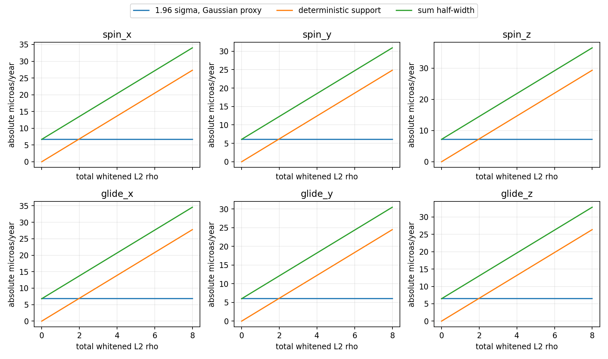
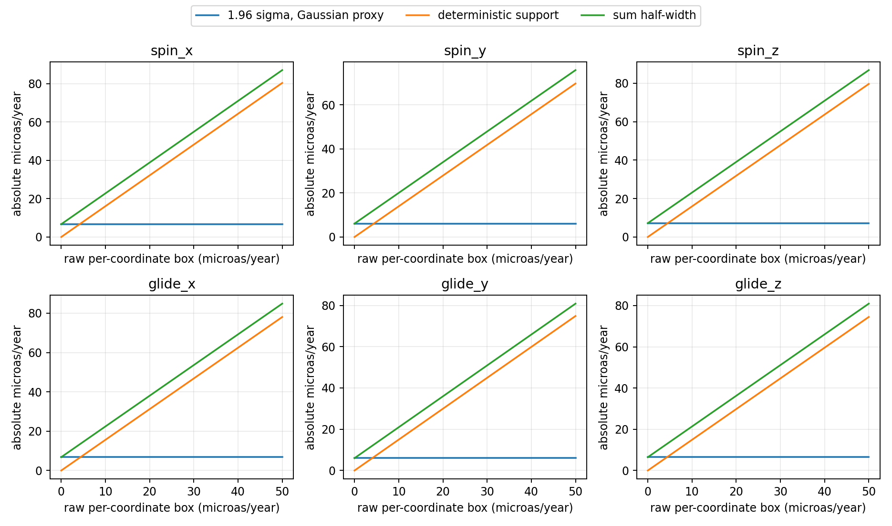

# Gaia EDR3 fixed-cohort linear bias sensitivity

Six coefficient Gaussian-reference sampling covariance and deterministic bias supports for the saved 4756-source frame design.
The 1.96 sigma plus support widths are componentwise reference widths, not joint or empirical coverage.
Rho is one total norm over all 9512 whitened coordinates. The box applies independently to raw pmRAstar and pmDEC.
No certified rho, physical box bias, cross-source covariance, selection law, Jacobi/CAS07 input, or verified Lean wrapper is available.

The full six-by-six sampling covariance, source identities, supports, and numerical controls are in result.json.
