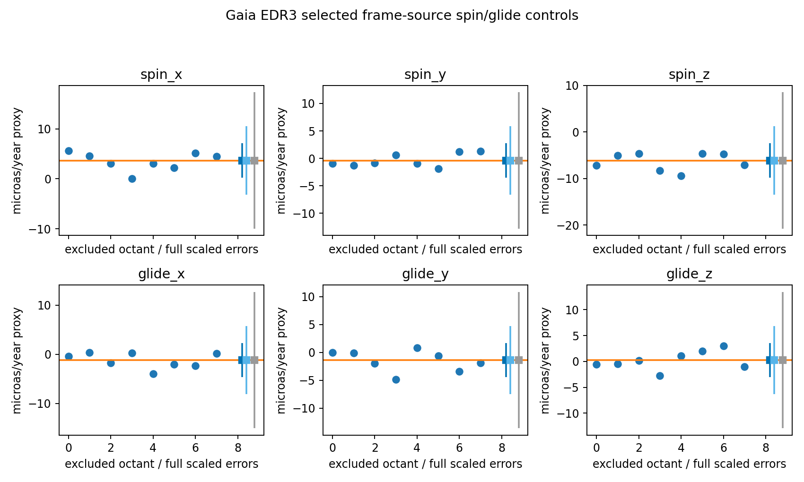

# Gaia frame-source diagnostic

4756 actual EDR3 used-spin sources selected by fixed random_index cutoff, verified with independent COUNT/solution-type queries. Full six-coordinate fit rank=6, condition=1.4416, descriptive weighted RSS=10649.697, nominal df=9506.

Spin/glide coefficients (microas/year): [3.667494969920384, -0.37385649033005425, -6.120242829321318, -1.179407771206841, -1.398858052231999, 0.24717320046103616]

in-sample frame calibration control, no independent reference-frame physics test
cross-source calibration correlations and direction-error propagation unavailable
error scaling changes proxy intervals only, does not repair source selection/correlations
no acceleration, velocity, instantaneous shear, global tilt or native geometry inference

1009 days from2014-08-22 21:00 UTC toMay2017, interruptions; no top-hat or instantaneous derivative interpretation

https://arxiv.org/html/2204.12574v2, https://gea.esac.esa.int/archive/documentation/GEDR3/Data_processing/chap_cu3ast/sec_cu3ast_cali/ssec_cu3ast_cali_frame.html, https://arxiv.org/abs/2012.03380
