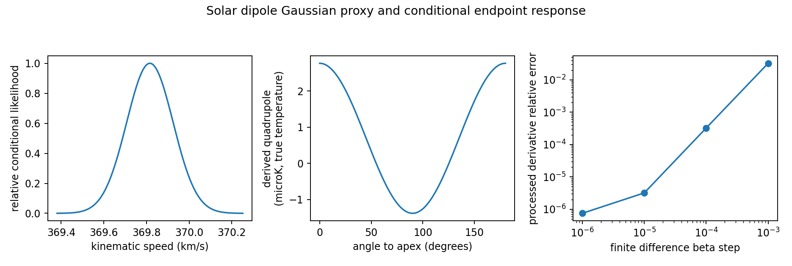

# G02: 물리 solar dipole와 endpoint response

Planck III/I의 source-bound dipole에 선형합 오차의 대각 Gaussian proxy를 명시적으로 적용하면, 순수 kinematic branch의 속도는 369.816042 ± 0.108896 km/s다. source systematic/calibration errors를 확률 law로 해석하는 추가 전제이며 공식 likelihood나 완전 공분산이 아니다. intrinsic/late/foreground dipole은 이 branch에서 명시적으로0으로 고정했다. 일반 branch는 누락 성분을 공급해야 한다.

orbital dipole의 T0 보정과 분모는 같은 nuisance다. 무차원 dipole에서 T0가 상쇄되고, physical-K amplitude에는 한 번 남는다. nominal removed template과 best reference의 차이는 2.666946 microK며 관측 residual ell1이 아니다. true-temperature derived kinematic C2=3.842674 microK², 실제 SMICA에 correction을 적용하지 않았다. 강도 지도 second-order Qnu는 bandpass/weight 없이는 component correction으로 사용할 수 없다.

같은 NSIDE64 cache-stage mask/OLS에 exact Lorentz pullback와 기존 analytic quadrupole boost를 통과시켜 finite differences/remainder를 계산했다. 그 source는 처리된 fitted-Q를 이용한 positive polynomial surrogate다. upstream raw downgrade/beam/compsep와 physical global history는 검증하지 않는다. finite remainder grid는 전역 certified bound가 아니다.

dipole-only local/global endpoint [I,I]는6모수에서 rank3이며 nullspace(h,-h)가 남는다. unconstrained intrinsic dipole nuisance를 사영하면 rank0이다. 작은 physical covariance를 거부하던 unit-dependent threshold와 rectangular rank deficiency에서 condition1을 표시하던 helper 결함은 회귀검사를 통해 수정했다. 물리 global transfer와 CF4 selected law가 없어서 actual local/global 공동 적합은 HOLD다.

source constants·units·frame·covariance proxy·response·finite steps는 result.json에, 실제 code/input/시간은 execution_receipt.json에 있다. [Planck III](https://doi.org/10.1051/0004-6361/201832909), [Planck I](https://doi.org/10.1051/0004-6361/201833880), [Fixsen](https://doi.org/10.1088/0004-637X/707/2/916), [boost convention](https://arxiv.org/pdf/1403.6117).
