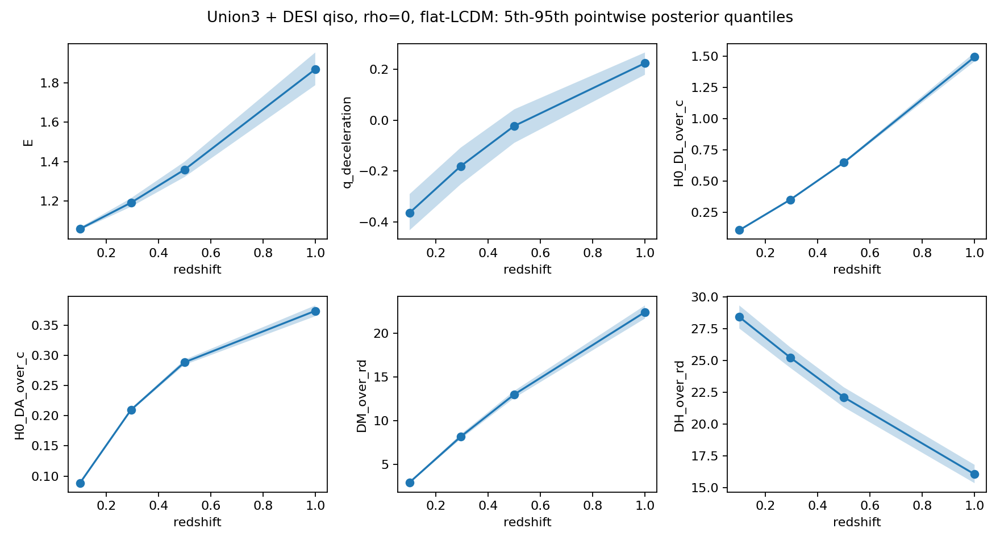

# RB10/11 conditional joint distance fit

Status: `CONDITIONAL_SCENARIO_QUADRATURE_PASS`. Union3 22-node compressed Gaussian + DESI BGS qiso.

The rho grid is a cross-covariance sensitivity, not a measured covariance.
The DESI syst alternative appears once. The common M offset is integrated once.

| rho | Omega_m mean ± SD | H0 rd mean ± SD (km/s) | M mean ± SD | PPC tail | quadrature |
|---:|---:|---:|---:|---:|---|
| +0.00 | 0.35746 ± 0.02708 | 9974.63 ± 204.18 | 43.0889 ± 0.0887 | 0.2856 | PASS |
| +0.25 | 0.35720 ± 0.02707 | 9971.55 ± 220.97 | 43.0889 ± 0.0887 | 0.2764 | PASS |
| -0.25 | 0.35772 ± 0.02710 | 9977.73 ± 186.10 | 43.0889 ± 0.0887 | 0.2886 | PASS |
| +0.50 | 0.35694 ± 0.02706 | 9968.50 ± 236.76 | 43.0888 ± 0.0887 | 0.2778 | PASS |
| -0.50 | 0.35798 ± 0.02711 | 9980.87 ± 166.31 | 43.0890 ± 0.0887 | 0.2827 | PASS |

All final posterior node IDs, weights, conditional M laws, and distance images are in the matching NPZ files.
Physical Sigma2, W2, tilt, curvature, x ceiling, x/Q/Pi/F/G are unavailable with unknown mass one.
CF4 and CMB products are not incorporated. Model competition and catalogue coverage remain unavailable.

Same262144node IDs/weights and six distance/expansion-function images are preserved. Final numerical-state/measure binding and independent48-point integral validation are recorded in final_binding_verification.json. Existing physical legacy fields remain unavailable with unknownmass1; FLRW distance assumptions do not constitute measured zero anisotropy.

Figure scope: Union3+DESI qiso, rho=0, flat-LCDM conditional posterior; 5th–95th pointwise posterior quantiles, not simultaneous coverage. All six plotted functions are dimensionless, including DM/rd and DH/rd; H0rd parameter is km/s.
