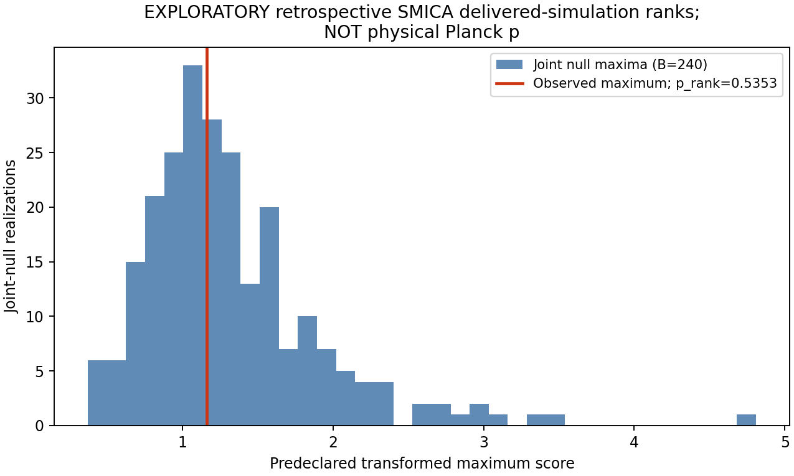
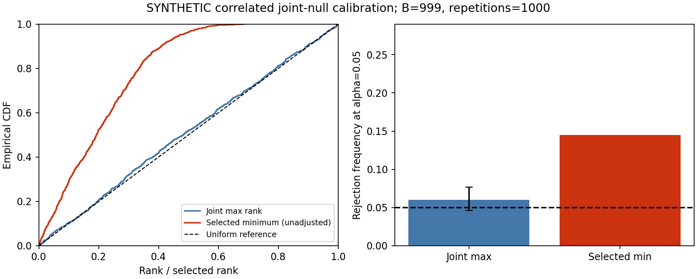
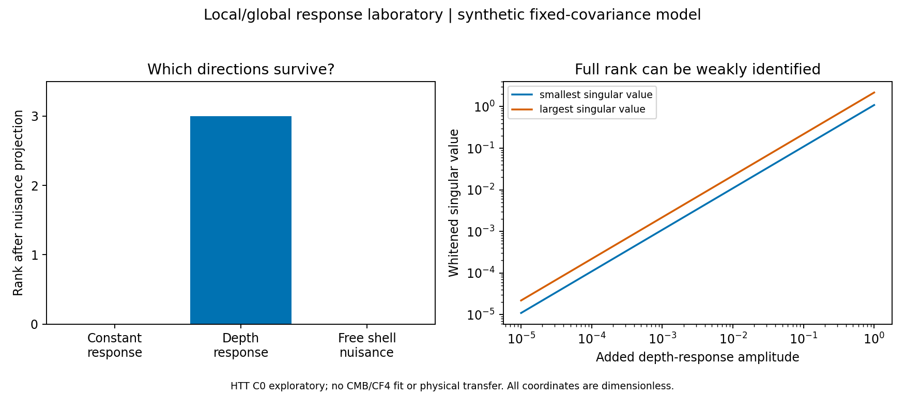

# 관측 reboot: 실제 SMICA pilot, 통계 검증과 전체 분석 계획

새 분석은 **선언한 전달 시뮬레이션 모형에 조건부인 탐색적 SMICA 검정**이다. 고정한 네 저차 전력 요약의 global rank는 **129/241 = 0.535270**다. 이 값은 현재 통계량에서 이례적인 큰 편차를 보여주지 않는다. 모형의 참 확률이나 Bianchi family의 확률은 계산하지 않았다. 과거에 검토한 하늘을 재사용하므로 분석 선택 이력을 제거한 confirmatory 검정으로 해석하지 않는다.

## 실제 자료와 처리

source gate와 실제 SHA256가 일치한 K1 NSIDE64 cache를 사용했다. 관측과 300개의 signal+noise 쌍에 같은 common mask>0.5, 38,413픽셀, ell0–5의 36열 OLS를 적용했다. 각 signal/noise ID는 한 번만 사용했다. 앞 60개는 특징의 평균/표준편차를 정하는 학습, 뒤 240개는 calibration이다. ell2–5의 32실수 계수에서 norm²/(2ell+1)를 계산했다. 이는 **선택된 하늘에서 적합한 계수의 전력 요약**이며 unbiased full-sky C_l 추정량으로 인증하지 않았다.

| ell | 적합 전력 요약 (microK²) | 개별 two-sided rank | joint-max adjusted rank |
|---|---:|---|---:|
| 2 | 226.450962 | 27/241 (0.112033) | 0.535270 |
| 3 | 402.197808 | 129/241 (0.535270) | 0.946058 |
| 4 | 239.880733 | 137/241 (0.568465) | 0.975104 |
| 5 | 291.639119 | 65/241 (0.269710) | 0.697095 |

Global score는 학습으로 표준화한 네 absolute departure의 최대다. 검정240개 중 128개가 관측 이상이므로 (1+128)/241을 쓴다. 가능한 최소 rank는 1/241=0.004149다. IID조건부 null tail확률 q의 95% Clopper–Pearson 구간은 [0.468058, 0.597775]다. 이 구간은 이미 실현된 rank p의 신뢰구간이 아니며 물리 모형의 정확성에 대한 구간도 아니다.

Planck release의 독립noise/systematics 설명과 공식 plancklens의 전달 CMB+noise 결합을 근거로 사용했다. 실제 observed sky와 simulation의 동일 법칙, 전경 잔여, 고정 actual-data weight, systematic mean과 처리 반응의 적합성은 아직 검증 대상이다. 원noise 평균을 관측의 bias로 가정해 빼지 않았다. 내부 OLS identity 오차 약2.1e-15는 algebra 검증이며 누락 high-ell leakage나 실제 map response의 검증을 대신하지 않는다.

## legacy와의 비교

과거 K1 p=.039는 다른 마스크/처리/6통계량과999signal+300cyclic-noise 설계의 empirical rank다. 새 p와 통계적 개선량처럼 빼거나 더 작은 값을 선택할 수 없다. 과거 archive p=.078/.079는 legacy 다중 채널(dipole, CF4, D2/D3 scalar summary)의 posterior-predictive discrepancy이고, R8의5비기각/25미해결은 합성 pool 결과다. source별 비교와 C_l/D_l/STF normalization 충돌은 [legacy 재독](../../research/LEGACY_REBOOT_REVIEW.md)에 있다.

## 새 통계 코드의 실제 검증

고정 B=999, 1000회 독립 합성 실험에서 global-max rejection은 0.060, 각 marginal을 검사하고 가장 작은 값을 고르는 비보정 절차는 0.145였다. Global 95% binomial 구간 [0.04610, 0.07656]은 nominal 0.05를 포함한다. 이 캠페인은 한 번 고정한 독립 학습 자료에 조건부다. 이것은 선언한 합성 실험의 구현/오류율 점검이며 Planck에서의 검정 크기를 입증하지 않는다. 정확한 동점 rank, CP coverage, 학습 누출·same-sky ID중복 거부, OLS독립 oracle와 signal+noise cross-term을 별도 테스트했다.

## local/global 연구 결과

유도한 관측 모형 y=B beta_local+G beta_global+noise에서 covariance whitening과 nuisance 사영을 수행했다. 선언한 합성 행렬에서는 일정 response가 local nuisance에 흡수되어 rank 0, 깊이 response가 rank 3, shell마다 자유로운 nuisance를 허용하면 다시 rank 0이다. 아주 작은 depth response는 full rank를 유지해도 정보가 작다. parameter단위 변경에 따라 nuisance 공간이 사라지지 않도록 정규화했고 회귀로 확인했다. 실제 물리 response의 rank는 다음 단계에서 계산한다.

[이론 유도](../../research/THEORY_REBOOT.md)는 endpoint Lorentz/STF response, nuisance quotient, 두-shellrank, 공유sky covariance와 restricted BianchiI shear history를 연결한다. Wolfram과 NumPy 확인은 경량 계산 근거이며 four-axisCAS, 새 strong no-go 또는 native family 판정이 아니다.

## 전체 분석을 계속하는 계획

23개 개발/PR 카드와 20개 추가 분석 기회를 연결했다. 현재 완료는 RB00의 scoped reboot다. 나머지 카드는 실제 관측 법칙·처리 응답·물리 반응·추론과 새로운 결과를 완결하는 일이다. ACT/Planck lensing, SPT/ACT/BK/Planck spectra, CLASS/FFP10/BeyondPlanck polarization, JWST/Union3, SDSSdepth, Gaia 등은 현재 파일과 코드에 근거한 작업 목록에 들어간다. 추가기회 census가 저장소 전체를 완전히 조사했다는 뜻은 아니다.

Codex는 [지속 goal 지시](../../AUTONOMOUS_GOALS_KO.md)를 따라 하나의goal을 마치면 다음readygoal로 이동한다. Native atlas 대기는 non-native 결과/보고서를 막지 않는다. [개발 DAG](../../DEVELOPMENT_DAG_KO.md), [GOALS](../../GOALS.json), [복사용 handoff](../../CODEX_HANDOFF_KO.md)가 실행 진입점이다.

## 근거와 재현

새로 실행한 분석의 수치는 report.json의 source_files와 해당 결과 JSON에서 생성했다. 역사적 수치는 legacy 재독 문서의 각 원본 경로에 연결했다. actual argv/exit와 최초 gate-identity 실패/repair는 ../../evidence에 있다. 그림 제목 수정은 저장feature로 재렌더했으며 통계 결과를 재선택하지 않았다. README의 재현 명령은 새 output 디렉터리를 요구한다. 독립 검토의 범위와 최종코드 identity는 ../../review/INDEPENDENT_REVIEW.md에 있다.
