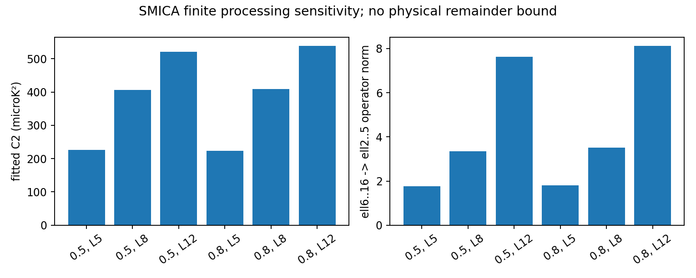
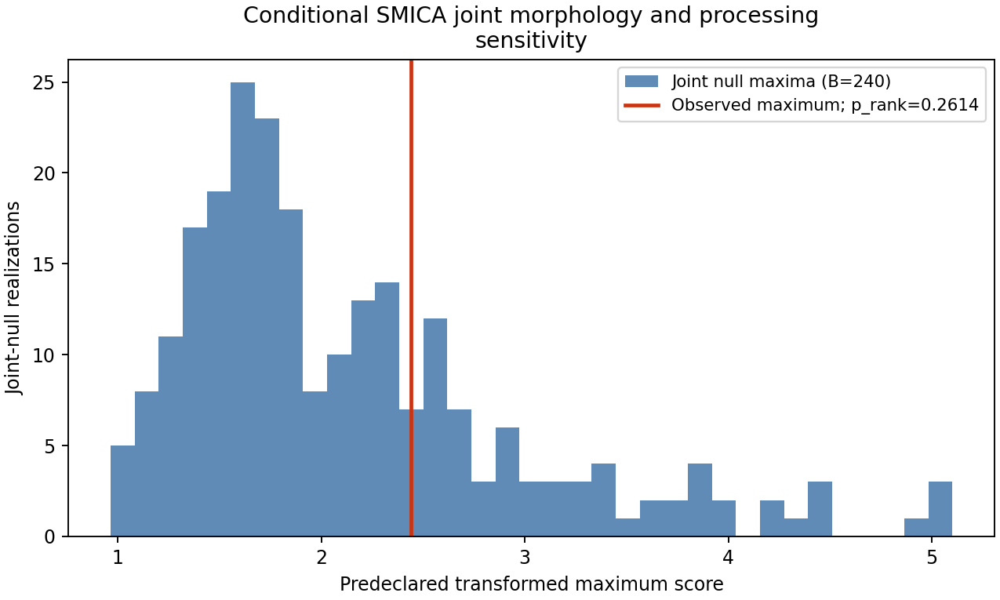

# G01: SMICA 온도 tensor와 유한 처리 민감도

8개 tensor 통계의 조건부 joint rank는 17/241 (0.070539), 마스크 2개 × fitted lmax 3개 × 통계 8개의 joint rank는 63/241 (0.261411)다.

같은 하늘과 같은 300개 모의 쌍을 재사용한 다른 질문이다. 통계족 확대는 독립 증거가 아니며 과거 p=.039와 개선량을 계산하지 않는다. 현 선택만 max 보정했으며 전체 역사적 선택과 실제 하늘/null 교환가능성은 미검증이다.

실제 scan phase는 13.51초, peak RSS 1102.5 MiB. 단일 BLAS thread, 고유 signal/noise ID 300개, train60/cal240을 유지했다.

| mask | fitted lmax | pixels | C2 (microK²) | ell6..16→ell2..5 norm |
|---|---:|---:|---:|---:|
| 0.5 | 5 | 38413 | 226.45096 | 1.754275 |
| 0.5 | 8 | 38413 | 406.88775 | 3.346862 |
| 0.5 | 12 | 38413 | 521.25586 | 7.629347 |
| 0.8 | 5 | 37604 | 223.90583 | 1.803284 |
| 0.8 | 8 | 37604 | 409.60223 | 3.502861 |
| 0.8 | 12 | 37604 | 538.36825 | 8.112107 |

cache-stage harmonic injection만 검사했다. 원래2048→64 downgrade, beam, component separation 및 ell>16 전체 remainder는 상계하지 않았다. 포함된 shell leakage와 low-mode identity는 1e-8 수치 기준을 통과했다. released SMICA HDU2 INT_BEAM/POL_BEAM은 존재하지만, 그 full-sky table은 마스크 의존 upstream response의 완전한 교정이 아니다. ell0/1 transfer는0이며 physical dipole 복원을 이 계수에 적용하지 않았다.

Q/O는 온도 STF tensor다. C_l/D_l와 real coefficient normalization, 회전 불변 shape, parity-odd chirality를 tests/obsstat/test_reboot_tensor_features.py로 검사했고 full tensor와 계수를 NPZ에 보존했다. residual ell1은 각 cut-sky fitted nuisance로 기록했으며 physical dipole로 해석하지 않았다.

자료/모형 출처: [Planck IV §3.5,3.6,4.3](https://arxiv.org/html/1807.06208v2), [Plancklens simulator](https://plancklens.readthedocs.io/en/latest/_modules/plancklens/sims/planck2018_sims.html). RB00 pilot 및 합성 calibration은 입력이 같아 재실행하지 않았다. 정확 source/code/시간은 response.json, split/statistic 정의는 declaration.json에 있다.
