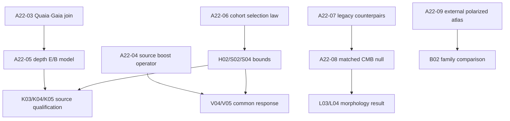
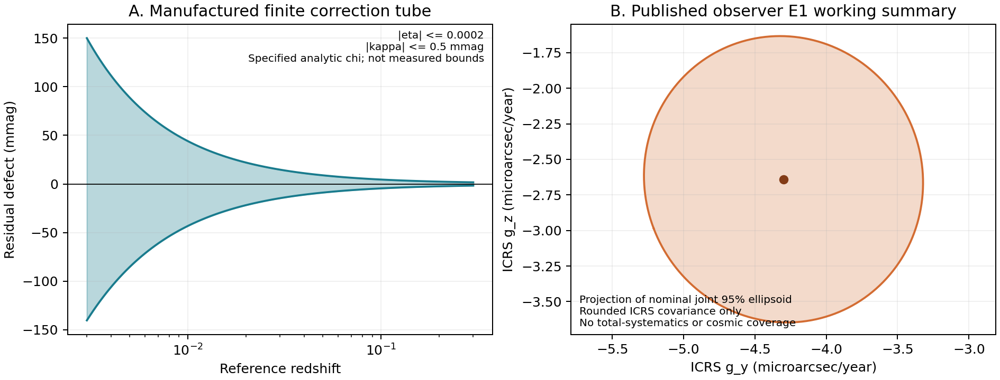

# PR #561 적대적 감사와 실행 재설계

기준: `76595070beb97e52dce9f2d7a0ff1dbf3c289e98`, 2026-10-22.
연구 소유: HTT/obsstat; 감사 소유: COMMON. 현재 세션은 선택한 파일의 감사·패치 환경이다.
소유자 기존 체크아웃과 외장 드라이브의 현재 상태는 이 세션에서 관측하지 않았다.
이 문서는 발표 승인서가 아니다. 여섯 논문 모두 `NOT_READY_TO_SUBMIT`이다.

## 결론과 실제 변화

**17/42는 17번째 노드에 갇혔다는 뜻이 아니라, 서로 다른 가지에서 17개가 완료됐다는 뜻이다.**
기준 DAG의 즉시 의존성 경계는 S02/L03/H02/V03/B02/K03 여섯 개이며 모두 외부 조건을 갖고 있었다.
원래 전체 외부 산출물 기준은 여전히 17/42다. 이번에 V03의 산출물 정책을 투명하게 수정하여,
이미 검토된 물질–복사 보상 섭동의 제한된 해석적 history를 인정한 기준에서는 **18/42**다.
이 증가는 새 관측 발견이나 외부 Einstein–Boltzmann payload 확보가 아니다.
[정책 결정](V03_SCOPE_DECISION.json)에 원문 노드, 변경 사유, 미충족 조건을 모두 보존했다.

이번에 실제로 추가한 과학/자료 산출물은 다음과 같다.

1. 같은 source/ray를 유한 observer boost로 옮길 때 two-redshift 잔차가 정확히 불변이라는
   source-processing 검증식과, magnitude/redshift 보정 결함의 유한 구간을 유도·계산했다.
   이는 고정 자료에 대해 후보 기준계를 바꾸는 추론과 다른 실험이다. 기존 A형 반응을 무효화하는 보편적 no-go가 아니다.
   [유도](theory/THEORY_AUDIT.md), [수치 결과](theory/RESULT.json).
2. Gaia 2021 공개 Table 2의 ICRS 가속도 요약을 물리적 접평면 E1 관측식과 연결했다.
   선택한 공분산 하에서 joint ellipsoid와 하늘 위치 간 fitted-mean 공분산, deterministic bias 민감도를 계산했다.
   약 4.0723 μas/yr는 해당 명목 95% Gaussian 집합이 원점을 포함하기 위한 가산 bias 크기의 문턱이며,
   실제 계통오차 상한이나 우주 가속도 검출치가 아니다.
   local/cosmic E1가 모두 자유로우면 설계 rank는 3/6이고 cosmic 성분은 식별되지 않는다.
   [보고서](k03/REPORT.md), [결과](k03/RESULT.json).
3. Table 2의 인쇄된 두 좌표계 공분산은 명시한 반올림 가정으로 서로 일치하지 않는다는
   수치 반례를 찾았다. 원 논문의 오류라고 단정하지 않는다. 원자료 estimator/precision 차이는 미해결이며,
   ICRS 요약 하나를 선언된 working covariance로 사용한다. 두 좌표계 요약을 결합하지 않는다.
4. Quaia v1.0.0의 공식 공개 파일 목록, 크기, MD5 및 라이선스를 확인했다.
   두 보조 파일 **1,279,519 bytes**를 실제 내려받아 SHA256/CRC/FITS/NumPy 구조를 검사했다.
   catalogue 99,786,240 bytes는 이번 세션에서 받지 않았다. local Codex가 기본 묶음
   **101,065,759 bytes**를 받거나 캐시를 재사용하도록 상한 없는 manifest와 ZIP 지원을 추가했다.
5. 오래된 브랜치의 실제 donor 함수와 현재 HEAD에서 빠진 파일을 구분했다.
   기능 단위의 재도입과 새 통계 실험으로 연결했다. 모든 브랜치를 합치지 않았다.

## 왜 오래 계산해도 정체됐나

| 원인 | 실제 근거 | 실행 교정 |
|---|---|---|
| 출판 완결 조건과 실행 작업의 혼합 | 42노드에는 source-law 확보·coverage·원고까지 섞임 | 과학 노드는 유지하고 A22 실행 단위를 별도로 연결; 작업 완료를 논문 완료로 계산하지 않음 |
| 외부 파일과 모델 의무의 혼동 | H02의 joint selection/calibration law는 다운로드 한 번으로 생기지 않음 | 선택된 cohort의 생성모형·정규화 분모를 직접 유도하고 미관측 parent 부분을 bounds로 남김 |
| 완료된 계산의 반복 | 651행 projection, 97LP, Gaia1614173행 stream, 64SDSS fits, PR4 split 결과가 이미 존재 | 같은 입력/모형/통계량으로 재실행 금지; 새 입력·반응식·반례·coverage 중 하나를 명시 |
| 실제 실행 frontier가 비어 있음 | F01/F02 완료, F03/F05 실행, F04 완료 부분과 남은 조건 혼재, F06–08 blocked | A22-03/04/06/07을 실행 가능한 새 경로로 등록하고 입력 의존성을 명시 |
| 서로 다른 관측식의 null을 물리 no-go로 읽을 위험 | calibration+flow+history rank12/15는 서로 다른 forward model 비교 | two-redshift passive test와 fixed-data trial-frame derivative를 분리 |
| 모든 비방사 관측을 cosmic tensor로 간주 | 관측자 BCRS 가속도와 congruence A_a는 다름 | 먼저 observer E/B 채널을 검증; cosmic 변환과 local nuisance를 추가 증거 없이 승격하지 않음 |
| branch 분산 | #533 geometry/optics/boost donor 일부는 #561 HEAD에 없음 | blob과 함수별 donor 목록을 따라 작은 이식; 이름만 보고 재사용했다고 기록하지 않음 |
| 상태 문서 드리프트 | PR 본문은 예전 HEAD, 폐기된 용량 상한과 이미 실행된 F04를 계속 설명 | 현재 handoff/manifest/42-node mirror/PR 본문을 함께 갱신 |

B02의 atlas 부재가 모든 연구를 막는다는 해석도 틀리다. 기존 DAG의 전이 의존성 검사에서
B02는 미완료 4개에, H02는 10개에 영향을 준다. 관측자 접평면 가속도/회전의 작은 정확한
선형 예제는 CF4나 Bianchi atlas 없이 rank 6이다. 실제 자료의 source qualification은 별도다.
[실행된 의존성 감사](legacy/DEPENDENCY_CAPABILITY_AUDIT.json).

## 원래 직관을 유지하면서 연구를 바꾸는 방법

MES와 signed x/Q/Pi/F/G_F는 계속 같은 물리 carrier의 joint law에서 계산한다.
부호·분모·미정의 질량을 지우지 않는다. 현재 물리량 전체 posterior가 없다는 이유로
관측량에서 확인할 수 있는 구간/부분식별까지 버리지 않는다. #531의 joint-ID pushforward와
이번 normalized selection bounds를 연결하되 Γ를 임의로 작게 정해 발견을 만들지 않는다.

SMICA의 저차 morphology 직관은 phase/orientation/parity counterpair와 전체 sky ID를 보존한
복수 pipeline 비교로 되살린다. 같은 하늘의 여러 지도는 반복 관측 표본 수를 늘리지 않는다.
오래된 p=.039는 후향적 결과이며, 새로운 statistic·선택·max-score를 사전 고정하고
동일 processing의 null realization 및 Monte Carlo 오차를 갖춘 뒤 다시 판단한다.

local boost vs global tilt는 서로 다른 거리 반응을 비교하는 원래 질문을 유지한다.
먼저 실제 source pipeline의 observer equivariance를 검사하고, 그 다음 고정 관측자료에서
후보 기준계/물질 history를 바꾸는 모형을 비교한다. 보상된 선형 history의 optical h는
유효한 물리 하위모형이지만 Planck T/E/B transfer와 자동으로 일치하지 않는다.

Gaia–Quaia의 redshift별 E/B 분석은 새 방향이다. 공통 local E1, 거리 의존 source 효과,
고차 각모드와 선택 템플릿을 한 joint model에 두고 nuisance를 적분한다.
조건부 선형 Gaussian 구간에서는 C=N+HPHᵀ와 Woodbury/Schur 방식으로 정확히 계산할 수 있다.
이는 일반 비Gaussian/systematic law를 해결하지 않는다. 먼저 작은 직접 행렬 계산과 대조하고,
hyperparameter 및 하늘 상관 구조를 바꿔 coverage를 확인한다. 단순 iid-source bootstrap 반복은 대안이 아니다.

Bianchi family identification은 계속 외부 polarized 물리 atlas가 필요하다.
현재 할 수 있는 것은 관측 morphology의 동치류/감도와 restricted analytic subcase 비교다.
그 결과를 family detection이나 완전한 family exclusion으로 쓰지 않는다.
[구체적 donor/반례 지도](legacy/REPORT.md).

## 잠재적 출판 후보와 추가 연구로 얻을 후보

아래는 편집자 판단이나 novelty 인증이 아니라 현재 증거에 따른 후보 목록이다.

| 현재 실제 산출물이 있는 후보 | 추가로 충족해야 할 조건 |
|---|---|
| two-redshift source-processing equivariance와 finite defect tube | 실제 표준화/PV pipeline 비교, 외부 방법 비교, 실제 자료에서 유용한 bound |
| 조건부 calibration–flow–history 식별성/부분식별 방법 | source-matched covariance/selection, 물리 remainder, 실제 데이터의 비자명한 구간 |
| Gaia observer E1 compressed response 및 frame-covariance 감사 | 원 covariance/estimator 차이 해소, 고차모드/공간계통오차 모델, 독립 검증 |
| normalized selection sensitivity와 signed-functional joint pushforward | 실제 parent/cohort가 뒷받침하는 Γ/support/joint law, coverage와 real-data figure |
| 기존 실제 Planck split/morphology processing diagnostics | 같은 processing의 물리 joint null, 독립 realization, 다중검정·MC오차 |

| 앞으로 새로 얻을 수 있는 결과 | 연결 작업 |
|---|---|
| redshift별 E/B 신호와 local/common-mode 혼동에 대한 robust set | A22-03 → A22-05 |
| 실제 표준화 자료의 frame-equivariance defect 및 local/global 비교 | A22-04 → V04/V05 |
| 선택된 거리 cohort에서의 MES/signed-functional 부분식별 그림 | A22-06 → H02/S02/S04/K04의 적용 가능한 범위 |
| SMICA 및 다른 pipeline의 공통 하늘 morphology robust null/이상 | A22-07 → A22-08 → L03/L04 |
| restricted optical history와 관측 operator의 동치류 | A22-04 및 기존 V03; 완전 Bianchi 식별과 구분 |

출판 기준 미달을 숨기지 않는다. **현재 논문 6개 중 제출 가능 0개**다. 다음 루프는 위 표의
부족 조건을 실제 계산/관측으로 메우는 작업이며, 보고서 수를 늘리는 작업이 아니다.

## 실행 DAG와 PR 계획

실제 개설 PR은 **#561**이고 아래는 아직 열지 않은 구현 묶음이다.
ASTROMETRY(A22-03/05), OPTICS(A22-04), SELECTION(A22-06), MORPHOLOGY(A22-07/08).
각각 결과·그림·방법·한 번의 독립 검토가 갖춰지면 draft PR로 공개한다.
기계용 [EXECUTION_PLAN.json](EXECUTION_PLAN.json)과 기존 42개를 유지한
[CONTINUATION_TASKS.json](../OPEN_INPUTS_20261018/CONTINUATION_TASKS.json)이 연결되어 있다.

## 연구 루프 이행 기록

physmath-research-loop 현재 workflow 1.0.0을 적용했다. 과거 1.3.0 표기는 이번 실행의 authority가 아니다.
이론 10단계: (1)17/42와 물리 목표 재정의, (2)기존 증거 재사용, (3)primary source 비교,
(4)frame/source 가정 분리, (5)two-redshift 유도, (6)finite defect 구간 계산,
(7)Gaia local/cosmic 반례, (8)수치·Wolfram 대조, (9)독립 적대적 검토,
(10)범위 판정 및 다음 실험으로 인계했다. 새로운 strong no-go나 CAS_4AXIS_PASS를 등록하지 않는다.

코딩 10단계: (1)선택된 baseline 고정, (2)기존 downloader와 DAG 계약 읽기,
(3)실제 ZIP unsupported 재현, (4)ZIP/MD5 최소 패치, (5)CRC/identity/uncapped 회귀검사,
(6)실제 보조 자료 schema 계산, (7)42-node/새 작업 packet 연결,
(8)새 결과의 재생성·그림, (9)독립 검토·구체적 지적 수리,
(10)expected-HEAD 조건의 비강제 공개와 다음 task 인계. 최종 검증 상태는
[VERIFICATION.md](VERIFICATION.md)에 기록한다.

추천 실행 배치는 부모 gpt-6.1-sol/high, 이론·독립 검토 gpt-6-astra/xhigh,
작은 metadata task gpt-6-luna/medium이다. 이는 요청 runtime이며 관측 backend 식별은 UNKNOWN이다.
동시에 부모 포함 최대4, nested 없음, production writer 하나를 유지한다.

왼쪽은 가정한 correction bounds의 이론 구간이고 오른쪽은 공개된 ICRS working summary의 명목 joint ellipsoid 투영이다. 두 패널 모두 새로운 우주론적 검출이나 보정된 총오차 신뢰구간을 나타내지 않는다.
