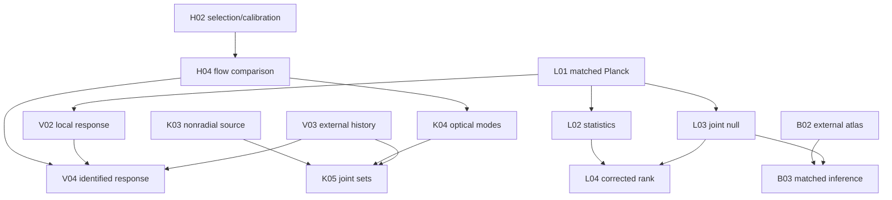

# 여섯 논문 전 노드 실행 목표

42개 원래 노드를 보존한다. 현재14개는 scoped 완료,28개는 pending이다. 다음 표는 연구 목표와 실행 준비를 구체화하며 원래 acceptance를 낮추지 않는다. 기초 준비가 가능하더라도 선행 노드가 끝나기 전 downstream 완료를 기록하지 않는다.

P1은 S02 공동 source 사상→S03 민감도→S04 관측법칙/identified interval→S05 원고→S06 판정으로 진행한다. 위 그림은 공유 입력의 주요 관계만 보여주며 전체 간선은 canonical JSON에 있다.

| 노드 | 상태 | 다음 실질 목표 | 산출물 |
|---|---|---|---|
| COMMON/E0 | completed_scoped | 기존 scoped evidence를 재사용한다. 실제 downstream source/API 변경이 있을 때만 영향 부분을 재검사한다. | evidence anchor |
| COMMON/E1 | completed_scoped | 기존 scoped evidence를 재사용한다. 실제 downstream source/API 변경이 있을 때만 영향 부분을 재검사한다. | evidence anchor |
| COMMON/E2 | completed_scoped | 기존 scoped evidence를 재사용한다. 실제 downstream source/API 변경이 있을 때만 영향 부분을 재검사한다. | evidence anchor |
| COMMON/E3 | completed_scoped | 기존 scoped evidence를 재사용한다. 실제 downstream source/API 변경이 있을 때만 영향 부분을 재검사한다. | evidence anchor |
| COMMON/X01 | completed_scoped | 기존 scoped evidence를 재사용한다. 실제 downstream source/API 변경이 있을 때만 영향 부분을 재검사한다. | SOURCE_BINDINGS.json |
| COMMON/X02 | completed_scoped | 기존 scoped evidence를 재사용한다. 실제 downstream source/API 변경이 있을 때만 영향 부분을 재검사한다. | NOVELTY_MATRIX.md |
| COMMON/X03 | completed_scoped | 기존 scoped evidence를 재사용한다. 실제 downstream source/API 변경이 있을 때만 영향 부분을 재검사한다. | CLAIM_SELECTION_LEDGER.json |
| P1/S01 | completed_scoped | 기존 scoped evidence를 재사용한다. 실제 downstream source/API 변경이 있을 때만 영향 부분을 재검사한다. | STAT_FUNCTIONAL_CONTRACT.md + tests |
| P1/S02 | pending | H03 joint-summary draw mapping을 재사용하고, 적어도 한 물리 sector에 admissible 관측 사상을 증명한다. q_app proxy와 physical x/Q/F/G를 별도 열에 둔다. | P1 signed samples, exact weights, Pi lower/upper, physical unknown-mass columns |
| P1/S03 | pending | S02에서 허용된 동일 샘플로 anchor 3종, floor grid, 네 depth 및 실제 selection fit을 비교하고 최소한 한 반례를 그림으로 제시한다. | paired sensitivity table, floor/depth plot, no-renormalization test |
| P1/S04 | pending | 선택법칙과 nuisance 집합을 명시하고 실제-data confidence-set image 또는 calibrated posterior를 구축한다. 물리 total x 대신 정당한 좁은 estimand가 가능하다. | observational-law derivation, calibration/coverage and identified intervals |
| P1/S05 | pending | P1 실제 결과 그림과 부분식별 정리를 결합하고 기존 pushforward/partial-identification 문헌과 새 관측 기여를 비교한다. | P1 manuscript source, figures, reproducible result table |
| P1/S06 | pending | P1 각 acceptance를 evidence와 대조하여 HOLD 또는 READY_FOR_OWNER_REVIEW 판정을 생성한다. | P1 publication_decision.json + independent review |
| P2/L01 | pending | 기존 primary checkout에서 fixed-window native full/HM/OE matched split stream을 한 번 실행한다. full RHS 재현 후 native split, T/E/B support, beam, finite band 및 미계산 tail을 연결한다. | native matched split JSON/NPZ, estimator/operator comparison, finite-tail scope |
| P2/L02 | pending | 동일 harmonic convention의 quadrupole/octupole STF 및 O(3)/SO(3), parity, depth/axis 선택 family를 고정하고 회전/반사 invariant 테스트를 실행한다. | fixed statistic-family specification, actual feature vectors and invariant tests |
| P2/L03 | pending | 관측과 동일 release/processing/selection을 통과하는 신호+잡음+systematics simulation law를 확보하고 exchangeability/coverage를 검증한다. | source-matched joint null bank and qualification report |
| P2/L04 | pending | L02의 전체 선택 family를 관측과 각 null row에 동일하게 적용해 joint maximum Monte Carlo rank와 precision을 산출한다. | corrected rank, finite-MC interval, complete selection family |
| P2/L05 | pending | 정해진 mask/beam/source/foreground 대안에서 anomaly 또는 음의 결과의 안정성과 원인을 비교한다. | robustness attribution and Planck VII comparison |
| P2/L06 | pending | P2 manuscript를 실제 calibrated 결과 또는 명시적 processing-method 결과로 작성하고 근거에 따른 readiness를 판정한다. | P2 manuscript, plots and readiness decision |
| P3/H01 | completed_scoped | 기존 scoped evidence를 재사용한다. 실제 downstream source/API 변경이 있을 때만 영향 부분을 재검사한다. | dimension-correct source estimator and response test |
| P3/H02 | pending | CF4 method/group overlap, source selection 및 공통 zero-point calibration/velocity covariance를 출처에 연결한다. calibration gauge를 외부 anchor로만 제한한다. | selection law, shared covariance, heldout calibration fit |
| P3/H03 | completed_scoped | 기존 scoped evidence를 재사용한다. 실제 downstream source/API 변경이 있을 때만 영향 부분을 재검사한다. | H_eff(z,n) empirical coefficient trajectories plus cross-window covariance |
| P3/H04 | pending | H02 관측법칙에서 isotropic flow, bulk, dipole/STF 및 depth alternatives를 동일 window로 injection/heldout/PPC 비교한다. | calibrated false-positive/power and heldout prediction |
| P3/H05 | pending | Boubel, Stiskalek, Duangchan, Kalbouneh 및 관련 CF4 분석을 같은 estimand/selection/null 조건으로 복제하거나 차이를 수치화한다. | matched comparator figure/table and explicit novelty claim |
| P3/H06 | pending | P3 survey-defined H_W 논문을 작성하고 competing models와 독립 calibration/coverage에 근거해 판정한다. | P3 manuscript and readiness decision |
| P4/V01 | completed_scoped | 기존 scoped evidence를 재사용한다. 실제 downstream source/API 변경이 있을 때만 영향 부분을 재검사한다. | finite Lorentz and 1+3 frame contract |
| P4/V02 | pending | finite local Lorentz boost를 실제 Planck 처리 순서에 넣어 injection residual과 nuisance-projected local response를 계산한다. | source-matched local response and finite-beta remainder |
| P4/V03 | pending | 이미 계산된 외부 global-history transfer 또는 허용된 해석적 physical response를 확보하고 local endpoint와 다름을 검증한다. | source/frame/history-tagged global response |
| P4/V04 | pending | local/global/nuisance block을 같은 frame과 실제 covariance로 whiten하고 error-bounded singular subspaces와 식별집합을 계산한다. | projected singular values, certified error margins and identified set |
| P4/V05 | pending | qualified joint law에서 local-only/global-only/mixed/systematic 모델 injection과 posterior/identified-set sensitivity를 비교한다. | joint inference, PPC, null/alternative recovery |
| P4/V06 | pending | P4는 실제 분리 또는 범위가 명시된 물리 비식별 결과를 논문화하고 readiness를 판정한다. | P4 manuscript and readiness decision |
| P5/B01 | completed_scoped | 기존 scoped evidence를 재사용한다. 실제 downstream source/API 변경이 있을 때만 영향 부분을 재검사한다. | family/IC/curvature sign/constraint atlas inventory |
| P5/B02 | pending | 외부에서 이미 산출된 polarized all-m physical atlas 중 검증가능한 subset을 import하고 IC/units/frame/modes/equivalence를 검사한다. | admitted external atlas subset with validation |
| P5/B03 | pending | admitted atlas와 L03 null에 동일 Planck beam/window/likelihood를 적용한다. | matched model features and joint covariance/null |
| P5/B04 | pending | 실제 검증 subset의 equivalence classes, heldout confusion 및 nuisance/profile evidence를 계산한다. | equivalence/confusion and inference result |
| P5/B05 | pending | P5 verified-subset paper 또는 HOLD를 실제 family calibration/likelihood 근거와 함께 작성한다. | P5 manuscript/readiness with exact admitted family scope |
| P6/K01 | completed_scoped | 기존 scoped evidence를 재사용한다. 실제 downstream source/API 변경이 있을 때만 영향 부분을 재검사한다. | physical measurement operator with antisymmetric counterexample |
| P6/K02 | completed_scoped | 기존 scoped evidence를 재사용한다. 실제 downstream source/API 변경이 있을 때만 영향 부분을 재검사한다. | conditioned rank and bounded unresolved-sector report |
| P6/K03 | pending | Gaia proper-motion/kSZ/remote multipole 등 실제 nonradial source와 광학/frame response를 연결하고 curl/acceleration transfer를 검증한다. | source-matched nonradial operator and covariance |
| P6/K04 | pending | CF4의 apparent STF identified subspace를 허용된 physical optical/congruence mapping과 교차해 제한 가능한 mode만 추론한다. | physical identified-mode intervals with source-window sensitivity |
| P6/K05 | pending | 공통 잠재상태에서 K03/K04/V03의 confidence-set image를 합성하고 bound되지 않는 sector는 unbounded로 유지한다. | four-sector identified-set report and simultaneous error budget |
| P6/K06 | pending | P6 실제 source-supported 조합과 네 sector의 unknown/unbounded 결과를 함께 논문화한다. | P6 manuscript, four-sector matrix and readiness |

## Goal-driven 실행 규칙

한 목표가 검증되면 `python scripts/htt_sixpaper_goal_packet.py --ready`로 다음 준비 노드를 고른다. `--frontier`는 미완료28개와 의존·외부 blocker 및 독립 준비 과제를 함께 표시한다. `--task L01`처럼 필요한 packet만 low-cost agent에게 제공한다. 이 CLI 자체는 job scheduler가 아니며 실제 Codex가 dispatch/실행/검증한다.

한 노드에서 raw data/외부 transfer가 없으면 정확한 입력을 기록하고 다른 ready node 또는 독립 준비를 수행한다. 문헌 정리·schema·toy test를 반복해서 scientific completion으로 세지 않는다. 두 번 연속 실질 수치/증명/입력 개선이 없는 수정은 멈추고 다른 과학 lane으로 이동한다.

현재 권장 분업: parent1 + bounded workers2 + fresh reviewer1, 최대4 active. 구현/실행은 gpt-6.1-sol high, 어려운 유도·독립 심사는 gpt-6-astra xhigh, 저비용 추출/정형 문서 보조는 gpt-6-luna medium. 이는 현재 호스트에 노출된 모델 선택지에 대한 역할 권고이며 가격·성능 벤치마크 결과가 아니다. 수학/물리 판단을 저비용 모델 단독으로 승인하지 않는다.

최종 노드는 제출행위가 아니라 근거 있는 readiness 판정이다. HOLD를 써도 미완료 선행연구를 완료로 바꿀 수 없다. 제출 가능한 수준에 도달하면 READY_FOR_OWNER_REVIEW로 반환하며 journal 제출과 main merge는 별도 사용자 지시가 있어야 한다.
