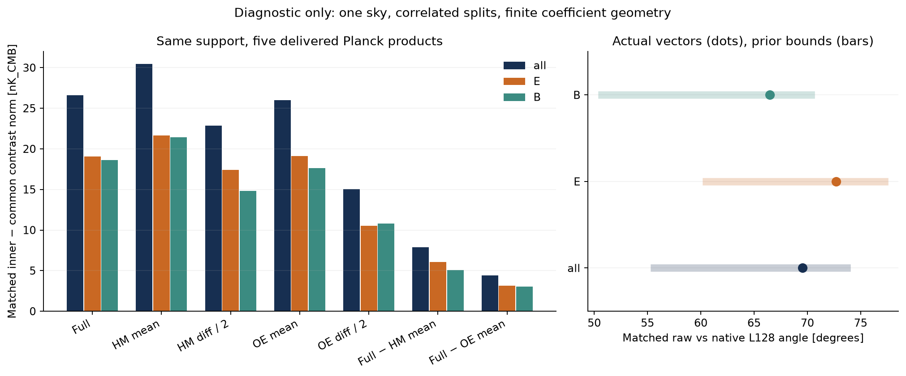
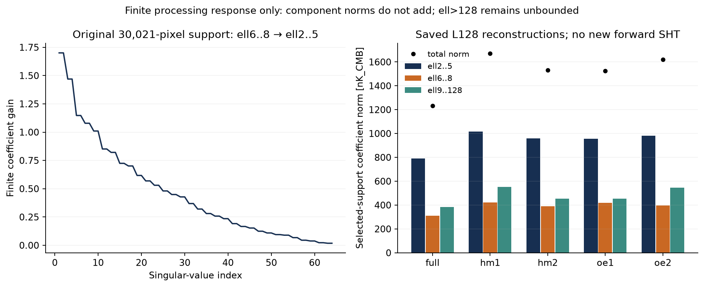

# L01 실제 native split 실행과 원래 EB support의 유한 응답

2026-10-18. Owner `obsstat`, claim tier `C0`, `DIAGNOSTIC_ONLY`, transfer source
`none`. 이 패키지는 비 claim-bearing 처리 진단이다. 기존 primary checkout에서
실제 full/HM/OE matched stream을 한 번 실행했고, 원래 30,021개 EB support를
복원하여 유한 spin-2 응답과 저장된 L128 재구성의 band 항을 계산했다.
논문 제출 판정은 `NOT_READY_TO_SUBMIT`이며 L01의 최종 완료 판정은 별도
독립 리뷰가 결정한다. 이 작성자는 canonical DAG/status를 바꾸지 않았다.

## 실제 native 실행

원본 helper와 checkout guard를 수정하지 않았다. 첫 helper는 기존 무관한
미추적 폴더 때문에 수치 계산 전에 exit 2로 중단됐으며 정확한 원문은
[FIRST_FAILURE.txt](FIRST_FAILURE.txt)에 있다. 부모가 기존 local-only exclusion을
복원한 뒤 clean tree에서 helper를 다시 실행했다. 첫 실제 native stream의 기준
HEAD는 `1e095a2749cce9b28e45aac043a82218c21f84e5`, ref는
`origin/research/htt-sixpaper-goals-robustness-20261018`였다. 이후 다른 연구 lane의
커밋은 이 producer나 입력을 바꾸지 않았다. 새 worktree/clone, 다운로드,
설치, SHT, Gram 재계산, solver 또는 ODE는 실행하지 않았다.

실제 interpreter는 `.venv/bin/python`, Python 3.12.3, NumPy 2.5.4,
SciPy 1.18.1, healpy 1.19.0이다. healpy는 frozen checkpoint의 1.19.0 요구와
일치했다. 기존 producer·dependency·receipt·FITS SHA와 fixed-window 검사는
native driver가 통과시켰다. full/HM/OE는 같은 한 하늘의 다섯 처리 제품이다.

원본 수치 결과는 외부 디스크의 create-only 파일에 보존했다:
`/mnt/extdrive/workdir/htt_open_data/provenance/L01_NATIVE_MATCHED_SPLITS_20261018T084759Z.json`.
그 안에 모든 RHS, coefficients, Gram, source identities가 있다. 새 native scan
타이머는 343.237초이며, 앞선 source hash/입력 검증 시간은 포함하지 않는다.

| 확인 항목 | 실제 결과 |
|---|---:|
| common / inner / removed-shell spatial pixels | 37,120,921 / 36,951,769 / 169,152 |
| full native RHS relative replay, common / inner | 2.023e-15 / 1.862e-15 |
| shell identity / split-linearity relative error | 2.578e-16 / 2.460e-16 |

동일 estimator의 inner-minus-common contrast는 다음과 같다. 단위는 고정된
real ell2..5 coefficient norm의 nK_CMB이며, pseudo-C_l 또는 sky 회전각이 아니다.

| 처리 대비 | all | E | B |
|---|---:|---:|---:|
| Full | 26.6274 | 19.0367 | 18.6178 |
| HM half difference | 22.8774 | 17.4219 | 14.8275 |
| OE half difference | 15.0500 | 10.5006 | 10.7815 |
| Full − HM mean | 7.88931 | 6.03646 | 5.07960 |
| Full − OE mean | 4.39307 | 3.15597 | 3.05596 |

HM/OE half-difference coefficient cosine는 -0.208001, 각도는 102.0052°다.
두 에너지를 독립 잡음 추정이나 잡음 분율로 읽을 근거가 없다. full 대비
half-difference energy ratios 0.738173(HM), 0.319459(OE)는 기술적 처리 비율이다.

이제 실제 벡터가 있으므로 이전 sharp conditional interval을 점으로 좁혔다.
matched raw contrast와 원래 native L128 contrast의 각도는 all 69.545694°,
E 72.706922°, B 66.471752°다. all 최선 nonnegative scalar-fit residual은
93.6951%다. 이전의 모든 bound 입력 길이와 구간도 재현했다. 이는 두 처리
estimator의 기하 차이이며 cosmic B, 잡음·foreground 배분 또는 유의성이 아니다.

## 원래 선택 support로 돌아가는 실제 bridge

기존 source NPZ는 primary checkout의
`docs/research_program/htt_mes_eps_loop9_20261015/inputs/retained_common_support_coefficients.npz`이며
실제 SHA-256은 `900e6c6fa04a6313f63753747d89e7059486bdeb88d51c91d895fcc8b4e09459`다.
9개 T 제품과 8개 EB 제품의 기존 계산을 재사용했다. T는 26,846개 RING64
픽셀, EB는 30,021개 RING64 픽셀을 쓴다. noSZ polarization은 없는 입력이다.

역사적 source script는 Git object
`c2889730d2b5e5b778951f15e8f09afd55bed4e3:scripts/run_htt_planck_multisplit_spin_20261015.py`다.
그 선택 규칙대로 기존 세 native PMASK를 먼저 AND하고, NESTED2048의 각
NSIDE64 parent에 속한 1,024 children의 유효 비율을 계산한 뒤 NESTED→RING으로
재배열하여 coverage≥.995를 적용했다. 새 PMASK의 threshold-after-coarsening
교집합(38,329/37,054개)과 이 규칙을 혼동하지 않았다.

30,021개가 정확히 복원됐다. 복원된 RING64 binary mask SHA-256은
`2889b2a141552da0b48d553080939c630cbd77e42715ba9d5044924bb924d2fa`다.
low-design condition 3.130962277057442는 역사적 3.1309622770574452를
수치적으로 재현한다. low identity residual은 1.776e-15다. 같은 support에서
계산한 64×90 ell6..8→ell2..5 response norm은 1.70060815923,
E-high→B-low block norm은 0.934494947530이다.

이 응답은 실제 healpy mixed all-m E/B synthesis 두 개와 독립 비교했다.
map 최대 차이는 6.251e-14, projected-response relative error는 최대
4.281e-15, 별도 low native injection replay는 4.730e-15였다.
이는 실제 source-selected mask와 spin convention의 유한 응답 검증이다.
beam/component-separation/E2E transfer 전체를 검증한 결과는 아니다.

같은 30,021 support 위에서 기존 full/HM/OE L128 alms를 재사용하여 low,
mid, tail vector를 실제 projection했다. full의 norm은 total 1232.210 nK,
ell2..5 789.503 nK, ell6..8 311.184 nK, ell9..128 383.995 nK이며,
vector closure error는 2.703e-15다. component norm들은 더해지지 않는다.

같은 support의 역사적 raw native-child-average coefficient와 새 L128 projection을
직접 비교하면 full의 각도는 4.357018°, 거리 94.0028 nK다. full/HM/OE 다섯
각도는 3.36005°–5.23831°다. 이것은 원래 관측 coefficient의 새 refit가 아니라,
보존된 원래 coefficient와 명시적으로 다른 재구성 입력 연산자의 비교다.
native-child Q/U 평균, windowing, L128 synthesis 및 grid 효과를 원인별로
분리하거나 물리적으로 parallel-transport된 polarization field라고 가정하지 않았다.

## 재사용한 T, beam과 남은 remainder

기존 T ell6..32 operator norm 2.4328695605629203과 nine-product source
identity를 재사용했다. ell>32 T는 unknown으로 남는다. 기존 polarized beam
receipt는 `CONDITIONAL_POL_BEAM_DIAGONAL_ONLY`이며 축대칭 E=B diagonal 가정에
조건부다. 새 raw fit나 projection에 beam을 다시 곱하지 않았다.

L32/L64/L128의 다섯 제품 finite-band bookkeeping을 기존 checkpoint에서
재사용했다. native matched support의 nested-dual residual gain도 기존 함수로
계산했다. saved residual을 W로 제한하는 보수적 all envelope는 45,453.9 nK여서
26.63 nK contrast의 정확도를 유용하게 제한하지 못한다. 이것은 실제 matched
reconstruction error의 측정값이나 순수 ell>128 tail bound가 아니다.
matched reconstruction의 추가 W-weighted RHS는 아직 계산하지 않은 항이며
실행 가능한 후속 분석이다. 이를 외부 입력 부재라고 분류하지 않는다.

ell>128, 실제 무한 harmonic tail, native-child averaging과 coarse pixel
model 사이의 물리적 차이는 이 유한 분석으로 bounded하지 않았다. 그 한계를
유지하는 유한 operator-ledger 범위와 물리적 sky inference를 구분해야 한다.
physical null/foreground covariance는 L03에서 별도로 다룰 문제이며 L01의
유한 selected-support 분석을 막는 새 사전조건으로 추가하지 않았다.

## 검증, 출처, 인계

기존 native suite 39개와 새 postprocessing/support suite 20개가 통과했다.
실제 native pixel 실행, 두 high native injections, low replay, 다섯 L128
projection도 성공했다. 두 figure의 PNG/PDF를 생성하고 PNG를 눈으로 확인했다.
전체 repository suite는 실행하지 않았다. 상세 명령과 raw 첫 실패, source와
산출물 identity는 EXECUTION_LOG.txt, FIRST_FAILURE.txt, EXECUTION_RECEIPT.json을
참조한다. 각 결과 JSON은 generating code SHA와 source identity를 갖는다.

보고서·수치·그림에는 observable-statistics, scientific-code-validation,
physics-math-audit, claim-firewall 및 claim-provenance 지침을 적용했다.
따라서 covariance/p-value, physical B/geometry/family 검출, native Bianchi solver
또는 제출 적격을 주장하지 않는다. requested worker는 gpt-6.1-sol/high이며
독립 관찰 runtime identity는 UNKNOWN이다. 독립 리뷰와 부모의 stage 판정은
이 작성 패키지와 분리된 다음 단계다.
