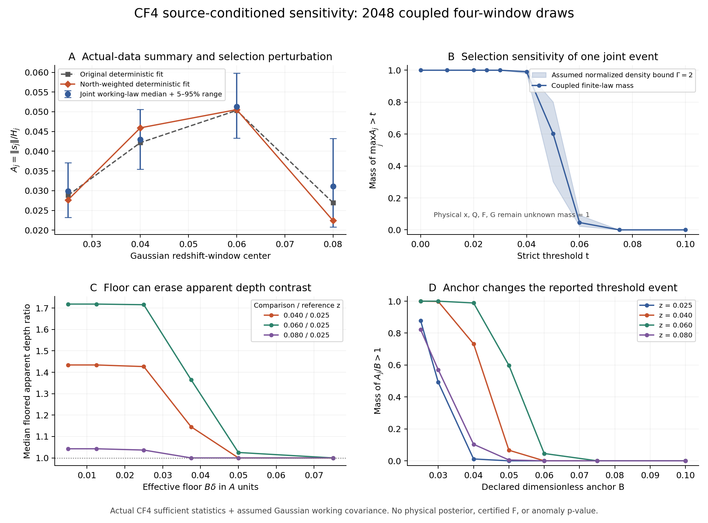

# P1/S02–S03: CF4 공동 표본의 anchor·floor·depth·selection 민감도

2026-10-18. HTT research diagnostics. **Actual-data summary reexecution; physical posterior 미승인.**

이 계산은 기존 CF4 35,970 그룹의 실제 관측 요약치로부터 2048개 공동 4-window 표본을 재구성하고, 선택 가정과 정규화가 통계량을 얼마나 바꾸는지 정량화했다. 전체 물리적 x_C, Q, F, G_F는 모든 표본에서 미측정 또는 정의역 미승인 상태로 유지했다. S02와 S03의 canonical 상태를 모두 `pending`으로 유지하는 것을 권고한다. S03의 source-conditioned 민감도 계산은 실질적으로 추가되었으나, S02의 물리적 mapping 및 source-qualified law가 아직 없다.

## 1. 재사용한 실제 출처와 재실행 범위

고정 저장소 commit: `967ef7c8f0b132ecaaba343045d333d4ebf299c1`. 입력은
`docs/research_program/observational_publication_20261015/H03_20261016/results/source_h03_v1/H03_SOURCE_TOMOGRAPHY.json`,
Git blob `538caae5212e576232b1c6b270cc084704504624`, SHA256 `5d31e2ab4fea682c538c31c15181ae7b07e11efba98b36c66aff6feca88f8326`이다.
이 JSON은 원본 4×9 계수와 **전체 36×36 공동 covariance**, 실제 north-weighted 대안 계수 및 method-deletion 변화량을 모두 보유한다. JSON 바이트를 Git blob identity에 맞춰 검증했다. `source/SOURCE_MAP.json`에는 사용한 원본 파일의 blob·SHA256이 있다.

상위 raw CF4 NPZ identity는 `86dfd896d5cf8f223396694dfb945137d1d28ea2227bc984665fb43f77fa376c`이다. 이번 실행에서 raw NPZ를 복원하거나 35,970행을 다시 fit했다고 주장하지 않는다. 정확한 실제 관측 충분통계에서 downstream pushforward만 재실행했다. 원본 H03의 diagonal velocity-noise 가정과 선택 불확실성은 그대로 남는다. 원본 창은 z=(.025,.040,.060,.080), Gaussian 폭 .012이며, 같은 그룹을 중복 사용한다.

SciPy Sobol seed 160916, 1024 scrambled 36-vectors와 그 antithetic 음수를 결합했다. 각 공동 ID는 네 창을 포함하며, 한 번만 부여한 가중치 1/2048의 합은 정확히 1이다. 이는 Gaussian working law를 근사하는 결정론적 finite measure로, 8192개의 독립 관측이나 물리 posterior가 아니다. 별도 독립 Monte Carlo 오차나 anomaly p-value를 부여하지 않았다.

재사용 검증: 원본 q_app 중앙값 네 개가 일치하며, 원본 coherent-STF test에서 rectangle lower 85/2048, coherent lower 1094/2048을 그대로 재현했다. 입력 JSON으로 재구성한 법칙이 기존 source run과 숫자상 연결됨을 확인한 것이며 raw-data refit 증거는 아니다.

## 2. 정의 → 유도 → 관측량

한 창의 apparent working coefficients를 `(H_j,D_j,s_j)`라 쓴다. H03의 STF 기저는 Frobenius-orthonormal이므로 `||s_j||_2=||S_j||_F`이다. positive H_j에서

`A_j=||s_j||_2/H_j`, `v_ja=s_ja/H_j`, `T_j(B)=A_j/B`, `B>0`.

`v_ja`의 음수는 그대로 저장했다. B는 이번 sensitivity analysis의 선언된 dimensionless anchor이며, 물리 MES shear bound가 아니다. A와 T는 물리 `x_C` 또는 `Q=x_C/U_sigma`가 아니다. 물리 sign-clean ceiling을 관측하지 않았으므로 이들을 certified F라고 부르지 않는다.

reference 창 j=0에 대해 apparent floor contrast를

`g_j(B,delta)=max(A_j/B,delta)/max(A_0/B,delta)=max(A_j,B delta)/max(A_0,B delta)`

로 정의한다. 따라서 **동일한 B delta이면 전체 paired contrast 배열이 같다.** floor가 작을 때 anchor가 상쇄되지만, 고정 delta에서 anchor만 바꾸면 effective floor가 바뀐다. 이는 physical G_F가 아닌 source diagnostic이다. 수치 0은 max-floor를 통과하는 관측값이며, missing 또는 부정 denominator는 거부한다. 미측정 물리량을 0으로 넣지 않았다.

## 3. 실제 선택 변화와 finite-law 결과

| z 중심 | A 중앙값 | working 5–95% 범위 | 실제 base fit A | 실제 north fit A | north 상대 변화 |
|---|---:|---|---:|---:|---:|
| 0.025 | 0.02987439 | [0.02320629, 0.03705731] | 0.02882516 | 0.02768206 | -3.966% |
| 0.040 | 0.04299340 | [0.03546864, 0.05056393] | 0.04216629 | 0.04592671 | +8.918% |
| 0.060 | 0.05126981 | [0.04329702, 0.05979327] | 0.05034101 | 0.05053997 | +0.395% |
| 0.080 | 0.03111974 | [0.02080593, 0.04326388] | 0.02695545 | 0.02241775 | -16.834% |

North branch는 원본 H03가 실제 CF4 방향에 `w_i -> w_i(1+0.6 n_i,z)`를 적용해 다시 fit한 값이다. 두 source는 같은 하늘이다. 대안 covariance가 저장되어 있지 않으므로 새 Gaussian draws를 만들지 않았으며, 이 상대 변화에 확률이나 유의성을 붙이지 않는다. 저적색편이와 고적색편이의 변화가 다른 점은 창/선택 정의가 결과의 일부임을 보인다.

원본 method deletion은 삭제 후 STF vector 대신 `d_j=||s_deleted-s_base||`만 저장했다. 이를 direction으로 임의 복원하지 않았다. 저장된 실제 `H_deleted=H_base+Delta H`에서

`max(0,||s_base||-d_j)/H_deleted <= A_deleted <= (||s_base||+d_j)/H_deleted`

라는 deterministic triangle outer interval만 계산했다. FP 제거시 z=.08 범위는 [0, .06357699208]인 반면 OTHER 제거시 [.02669656838, .02722046050]이다. 이는 source fit의 방법군 민감도 범위이며 물리 identified interval이 아니다. 모든 네 창·네 방법군은 result JSON에 있다.

공동 사건 `max_j A_j>.05`는 **1235/2048=0.60302734375**이다. 창별 strict mass는 [0.0, 0.06640625, 0.59814453125, 0.00537109375]이다. 네 marginal을 독립으로 곱하지 않았으며 threshold tie는 제외했다.

## 4. 정규화된 선택 가정의 sharp envelope

실제 selection을 추정하지 않고, 고정 finite measure p_i에 대한 alternative measure q_i가
`sum q_i=1`, `p_i/Gamma <= q_i <= Gamma p_i`, `Gamma>=1`
을 만족한다고 **가정**한다. 이는 normalized density envelope이며 max/min ratio Gamma 모델과 다르다. 두 점 사이 ratio는 Gamma²까지 가능하다.

known event mass e, unknown event mass u에서 sharp unrestricted-completion bound는

`L=max(e/Gamma, 1-Gamma(1-e))`,
`U=min(Gamma(e+u), 1-(1-e-u)/Gamma)`.

유도: event mass p에 대한 q(event)는 density bound로 `[p/Gamma,Gamma p]`에 있고, complement normalization으로 `[1-Gamma(1-p),1-(1-p)/Gamma]`에 있다. 두 구간의 교집합이 정확한 feasible interval이다. 양쪽 범주 내 ratio를 상수로 두면 endpoints를 달성한다; p=0,1도 별도 극한이 아닌 정확한 끝점이다. missing은 하한에서 전부 non-event, 상한에서 전부 event로 완성한다. 이 증명은 임의 physical completion의 존재를 보장하지 않는다.

위 A>.05 공동 사건의 계산 결과:

| Gamma | lower | upper |
|---:|---:|---:|
| 1.0 | 0.603027343750 | 0.603027343750 |
| 1.25 | 0.503784179688 | 0.682421875000 |
| 2.0 | 0.301513671875 | 0.801513671875 |
| 4.0 | 0.150756835938 | 0.900756835938 |

physical unknown mass u=1에서는 모든 Gamma에 대해 [0,1]이 유지된다. 선택 민감도 모델을 추가해도 미측정 물리량이 측정으로 바뀌지 않는다. 이 elementary finite-measure bound 자체의 이론적 novelty를 주장하지 않는다. contribution 후보는 source-coupled 실제 통계량과 물리 미측정 mass를 함께 유지하는 분석에 한정된다.

독립 계산: 네 개의 비균등 원래 질량 (.05,.15,.3,.5)에 대해 Gamma 다섯 값과 네 event/missing patterns의 **20개 양끝 LP**, 총 40개 최적화가 위 공식을 재현했다. coordinator의 Wolfram 검증도 다음 denominator-crossmultiplied equivalence를 `True`로 반환했다:

```wolfram
Resolve[ForAll[{p,g,q},Implies[0<=p<=1 && g>=1,
 Equivalent[g q>=p && q<=g p && g(1-q)>=1-p && 1-q<=g(1-p),
 q>=p/g && q>=1-g(1-p) && q<=g p && q<=1-(1-p)/g]]],Reals]
```

위 Wolfram 결과는 coordinator가 전달한 독립 검증이며, 이 worker가 직접 호출한 기록은 아니다. provider receipt는 상위 publication package에 포함한다.

## 5. floor와 depth 결과

| effective floor B delta | median g(.04/.025) | median g(.06/.025) | median g(.08/.025) | tie mass g(.08/.025)=1 |
|---:|---:|---:|---:|---:|
| 0.0050 | 1.434265 | 1.718693 | 1.042713 | 0.00000000 |
| 0.0125 | 1.434265 | 1.718693 | 1.042713 | 0.00000000 |
| 0.0250 | 1.426741 | 1.715694 | 1.036724 | 0.01855469 |
| 0.0375 | 1.145397 | 1.365249 | 1.000000 | 0.78710938 |
| 0.0500 | 1.000000 | 1.025396 | 1.000000 | 0.99462891 |
| 0.0750 | 1.000000 | 1.000000 | 1.000000 | 1.00000000 |

effective floor .075에서는 모든 draw·depth의 ratio가 정확히 1이 되어 strict `g>1` mass는 0이다. 이는 관측 하늘이 isotropic이라는 결론이 아니라, 큰 floor가 구분을 지운 결과다. 반대로 `.005`의 depth contrast median 1.718693은 같은 표본에서 `.05`를 쓰면 1.025396이 된다. 숫자 0, floor tie, unknown은 구별된다. 이 분석 grid는 원자료를 이미 본 뒤 선언한 sensitivity grid이며 preregistered detection threshold가 아니다.



그림: A는 joint working-law quantile와 실제 두 deterministic selection fits, B는 하나의 coupled event 및 가정한 density envelope, C는 floor 민감도, D는 anchor threshold 민감도이다. 각 패널은 동일 source를 사용한다. B의 음영은 physical confidence band가 아니다.

## 6. 검증·실행·DAG 판정

`test_functional_sensitivity.py`의 local selected-subset unittest는 **12/12 PASS**다. source exact blob, antithetic joint identity, orthonormal STF/Frobenius 계약, 원본 event counts, negative preservation, nonpositive anchor rejection, zero/missing 구분, strict tie, shared-row permutation, floor product identity, density endpoints/LP, unknown mass 보존, 실제 alternative fit을 검증했다. 첫 실행에서 Gamma=1의 `1-(1-e)` cancellation이 `0.30000000000000004`가 되는 endpoint 문제가 드러나 identity branch `[e,e+u]`를 명시했고 재검증했다. 테스트 tolerance를 늘려 숨기지 않았다.

실행 환경: Python 3.12.14, NumPy 2.3.5, SciPy 1.17.0; interpreter `/opt/codex/runtimes/codex-primary-runtime/dependencies/python/bin/python`. primary checkout tests, raw refit, native solver, ODE, physical transfer, coverage calibration: **NOT_RUN**. independent review는 상위 coordinator가 수행한다.

```bash
python functional_sensitivity.py
python -m unittest -v test_functional_sensitivity
python plot_functional_sensitivity.py
python build_report.py
```

`results/paired_functional_arrays.npz`는 original persistent IDs, exact weights, 공동 원본 draws, signed components, anchored apparent scores와 depth arrays를 포함한다. physical x/Q/F/G는 명시적 NaN과 typed missing-reason arrays로 저장하고, JSON에서는 unknown mass 1 및 [0,1] outer envelope를 유지한다. 절대 known-only renormalization을 하지 않는다.

**S02 pending:** source-conditioned pushforward와 unknown mass acceptance는 계산상 구현되었으나 canonical next action인 physically admissible joint mapping/selected likelihood가 아직 없다. **S03 pending:** 유의미한 실제 anchor/floor/depth/selection sensitivity evidence를 추가하되, S02 dependency와 physical functional admission이 남아 있다. S04 이후나 P1 submission readiness를 승격하지 않는다. 이는 네이티브 solver 부재를 근거로 한 strong no-go가 아니며, 부족한 실제 source/transfer qualification을 명시하는 제한된 판정이다.
