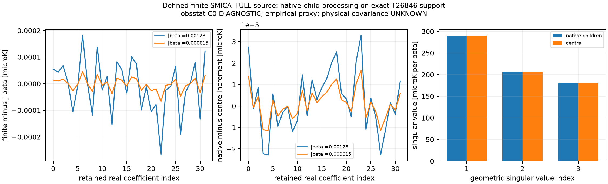

# V02 source-defined finite native-child 처리 확장

obsstat / C0 / DIAGNOSTIC_ONLY / non-claim-bearing. Author 실행 완료이며 fresh independent review 대기 중이다.
원래 acceptance “Matched mask/beam/input and mode leakage”를 보존했다. 기존 centre candidate의 모든 byte와 일곱 실험을 보존했고 재실행하지 않았다.

원본 SMICA_FULL saved fit로 정의한 같은 s=a_fit/b_INT를 사용했다. 실제 INT_BEAM 1회 → native2048 합성 → 원래 source-valid 1024-child 평균 → 정확한 T26846 선택 → RING64 centre ell0..5 OLS → ell2..5 유지 순서이다.
원래 producer의 finite(I_STOKES) 및 I_STOKES>-1e20 조건을 실제 native I에서 한 번 확인해 고정했다. 선택 mask는 cache confidence>.5와 TMASK coverage>=.995의 원래 규칙이다.

선택 mask SHA256 `98c90cbd186aceed02f6692ef83685b44d0f7f22569f218ea2936dcfafcedfbf`. 선택 parent의 최소 실제 value coverage=0.9951171875; TMASK-valid이지만 I-invalid인 native 수=0.

별도 baseline mismatch ||A_native B_INT s-a_fit||=0.0254908978869 microK (최대 절댓값 0.0134023136057). 이 차이를 강제로 0으로 만들거나 source를 재정의하지 않았다. 최종 주입은 a_fit+d_native이다.

| beta 크기 | native increment norm (microK) | finite-Jbeta norm (microK) | remainder/beta² (microK) | native-centre increment (microK) |
|---:|---:|---:|---:|---:|
| 0.00123 | 0.238539052932 | 0.000564597064243 | 373.188620691 | 7.98815377693e-05 |
| 0.000615 | 0.119266313454 | 0.000141147273669 | 373.183352948 | 3.99345174072e-05 |

방향은 (1,2,3)/sqrt(14)라는 설계점이며 velocity 추정값이 아니다. 각 32성분 finite 잔차, 처리 차이, baseline mismatch와 a_fit+d_native는 NPZ에 보존했다.

native J geometric singular values (microK/beta): 290.089198644, 206.420252237, 179.822266262.
native-centre J operator norm 차이=0.0799828357737 microK/beta.

zero increment propagation bound=2.03312165752e-11 microK (<=1e-9). FWL/joint 최대 차이=7.1054273576e-14 microK/beta (<=1e-8). Constant nuisance retained 최대값=1.44654253853e-15 microK.
여섯 native field의 direct-realY synthesis 최대 차이=2.62900812231e-13 microK; partially masked parent를 포함한 explicit child-sum 최대 차이=5.68434188608e-14 microK.

새 focused tests 4 PASS (1.17s): sine/cosine harmonic 합성, partially masked child reducer 및 constant, joint/FWL 및 monopole, invalid geometry. 전체 repository suite NOT_RUN. Native full map은 여섯 개만 한 번에 하나씩 처리했다. First failure가 있으면 EXECUTION_RAW.log에 보존한다.

32x64/48x96 quadrature 및 ell12/16 finite coefficient 비교의 propagation envelope는 JSON에 있다. 이는 명시한 유한 coefficient 차이의 비교용 상계이며 infinite Lorentz tail, physical covariance 또는 물리 uncertainty가 아니다.
Physical upstream processing mapping, covariance, identified physical rank는 UNKNOWN이다. 이는 이 정의된 finite operation을 수행할 외부 blocker가 아니다. local/global 분리, posterior, p-value, 물리 velocity 또는 Bianchi-family admission은 없다.

실행 62.056s; Python 3.12.3, NumPy 2.5.4, healpy 1.19.0; BLAS/OMP/MKL 각2 threads. Requested gpt-6.1-sol/high, observed UNKNOWN. Child commit/push 및 DAG 변경 없음.

그림 provenance: owner obsstat; category DIAGNOSTIC; C0; transfer empirical_proxy; null NOT_QUALIFIED; covariance UNKNOWN. Allowed use는 저장된 유한 source의 linearization 및 processing 비교이다. 물리 유의도·velocity·local/global rank·geometry/family 식별에 사용하지 않는다. Source는 results/NATIVE_RESPONSE.json 및 NPZ, 생성기는 finalize_native.py이다. 무작위 생성 없는 결정론적 그림이다.

Fresh read-only reviewer만 PASS_SCOPED_V02_SOURCE_DEFINED_FINITE_NATIVE_PROCESSING 여부를 판단한다. Parent가 그 결정에 따라 원래 V02 node와 다음 READY transition을 처리한다.
