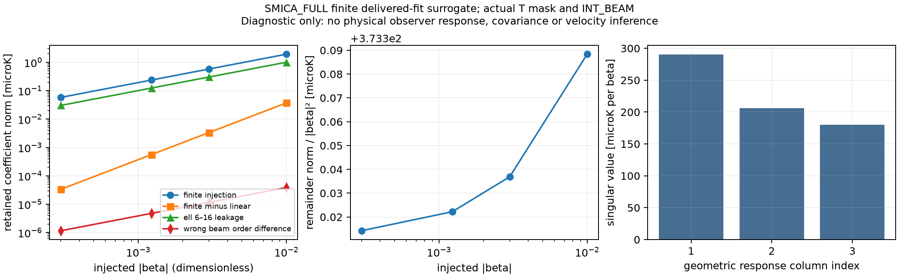

# V02: 실제 T source에 묶인 finite delivered-fit counterfactual

obsstat / C0 / DIAGNOSTIC_ONLY / non-claim-bearing. Fresh independent review 전
author 단계이며 original V02의 완료 또는 과학적 admission을 선언하지 않는다.

원래 objective는 “Inject finite local observer boost through the actual processed
Planck source”, output은 “local response columns with covariance/error envelopes”,
acceptance는 “Matched mask/beam/input and mode leakage”이다. 이 기준을 변경하거나
full physical-null qualification을 V02의 추가 gate로 만들지 않았다.

원본 NPZ의 SMICA_FULL masked-fit ell2..5 계수로 유한 source를 **정의**했다.
이를 실제 SMICA INT_BEAM의 같은 ell2..5 항으로 나눈 뒤 exact scalar finite
Lorentz pullback → 실제 INT_BEAM 1회 → RING64 합성 → 실제 T26846 mask →
ell0..5 동시 OLS → ell2..5 유지 순서로 처리했다. 원본 계수가 intrinsic sky
계수라는 가정, 알려지지 않은 물리 monopole/high modes의 zero filling은 없다.
좌표는 outward, beta=v/c, metric(-,+,+,+), signed perturbation의 Doppler weight1이다.
세부 정의와 식, 출처 및 acceptance mapping은 METHOD_AND_ACCEPTANCE.md에 있다.

## 실제 실행 결과

실제 common/HM/OE TMASK를 native에서 AND하고 parent coverage>=0.995 및
기존 K1 confidence>0.5를 적용해 26,846개 RING64 support를 재구성했다.
mask SHA256: `98c90cbd186aceed02f6692ef83685b44d0f7f22569f218ea2936dcfafcedfbf`.

| 방향 | beta | finite 주입 norm (microK) | finite-linear (microK) | ell6..16 누출 (microK) | 잘못된 beam 순서 차이 (microK) |
|---|---:|---:|---:|---:|---:|
| generic | 0.0003 | 0.058194469 | 3.35982809e-05 | 0.0303666405 | 1.16589591e-06 |
| generic | 0.00123 | 0.238607057 | 0.000564799182 | 0.124495185 | 4.77930089e-06 |
| generic | 0.003 | 0.582013731 | 0.00336003207 | 0.303606942 | 1.16527958e-05 |
| generic | 0.01 | 1.94064732 | 0.0373388367 | 1.0113902 | 3.87900517e-05 |
| x | 0.00123 | 0.266287112 | 0.000667200518 | 0.0502084253 | 4.53308119e-06 |
| y | 0.00123 | 0.339034689 | 0.000877063592 | 0.102555067 | 4.06015707e-06 |
| z | 0.00123 | 0.234442842 | 0.000462698118 | 0.10980083 | 4.0093942e-06 |

generic 방향은 (1,2,3)/sqrt(14)라는 설계점이다. beta=.00123은 주입 크기이며
관측 solar velocity를 추정한 값이 아니다. generic remainder/beta²는 위 유한
주입점에서 373.314233–373.388367 microK 범위이다. 원본 범위 밖의 source에 대한
보편적 remainder bound로 해석하지 않는다.

이 finite masked map의 32x3 local derivative geometric singular values는
290.1641928, 206.4748584, 179.8747163
microK/beta이다. 수치 rank는 3이지만 covariance-whitened
rank가 아니며 foreground/calibration nuisance 전체를 제거한 물리 rank는 UNKNOWN이다.
pixel monopole/dipole만 실제 selected design에서 FWL로 quotient했다.

## 검증과 오차 진단

- unchanged 원본 T ell6..16 leakage matrix 최대 차이: 3.60822483e-16.
- beta=0 원본 retained coefficient replay 최대 차이: 1.42108547e-13 microK.
- FWL quotient vs simultaneous fit 최대 차이: 8.17124146e-14 microK/beta.
- h=1e-5 vs 5e-6 finite-difference operator 차이: 5.56416431e-08 microK/beta.
- unchanged analytic generator vs saved derivative 상대 operator 차이: 7.17123221e-11.
- 주입 전체의 32x64 vs 48x96 quadrature 최대 retained 차이: 1.37364198e-12 microK.
- ell12 vs ell16 cutoff 최대 retained 차이: 2.45934301e-14 microK.

위 quadrature/cutoff 비교는 empirical numerical diagnostics이며 certified
infinite-tail bound 또는 physical sampling covariance가 아니다. response columns,
주입·remainder·누출·잘못된 beam 순서 차이는 NPZ에 함께 보존했다.
초기 새 unit-test의 두 roundoff 실패는 FIRST_FAILURE.txt의 raw output에 남겼다.
최종 focused tests는 8 PASS; 전체 repository suite는 NOT_RUN이다.

## 원래 acceptance에 대한 정확한 범위

source archive·actual TMASK·actual INT_BEAM·masked finite leakage가 연결된
finite counterfactual과 pixel monopole/dipole-projected local columns를 계산했다.
단, 실제 released Planck frequency/component-separation/calibration processing에
upstream observer injection을 운반하는 응답은 이 source fit만으로 정해지지 않는다.
이를 보충할 실제 bandpass/frequency response와 processing/frame mapping은 제공되지
않았다. 물리 response uncertainty와 covariance는 UNKNOWN으로 남겼다.

native-child masked averaging은 로컬에서 실행할 수 있는 별도 연산이다.
이번 RING64-centre counterfactual에서는 NOT_RUN이며 external missing input으로
기록하지 않는다. 기존 L01 finite response가 해당 확장을 지원한다.
physical source의 미지 high modes, polarization 및 upstream processing remainder는
유한 source 정의로 제한되거나 bound되었다고 주장하지 않는다.

Matched signal/noise/foreground law는 downstream 통계 해석의 제한이며 V02의
새 acceptance gate가 아니다. fresh reviewer가 원래 acceptance와 실제 지원되는
source 범위를 판단해야 한다. V03 global-history response, local/global inference,
physical observer velocity, likelihood/p-value, native solver 결과는 생성하지 않았다.

## Runtime 및 산출물

실행 440.018s; Python 3.12.3, NumPy 2.5.4,
SciPy 1.18.1, healpy 1.19.0; BLAS/OMP/MKL 각2 threads.
requested gpt-6.1-sol/high; observed model/effort UNKNOWN. source byte identities와
실제 beam 값은 generated result JSON에 있다. claim-bearing publication은 없으며
child commit/push도 하지 않았다. parent의 다른 lane 파일은 수정하지 않았다.

그림은 위 생성 결과만 사용한다. 실제 mask/beam 아래 유한 주입, linearization
remainder, high-mode leakage 및 geometric singular values를 보여준다. covariance,
physical velocity 또는 local/global 식별 claim은 담지 않는다.
