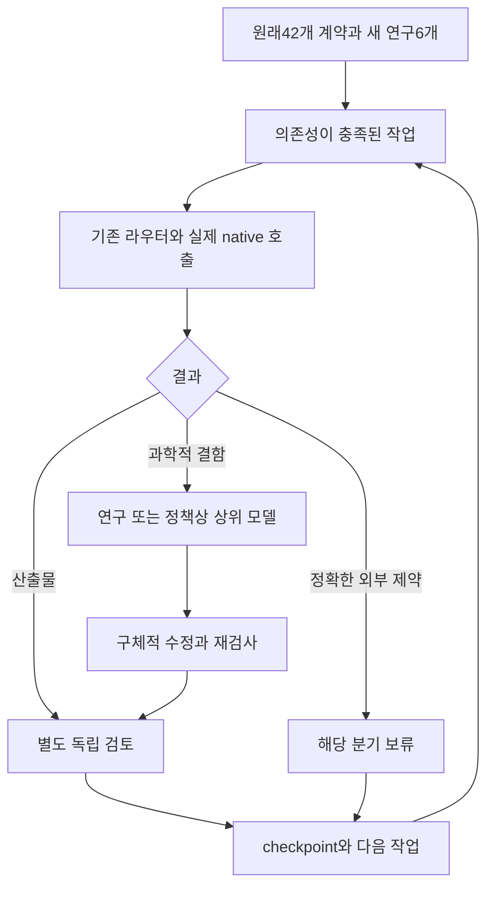

# 18/42 정체 감사와 전체 DAG 연속 실행

대상: PR561, intake HEAD `a8e66da28461a415f5da3b3d609c482554d2dcd1`.
2026-10-23 한국 날짜의 연구 재개 기록. 원래42개 과학적 합격 기준을 바꾸지 않는다.

**진단: 단순히 한 번 실행하고 멈춘 것이 아니다.** 이전 인계 커밋
`a8fd176305fb475947a46f9dacb651805d323741` 이후5개 커밋에서 실제 분석7개가
진행됐지만, 그 조건부 결과가 원래 노드의 합격 조건을 만족하지 못했다.
여기에 모델을 선택하는 라우터와 실제 반복 실행을 연결하는 제어기의 부재가 겹쳤다.
소스에서 확인한 결함과 과거 각 세션의 종료 원인에 대한 추정은 구별한다.
과거 모든 로컬 세션의 종료 로그를 관측한 것은 아니다.

## 무엇이 실제로 진행됐나

| 커밋 | 새로 수행한 일 | 원래 합격 기준이 남은 이유 |
|---|---|---|
| d256ed4 |755850개 Quaia/Gaia proper-motion 결합 | 표본 결합은 실제 공간 공분산·선택 법칙이 아님 |
| e638029 | 스펙트럼 수송·선택된628개 cohort 분석 | mark likelihood에 물리적 거리 인자 F_or가 아직 없음 |
| 9f0beb6 | 적색편이 E/B32모형과 whole-field coverage | omitted-l4 coverage0.28418, template-mean0 실패 |
| 120c8a7 | morphology/counterpair·30+15 처리창 실험 | 처리 민감도는 물리적 matched null이 아님 |
| a8e66da | 공개 SN01001023행 fit | chi2/19=3.2323283>3, 공개 요약과 baseline parity 미재현 |

18/42는 명시적 V03 alternate-output 정책을 적용한 scoped 완료 수다. 원래 외부
EB 출력 요구를 그대로 적용하면17/42다. 이번 수정은 이 숫자를 올리지 않으며,
6개 논문은 모두 NOT_READY_TO_SUBMIT이다. 검증된 조건부 연구를 무가치하게
취급하지 않되, 큰 과학 계약을 충족했다는 표시와 혼동하지 않는다.

## 재현된 근본 원인과 수정

| 원인 | 관측 증거 | 이번 수정 | 성공 판정 |
|---|---|---|---|
| 계획을 실행으로 오인할 수 있음 | native_routing는 의도적으로 launch_performed=false | 기존 라우터 위에 durable host 제어기 추가 | 실제 agent ID ack와 실제 outcome 필요 |
| 원래 DAG ready=0을 전역 종료로 사용 가능 | 기존 packet 출력 ready node0·ready action0 |42개 계약+새 연구6개를 한 campaign으로 연결 | blocked branch와 독립 READY branch 구별 |
| worker 단계 종료가 전체 종료로 번짐 | 첨부 executor05는 한 next step을 고르고 validated/blocked에서 단계 종료 | worker 종료 뒤 host의 next 의무를 current context에 전달 | implementation→review→next 실증, 회귀 검사 |
| 모델 결함을 데이터/연산량으로 우회 | l4/mean stress 실패, 더 많은 source만 확보 | 유한 nuisance span을 직접 제거하는 score quotient | 실패 원인 자체가 제거되는지 검사 |
| 좁은 산출물과 원래 acceptance의 거리 | mark-only, observer-only, operator-only 결과 | 각 새 작업의 enables_nodes와 원래 acceptance를 함께 보존 | scoped 결과로 원래 노드 자동 승인 금지 |
| 오래된 주입 문서의 지시 충돌 | current pack에 전역 PR4 skip, 최신 계획에는 source-bound PR4 분석 | frozen PR122 범위와 현재 승인된 계획을 구분, pack 재생성 | 기존 frozen 계약을 수정하지 않고 current 지시만 일치 |

"의욕 부족", "모델이 약해서" 같은 설명은 증거가 아니다. 어떤 추정량, 어떤
입력, 어떤 종료 전이가 진전을 막았는지 반증 가능한 문제로 좁혔다. 높은 모델은
관측 입력을 만들어낼 수 없다. 반대로 이론·추정량 결함을 단순 외부 입력 누락으로
분류해 연구를 끝내서도 안 된다.

## 실제 연구 루프 산출물

`THEORY_AND_RESULTS.md`, `ASTROMETRY_RESULT.json`, `contrast.svg`를 함께 읽는다.
공통 observer E1를 제거하려는 원 아이디어를 고정 GLS에서 정확히 살리고,
posterior shrinkage·모형 혼합에서는 자동으로 성립하지 않음을 실제64모형으로
계산했다. 그 차이는 작아서 큰 coverage 실패의 원인으로 과장하지 않는다.
더 큰 실패에는 이미 보유한102열 score를 사용해 l2/l3/l4 및 선택 template의
유한 nuisance span을 제거하는 별도 계산 경로를 구현했다.

이론 질문은 기존 라우터의 blocker_escalation으로 실제 Astra/ultra에 전달했다.
코딩·그림 작업은 실제 지원되는 gpt-6.1-sol/medium fallback으로 수행했다.
독립 검토는 별도 Astra/xhigh다. requested/selected와 observed는 별개이며,
독립 runtime 관측이 없는 항목은 UNKNOWN이다. `REVIEW_AND_EXECUTION.json`에
실제 수행·검토·제한을 기록한다. 모델 이름을 적은 것만으로 escalation을 했다고
주장하지 않는다.

## 다음 과학 목표와 PR 작업 단위

기존 PR561에 이번 연속 실행 수정과 실제 summary 연구 결과를 push한다. 아래는
새 GitHub PR이 이미 열렸다는 뜻이 아니라, 이후 독립 검토할 개발 단위다.

| 작업 | 실제 다음 산출물 | 연결되는 원래 노드 |
|---|---|---|
| R23-Q | 보유102x102 score로 nuisance quotient·estimability·실패 controls 재검사 | K03/K05 |
| R23-DISTANCE |628개 cohort의 실제 거리 인자·선택 normalizer·undefined mass | H02/S02 |
| R23-SN | producer-supported model-error 반영 후 원래 기준의 baseline 적합성 | V04/H04 |
| R23-CMB | paired map 공통장·차이장 식별 및 실제 새 nuisance 실험 | L03 |
| R23-CONGRUENCE | 동일 관측자/소스 convention에서 응답과 nuisance quotient 합성 | K04/S04 |
| R23-ATLAS | 새 existing numeric atlas 경로만 검증하거나 정확한 잔여 입력 기록 | B02 |

기계가 읽는 목표·입력·합격 조건·repair ID·연결은 `FRONTIER.json`에 있다.
빌더가 원래42개 노드 전체를 가져와 총48개 task를 만든다. 기존18개는 source에
기록된 scoped evidence를 재사용하며 새로 검증했다는 뜻이 아니다. 새로운 작업의
합격은 downstream 원래 노드를 다시 검토할 기회를 만들 뿐, 자동 합격이 아니다.
순서상 한 lane의 외부 atlas가 다른 lane의 진전을 막는 전역 barrier는 없다.

## 남은 자료와 실행 환경

가장 가까운 다음 계산에는 대용량 새 다운로드가 아니라 이미 만들어 둔 두 파일이
필요하다. `full_stats.npz`와 `margin_stats.npz`의 G/b만 약84kB씩이고, 정확한
압축 파일 크기는 이번 세션에서 확인하지 못했다. 경로·해시는 THEORY_AND_RESULTS에
있다. 원래 과학 합격을 위한 잔여 자료는 다음과 같다.

- Gaia의 cross-source 공간 오류·classifier 선택 법칙과 동일 congruence의
  PM/NNR/clock 물리 응답. 위치 covariance만으로 대체할 수 없다.
- CF4/SN의 실제 contributor genealogy, parent targeting/quality, shared calibration
  및 PV/selection joint law 또는 자료로 정당화한 outer bound.
- SN010010의 정확한 producer nominal configuration, model-error/covariance 및
  observed FITRES binding. 현재 공개 파일의 부족을 임의 variance로 메우지 않는다.
- CMB의 같은 release·mask·beam·weights·realization에 맞는 processed-total,
  foreground/noise joint law와 통계량별 calibration.
- 이미 존재하는 polarized all-m T/E/B physical atlas와 IC/frame/units/history.
  이를 만들기 위한 native solver/ODE 작업은 이번 범위 밖이다.

공개 무인증 자료의 product/aggregate/expanded 다운로드 상한은 없다. 외장하드의
실제 mount와 여유 공간,2GiB reserve를 확인하고 cache를 우선한다. 권한 벽을
우회하지 않는다. 같은 실패 검색·완료된 catalogue campaign을 이유 없이 반복하지 않는다.

이번 세션에서 Remote Desktop Commander는 월간 사용량 한도 때문에 첫 명령을
거부했다. 기기는 연결된 상태이며 재시작·재연결이 필요한 오류가 아니다. 소유자
로컬 checkout/cache의 현재 상태는 관측하지 못했고 로컬 하네스 활성화를 주장하지
않는다. GitHub의 고정 소스와 작은 patch fixture에서 계산·검사를 수행했다.
로컬 Codex는 이 transport 없이 기존 checkout에서 인계 프롬프트를 실행할 수 있다.

## 완료 판단과 계속 실행

노드 하나를 마친 뒤 종료하는 것은 성공이 아니다. 실제 결과·독립 검토 후 다음
ready action을 즉시 실행한다. scientific-ready가0이면 acquisition/research를
검토한다. 상위 모델의 구체적 repair도 실패하면 같은 one-use 예산을 이름만 바꿔
초기화하지 않고, 새 입력/질문을 구체화하거나 해당 분기의 정확한 hold를 남긴다.
다른 lane은 계속한다. 모든 원래 acceptance를 충족했을 때만 과학적 완주라고 쓴다.
실제 host/session 종료나 외부 입력 때문에 중단되면 checkpoint와 다음 명령을 남기며,
백그라운드에서 계속 실행 중이라고 말하지 않는다.
