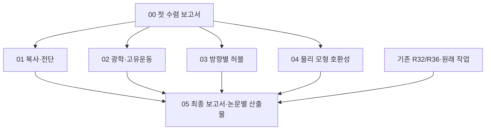

# HTT 연구 수렴 — 보고서부터 완결하기

이번 실행의 목표는 기존 연구와 새 이론 결과를 사용해 단계별 최종물을 만드는 것이다. 새 연구 프로그램이나 별도 실행기를 만들지 않는다. 현재 42개 과학적 기준, 여섯 논문 계약, R32/R36 제품과 진행 중인 세션을 보존하고, 기존 DAG에 유한한 6개 delivery unit을 연결한다.

기준 소스는 `research/htt-adaptive-methods-20261023`의 `bdead6a8f51282ca647224b460b0f65de085568b`다. 10월 28일의 R36-06 push는 검토된 streaming helper와 lifecycle 시험 소스이며, MC100 또는 새로운 PR4 과학 결과의 완료 증거가 아니다.

마지막 대조 중 올라온 `679f2c5e434abcb78f330b540ae457b32d9f7a8a`도 반영했다. R36-11의 검토된 PR4 manuscript consumer 준비본이며, 실제 MC100 과학자료의 qualification과 최종 원고 검토는 아직 필요하다. `UPSTREAM_DELTA.json`이 당시 두 상태를 구분한다.

## 먼저 읽을 산출물

- `baseline/BASELINE_REPORT.pdf`: 현재 결과를 네 물리 목표로 정리한 첫 보고서 후보.
- `imports/four_goals/output/HTT_FOUR_GOALS_FIBRE_20261028.pdf`: 37쪽 상세 이론 보고서와 여섯 과학 도표.
- `imports/foundations/output/HTT_METHOD_FOUNDATIONS_20261028.pdf`: 정초·정보 보존·저장된 Gaia 법칙 비교.
- `imports/four_goals/sources/user_attachments/`: 사용자가 제공한 MF02 통합 노트와 광학 `main.pdf` 원본. 이론·유도 자료이며 관측자료 또는 검출기 보정 산출물을 대신하지 않는다.

새 자료는 필요한 원본·재현 코드·작은 결과·도표로 올렸다. 원시 관측 카탈로그, 대용량 FITS 및 외부 논문 전문은 새로 올리지 않았다. 이전 보고서의 실행·검토 기록은 당시 기록으로 보존한다.

## 유한 DAG

화살표 B–E→F는 **완료된 과학 결과를 반영하는 흐름**이다. 실행기의 hard dependency는 첫 보고서의 qualification이며, 최종 보고서는 나머지 실행 가능한 작업보다 뒤로 배치한다. 미확보 외부 입력 때문에 최종 문서 자체가 생성되지 않는 all-success barrier를 만들지 않는다. 미완료 분석은 HOLD로 남기고 최종 보고서에 정확한 잔여 의무를 기재한다.

| 순서 | 실행 task | 실제 산출물 | 다음 행동 |
|---|---|---|---|
| S0 | R37-00-FIRST-REPORT | 기존 수치·물리 설명·그림을 통합한 영어 보고서와 기존 task 범위 | 추가 카탈로그 적합 전에 보고서 확보 |
| S1 | R37-01-RADIATION | 공통 복사 표현, 편광 생략 오차, 전단 support 비교 | 해당 장과 그림 갱신 |
| S1 | R37-02-KINEMATICS | 광학 일치성, 실제 식별 방향, 공통 물리 오차영역 | 광학 논문 보충부·방법 비교 갱신 |
| S1 | R37-03-HUBBLE | 기존 방향별 SN/CF4 결과와 감쇠·보정 민감도 | 허블/광학 장 갱신 |
| S1 | R37-04-CLASSIFICATION | 공급된 물리 family의 호환집합·분리·부호 안정성 | 기하학/분류 장 갱신 |
| S2 | R37-05-FINAL-REPORT | 정제된 통합 보고서, 논문별 발췌본, 재현 자료, 잔여 의무 | 이번 release 종료 |

`DEVELOPMENT_PLAN.md`는 계산과 해석, `DATA_ANALYSIS_CONTRACTS.md`는 실제 파일·함수·입력·도표, `FRONTIER.json`은 기존 controller가 소비하는 계약이다. `RUN_CONTRACT.json`과 `OUTPUT_DAG.json`은 우선순위·단계·종료조건을 제공한다. `HANDOFF_CURRENT_SESSION.md`를 진행 중인 세션에 적용한다.

## 실행 방식의 수정

기존 `next`는 `(last_turn, task_id)`로 정렬하여 계획 문서의 우선순위를 소비하지 않았다. 또한 adaptive가 켜진 상태에서 모든 일이 막히면 새 discovery packet을 만들었다. 재현된 두 동작에 대해 기존 실행기에 선택적 `--prefer-task`, `--defer-task`, `--no-discovery`만 추가했다. 플래그를 사용하지 않으면 기존 동작은 같다. 이미 발급·실행 중인 packet과 acquisition-resume reservation이 항상 우선한다.

이 release에서는 첫 보고서와 네 분석을 우선하고, 최종 보고서는 알려진 실행 가능 작업 뒤로 미룬다. 새 discovery를 시작하지 않는다. 현재 issue에 대한 기존 research/escalation/repair와 원래 task의 적격 입력 취득·resume은 계속 사용할 수 있다. `next`는 dispatch 자체가 아니므로 host가 실제 spawn→ack→record→독립 검토→next를 수행한다.

## 완료와 종료

완료된 과학 계산은 다시 수행하지 않는다. 새로운 비교·공통 오차 전달·변경된 장만 계산한다. 각 분석은 현재 자료로 가능한 substantive conditional/sensitivity 결과를 먼저 완결하고, 더 강한 관측 해석의 입력은 해당 원래 gate에 남긴다. source-gap 목록이나 계획서만으로 분석 제품을 qualify하지 않는다.

기존 task는 uptake 시 현재 state에서 ID 목록을 고정한다. 완료 제품은 재사용하고 실행 가능한 나머지는 계속 수행한다. 최종 보고서 직전에 아직 수행 가능한 acquisition·repair·resume이 있는지 확인한다. 실제 외부 입력/능력/소진된 할당 때문에 남은 작업은 정확한 HOLD와 재개 입력을 기록한다. 모든 실행 가능한 scoped 작업을 마치고 최종 PDF·소스·도표·검토를 확보하면 종료한다. 새 frontier나 R38 연구주기를 자동 생성하지 않는다.

원래 17/42와 analytic alternate 18/42는 이전 scientific checkpoint의 별도 수치다. 이번 보고서 생산이나 조건부 분석 완료로 이를 올리지 않는다. 기존 여섯 논문을 제출 가능한 상태로 일괄 승격하지 않으며, journal 제출·main merge도 수행하지 않는다.
