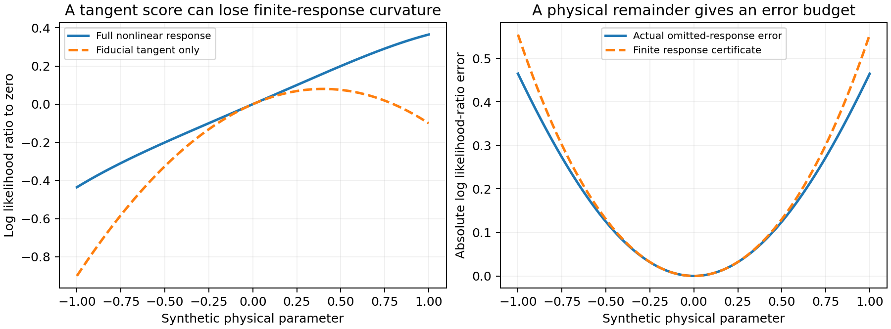
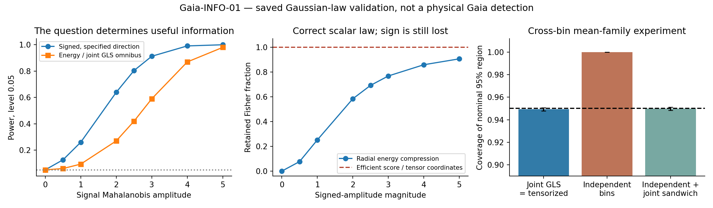
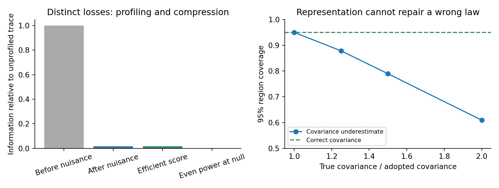

# The physical question and the result of this pass

The programme can recover its original physical purpose: use signed, joint sky morphology to constrain specified spacetime or radiation quantities, then compare their physically admissible images with an FLRW reference and with anisotropic families. Its natural output is a likelihood or an identified/confidence region for those quantities. The five objects $(x,F,Q,\Pi,G_F)$ organize that inference; they are not five independent observations or five likelihood factors.

The latest inspected active-branch head is `7f3f49a6b6d9` (full identity in the source manifest). PR #563 has been merged and followed by actual conditional CF4, PM, optical, radiation, supernova and geometry results. In particular, the five-component PM history response and the common-input nonlinear radiation comparison now exist as qualified scoped products. The older report's statement that these were future tasks is no longer the current state. This pass reads their result interpretations and qualification records; it does not rerun their catalogue analyses or alter their acceptance.

The new calculation here is **Gaia-INFO-01** on the exact saved 24-dimensional Gaussian carrier. It establishes four complementary results: matched tensor coordinates preserve joint GLS; the correct scalar energy preserves its omnibus test; early compression can completely erase a different slope estimand; and a score optimal for one depth family can erase discrimination against another. A common family carrier repairs the last loss exactly. The radiation and optical physics below determine which statistical directions have physical meaning.

There are two levels of response preservation. At the physical level, energy moments of ranks 0,2,4 preserve the radiative shear operator, even when other kinetic information remains unresolved. At the statistical level, a subspace of the measured coefficients can preserve the likelihood ratios for a declared response family. Neither level requires retaining all tensor or sky components forever. Both require specifying the response before discarding its relevant directions.

This is an internal foundation study. No push, live-controller change, solver evolution, ODE integration or raw Gaia catalogue refit was performed. The report keeps established identities, reused physical results and newly executed finite comparisons distinguishable through their source records.

# Define the physical null before defining its distance

Choose a matter congruence, an observer tetrad and a positive local expansion scale $H$. Let $\Sigma_{ab}$ and $\Omega_a$ be physical shear and vorticity rates, $A_a$ proper acceleration, and $\beta_{RM}$ radiation–matter relative velocity. A dimensionless physical target is

$$\theta_{\rm kin}=\big(\Sigma/H,\ \Omega/H,\ A/(cH),\ \beta_{RM}\big).\tag{1}$$

The symmetric trace-free shear has five components; the other displayed vectors have three each. This count presumes that all sectors are free in the selected physical family. A geodesic dust family instead fixes $A=0$ by its equations. It does not measure that zero from a sky likelihood.

For the standard common-rest-frame matter/radiation FLRW model these quantities vanish. Observer velocity $\beta_{MO}$ can be nonzero in that same universe and belongs in the observation response. It must not be added to a geometric departure norm as though it proved anisotropic expansion. Relative matter/radiation motion is a different physical target.

Two nulls serve different questions. The exact geometric null specifies the fundamental FLRW congruence and its zero tensors. A stochastic perturbed-FLRW null also includes local peculiar motions, shear, radiation anisotropies and selection effects generated by its perturbations. A nonzero local shear can reject the first at an event while remaining ordinary under the second. Vanishing selected local tensors at one event is also insufficient to characterize global FLRW geometry.

| Axis | Required declaration | Role in the inference |
|:--|:--|:--|
| Symmetry and redundancy | Coordinate chart, passive triad rotations, harmonic phases, observer transformation, statistical nuisance | Transform data, response and covariance together; do not identify observer motion with a passive coordinate change. |
| Invariant | Transformation group and retained physical question | A norm may preserve an amplitude question while losing signed orientation or a model likelihood ratio. |
| Observable | Field, instrument, sky processing, source/depth selection and joint error law | Temperature, intensity, E/B polarization and PM coefficients are different carriers. |
| Physical quantity | Congruence, frame, clock, units and forward response | A sky quadrupole acquires the meaning of shear only through its radiation or optical response. |

# MES as a physical reference and a signed inverse

MES refers here to Maartens–Ellis–Stoeger. Their transport and constraint **equalities** relate radiation moments and derivatives to kinematics. The familiar **bounds** follow by taking norms and imposing derivative and matter assumptions. A bound can anchor dimensionless coordinates. It does not specify an observational probability law.

Use signature $(-,+,+,+)$. The following physical-time conventions are convenient: $\Sigma$ and $\Omega$ have units s$^{-1}$, $A$ has units m s$^{-2}$, and $H$ has units s$^{-1}$. In the MES geometric convention, differentiation is per proper length, $H=c\Theta/3$, $\Sigma=c\sigma^{(g)}$, $\Omega=c\omega^{(g)}$, and $A=c^2a^{(g)}$.

## A usable MES normalization

For the matter/dust branch and derivative assumptions used by the corrected MES application, define the conventional temperature-multipole bounds \(\epsilon_\ell\). Its simplified envelopes are

$$
B_\sigma=\frac53\epsilon_1+3\epsilon_2+\frac37\epsilon_3,
\qquad
B_\omega=\frac{10}{3}\epsilon_1+\frac{2}{15}\epsilon_2.
$$

They bound \(\|\sigma^{(g)}\|_F/\Theta\) and the full antisymmetric-tensor norm \(\|\omega^{(g)}_{ab}\|_F/\Theta\), respectively. Their scope includes the almost-isotropy/Copernican use of radiation constraints and control of derivatives. Small multipoles at one event do not alone bound their spatial or temporal derivatives. The more explicit shear expression in the explanatory letter, Eq. (6), retains derivative allowances:

$$
\frac{\|\sigma^{(g)}\|_F}{\Theta}
<\frac83\epsilon_2+\epsilon_2^*+5\epsilon_1^\dagger
+\frac97\epsilon_3^\dagger.
$$

The conversion from the explicit derivative budget to the simplified envelope uses further derivative-timescale assumptions; those should remain parameters of the reference family. A much tighter spatially homogeneous/Bianchi-I specialization is a different branch, not a replacement for that envelope.

For \(H>0\), positive declared reference values and the vorticity vector \(\Omega_a=\tfrac12\varepsilon_{abc}\Omega^{bc}\), a dimensionless parameter carrier is

$$
x_{\rm kin}=
\left(
\frac{\Sigma}{3HB_\sigma},\quad
\frac{\sqrt2\,\Omega}{3HB_\omega},\quad
\frac{A}{cH a_*},\quad
\frac{\beta_{RM}}{b_*}
\right).
$$

The \(\sqrt2\) follows from \(\Omega_{ab}\Omega^{ab}=2\Omega_a\Omega^a\). There is no MES authority for arbitrary \(a_*\) or \(b_*\): these are separate declared reference scales unless supplied by a further theorem. In the geodesic branch, \(A=0\) is a domain restriction, rather than division by a zero acceleration radius. At a zero or inapplicable MES radius retain the unnormalized component and an explicit domain label. Nonlinear observables should be evaluated jointly from the same carrier; appending a squared norm does not create another independent measurement.

For a product of rotational norm balls, the body gauge is the maximum of the normalized sector norms. A response-feasible region generally couples sectors and need not be a product. Its support function supplies directional information that the original norm ceilings discarded. If \(B_\sigma\) or \(B_\omega\) is estimated from the same sky used in the likelihood, propagate the numerator and denominator jointly; multiplying a separate “MES likelihood” by the same-data sky likelihood would double count evidence.

The sky convention can be checked exactly. If \(\vartheta(n)=\sum a_{\ell m}Y_{\ell m}(n)/T_0=\sum\tau_{A_\ell}n^{\langle A_\ell\rangle}\), then

$$
\|\tau_{A_\ell}\|_F^2
=\frac{(2\ell+1)!!}{4\pi\ell!}\sum_m|a_{\ell m}/T_0|^2.
$$

For the realized \(\widehat C_\ell=(2\ell+1)^{-1}\sum_m|a_{\ell m}/T_0|^2\), the coefficients at \(\ell=1,2,3,4\) are \(9/(4\pi),75/(8\pi),245/(8\pi),2835/(32\pi)\). A realized power and an ensemble expectation are distinct objects. The unit and tensor/vector conversion was independently checked in exact rational arithmetic and Wolfram; receipts accompany this note.

## Recovering signed shear information from radiation

The retained Loop A result gives a useful direct realization of the original aim. Let \(I(e)\ge0\) be bolometric radiation energy density per solid angle in the specified congruence, and set

$$
\rho=\int I\,d\Omega,\quad q_a=\int Ie_a\,d\Omega,
\quad\pi_{ab}=\int Ie_{\langle a}e_{b\rangle}\,d\Omega,
\quad H_{A_\ell}=\int Ie_{\langle A_\ell\rangle}\,d\Omega.
$$

The physical energy flux is \(cq\). All these moments have energy-density units. Propagation direction is \(e=-n\), where \(n\) is outward sky direction. For a direction-dependent exact Planck spectrum, \(I=\pi k_B^4T^4/(60\hbar^3c^3)\). The fourth power must precede angular projection: temperature dipole/quadrupole and bolometric stress are not interchangeable. Polarization E/B coefficients are not the unpolarized intensity moments defined above.

In the geodesic, irrotational, collisionless branch, the retained exact relation in physical-time units is

$$
\mathcal L_I\Sigma=-R_\tau,
\quad R_\tau=\partial_\tau\pi_{\langle ab\rangle}
+4H\pi_{ab}+\frac{2c}{5}D_{\langle a}q_{b\rangle}
+cD^dH_{abd},
$$

$$
\mathcal L_I S=\frac{8\rho}{15}S+
\frac{10}{7}\operatorname{STF}(S\pi)-H_4:S.
$$

This is an algebraic inverse once the local transport residual is supplied. It needs no Boltzmann integration. The positive-operator proof, reused from Loop A, is

$$
\langle S,\mathcal L_I S\rangle
=\int I\{2|Se|^2-(e^TSe)^2\}\,d\Omega
\ge\lambda_{\min}(\rho I_3/3+\pi)\|S\|_F^2.
$$

The response matrix is only five-dimensional and uses brightness ranks 0, 2 and 4. The residual uses differentiated ranks 1, 2 and 3. Thus the operator can be completed from a sky product before the residual product exists. This is a concrete response-based completion rule and a natural role for tensorized compression.

**Directional constraint derived in this pass.** Suppose \(\mathcal L_I\) is fixed and invertible and the residual belongs to a closed convex set \(\mathcal R\). Then the exact feasible shear set for the transport equality above is

$$
\mathcal S_I=-\mathcal L_I^{-1}\mathcal R,
\qquad h_{\mathcal S_I}(u)=h_{\mathcal R}(-\mathcal L_I^{-T}u).
$$

This follows directly by maximizing \(\langle u,-\mathcal L_I^{-1}r\rangle\) over \(r\in\mathcal R\). For \(\mathcal R=r_0+\epsilon_R B_2\), the center is \(-\mathcal L_I^{-1}r_0\) and the half-width in direction \(u\) is \(\epsilon_R\|\mathcal L_I^{-T}u\|\). A scalar MES ball keeps only a common outer radius; the directional support formula preserves physically relevant anisotropic uncertainty. Its intersection with a MES body is legitimate when both apply to the same congruence, source and derivative premises.

If instead \(\widehat R_\tau\mid\Sigma\sim N(-\mathcal L_I\Sigma,C_R)\), with fixed known \(\mathcal L_I\) and qualified covariance, then

$$
L(\Sigma\mid\widehat R_\tau,I)\propto
\exp\left[-\frac12(\widehat R_\tau+\mathcal L_I\Sigma)^T
C_R^{-1}(\widehat R_\tau+\mathcal L_I\Sigma)\right].
$$

The conditional Gaussian observation model supplies this likelihood; the MES radius supplies a physical reference. It is a specified conditional experiment, not a newly measured shear constraint. If \(I\) and \(R\) are uncertain and correlated, they belong in one errors-in-variables law.

The reused finite-error inversion remains useful without Gaussian assumptions. If \(\|\mathcal L_I-\widehat{\mathcal L}\|\le\epsilon_L\), \(\|R_\tau-\widehat R_\tau\|\le\epsilon_R\), \(\widehat\lambda=\lambda_{\min}(\widehat{\mathcal L})>\epsilon_L\), and \(\widehat\Sigma=-\widehat{\mathcal L}^{-1}\widehat R_\tau\), then

$$
\|\Sigma-\widehat\Sigma\|_F
\le\frac{\epsilon_R+\epsilon_L\|\widehat\Sigma\|_F}
{\widehat\lambda-\epsilon_L}.
$$

This supplies a finite, testable input contract. If only one sky's moment values are known, report \(\mathcal L_I\) and the directional inverse family as a function of derivative allowance. A derivative prior, an external response/history, remote-radiation information or another qualified source can later supply \(\mathcal R\). Nothing here requires every unrelated observation branch to wait for that input.

## Keep the normalized data carrier and the parameter carrier distinct

Let $Y$ denote the observed coefficients and let $x_{\rm obs}=T(Y)$ be a channel-labelled carrier. Its physical mean is supplied by a model $m_k(\theta,\eta)$, where $k$ indexes the family and $\eta$ includes frame, instrument, derivative/history and selection nuisance quantities. The normalized kinematic vector in the MES construction is a parameter coordinate, not automatically an observed $x_{\rm obs}$.

For a fixed nonsingular matrix $B$, the change $x=BY$ preserves the experiment when

$$m_x=Bm,\qquad C_x=BCB^T.$$

The density Jacobian is independent of the unknown parameters and cancels in likelihood ratios. A fixed invertible nonlinear transformation similarly preserves information on its support with the correct induced density. Polynomial products or norms appended to $x$ do not add independent information. If they replace it, their adequacy depends on the physical target.

A same-sky normalization needs particular care. The map $Y\mapsto Y/\|Y\|$ gives the same result for $Y$ and $4Y$ and loses the radial scale. Retaining $(Y/\|Y\|,\|Y\|)$ restores the original nonzero vector. The same principle applies when a MES reference radius is estimated from the observed multipoles: retain the numerator–denominator joint law, or justify a conditional inference. A parameter-dependent denominator cannot be inserted as though it were a fixed pre-processing constant. A zero reference radius defines a special physical sector, not a permissible division.

For a physical or instrument map $m_k$ and a qualified covariance, an illustrative observation model is

$$Y=m_k(\theta,\eta)+b+\epsilon,\qquad \epsilon\sim N(0,C),
\quad b\in\mathcal B_k(\theta,\eta).$$

The remainder set $\mathcal B_k$ can contain the finite MES derivative allowance, optical truncation, source-response uncertainty or a calibrated foreground budget. It is a set until a probability law for its elements is supplied. Profile inference uses a supremum over admissible nuisance; marginal likelihood uses an explicitly supplied proper probability law. An outer MES envelope cannot by itself determine either the nuisance weights or a Bayesian model prior.

If intensity and its transport residual are estimated together, their covariance and nonlinear response belong in one errors-in-variables experiment. A product of separately computed ``sky likelihood'' and ``MES likelihood'' from the same data would count information twice. The recovered exact radiation operator gives a small physical inverse after its residual is supplied; it does not remove the need to model that residual.

# A precise interpretation of $(x,F,Q,\Pi,G_F)$

The following is a constructive foundation version, not a claim that every historical occurrence of these letters had identical semantics. It retains the directional, normalized, probabilistic and depth roles while making their inputs explicit. Statistical $Q$ below is not a sky quadrupole, and $\Pi$ is not radiation anisotropic stress.

Start from one joint confidence region $\mathcal C_\alpha(Y)$ for the noiseless observable/response quantities. Define the compatible parameter region

$$\Theta_\alpha(Y)=\{\theta:\exists\eta,b,k,
\ m_k(\theta,\eta)+b\in\mathcal C_\alpha(Y),\quad
 b\in\mathcal B_k(\theta,\eta)\}.$$

For a fixed $d$-dimensional Gaussian observation with known covariance, one available event is the full observation ellipsoid with radius $\chi^2_{d,1-\alpha}$. If common linear nuisance has been projected out exactly, its rank-reduced Gaussian event can be used. A nonlinear or constrained fit does not automatically justify replacing $d$ by data dimension minus fitted parameter count.

**Common-event image property.** If the true noiseless response belongs to $\mathcal C_\alpha(Y)$ with probability at least $1-\alpha$, and the actual remainder/nuisance lies in the declared class, then the true $\theta$ belongs to $\Theta_\alpha(Y)$ on that event. Consequently every deterministic functional $g_j(\theta)$ lies in its projected image $g_j(\Theta_\alpha)$ on the *same* event. Separate scalar confidence intervals need not be intersected and recalibrated as though they were independent. This is confidence-set propagation with its physical admissibility assumptions exposed.

Choose a fixed, closed, convex, bounded, absorbing reference body $K_0$ containing the origin in its interior, in common dimensionless physical coordinates. A valid MES product body is one possible reference; a measured-noise ellipsoid is a different reference with a different interpretation.

| Object | One explicit construction | What it means |
|:--|:--|:--|
| $x$ | A response-sufficient signed joint carrier $T(Y)$ with covariance or full law | Information retained for the declared target families. |
| $Q$ | $p_{K_0}(\theta)=\inf\{r>0:\theta\in rK_0\}$ | Gauge relative to the declared anchor; it is a norm only under the corresponding symmetry assumptions. |
| $F$ | $F_\alpha(v;Y)=h_{\Theta_\alpha(Y)}(v)/h_{K_0}(v)$, $v\ne0$ | Directional support utilization. The denominator is positive under the stated body assumptions. An unbounded numerator records a remaining unbounded direction. |
| $\Pi$ | $P[Q(\theta)>\varepsilon\mid Y,\mathcal M]$, or a separately defined calibrated tail probability | A probability attached to a named posterior/null and a meaningful finite threshold. |
| $G_F$ | A declared depth-contrast/transport map on the joint carrier, retaining its complete cross-depth law | Signed depth evolution and common-mode structure; it does not manufacture a dynamical transfer law. |

For fixed $\mathcal L_I$ and a spherical residual allowance, the support formula above gives the concrete shear half-width

$$\Delta_\Sigma(v)=\epsilon_R\|\mathcal L_I^{-T}v\|.$$

This is the useful physical content of a directional $F$: the same residual error constrains shear more tightly along a strongly responding eigenmode than along a weak one. A scalar MES ceiling retains only an outer maximum. For uncertain and correlated $(\mathcal L,R)$, use their joint feasible set before taking the inverse image; replacing it by independent sets is an explicit conservative enlargement, not an exact factorization.

The interval

$$\left[\inf_{\theta\in\Theta_\alpha}Q(\theta),\ 
\sup_{\theta\in\Theta_\alpha}Q(\theta)\right]$$

summarizes departure relative to that anchor. Its lower endpoint exceeds a chosen tolerance only if the entire confidence image lies beyond the tolerance. A value above a MES radius tests that MES reference and its assumptions; it is not automatically a rejection of stochastic perturbed-FLRW cosmology. With a continuous prior, posterior $P(\theta\ne0)$ is usually one even under an uninformative experiment. A finite tolerance, a point-null model comparison with explicit prior mass, or a calibrated test is the relevant alternative.

For a linear depth map $D$, $G_F=Dx$ has covariance $DC_xD^T$. A physical transport map may replace $D$ when specified by the source model. Radial moment order in a kinetic hierarchy is not itself a source-redshift coordinate. Morphology across repeated processing of one sky is also not an independent depth ensemble.

Since $(F,Q,\Pi,G_F)$ are computed from the carrier, response and chosen law, they do not increase its Fisher information. Their value is the coherent physical interpretation and joint error control they provide. If external constraints improve the inference, identify that additional information explicitly and offer it to the comparison method as well.

# Compression rules for the physical questions

## Local information, exact likelihood and model adequacy are different targets

Under regularity and a parameter-independent statistic $T(Y)$, differentiation through its induced law gives

$$s_T(T)=E[s_Y(Y)\mid T],\qquad
I_Y-I_T=E[\operatorname{Cov}(s_Y\mid T)]\succeq0.$$

The identity is the law of total covariance applied to the score. Equality requires the relevant score to be measurable from the statistic at the parameter point considered. Local Fisher equality is weaker than global likelihood-ratio sufficiency or retained sensitivity to an unspecified alternative.

For $Y\sim N(J\theta+N\eta,C)$ with fixed $C,J,N$, let $W=C^{-1/2}$ and $M=I-P_{WN}$. The efficient score at $\theta$ is $J^TW^TM(WY-WJ\theta)$, and the information is $I_{\rm eff}=J^TW^TMWJ$. The fixed data score summary $J^TW^TMWY$ is the score at $\theta=0$; subtracting $I_{\rm eff}\theta$ gives the general score. A symmetric whitening is convenient; a Cholesky whitening works with its proper transposes. A rank-deficient information matrix constrains only its image. It does not justify an inverse for all nominal parameters.

## Common-family compression with the required offset correction

Choose an admitted reference-family mean $m_0$. For families with a common fixed covariance and common linear nuisance, write the whitened nuisance-free means

$$\mu_k(\theta)=a_k+A_k\theta,
\quad a_k=MW(m_{k0}-m_0),\quad A_k=MWJ_k.$$

Define the centered observation $z=MW(Y-m_0)$. Let the columns of $U_*$ form an orthonormal basis for all $a_k$ and all columns of $A_k$, and set $t_*=U_*^Tz$. Orthogonal decomposition yields

$$\|z-\mu_k(\theta)\|^2
=\|t_*-U_*^T\mu_k(\theta)\|^2+
\|(I-U_*U_*^T)z\|^2.$$

The second term is the same for every candidate and parameter. Therefore $t_*$ preserves their profile likelihood ratios exactly. With compatible proper prior/nuisance treatment, the same factorization can preserve their evidence ratios. Choosing $m_0$ in the admitted mean family makes this space the span of all pairwise mean differences; its rank is the minimum for **linear** compression preserving these Gaussian likelihood ratios. An arbitrary external origin can add a redundant common offset direction.

The offset condition matters. In $\mathbb R^3$, compare $\mu_1=(\theta,0,0)$ with $\mu_2=(0,\phi,1)$, with identity covariance. Keeping only the tangent scores $(Y_1,Y_2)$ loses $Y_3$. The full log likelihood ratio at zero parameters changes from $-0.5$ to $1.5$ between $Y=(0,0,0)$ and $(0,0,2)$, despite identical retained scores. The union must include the family offset.

This common-family construction follows established Gaussian compression theory. A 15-dimensional synthetic check with three nuisance directions compresses the declared affine family to six dimensions; 200 likelihood-ratio comparisons agree to $1.42\times10^{-14}$.

## Keep a diagnostic for alternatives outside the declared family

The cancelled quantity

$$q_\perp=\|(I-U_*U_*^T)z\|^2$$

is ancillary to the listed family likelihood ratios, but it is informative about unmodelled departures. Two observations with the same retained scores can have $q_\perp=0$ and $25$. Under a correctly specified fixed Gaussian family, it has an independent central chi-square law with the remaining projected dimension. Retaining $(t_*,q_\perp)$ supports an omnibus adequacy check. It does not recover the missing residual orientation for later model attribution; preserving extra agnostic modes or the residual vector serves that broader purpose.

This distinction is central to an open-ended beyond-FLRW programme. A compressor optimized only to distinguish a finite Bianchi library can erase evidence for a departure outside that library. An overall rejection statistic is also not a classifier of the rejected model's physical replacement.

## A finite physical-remainder certificate

For any response family, including nonlinear means, decompose

$$\mu_\theta=U U^T\mu_\theta+\delta_\theta,
\qquad r_\perp=(I-UU^T)z.$$

The difference between the full and retained log likelihood ratios for two candidates is exactly

$$\Delta\ell_{\theta,\phi}
=r_\perp^T(\delta_\theta-\delta_\phi)
-\frac12(\|\delta_\theta\|^2-\|\delta_\phi\|^2).$$

If $\|\delta_\theta\|\le\epsilon_\theta$ uniformly on the declared physical domain, then

$$|\Delta\ell_{\theta,\phi}|\le
\|r_\perp\|(\epsilon_\theta+\epsilon_\phi)
+\frac12(\epsilon_\theta^2+\epsilon_\phi^2).$$

Against a retained zero reference, the sharper expression is

$$|\Delta\ell_{\theta,0}|\le
\|r_\perp\|\epsilon_\theta+\frac12\epsilon_\theta^2.$$

An optical remainder or MES residual allowance becomes useful here only after mapping it into **whitened observable units**. For a linear adapter $K$, a physical error radius $b$ supplies $\epsilon\le\|MWK\|_{\rm op}b$. The existing finite inverse bound can first turn $(\epsilon_L,\epsilon_R)$ into a kinematic radius. This connects physical approximation error to a quantitative decision about which carrier directions can be dropped. It is a conditional certificate, not extra Fisher information.

A synthetic nonlinear mean $(\theta,0.3\theta^2)$ demonstrates the issue. The score at zero sees only the first coordinate. For the declared observation, the largest finite log-ratio error is 0.465 on $|\theta|\le1$, while the derived bound is 0.555. All 401 checked parameter values satisfy it. A physical tolerance can therefore trigger retention of the quadratic response before an apparent score compression is treated as globally sufficient.

{width=100%}

The bound can be conservative in high dimension because it uses the residual norm. A known low-rank envelope for the omitted responses permits projecting $r_\perp$ onto that envelope before applying Cauchy–Schwarz. Choosing the envelope or compressor from the same noisy observation requires a corresponding selection-aware validation; it cannot be treated as a fixed pre-analysis map.

## Where the linear common-space construction must change

If covariance depends on parameters or family, Gaussian likelihood ratios also contain quadratic data terms. They are generated by precision differences $C_k^{-1}-C_0^{-1}$ and linear terms $C_k^{-1}m_k-C_0^{-1}m_0$. A collection of their linear and quadratic forms can be sufficient for the declared finite-dimensional exponential family; a union of mean scores alone generally is not. The executed control has the same mean score but covariance-family log ratios $-0.20273$ and $1.29727$.

Different nuisance subspaces likewise change the projected quadratic form. Different nuisance priors change marginal evidence factors. State whether the target is a profile comparison, a marginal Bayes factor, or a sampling test. Nonlinear parameter dependence can require a response span over a domain or an explicit approximation certificate, rather than only a tangent space at one fiducial point.

# Gaia-INFO-01 on the retained observation law

The detailed experiment below is newly executed from the saved coefficient law. It reuses neither the old fitted tail as a new detection nor the raw catalogue. The two slope questions are deliberately kept distinct.

## The actual saved input

The experiment uses the exact saved depth-moment `RESULT.json` at active-branch commit `7f3f49a6b6d9`. Its Git blob is `e45d91abca91` (identities abbreviated here; full values are in the source manifest); the runnable script checks that identity before computing. The source `compute.py` was also read at that commit to reconstruct the maps rather than guessing their meanings.

The source confirms 755,850 selected rows, a 102-column old nuisance design, six added slopes with $g(z)=z/(1+z)$, and the profiled information trace fraction

$$\frac{\operatorname{tr}F}{\operatorname{tr}A}=0.01584852677360534.$$

This is **1.5848527% in the declared parameter coordinates**, not information recovered by tensorization. Trace fractions change under a general rescaling of parameters. The saved generalized directional retentions are 0.01534238, 0.01541520, 0.01566121, 0.01572949, 0.01656432 and 0.01703457; generalized eigenvalues of the pair $(F,A)$ are invariant under invertible parameter reparameterization. Here the source's generalized spectrum is reused, whereas the trace fraction is directly checked from the saved $F$ and eigenvalues of $A$.

The 24-dimensional carrier has coordinates

$$y=(b_1,b_2,b_3,h),\qquad b_i,h\in\mathbb R^6,$$

where each six-vector contains **E1 polar Cartesian components followed by B1 axial Cartesian components**, in ICRS and microarcseconds per year. It is not an E2/STF shear carrier. The first 18 entries are the three old reported-redshift-bin intercepts; the last six are the new within-bin slopes. The full covariance is positive definite, with extreme eigenvalues 0.163201276 and 64.22579819 in squared microarcseconds/year.

At reported-redshift centres,

$$c=(1/4,7/12,26/33),\qquad Y_i=b_i+c_i h,$$

so $Y=Ty$ is 18-dimensional. Adjacent depth differences are $d=KY$, with blocks $(-I,I,0)$ and $(0,-I,I)$, giving a 12-dimensional carrier. The saved values and covariances of both maps are reproduced to floating-point precision. Their exact matrices are included in `GAIA_INFO.json`.

The retained Gaussian law is conditional on the original selected catalogue, stated nuisance model and independent-row working weights. The previous six-slope statistic 12.1402056890 and working-model tail 0.0589130888 are inherited unchanged. This work neither refits those rows nor interprets that tail as an empirical cosmological exclusion.

## Two physical questions require different compressions

### The original within-bin slope question

For the saved coefficient experiment, let

$$y\sim N(Jh+N\eta,C_{24}),\qquad
J=\begin{pmatrix}0_{18\times6}\\I_6\end{pmatrix},\quad
N=\begin{pmatrix}I_{18}\\0_{6\times18}\end{pmatrix}.$$

All bin intercepts remain arbitrary nuisance parameters. Profiling them gives the exact six-dimensional likelihood

$$-2\log L_p(h)= (y_h-h)^T C_{hh}^{-1}(y_h-h)+\text{constant},$$

where $y_h=y_{18:24}$ and $C_{hh}=C_{24}[18:24,18:24]$. The calculation reproduces the saved $F=C_{hh}^{-1}$. Thus a six-vector score or $y_h$ with its covariance retains the target's entire likelihood, not only its local Fisher matrix. Keeping all 24 coordinates is unnecessary once this target and nuisance model have been fixed.

However, reducing the carrier to bin-centre values $Y=Ty$ **before** fixing the question destroys this slope identification. Indeed, $TN=I_{18}$ and $TJ=\operatorname{stack}(c_iI_6)$ lies in its span. Every $h$ can be absorbed into the free bin means. The profiled information for $h$ in $Y$ is exactly zero. The code checks the column-span residual as zero. The twelve adjacent contrasts cannot repair this loss while the corresponding bin-mean differences remain arbitrary nuisance.

This is a concrete target-sensitive counterexample to treating the 24→18 map as universally harmless. It does not invalidate the 18-dimensional observable or its use for a different physical question.

A further useful equality holds: dropping covariance cross-blocks between the first three six-vectors and the last six **after this saved law is formed** does not change the above profiled slope likelihood, because only $C_{hh}$ remains. Correlations are not automatically important for every target. Their role must be derived from its response and nuisance projection.

### A separate constrained cross-bin depth question

For a second experiment, stipulate the bin-mean family

$$Y_i=\alpha+c_i\vartheta+\epsilon_i,\qquad
\epsilon\sim N(0,C_Y),\quad C_Y=TC_{24}T^T.$$

Here the six-vector $\alpha$ is common across bins. This is a **different mean-family assumption** from arbitrary $b_i$ in the first experiment. It asks about the observable's coarse depth trend, not the original within-bin slope parameter. Its exact 18-dimensional GLS profile is equivalent to GLS on the 12 adjacent contrasts with $C_d=KC_YK^T$. A common spin/glide shift $N_{18}a$, $N_{18}=\operatorname{stack}(I_6,I_6,I_6)$, cancels under this profile; the numeric change in the inferred slope is below $10^{-10}$.

This matched experiment is where the independent-bin approximation is consequential. All methods see the **same** Gaussian draws from $C_Y$. Method B deliberately replaces it with its three diagonal 6×6 blocks. This is a diagnostic misspecified control, not the strongest published VSH estimator. C uses joint GLS; D uses the same carrier and law in transformed, normalized tensor coordinates.

## What C versus D actually establishes

For any fixed invertible carrier transformation $x=By$, propagate every object:

$$J_x=BJ,\quad N_x=BN,\quad C_x=BCB^T.$$

The resulting profile likelihood, Fisher matrix and physical parameter confidence set equal those of the original GLS calculation. The test uses a nontrivial common spatial rotation and fixed positive E/B reference scales; the scales are declared microarcsecond/year references, not MES bounds. The maximum fitted-parameter difference is $2.42\times10^{-13}$ and the Fisher-matrix difference is $2.15\times10^{-16}$.

This tests **D's carrier/likelihood layer**. The additional $F,Q,\Pi,G_F$ interpretation must be defined as functions or images of this common inference object. They do not create extra likelihood factors. The result supports compatibility with optimal inference, not statistical superiority over correct joint GLS.

## Scalar compression: genuine loss and genuine equality

Whiten the efficient six-slope carrier as $Z\sim N(\delta u,I_6)$ for a predeclared unit direction $u$. Its radial energy

$$R=\|Z\|^2\sim\chi'^2_6(\delta^2)$$

has the exact noncentral chi-square law. It was not approximated by a Gaussian likelihood on a norm.

At the null, every even compression $T(-Z)=T(Z)$ has zero score for the signed mean direction: its conditional score expectation vanishes by symmetry. Its local Fisher information in that signed parameter is zero. More generally, $T(Z)$ has identical distributions for $+\delta u$ and $-\delta u$; equal-prior sign classification therefore has best accuracy 1/2. The full signed likelihood has accuracy $\Phi(\delta)$, equal to **0.9937903 at $\delta=2.5$**. This global sign ambiguity persists even when local information about the positive amplitude grows away from zero.

The energy statistic's retained signed-amplitude Fisher fraction, integrated from its exact likelihood, is:

| $|\delta|$ | 0 | 0.5 | 1 | 2 | 2.5 | 3 | 4 | 5 |
|---:|---:|---:|---:|---:|---:|---:|---:|---:|
| Fraction | 0 | 0.07698 | 0.25154 | 0.58373 | 0.69196 | 0.76774 | 0.85834 | 0.90599 |

For a specified signed direction, the level-0.05 Neyman–Pearson test has exact power 0.80376494 at $\delta=2.5$. The scalar energy test has exact power 0.41933860. A 100,000-draw experiment gives 0.80370 (MCSE 0.00126) and 0.41871 (MCSE 0.00156), respectively.

The comparison must also retain its equality case: the correct six-parameter joint-GLS **omnibus** test has exactly the same energy statistic and power as this scalar test. If the desired question is only whether an unspecified six-vector is nonzero, this scalarization already gives the likelihood-ratio statistic. The power advantage above comes from preserving a specified physical direction, not from using six numbers as an end in itself.

## Measured covariance effect in the declared cross-bin experiment

The following numbers use the actual saved covariance and 100,000 new Gaussian draws (seed 20261028), with a signal of Mahalanobis amplitude 2.5 along the declared least-informative direction. The source law, injection and target are identical across these rows.

| Method | Nominal covariance trace | Actual estimator covariance trace | 95% coverage | Power |
|:--|--:|--:|--:|--:|
| C joint GLS = D matched tensor coordinates | 24.83536 | 24.83536 | 0.94927 ± 0.00069 | 0.42130 ± 0.00156 |
| B diagonal bin blocks, nominal errors | 296.86857 | 25.96399 | 100000/100000 | 0/100000 |
| B point estimator, correct joint sandwich | 25.96399 | 25.96399 | 0.94976 ± 0.00069 | 0.40135 ± 0.00155 |

Errors shown are one Monte Carlo standard error. For the boundary counts, exact 95% binomial intervals are [0.9999631,1] for coverage and [0,0.00003689] for power. The nominal/actual error mismatch is not a new cosmological effect. Discarding the shared covariance destroys cancellation in a depth difference, producing an excessively broad confidence region. Correct sandwich errors repair coverage but leave a modest efficiency loss relative to joint GLS.

This result falsifies the idea that independent-bin treatment is harmless in this specific depth-mean family. It does not show that all separate VSH estimates are deficient: retaining their joint covariance makes them a valid route to C. The useful methodological result is the source-bound demonstration of where the covariance matters and the exact repair.

## A minimum common carrier for more than one depth family

For the constrained bin experiment, compare response families $J_g=\operatorname{stack}(c_iI_6)$ and $J_{g^2}=\operatorname{stack}(c_i^2I_6)$ under the same $C_Y$ and common nuisance $N_{18}$. Whiten and project nuisance, then span both responses. The numerical rank of each is six and of their union is **twelve**.

Projecting onto an orthonormal basis of that union preserves the pairwise profiled likelihood ratio exactly. The source-data deviance difference is -67.77514657 in this working model, and its compressed versus full-profile difference is 0 to the recorded precision. This number is a calculation on the saved summary, not a validated preference for a physical cosmological history. The important result is the exact likelihood-ratio identity and rank audit.

Thus one six-vector score is enough after choosing one depth response. It is not automatically enough before comparing two response families. Their twelve-dimensional common carrier is the appropriate output of the response-family design, rather than either the original 24-vector or an early norm.

The code also tests the tempting alternative of using only the six-dimensional $g$-family score for both models. After that projection, both candidate response matrices have rank six and span the entire compressed space. Both families can therefore fit every compressed point exactly: their profiled deviance difference becomes zero, while the full/common-carrier difference is -67.77514657. Thus even a perfectly optimal score for one family's parameters can erase the information required to discriminate another family. This is a directly computed application of the common-carrier principle, with unrestricted linear amplitudes and the same fixed covariance in both models.

## Common confidence events and robustness

In whitened six-dimensional coordinates, the common 95% ellipsoid covers in 0.95004 of the draws (MCSE 0.00069). Intersecting six separately reported marginal 95% intervals covers in only 0.73577 (MCSE 0.00139), matching $0.95^6=0.73509189$.

A common confidence set $\mathcal C$ can be pushed through any jointly defined vector of nonlinear physical functionals $\Phi$:

$$\theta\in\mathcal C\quad\Longrightarrow\quad\Phi(\theta)\in\Phi(\mathcal C).$$

For a Gaussian ellipsoid, the support of a linear functional $\ell^T\theta$ is $\ell^T\widehat\theta+\sqrt{q_{6,.95}\ell^TV\ell}$. This is a concrete place for directional $F$, a declared reference $Q$, probabilities under a separately stated law, and correlated depth images to operate. Correct joint GLS supports the same construction; the contribution must be the physical target and verified composition, not a claim to have invented simultaneous inference.

Fixed nuisance spin/glide shifts are removed exactly in the chosen cross-bin profile. An unmodelled bias outside that nuisance span raises false-positive rates: a one-Mahalanobis-unit bias gives exact probability 0.093559 rather than 0.05. Underestimating covariance likewise damages coverage; using the correct inflated covariance restores it. These are explicit sensitivity scenarios, not measured Gaia spatial covariance or measured selection bias. A tensor representation cannot repair a wrong data law.

## Result and remaining empirical step

The original proposal is strengthened by a target-specific claim: preserve signed, jointly distributed carriers until response families and nuisance directions have been declared, then compress to their informative span. The saved Gaia example provides four actual outcomes: equality with correct GLS, exact sign-loss counterexamples, a numerically consequential cross-bin covariance error and repair, and a six-versus-twelve-dimensional common-carrier calculation.

The remaining physical step is the source-qualified mapping from these E1/B1 centroid coefficients to matter motion and its true-depth/reference-frame response. No STF shear, cosmic vorticity or MES radiation bound is inferred directly from this 24D carrier. That interface belongs to the physical foundation, while the present small experiment already validates its inference architecture under the saved law.

Reproduce with `OPENBLAS_NUM_THREADS=1 python code/gaia_info.py --draws 100000`. The script verifies its input blob, maps, covariance, exact GLS equivalences, sign symmetry, nuisance invariance and common-family likelihood ratio; results and Monte Carlo uncertainty are in `GAIA_INFO.json`. Figures are `figures/gaia_info_comparison.{png,pdf}` and `gaia_info_robustness.{png,pdf}`. The output includes fitted signed coordinates and covariances, rather than only scalar summaries.

{width=100%}

{width=100%}

# How far the original physical programme is now restored

The latest branch contains a stronger physical PM input than the older 24D comparison alone. R36-03 extracts all five common E2/STF coefficients and their nuisance geometry from the saved 102-dimensional Gram. With six common spin/glide nuisance columns, its information eigenvalues are approximately 2.43693, 2.65563, 3.17145, 3.67145 and 4.95102 in $(\mu\mathrm{as}/\mathrm{yr})^{-2}$. Profiling all 97 non-E2 columns leaves a positive rank-five image. The conditional 80% power radii are 1.60963–2.29431 $\mu\mathrm{as}/\mathrm{yr}$ along the primary best/worst eigen-directions.

Its response is

$$\mathcal A_{\rm PM}=\frac{2c}{D}(B_o-B_s)-\dot B_o,
\qquad \mu=(I-nn^T)\mathcal A_{\rm PM}n.$$

Here $B$ is dimensionless STF anisotropy in a weak homogeneous fixed-axis Bianchi-I kinematic family, the dot denotes cosmic proper time, and $D=a_oc\int_{t_s}^{t_o}dt/a(t)$ is the supplied distance. Set $q_{\rm hist}=(B_o-B_s)/T_{\rm ref}$, $s=\dot B_o$ and $k=2cT_{\rm ref}/D$ for a fixed positive reference time. For one common distance, $\mathcal A_{\rm PM}=kq_{\rm hist}-s$ gives five measured combinations of ten endpoint/history-rate parameters and has kernel $\delta s=k\delta q_{\rm hist}$. This is a direct physical interpretation of the retained tensor and its nullspace. A qualified distance/history and centroid/reference-frame law can turn its coefficient region into a conditional kinematic region. Tensorization itself cannot separate the kernel. The positive nearby-source shear response and the potentially negative distant local term also explain why sign retention matters physically.

Radiation provides a second physical target before a transport history is supplied. In the energy-density moment convention, define $f=q/\rho$, $P=\pi/\rho$ and

$$\mathscr D=P-\frac{3}{2+\sqrt{4-3|f|^2}}\operatorname{STF}(ff^T),\qquad \rho>0,\quad |f|<1.$$

For positive radiation stress, $\mathscr D=0$ characterizes stress that is isotropic in a timelike radiation rest frame. A confidence image excluding zero identifies stress anisotropy that an observer boost alone cannot remove. Higher angular moments can still be anisotropic when this stress defect vanishes. The associated rest-stress scalar measures the anisotropic stress after the timelike Landau frame has been found. These are radiation quantities with a direct interpretation, preceding any inference about matter shear.

The common-input R36-05 experiment already compares an exact nonlinear radiation adapter with a linear temperature-to-stress adapter. At intrinsic amplitude zero and observer speed $\beta=0.00123$, the exact physical-target coverage of $\mathscr D$ is 94.53%, versus 74.10% for the linear adapter; rest-stress coverage is 95.56% versus 37.72%. Each case uses 4,096 test skies after 8,191 calibration skies. The linear adapter still covers its own approximate target near 95%, isolating forward-map bias as the failure. This result is about physical-target fidelity under a complete synthetic sky and stipulated error law. It is not a generic comparison of tensor coordinates against optimal GLS, or an empirical Planck constraint.

The same product preserves the complete radiative operator with ranks 0,2,4 to about $3.34\times10^{-16}\rho_0$ while the unresolved angular entropy residual remains positive. It is an especially direct realization of response-preserving compression: discard irrelevant kinetic detail while preserving the operator acting on every shear direction.

The optical branch gives a complementary local inverse. For nearby calibrated sources and observer belonging to one smooth congruence, with a nonrotating triad and the displayed axial-vector convention,

$$d(n)=\lim_{r\to0}\frac{cz}{r}=H+\Sigma:nn-\frac{A\cdot n}{c},\qquad
\mu(n)=(I-nn^T)\Sigma n+n\times\Omega.$$

Ideal full-sky angular averages recover

$$H=\langle d\rangle,\quad A/c=-3\langle dn\rangle,\quad
\Sigma=\frac{15}{2}\langle d(nn-I_3/3)\rangle
=5\langle\mu_{(i}n_{j)}\rangle,\quad
\Omega=-\frac32\langle n\times\mu\rangle.$$

The radial quadrupole thus measures local shear and the radial dipole measures congruence acceleration under this source law. Vorticity enters the transverse field and is degenerate with an uncalibrated catalogue-frame spin. Finite-redshift data require the already developed finite response remainder and selection map; distant-quasar secular aberration uses its own observer/source response. The angular expansion factor becomes a physically defined $H(z,n)$ only after that finite-depth adapter is stated.

| Original target | What is available now | What turns it into a physical constraint |
|:--|:--|:--|
| Matter shear from radiation morphology | Five-dimensional positive response operator; directional inverse and finite error bound | Joint transport derivative residual or a physically justified residual set, in the same congruence and units |
| Radiation anisotropy beyond an observer boost | Exact stress criterion and rest-stress scalar; common-input nonlinear comparison | Calibrated positive intensity and spectral/processing uncertainty, rather than E polarization as intensity |
| Optical shear and acceleration | Same-congruence local law, raw-to-target Jacobian, nonlinear dipole–octupole shared-budget test | Actual source/congruence/observer-chart law and finite-redshift/selection budget |
| Vorticity | Radial scalar expansion is blind to its antisymmetric part; a transverse B1 pattern can carry it | A nonrotating reference or a calibrated frame-spin model, plus the relevant source response |
| Observer velocity and physical tilt | Corrected boost map and explicit intrinsic/observer/matter distinctions | Independent matter/radiation frame information and a source/history model for the selected tilt |
| FLRW departure | Joint confidence images and separate exact-geometric/stochastic nulls | The specified perturbation, selection and covariance law for the null being tested |
| Bianchi comparison | Signed common-family response comparisons and finite spatial-Ricci compatibility examples | Qualified transfer/domain/equivalence information for actual family identification; geometry at one event alone is not a CMB family label |

Several local kinematic components can thus be constrained now as conditional response combinations, while others remain functions of an explicit derivative/history allowance. This is more useful than either assigning a direct kinematic meaning to every morphology scalar or requiring a complete six-paper transport programme before any result exists.

# The next focused research unit

The next mathematical/scientific unit is a **response-qualified kinematic confidence image with a controlled compression error**. It has four concrete parts: select a physical congruence and finite response family; construct its common carrier and an out-of-family diagnostic; map an explicit MES/optical remainder into the compression and inverse error budgets; compare the resulting physical images against full-data/GLS inference on common inputs.

The new Gaia experiment supplies a real retained-data demonstration of information loss, exact equality and its repair. The existing radiation experiment supplies a different demonstration of nonlinear physical-target bias. These results should stay separate in interpretation and joined in the overall argument. A methods paper can then show which information is necessary for which physical question, rather than treating all scalarization as inferior or five new symbols as a new probability theory.

For source-limited sectors, publish a response map and sensitivity/identified-set curve indexed by a meaningful derivative or model-error radius. If the radius is not observed, label it as a parameter of the conditional result. The original objective is recovered when an observational confidence event reaches a named kinematic or radiation quantity through that map. A claim of global anisotropic-model identification requires the additional history and family-equivalence inputs associated with that claim.

# Primary references and reproducibility

The companion `PRIOR_ART.md` records the detailed priority and comparator assessment. The main baselines are Alsing and Wandelt's generalized score compression (2018); Alsing and Wandelt's nuisance-hardened compression (2019); Heavens, Sellentin and Jaffe's MOPED-PC (2020); and Heavens et al.'s model-comparison compression (2023). Their primary sources and the verified 2026 guide are listed there with exact scope. Hall's extragalactic-PM likelihood treatment, Gaia-CRF3 and Makarov's redshift-resolved PM analysis provide astrophysical comparators. These methods receive the same data, nuisance assumptions and physical constraints in a fair comparison.

- Maartens, Ellis and Stoeger, *Limits on anisotropy and inhomogeneity from the cosmic background radiation*, Phys. Rev. D 51, 1525 (1995), [doi:10.1103/PhysRevD.51.1525](https://doi.org/10.1103/PhysRevD.51.1525).
- Maartens, Ellis and Stoeger, *Anisotropy and inhomogeneity of the universe from $\Delta T/T$*, [astro-ph/9510126](https://arxiv.org/abs/astro-ph/9510126). The explicit derivative-bound and simplified-envelope branches are distinguished in `MES_FOUNDATION.md`.
- Stoeger, Araujo and Gebbie, corrected COBE constraints, [astro-ph/9904346](https://arxiv.org/abs/astro-ph/9904346).
- Alsing and Wandelt, *Generalized massive optimal data compression*, [arXiv:1712.00012](https://arxiv.org/abs/1712.00012).
- Alsing and Wandelt, *Nuisance hardened data compression for fast likelihood-free inference*, [arXiv:1903.01473](https://arxiv.org/abs/1903.01473).
- Heavens, Sellentin and Jaffe, *Extreme data compression while searching for new physics*, [arXiv:2006.06706](https://arxiv.org/abs/2006.06706).
- Heavens, Mootoovaloo, Trotta and Sellentin, *Extreme data compression for Bayesian model comparison*, [arXiv:2306.15998](https://arxiv.org/abs/2306.15998).
- Pyne, Joachimi, Gordon and Lin, *A guide to choosing data compression methods for cosmological inference*, [arXiv:2609.04829](https://arxiv.org/abs/2609.04829), submitted 4 September 2026; primary PDF verified in this pass.

`code/gaia_info.py` reproduces the new saved-law calculations and figures; `code/foundation_checks.py` reproduces the finite Gaussian identities and counterexamples. `sources/gaia/SOURCE_MANIFEST.json` records the exact retained source identity. Lane notes contain the full source conventions and numerical receipts. The independent review tests the integrated claims and actual computations; it does not promote original observational acceptance or priority claims.
