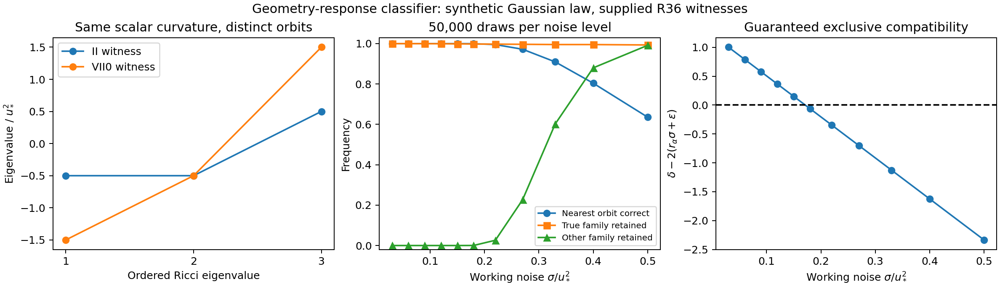

# Goal 3 — From physical confidence images to anisotropy-family classification

28 October 2026. Internal theory study; PhysMath 1.3.0 stages R2/R3/R4/R5/R7/R9 as specified in `WORK_PACKET.md`. The scientific unit is a classifier for **supplied physical response families**, with an explicit geometry bridge, an orientation quotient, a common error event and a residual diagnostic. No solver, ODE integration, repository mutation or observed Bianchi classification was performed.

## 1. Restore the original classification target at two levels

An observational family is a set of predicted joint means, including its physical parameter domain, source history, actual orientation, nuisance structure and detector response. Two families are distinguishable if those sets remain separated after the admitted nuisance and response errors. A morphology scalar becomes useful when it separates the relevant sets; retaining every tensor forever is not the objective.

Two classifications must remain distinct:

1. **Geometric/kinematic family:** spacetime geometry and a specified matter or hypersurface-normal congruence. Bianchi type describes a simply transitive group presentation; local Ricci eigenvalues or a shear tensor need not determine it.
2. **Internal response family:** polarization/helicity state, transport channel, detector response and their equivalence under passive fibre-basis changes. Distinct internal states can have the same trace stress and hence need not represent different geometries.

MF02 §3.2.1 (pp. 62–63) supplies a particularly useful example: rotational isotropy permits unequal photon helicity populations. Parity would impose an additional equality. Thus nonzero circular polarization, by itself, is not a geometric departure from FLRW. MF02 §4.4 (pp. 78–79) requires a compatible lifted symmetry of the full initial data; symmetry of the trace stress alone does not determine symmetry of the internal state.

The output should therefore be a compatible set of physical family labels, with geometry and internal-channel labels distinguished, rather than a forced single Bianchi name for every sky.

## 2. A concrete bridge from kinematics and tidal stress to spatial geometry

Choose a future hypersurface-normal unit vector and signature $(-,+,+,+)$. Its vorticity vanishes. Write $h=H/c$, $S=\Sigma/c$, $K_{ij}=-(h\delta_{ij}+S_{ij})$, and $\kappa=8\pi G/c^4$. Here $h,S$ have inverse-length units, $E_{ij}=C_{ia jb}n^an^b$ has inverse-length-squared units, and $\rho,\pi_{ij}$ are total energy density and anisotropic stress. In the Riemann convention of the supplied sources, Gauss and Einstein give

$$ {}^3R=2\kappa\rho+2\Lambda-6h^2+S:S, $$

$$ \boxed{{}^3R_{\langle ij\rangle}=E_{ij}+\frac\kappa2\pi_{ij}-hS_{ij}+\operatorname{STF}(S^2)_{ij}.} $$

This is an established Gauss relation, here used as the physical adapter into the R36 geometry image. It is Eq. (1.3.41), with the scalar relation (1.3.40), in Tsagas–Challinor–Maartens (2008), journal p. 73. Their units have $c=8\pi G=1$; the formula above restores the physical dimensions. For a vortical matter congruence its local rest spaces do not form these hypersurfaces. One must select a normal congruence and transform the stress/kinematics, or use the more general projected-curvature object with its different symmetries.

**Direct derivation.** In an orthonormal normal frame, the spatial Gauss equation is

$$ {}^3R_{ijkl}=R_{ijkl}-K_{ik}K_{jl}+K_{il}K_{jk}. $$

Decompose the four-dimensional Riemann tensor into Weyl, Ricci and scalar parts; use $R_{ij}=\kappa[(\rho-p)\delta_{ij}/2+\pi_{ij}]+\Lambda\delta_{ij}$ and $R_{00}=\kappa(\rho+3p)/2-\Lambda$. The spatial contraction yields $E_{ij}+(2\kappa\rho/3+2\Lambda/3)\delta_{ij}+\kappa\pi_{ij}/2-KK_{ij}+K_i{}^kK_{kj}$. Taking the trace and STF parts gives the displayed formulas.

A joint confidence image for $(E,S,h,\pi,\rho,\Lambda)$ can therefore be mapped to a joint spatial-Ricci image. This specifies which physical measurements are missing from a shear-only classification. The tidal tensor must come from a qualified local or light-cone response: a single lensing map is not automatically a direct measurement of all five components of local $E_{ij}$. The source, screen and line-of-sight kernel belong in that response.

### Finite error bound for the adapter

Let $\|\delta E\|_F\le e_E$, $\|\delta\pi\|_F\le e_\pi$, $\|\delta S\|_F\le e_S$, $|\delta h|\le e_h$, and similarly $e_\rho,e_\Lambda$. One valid deterministic bound is

$$e_{\rm TF}=e_E+\frac\kappa2e_\pi+|h|e_S+e_h\|S\|_F+e_he_S+2\|S\|_{\rm op}e_S+e_S^2,$$

$$e_{\rm tr}=2\kappa e_\rho+2e_\Lambda+12|h|e_h+6e_h^2+2\|S\|_Fe_S+e_S^2,$$

$$\|\delta{}^3R_{ij}\|_F\le\sqrt{e_{\rm TF}^2+e_{\rm tr}^2/3}.$$

The quadratic term follows from $(S+\delta S)^2-S^2=S\delta S+\delta SS+(\delta S)^2$ and the norm contraction of STF projection. Propagating the actual joint state-error image, as in `JOINT_REMAINDER.md`, can improve on these separate component bounds by retaining cancellations. These are physical approximation bounds, not estimated covariances.

The executed independent index construction tests 500 random finite examples: the direct four-index contraction and the compact Gauss formula differ by at most $4.764\times10^{-15}$. All 500 finite perturbations satisfy the bound; the largest error/bound ratio is 0.76912.

## 3. Orbit-aware family compatibility with one covering event

Take the fixed conditional experiment

$$Y=m_k(\lambda,R,U)+N\eta+b+\xi,\quad \xi\sim N(0,C),\quad C\succ0.$$

Here $R$ is the actual spatial orientation of a candidate relative to the observed sky. $U$ denotes physical internal transport parameters when applicable; a passive fibre change conjugates states, channels and detector effects together and leaves the prediction unchanged. With $W=C^{-1/2}$ and $M=I-P_{WN}$, define the candidate mean set

$$\mathcal M_k=\{MW[m_k(\lambda,R,U)-m_0]:\lambda\in\Lambda_k,\ R\in SO(3),\ U\in\mathcal U_k\}.$$

Supply a bound $\|MWb\|\le\epsilon_k$ on the declared domain. Let $z=MW(Y-m_0)$, $d=\operatorname{rank}M$ and $r_\alpha=\sqrt{\chi^2_{d,1-\alpha}}$. Then

$$\boxed{\widehat{\mathcal K}_\alpha(Y)=\{k:\operatorname{dist}(z,\mathcal M_k)\le r_\alpha+\epsilon_k\}}$$

contains the true supplied family with probability at least $1-\alpha$. **Proof:** on the one event $\|MW\xi\|\le r_\alpha$, the true mean is at distance no greater than $r_\alpha+\epsilon_k$. This event is common to all the comparisons; no independence assumption is made between scalar diagnostics derived from it.

For two families put $\delta_{kl}=\inf_{a\in\mathcal M_k,b\in\mathcal M_l}\|a-b\|$. If

$$\boxed{\delta_{kl}>2r_\alpha+\epsilon_k+\epsilon_l,}$$

their compatibility tubes are disjoint. This is a sufficient, finite separation certificate. If it fails, the result is an overlapping compatible set rather than evidence of a universal degeneracy. A supplied non-isotropic common error body can replace the balls and be tested through support functions or convex optimization where appropriate.

Nearly-FLRW candidate families can share their zero-anisotropy member. If the declared domains include that common point, their global separation is zero. The useful result is then an amplitude-dependent or locally restricted separation curve, together with the compatible set near zero. The numerical experiment below fixes a nonzero curvature scale; it does not assert a uniform classification guarantee down to the common isotropic limit.

### What may be quotiented out

A passive triad change transforms data, means, nuisance and covariance jointly and does not change the experiment. An active candidate orientation relative to a fixed mask/detector is usually a fitted parameter, not a symmetry of that fixed observation law. For isotropic Frobenius errors on a symmetric tensor, orientation optimization is exact:

$$\inf_{R\in SO(3)}\|A-RBR^T\|_F=\|\lambda^\uparrow(A)-\lambda^\uparrow(B)\|_2.$$

The result follows by maximizing the trace pairing; an improper eigenbasis match can be changed to a proper one by a sign flip that commutes with the diagonal tensor. For joint tensor pairs or anisotropic observational covariance, the same eigenvalue shortcut generally does not apply. Relative orientations and the joint metric must then be retained.

A joint sky prediction uses one common spatial orientation across its T/E/B, optical and PM channels. Independently aligning each channel can erase the relative orientation that the model predicts. A passive internal basis change likewise acts on all associated state, channel and detector objects together.

## 4. Common carrier, adequacy and new channels

For a common fixed Gaussian law, retain the span of **all pairwise admissible mean differences**, including their orientations and offsets. Orthogonal projection onto this span preserves the declared-family likelihood ratios. The orthogonal residual norm supplies an out-of-family diagnostic. This reuses established Gaussian/common-family compression; a span of tangent vectors at one orientation is insufficient for a nonlinear orbit unless its approximation error is controlled.

Finite response/truncation errors enlarge the mean sets before classification. A grid of family templates becomes a certified approximation only when a covering or Lipschitz remainder bounds points between templates. Reported Monte Carlo agreement on a grid is not such a bound.

For an additional polarimetric or PM channel, partition the joint covariance into old channel T and new channel P. Its conditional response and nuisance designs are

$$J_{P|T}=J_P-C_{PT}C_{TT}^{-1}J_T,\quad N_{P|T}=N_P-C_{PT}C_{TT}^{-1}N_T,$$

with covariance $C_{P|T}=C_{PP}-C_{PT}C_{TT}^{-1}C_{TP}$. For a parameter direction $v$, efficient information is the minimum over a common nuisance direction $a$ of the old weighted norm plus the conditional-channel weighted norm. It cannot decrease when the model class is held fixed. It increases strictly if no old minimizing nuisance direction also annihilates $J_{P|T}v+N_{P|T}a$.

This identifies the useful new detector: it must respond outside the nuisance-equivalent image. The executed unit example $Y_T=\theta+\eta+\xi_T$ has zero efficient information; adding $Y_P=\theta-\eta+\xi_P$ gives information 2 under unit independent noise; adding a duplicate $Y_P=\theta+\eta+\xi_P$ still gives zero. Naming a full Hermitian carrier does not substitute for that rank condition. Adding an unconstrained new internal-transport nuisance family can also weaken a previously assumed geometric interpretation; data addition and model expansion are different operations.

MF02 §§3.6–3.7 (pp. 69–71) supply the physical path comparison: calibrated complete state/effect data can recover an incoherent relative unitary channel $\operatorname{Ad}_W$, with $W$ determined up to its central phase. A single unpolarized input is unchanged by every unitary. Such internal distinctions should be separate family attributes unless the selected matter model links their stress/history to geometry.

## 5. Reusing R36 geometry: an exact finite classification experiment

The newly retrieved, immutable R36 `TABLE.json` at commit `7f3f49a6b6d95b6ae0323d5bebd3afce0067b1a7` has Git blob `1ae270fec9ae55375c01ec1f346f8755d9257049`. Its byte-exact copy is included under `sources/goal3`; the script verifies the blob before use. Its II and unequal-VII0 witnesses have, in the source frame,

$$R_{\rm II}/u_*^2=\operatorname{diag}(1/2,-1/2,-1/2),\quad
R_{\rm VII_0}/u_*^2=\operatorname{diag}(-1/2,3/2,-3/2).$$

They share ${}^3R/u_*^2=-1/2$, $h/u_*=2$, $S/u_*=\operatorname{diag}(1/10,-1/20,-1/20)$, $\kappa\rho/u_*^2=4697/400$ and zero momentum density. The Gauss bridge determines the different electric Weyl tensors for a declared common $\pi=0$; the code verifies the reconstruction. Their rotation-orbit separation is exactly $\sqrt2u_*^2$.

The synthetic observation consists of six symmetric-tensor coefficients and one common-offset calibration measurement. The nuisance shifts the scalar trace coordinate and the calibration channel together. Profiling leaves six dimensions. Because both families have the same trace, their full likelihood ratios require only the five STF coordinates; a one-dimensional trace residual remains for adequacy. Across 250 random observations and independently oriented candidates, full and compressed log likelihood ratios agree to $4.44\times10^{-15}$.

At a stipulated Frobenius working noise $\sigma=0.12u_*^2$, physical response error radius $\epsilon=0.10u_*^2$ and a common 95% event in six dimensions, each tube has radius $0.5258155u_*^2$. The separation margin is $0.3625825u_*^2>0$. Exclusivity is guaranteed whenever $\sigma<0.1710901u_*^2$ under these same assumptions.

The zero-bias Monte Carlo uses 50,000 independent draws at each of 11 noise levels. At $\sigma=0.12u_*^2$, the true family is retained in 49,960/50,000 draws; the wrong family in 0/50,000; nearest-orbit classification is correct in 50,000/50,000. The confidence construction is conservative after orientation fitting and addition of the physical-error allowance. An observed zero event frequency has a two-sided exact 95% binomial upper bound $7.378\times10^{-5}$, not a proved zero sampling probability. The Gaussian law here is a declared geometry-response experiment, not a measured curvature catalogue law.

Two controls sharpen its meaning. First, scalar curvature is identical and cannot classify this pair; but $\operatorname{tr}(R^2)/u_*^4$ is $3/4$ versus $19/4$, so a suitable scalar invariant can classify the noiseless pair after the question is fixed. Second, an unmodelled trace-coordinate shift of one unit leaves every retained STF likelihood ratio unchanged but produces projected adequacy residual $1/\sqrt2$, larger than the $\sigma=0.12$ tube. It rejects both listed families. The common carrier must therefore be accompanied by its adequacy diagnostic for an open-ended beyond-FLRW search.

The R36 type-I and equal-VII0 controls have the same flat intrinsic geometry despite different simply transitive presentations. A geometrical classifier should retain that equivalence rather than force distinct labels. Additional extrinsic, matter or derivative data can separate physical families when their response differs; identical geometry under another presentation is not a new observable difference.

## 6. Signed morphology supplies a different class label

The attached `main.pdf` Theorems 1–2 and Eqs. (3)–(17), pp. 2–5, give $C_QO=v$, $M_Q=C_QL_Q=tI/3+2Q^2/5$ and $\chi=\det[v,Qv,Q^2v]$. The sharp pair has $\|Q\|_F=\|O\|_F=1$ and $\chi=\pm4\sqrt2/135$. Its two signs are inequivalent under common proper rotations. The code reproduces the positive and negative endpoints.

**Sharp fixed-Q sign radius.** Let Q have simple spectrum and $\chi(Q,O)\ne0$. In its oriented eigenframe, with $m_i=t/3+2\lambda_i^2/5$, the Frobenius distance in the ambient STF3 space to a zero-chirality tensor is

$$\boxed{\rho_{\rm sign}(Q,O)=\min_i\frac{|v_i|}{\sqrt{m_i}}.}$$

**Proof.** With Q fixed, $\chi=\prod_{i<j}(\lambda_j-\lambda_i)\prod_i v_i$, so the zero set is the union of the three hyperplanes $\langle L_Qe_i,O\rangle=0$. Their normal squared norms are $e_i^TM_Qe_i=m_i$. Orthogonal projection onto the nearest hyperplane attains the stated distance. Inside this open ball no component crosses zero. At the supplied sharp witness the radius is $1/\sqrt3=0.5773503$ and the code constructs an attaining perturbation. This is a bound for fixed Q and an ambient O-error ball; uncertainty in Q requires the joint image, and the fixed-O-norm sphere is a different domain.

This sign label is a morphology result. A physical parity signature arises only after assigning the response representation and its parity convention. A pseudo-octupole formed with an axial vector cannot silently inherit the parity interpretation of a polar optical octupole. Neither sign is a universal Bianchi-type label.

## 7. Use the five coordinates without losing the classifier

- **x:** the joint response-sufficient carrier, including signed tensor coefficients and declared internal channels; keep the adequacy residual alongside its data representation.
- **F:** directional support of each compatible physical image. Keep the family label and actual nonconvex image. The support of a combined union retains only its closed convex hull and can erase disconnected parity branches.
- **Q:** a declared bounded anchor in the physical observable quotient; use the common physical error image when comparing departures.
- **Pi:** probabilities under the one declared sampling/posterior law. Compatibility and a model posterior are distinct outputs.
- **G_F:** specified source/depth/fibre comparison maps and their common uncertainty. Passive gauge changes do not create new data; an additional calibrated path can.

## 8. Primary comparison and the next executable unit

Joint temperature/polarization Bianchi discrimination is established. Pontzen–Challinor (2007) derive a nearly-FRW Bianchi polarized hierarchy and show why a temperature-selected VIIh pattern must confront polarization. Pontzen (2009) treats further dynamical modes; a type label is not a unique template. Sung–Coles (2011) exhibit temperature and polarization patterns across the FRW-admitting Bianchi classes. Planck 2015 XVIII performs a physical versus phenomenological Bianchi comparison using the linked temperature/polarization prediction. These are stronger comparators than scalar power alone.

The useful contribution proposed here is a **response-qualified, error-certified common physical classification**, combining the supplied Gauss/optical/fibre maps and their joint remainder image. The generic orbit distance, Gaussian compression and tube argument are established mathematics. The executed R36 bridge and exact fixed-Q sign-radius application are concrete derived results of this pass; independent priority has not been established.

The next unit can be completed without new kinetic evolution:

1. Select two or more already supplied physical response families and freeze their shared source/frame/units, amplitude/history domain and observation law. Keep geometry and internal-transport labels separate.
2. Use the current R36 E2 response for a physical PM-history comparison, or the Gauss bridge when an electric-Weyl/stress response is actually supplied. For CMB Bianchi types, ingest qualified external full T/E/B templates with their mode/history and processing metadata; do not replace this adapter with a temperature figure.
3. Compute the nuisance-orthogonal common span, full-domain response-error image and an out-of-family residual statistic. Preserve orientation and parity jointly.
4. Report compatible family sets, minimum separation versus the physical budget, and matched full-law/GLS results. A broad posterior or an overlapping set is a physical result with an explicit unresolved direction, not a workflow stall.

## Sources and evidence

- Tsagas, Challinor & Maartens, *Relativistic cosmology and large-scale structure*, Physics Reports 465 (2008) 61–147, §1.3.5 Eqs. (1.3.34)–(1.3.41), [doi:10.1016/j.physrep.2008.03.003](https://doi.org/10.1016/j.physrep.2008.03.003), [arXiv:0705.4397](https://arxiv.org/abs/0705.4397). Relevant full primary text read from the user-provided `papers.zip` and checked against the author-hosted version.
- Pontzen & Challinor, *Bianchi model CMB polarization and its implications for CMB anomalies*, MNRAS 380 (2007) 1387–1398, [arXiv:0706.2075](https://arxiv.org/abs/0706.2075). Primary abstract, introduction and conclusions retrieved through Exa.
- Pontzen, *Rogues' gallery: the full freedom of the Bianchi CMB anomalies*, Phys. Rev. D 79 (2009) 103518, [arXiv:0901.2122](https://arxiv.org/abs/0901.2122). Primary abstract read; used only for the presence of additional linearized dynamical modes.
- Sung & Coles, *Temperature and Polarization Patterns in Anisotropic Cosmologies*, JCAP 06 (2011) 036, [arXiv:1004.0957](https://arxiv.org/abs/1004.0957). Primary abstract read; no new derivation attributed to unread sections.
- Planck Collaboration, *Planck 2015 results. XVIII. Background geometry & topology*, [arXiv:1502.01593](https://arxiv.org/abs/1502.01593). Primary search/retrieval and SciSpace abstract identify the joint T/polarization model test.
- User attachments: `main.pdf`, Theorems 1–2 and Eqs. (3)–(17), pp. 2–5; MF02 §§3.2, 3.6–3.7 and 4.4, pp. 62–64, 69–71 and 78–79.
- Pinned R36 geometry TABLE and interpretation plus PM interpretation and their later formal qualification records, under `sources/goal3`. Later publication status resolves the earlier immutable prose saying candidate/pending.
- New code: `code/goal3_classification.py`; machine-readable results: `lanes/GOAL3_CLASSIFICATION.json`; plot: `figures/goal3_classification.png` and vector PDF. Final executed command: `OPENBLAS_NUM_THREADS=1 python code/goal3_classification.py`, exit 0.
