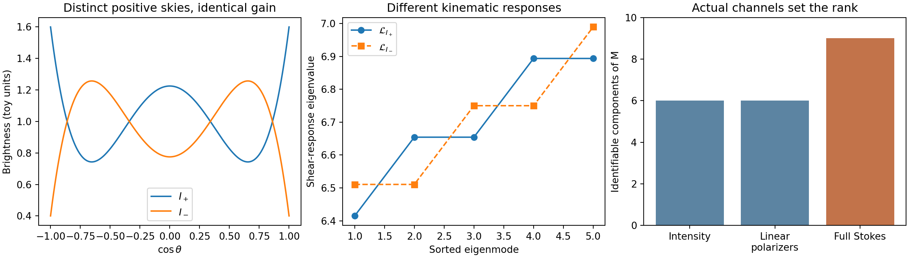
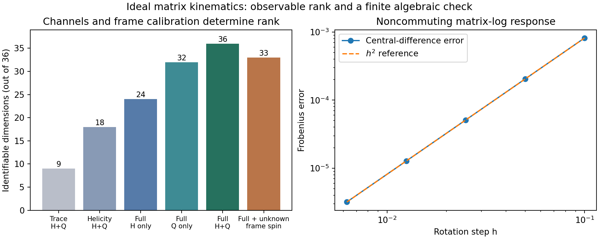
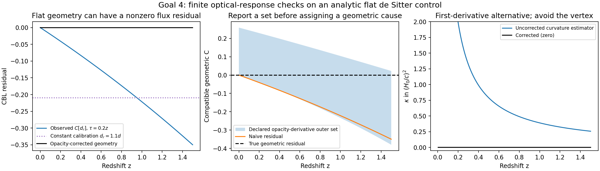
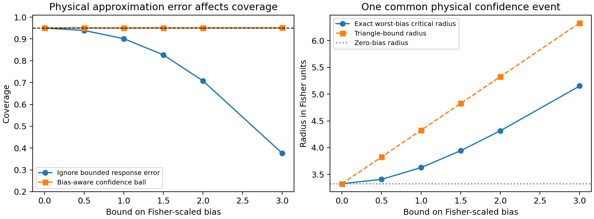

# The recovered research programme

The original target is physical: infer specified kinematics and geometry from observed angular and depth structure. The five coordinates $(x,F,Q,\Pi,G_F)$ can retain their roles while their domain expands to signed STF/PSTF tensors, calibrated polarization states and their detector-accessible images. A matrix-valued matter response does not replace the spacetime metric or the observer congruence. It identifies additional physical information only through a specified source, transport and measurement map.

This report develops four concrete routes: low-multipole morphology and radiation-to-kinematics; beyond-FLRW kinematic measurement; anisotropy-family classification including supplied Bianchi geometries; and directional Hubble/optical-distance consistency. Each route includes a mathematical construction, a finite executed control, reuse of the latest pushed work and a precise next observable contract. The separate fibre-count experiment tests what actual analyzer channels preserve. The joint-error section connects the new MF02 reduction bounds to physical confidence regions.

The active branch was freshly checked at `7f3f49a6b6d9`, unchanged from the preceding foundation pass. Current R36 results include the positive radiation shear operator, exact nonlinear temperature-to-stress tests, optical source Jacobians and joint octupole budget, common E2 PM-history response, and finite geometry images. They are reused at their qualified conditional scope. The two new source documents are the 152-page MF02 unified fibre note and the 14-page optical manuscript. Full source identities, code and numerical receipts accompany the report. No push, live-controller change, native solver, ODE evolution or raw-catalogue refit was performed.

## What this pass establishes

| Original objective | Constructive result in this pass | Physical use |
|:--|:--|:--|
| Low-$\ell$ morphology and dipole/radiation response | A common 23-component linear carrier preserves Thomson gain and the whole shear operator; 20 suffice without circular polarization. A polarized collision omission gives an explicit shear-bias bound. | Identify the intensity and polarization moments required for a conditional MES inverse. |
| Beyond-FLRW kinematic quantities | A finite detector-rank formula and a calibrated radial/transverse inverse, with frame-spin and source kernels retained. | Construct joint regions for the identifiable shear, expansion, vorticity-relative-to-frame and internal-response components. |
| Anisotropy and Bianchi-family comparison | A Gauss bridge to spatial Ricci, orbit-aware compatible-family sets, finite separation certificates and an exact fixed-quadrupole chirality sign radius. | Compare supplied physical families without forcing a geometric label from one morphology scalar. |
| Direction/redshift-dependent Hubble factor | An opacity/finite-distance local Hubble interval, calibrated matrix-distance bounds, and opacity-qualified CBL/curvature regions. | Separate optical-response uncertainty from the geometric quantity being tested. |

The most useful new connection is a complete error path. MF02 supplies a conditional state-reduction bound. The source and detector map turn it into a *joint* observable error body. The kinematic response turns that body into a parameter bias bound. A common statistical event then gives physical confidence images and family compatibility. The supporting linear algebra and robust-inference tools are established; the scientific content lies in the supplied physical response and the quantities it permits us to constrain.

## Four distinctions carried through every route

| Axis | What is held distinct |
|:--|:--|
| Symmetry and redundancy | Passive coordinate/triad/fibre changes; active model orientation; actual photon polarization rotation; unknown calibration. |
| Invariants | Scalar powers, trace, spectra and chirality relative to their stated transformation group and physical question. |
| Observables | Detector counts, Stokes channels, radial distance response and transverse proper motion, with selection and covariance. |
| Physical quantities | The chosen congruence's kinematics, radiation stress, internal drift/transport, spatial curvature and family parameters. |

Throughout, the physical velocity has $u^au_a=-c^2$. A unit velocity is written $\bar u=u/c$ when translating the optical manuscript. A density-normalized internal drift is a matter response, not another classical congruence. In particular, opposite helicity currents can coexist with unchanged total stress. Isotropy under proper rotations also does not require parity symmetry: a circular-polarization imbalance alone is not a geometric FLRW violation.

For comparison across fibres, transform state, detector effect and channel together. A geometric photon screen connection preserves helicity; it does not supply an arbitrary SU(2) analyzer rotation. Actual polarization conversion must be a specified interaction or instrument operation. These distinctions determine the ranks in the count experiment below.

# Goal 1 — Low-multipole morphology, polarization and a response-preserving MES bridge

## Scientific outcome

The useful extension is a joint response carrier, rather than an unrestricted enlargement of the state. The cold-electron Thomson **gain** depends on nine real integrated polarization components, while the instantaneous radiation-to-shear operator depends on fifteen intensity components of angular degrees 0, 2 and 4. A carrier sufficient for one of these physical questions is not sufficient for the other. Their generic joint real-linear carrier has dimension 23; if circular polarization is excluded by the declared model and measurement question, the corresponding dimension is 20.

This makes the original low-multipole programme concrete. Preserve the intensity moments that act on shear, and preserve only those polarization moments that enter the collision residual or the selected detectors. Then map a joint observational confidence event through the known instantaneous operator and an explicit derivative/remainder allowance. The matrix description adds a calculable polarized collision correction; it does not replace an unmeasured transport derivative with morphology.

The numerical experiment below verifies an exact counterexample: two positive skies have identical Thomson-scattered output, yet different shear-response operators. It also verifies the 23-dimensional union and the detector ranks, and calculates a finite shear bias from omitting linear polarization.

## Sources, scope and conventions

Applied skill context: PhysMath 1.3.0 selected R2/R3/R4/R5/R7/R9 definitions and integrated policies in `WORK_PACKET.md`; one production/check pass, followed by the parent's integrated independent review. No recursive delegation.

Sources actually read:

- MF02 attached PDF, pp. 28–30, §1.10, especially (1.10.1), (1.10.5)–(1.10.9), (1.10.17), (1.10.20); pp. 53–54, §2.5; p. 120, Proposition 10.6.1 and (10.6.2)–(10.6.3). Its gain spectrum is reused, not relabelled as a new result.
- Prior `MES_FOUNDATION.md`, §4: the exact five-dimensional positive shear operator and finite inverse-error bound. Current R36-05 interpretation and publication status, pinned at `7f3f49a6b6d9`: the nonlinear temperature-to-radiation adapter and exact rank-4 response preservation.
- Anthony Challinor, *Microwave background polarization in cosmological models*, Phys. Rev. D 62, 043004 (2000), arXiv:astro-ph/9911481. The user's supplied journal PDF was read at p. 043004-5, Eq. (3.7) and its explanatory paragraphs. It gives the intensity/E-quadrupole and circular-dipole Thomson source structure, including the separation of circular polarization. Exa and SciSpace retrievals identified and cross-checked the primary paper.
- Cyril Pitrou, *The radiative transfer at second order: a full treatment of the Boltzmann equation with polarization*, arXiv:0809.3036, primary abstract read through Exa. It locates the extension beyond the cold rest-frame model; its full second-order coefficients are not used here.
- Kamionkowski and Loeb, *Getting Around Cosmic Variance*, Phys. Rev. D 56, 4511 (1997), arXiv:astro-ph/9703118, primary text through Exa. Cluster Thomson polarization probes two projected components of the remote quadrupole, providing a prospective extra source rather than all five components at each event.

Work in one electron rest frame with $g=(-,+,+,+)$, cold unpolarized electrons, negligible recoil, and photon energy much below $m_ec^2$. The Thomson map is energy diagonal in this frame. It therefore also acts on bolometric brightness provided the same energy weights are used. Let $n$ be the photon propagation direction and $P_n=I_3-nn^T$. The Hermitian screen brightness $\mathsf F(n)$ satisfies

$$
\mathsf F=P_n\mathsf F P_n,\qquad \mathsf F\succeq0,\qquad I(n)=\operatorname{tr}\mathsf F(n).
$$

In an oriented real screen basis the convention is

$$
f=\frac12\begin{pmatrix}I+Q&U-iV\\U+iV&I-Q\end{pmatrix}.
$$

$Q\pm iU$ have spin weights $\pm2$; $I,V$ have spin weight zero, with their distinct parity. Spatial rotations act on the embedded screen tensor. A passive screen-basis change transforms state and detector components together and leaves their pairing unchanged. An actual observer boost changes energy and direction and must be included in the forward map. The finite carrier below is qualified to the stated frame.

## 1. What one Thomson-scattered component preserves

Define

$$
M=\int\mathsf F(n')\,d\Omega',\quad
(\mathscr G\mathsf F)(n)=\frac{3}{8\pi}P_n M P_n,
\quad C_T[\mathsf F]=\gamma_T(\mathscr G\mathsf F-\mathsf F),
\qquad\gamma_T=n_e\sigma_Tc.
$$

The map $\mathscr G$ factors through the nine-real-dimensional Hermitian matrix $M$. This is the exact scattered gain, not a nine-dimensional closure of the full collision operator: the loss term retains the incident angular field. An observed direct-plus-scattered sky also contains the direct term and its higher multipoles.

Write $M=aI_3+S+iA$, where $S$ is real symmetric trace-free and $A$ is real antisymmetric. Isotropic angular integration gives

$$
\frac{3}{8\pi}\int P_nMP_n\,d\Omega
=\frac35M+\frac1{10}M^T+\frac1{10}\operatorname{tr}(M)I_3.
$$

Thus the scalar, real STF and imaginary-antisymmetric pieces have multipliers $1,7/10,1/2$, with dimensions $1,5,3$. This reproduces MF02 Proposition 10.6.1. The image contains an intensity monopole, a linked intensity/E quadrupole, and a circular-polarization dipole. It has no independently generated B-mode source in this rest-frame Thomson limit. The separation is consistent with Challinor Eq. (3.7).

For a detector effect $R_j=P_{n_j}R_jP_{n_j}\succeq0$, its scattered signal is

$$
y_j=\operatorname{tr}[R_j(\mathscr G\mathsf F)(n_j)]
=\frac3{8\pi}\operatorname{tr}(B_jM),\qquad B_j=P_{n_j}R_jP_{n_j}.
$$

Only the span of the actual $B_j$'s is identifiable. Intensity effects and real linear-polarizer effects are blind to the imaginary antisymmetric part. Full Stokes effects can access it. The executed designs give ranks 6, 6 and 9, respectively. Nine stored matrix components therefore do not imply nine observed components.

An omitted matrix component has a direct detector error budget:

$$
|\delta y_j|\le\frac3{8\pi}\|B_j\|_F\|\delta M\|_F.
$$

With a specified joint Gaussian channel law $y\sim N(A m+N\eta,C)$, the identifiable physical directions are the image of $C^{-1/2}A$ orthogonal to $C^{-1/2}N$. This is the standard linear inverse/efficient-score construction applied to a physically explicit detector map, and does not require the full angular field to be retained for that one question.

## 2. A sufficient scattering carrier can erase kinematic information

For unpolarized radiation, $\mathsf F=IP_n/2$, define

$$
\rho=\int I\,d\Omega,\qquad
\pi=\int I(nn^T-I_3/3)\,d\Omega.
$$

Then $M=\rho I_3/3-\pi/2$. The scattered gain knows intensity degrees 0 and 2, and nothing of a pure degree-4 perturbation. In contrast, the prior exact radiation response is

$$
\mathcal L_I X=\frac{8\rho}{15}X+
\frac{10}{7}\operatorname{STF}(X\pi)-H_4:X,
$$

with the equivalent quadratic form

$$
\langle X,\mathcal L_I X\rangle
=\int I(n)\{2|Xn|^2-(n^TXn)^2\}\,d\Omega.
$$

Take $I_\pm(n)=1\pm0.6P_4(n_z)$. Both are everywhere positive, bounded below by 0.4. Orthogonality gives $M_+=M_-$, hence identical scattered output at every direction and detector. Their degree-4 moment differs, so $\mathcal L_{I_+}\ne\mathcal L_{I_-}$. The quadrature gives

$$
\|M_+-M_-\|_F=1.20\times10^{-13},\quad
\max_n\|\mathscr G\mathsf F_+-\mathscr G\mathsf F_-\|_{\max}
=1.41\times10^{-14},
$$

while

$$
\|\mathcal L_{I_+}-\mathcal L_{I_-}\|_{\rm op}=0.5744626567
$$

in the declared brightness units. This is a response-specific counterexample, not a claim that all scattering destroys all geometric information. It shows why a physical question must be fixed before using the gain's minimal carrier as the whole kinematic carrier.

## 3. The common carrier for scattering and the shear operator

Decompose the incident screen field into its unpolarized trace part, real trace-free linear-polarization part $\mathsf P_L(n)$, and circular part. Set

$$
P_* =\operatorname{STF}\operatorname{Re}\int\mathsf P_L(n)\,d\Omega,
\qquad A_* =\operatorname{Im}M.
$$

For the pair of exact outputs $(\mathscr G\mathsf F,\mathcal L_I)$, a common carrier is

$$
x_{\rm pair}=(\rho,\pi,H_4,P_*,A_*),
\qquad \dim=1+5+9+5+3=23.
$$

**Finite-dimensional statement.** On a neighbourhood of a positive unpolarized isotropic screen field, this is a minimal real-linear carrier for preserving all gain outputs and the entire five-dimensional shear operator.

**Proof.** The gain is fixed by $M=\rho I_3/3-\pi/2+P_*+iA_*$. The shear operator is fixed by $(\rho,\pi,H_4)$. The latter map is injective: the symmetric operators on STF rank 2 decompose into angular representations of degrees $0,2,4$, and each coefficient in $\mathcal L_I$ is nonzero. Equivalently, its invariant trace fixes $\rho$, its degree-2 component fixes $\pi$, and its degree-4 component fixes $H_4$. Once these fifteen quantities are fixed, the real STF and imaginary antisymmetric parts of $M$ fix the remaining eight. Small real-linear perturbations spanning these directions remain positive on the physical two-dimensional screen around a strictly positive reference, so positivity does not lower the local rank. The executed 24-by-23 response matrix has rank 23 and smallest singular value 0.5649300 in its declared, unnormalized coordinate basis. This numerical rank verifies the concrete bases; the representation argument proves the dimension.

If the model restricts $V=0$ and only intensity/linear polarization and shear are targets, the unnecessary three circular components can be omitted: the corresponding carrier has dimension 20. For an unpolarized incident family it has dimension 15. These are exact response preservation statements, not claims that those many coefficients have already been measured, nor that every component of the transport residual is present.

The shear operator is blind to all intensity degrees above 4. The scattered gain is blind to many more angular details. Consequently an angular-entropy residual can be nonzero while the selected physical responses are preserved exactly, consistent with the already executed R36-05 result.

## 4. A polarized collision correction to the MES inverse

Taking the intensity trace of the gain and integrating its quadrupole gives

$$
C_\pi=\gamma_T\left[-\pi-\frac15\operatorname{STF}\operatorname{Re}M\right]
=-\gamma_T\left(\frac9{10}\pi+\frac15P_*\right).
$$

To see the coefficient directly, $\operatorname{tr}(P_nMP_n)=\operatorname{tr}M-n^T\operatorname{Re}Mn$, and

$$
\int n_{\langle a}n_{b\rangle}n_cn_d\,d\Omega
=\frac{8\pi}{15}\delta_{c\langle a}\delta_{b\rangle d}.
$$

The unpolarized limit yields the familiar $9\gamma_T/10$ intensity-quadrupole damping. Here $P_*$ is an explicitly integrated screen tensor, not an unannounced identification with a convention-dependent $E_{ab}$ coefficient.

In the same geodesic/irrotational congruence used for the prior radiation inverse, write the noncollision derivative combination as $R_\tau$. The source equation becomes

$$
\mathcal L_I\Sigma=-(R_\tau-C_\pi).
$$

Thus a polarized collision estimate is an additive source correction in the existing physical inverse. Holding the same $I,R_\tau,\gamma_T$, ignoring $P_*$ shifts the inferred shear by

$$
\Sigma_{\rm true}-\Sigma_{\rm unpol}
=-\frac{\gamma_T}{5}\mathcal L_I^{-1}P_*,
\quad
\|\Sigma_{\rm true}-\Sigma_{\rm unpol}\|_F
\le\frac{\gamma_T}{5\lambda_{\min}(\mathcal L_I)}\|P_*\|_F.
$$

The finite experiment uses a positive screen field $P_n/2+0.12[P_nS_1P_n-\tfrac12P_n\operatorname{tr}(P_nS_1P_n)]$. Its smallest physical screen eigenvalue is 0.41563. The collision quadrupole identity has residual $1.74\times10^{-14}$. With $\gamma_T=0.4$ in the declared toy time unit, the omitted-polarization shear shift has norm 0.0072 and attains the stated bound because the intensity is isotropic. This is a physical approximation-error test under a fully specified source law, not a sky detection.

For uncertain quantities, include this correction in the same joint source event. If $\|\delta\mathcal L\|_{\rm op}\le\epsilon_L$, the uncertainty of the noncollision residual is $\epsilon_R$, and the uncertainty of $P_*$ is $\epsilon_P$, then for fixed $\gamma_T$

$$
\|\Sigma-\widehat\Sigma\|_F
\le\frac{\epsilon_R+\gamma_T\epsilon_P/5+
\epsilon_L\|\widehat\Sigma\|_F+\epsilon_{\rm other}}
{\widehat\lambda-\epsilon_L},\qquad\widehat\lambda>\epsilon_L.
$$

Here $\epsilon_{\rm other}$ explicitly includes uncertainty of the intensity-quadrupole collision term, optical-depth/rate calibration, frame conversion and any declared neglected source. Correlated uncertainties can be propagated more tightly from their common set rather than replacing it by separate balls. In particular, the parent’s `JOINT_REMAINDER.md` constructs a detector-projected error Gram that retains cancellation between derivative, collision and transfer errors; it can replace this conservative sum of radii when the common primitive error set is supplied.

## 5. How the five factors serve the original purpose

- $x$ retains the joint response carrier, or the smaller measured quotient selected by actual detector effects and nuisance. It also records the separate differentiated moments needed by $R_\tau$, when supplied.
- $F$ is the directional support of the resulting physical shear/confidence image; the support direction can be chosen by a detector or a specified shear mode.
- $Q$ uses a fixed, dimensionally consistent reference body. Positivity and causal constraints remain physical-domain conditions; a positive cone alone is not an absorbing bounded Minkowski reference body.
- $\Pi$ is a sampling/posterior probability under the common calibrated channel law. Stokes positivity, detector probability and confidence coverage are different statements.
- $G_F$ retains frame/screen comparison, sky masks and cross-window covariance. Repeated maps of one sky do not supply independent physical depths, and a passive basis rotation does not generate physical B modes.

This construction can produce a tensor-valued physical identified set now, parametrized by the remaining derivative allowance. It can also quantify the error incurred by an unpolarized or rank-2 approximation before making any observed-shear claim.

## 6. Concrete next unit and observation contract

The shortest useful application is **a joint T/E radiation-source sensitivity image**: retain the calibrated bolometric intensity degrees 0, 2 and 4, the incident linear-polarization contribution $P_*$, and their joint covariance; compute $\mathcal L_I$, $C_\pi$, and the shear support curve against a declared $R_\tau$ allowance. Use the current exact R36 temperature-to-intensity adapter and its positive moment response instead of refitting or discarding it. An intensity-only baseline gets the same source assumptions and is compared through the explicit omission-bias formula above.

The required data are signed temperature/intensity and Q/U channels with bandpass, unit, beam, mask and joint processing covariance; an energy/spectral completion if bolometric intensity is needed; and the electron/rest-frame and collision-rate model for the selected source. An E-mode sky alone does not supply these intensity moments. Stokes V is needed only if the circular response is itself a target.

For a later derivative-source programme, remote-quadrupole polarization is a meaningful external route. A single cluster measures only two projected quadrupole combinations. Distinct clusters occupy different spacetime events, and redshift differentiation along a light cone is not automatically a proper-time derivative at fixed spatial point. The proper target is therefore the identifiable combination of remote moments under a specified space/time response, with optical depth, peculiar motion and selection nuisance retained. This extends the source information constructively without calling unobserved derivatives measured or requiring a native Boltzmann solver for the current conditional response result.

## Numerical evidence and claim status

`code/goal1_thomson_response.py` executes 968-point spherical quadrature, exact finite detector-rank construction, the response-union rank, positive-sky counterexample and the polarized collision-bias test. `lanes/GOAL1_NUMERICS.json` records all numbers. `figures/goal1_thomson_carrier.{png,pdf}` presents the positive skies, unequal shear spectra and actual detector ranks. First execution completed all numerical assertions but hit a Matplotlib legend syntax error; the label-only repair is recorded in `GOAL1_EXECUTION_NOTE.txt`, and the second execution completed.

Reused/established: cold Thomson kernel and spectrum, polarization selection rules, the exact MES/HTT radiation operator, linear inverse identifiability. Derived here as a research application: the explicit pair-response counterexample, the common 23/20-component carrier statement and the polarization-induced shear-error budget in the retained framework. These are candidate application contributions; their generic linear-algebra structure is not asserted as a new universal theorem or as a completed empirical FLRW exclusion.

{width=100%}

# Goal 2 — detector-qualified kinematic inversion

## 1. The result

The matrix extension makes the original kinematic question more precise: which components of a specified matter/response gradient survive the source, transport, detector and frame calibration? The exact longitudinal–transverse inverse in MF02 can be turned into a finite measurement-rank theorem and a joint confidence image. This yields a constructive alternative to the phrase “100% vorticity reconstruction.”

For a two-dimensional internal space, a general Hermitian-valued spatial gradient has 36 real components. In the executed ideal-response design, total-intensity channels retain 9, two helicity channels retain 18, and an informationally complete four-effect instrument retains all 36. Radial data alone retain 24. An unknown common catalogue spin removes three geometric antisymmetric directions even from the complete instrument, leaving rank 33. Those losses have distinct mechanisms and remain explicit in the physical result.

A second result concerns the matrix-log bridge. The Fréchet matrix-log identity is correct, but a measured scalar channel magnitude uses the logarithm *after* detector contraction. These two operations differ. In the executed two-state example, the channel log derivative is \(1/3\), while the detector pairing with the matrix-log derivative is \(\log 2/2\). The matrix extension therefore needs a measured Stokes/coherency carrier or its full detector likelihood; it cannot be inserted into a scalar magnitude pipeline by replacing one formula.

## 2. Source and convention map

The attached main.pdf was read throughout its 14 pages. Its retained results include the STF contraction image and sharp chirality bound, the local scalar optical response (21)–(24), the finite coupled octupole (26), the constructive inverse and four-component kernel (30)–(35), and the complete-field inverse (38)–(39). These results are preserved.

MF02 was read at §§1.12 (pp.34–35), 2.7 (pp.55–56) and 2.8 (pp.57–58), with the gradient convention in §§1.2–1.3 (pp.10–12). The rendered p.58 was inspected to resolve index order in (2.8.11). Current R36-03-PM-HISTORY and R36-04-OPTICAL-JOINT interpretations are reused with their later formal qualification records, which supersede the older “pending review” prose. The branch is pinned at 7f3f49a6b6d9.

Use signature \((-+++)\). In this note \(K_{ab}=h_a{}^ch_b{}^d\nabla_d u_c\) has the velocity index first and the derivative index second, and has physical inverse-time units:
$$
K_{ab}=Hh_{ab}+\Sigma_{ab}+W_{ab},\qquad
W_{ab}=\epsilon_{abc}\Omega_c .
$$
Thus \(Wn=n\times\Omega\) with the displayed axial-vector convention. The attached optical manuscript writes its spacetime derivative in the opposite index order; its radial contraction is unaffected by the antisymmetric transpose, while transverse signs must be translated.

Use \(u^au_a=-c^2\) for the physical velocity here, and \(\bar u=u/c\) for the unit velocity used in the optical manuscript. Its past-directed null vector is therefore \(\ell=-\bar u+n=-u/c+n\) in the present notation. With outward source direction this yields
$$
\mathcal H_u(n)=H-A\cdot n/c+\Sigma:nn.
$$
MF02 §2.8 instead uses the future-null \(r=u/c+n\), yielding the displayed plus sign in its acceleration term. Both formulas have their stated conventions; copying the sign from one into the other would be an error.

Geometric \(u\), internal drift \(\Delta_a\), and detector effects \(R\) are different objects. A Hermitian response \(Z=r^ar^b\mathcal D_a\mathcal U_b\) does not by definition become the measured photon redshift. MF02 explicitly retains that physical qualification.

## 3. The axial STF bridge

For a real STF matrix \(S\) and any vector \(w\), define
$$
(L_Sw)_{ijk}=\frac13(S_{ij}w_k+S_{ik}w_j+S_{jk}w_i)
-\frac{2}{15}\bigl[\delta_{ij}(Sw)_k+\delta_{ik}(Sw)_j+\delta_{jk}(Sw)_i\bigr].
$$
Taking one trace gives zero, and on the unit sphere
$$
(S:nn)(w\cdot n)=(L_Sw):n^3+\frac25(Sw)\cdot n.
$$
This is main.pdf (28) and MF02 (1.12.8), with the same lift. Its singular-value and minimum-norm inverse results survive unchanged when \(w\) carries an axial rather than polar representation.

Under an improper orthogonal \(R\), an axial vector transforms as \(w'\!=\det(R)Rw\); hence
$$
L_{RSR^T}w'=\det(R)\,R^{\otimes3}L_Sw .
$$
The coefficient is then a rank-three pseudotensor. This algebra does not say that matter vorticity generates a scalar luminosity-distance octupole. The radial contraction itself removes \(W_{ab}\), and any axial coupling needs a parity-sensitive physical response. For example, the specified spin-raising adapter \(P_B=i\kappa\eth^2\Psi\) in MF02 removes the \(\ell=1\) term and maps a pseudoscalar cubic to a magnetic-type spin-2 pattern, but its coupling constant and applicability must come from transport/detector physics. Stokes \(V\) and CMB \(B\) are distinct observables.

Exact Wolfram checking returned zero for the cubic Laplacian and for the six-axis inverse below. The first call used an incorrect differentiation syntax for the Laplacian, produced D::ivar, and is retained alongside the corrected call. The Python product-decomposition residual is \(8.33\times10^{-17}\); the axial parity transformation and STF trace were also checked.

## 4. From the continuum identity to finite detector data

Let \(\mathcal K_{ab}\in\mathrm{Herm}(E)\) be the spatial response gradient at one event in a common fibre. Define
$$
\mathcal H(n)=n_an_b\mathcal K_{ab},\qquad
\mathcal Q_a(n)=(\delta_{ab}-n_an_b)\mathcal K_{bc}n_c.
$$
Then
$$
n_a\mathcal H+\mathcal Q_a=\mathcal K_{ab}n_b,
\qquad
\mathcal K_{ab}=3\left\langle[n_a\mathcal H(n)+\mathcal Q_a(n)]n_b\right\rangle.
$$
The proof uses only \(\langle n_bn_c\rangle=\delta_{bc}/3\). Consequently any discrete angular design whose weighted second moment is \(I/3\) gives the same ideal inverse. Six antipodal Cartesian directions already suffice when *all matrix-valued radial and transverse responses* are supplied. This is an exact reconstruction of a spatial gradient, not of all spacetime derivatives or of acceleration by itself.

Now choose an orthonormal Hermitian basis \(E_A\), \(A=1,\ldots,r\), \(r=\dim_{\mathbb R}\mathrm{Herm}(E)\), and write
$$
\mathcal K_{ab}=\sum_A k^A_{ab}E_A,\qquad B_{iA}=\operatorname{tr}(R_iE_A).
$$
Assume the calibrated instrument gives the linear responses
$$
h_{ij}=\operatorname{tr}[R_i\mathcal H(n_j)],\qquad
q_{ij,a}=\operatorname{tr}[R_i\mathcal Q_a(n_j)].
$$
Assemble \(b_{ij}=n_jh_{ij}+q_{ij}\). If \(N=[n_1,\ldots,n_J]\), the map is, up to vectorization order,
$$
b=(B\otimes N^T\otimes I_3)\,k.
$$

**Finite detector-rank proposition.** For fixed calibrated effects, fixed fibre identifications and a common physical response, the assembled map has rank
$$
\boxed{\operatorname{rank}J
=3\,\operatorname{rank}B\,\operatorname{rank}N.}
$$
This follows from the rank of a Kronecker product. Thus complete spatial-gradient recovery requires both a three-dimensional direction span and an informationally complete internal detector span. If only radial responses are supplied and the angular quadratic design spans \(\mathrm{Sym}_3\), the rank is \(6\operatorname{rank}B\). Every internal antisymmetric gradient sector is then invisible. Tangential data alone additionally remove each isotropic expansion sector.

These are applications of finite linear inverse theory to the supplied matrix response, not claims of a new general rank theorem. They identify exactly which measurement additions change the answer.

For ordinary polarimetric flux, the primitive measurement is \(\operatorname{tr}[R_i\mathcal A(L)]\). The assumption that it realizes \(h_{ij}\) or \(q_{ij}\) above is an additional source/response contract. A measured polarization rotation is not automatically a transverse velocity-gradient measurement. Likewise the proper motion of a distant quasar uses endpoint, observer and history terms, not the instantaneous neighbouring-worldline formula without qualification.

## 5. What geometric vorticity can actually be separated?

Suppose
$$
\mathcal K_{ab}=K_{ab}I+J_{ab}.
$$
If \(\operatorname{tr}J_{ab}=0\) in the stated physical decomposition, then
$$
K_{ab}=\operatorname{tr}\mathcal K_{ab}/\dim E.
$$
Expansion, shear and vorticity are linear functions of that trace:
$$
H=\tfrac13K_{aa},\qquad
\Sigma_{ab}=K_{(ab)}-H\delta_{ab},\qquad
\Omega_a=\tfrac12\epsilon_{abc}K_{bc}.
$$
If the trace-free condition is not supplied, the transformation
$$
K\mapsto K+D,\qquad J\mapsto J-DI
$$
leaves \(\mathcal K\) unchanged. No detector reconstruction of \(\mathcal K\) alone distinguishes that split. Choosing a matter frame or an internal-trace convention is part of the physical target, not another measured component.

An unknown rotation of the catalogue triad adds precisely the identity-sector antisymmetric field. Profiling a completely free three-vector spin therefore removes the three geometric vorticity directions, even if the internal instrument is complete. Internal traceless antisymmetric response may remain accessible if the instrument measures it. A calibrated nonrotating frame, external frame-spin constraint, or a physically specified multi-epoch/frame model is needed for geometric vorticity.

This accords with Mignard–Klioner (2012), whose toroidal \(\ell=1\) VSH coefficients describe frame rotation, while spheroidal \(\ell=1\) describes glide/acceleration in its source model. Their full vector treatment is a required baseline. Adding polarization does not by itself supply the missing absolute frame.

Acceleration is a separate target. In the manuscript's same-congruence scalar branch,
$$
d=-A/(cH).
$$
In the qualified geodesic-dust moving-observer branch, R36-04 instead has
$$
d_{\rm boost}=-2(I+S)\beta+O(\beta^2)
$$
in the corrected optical chart. Both can span a three-component observed dipole, but they have different physical referents. One should compare these response families or introduce a jointly derived source law, rather than summing their formulas without deriving the mixed setting. The fibre dipole coefficient further contains \(\dot\Delta/c-K^T\Delta/c\). Inferring acceleration from that coefficient requires separating these terms.

## 6. Joint confidence regions with calibration and finite response error

For a chosen physical linearization let
$$
y=J\theta+N\eta+b+\epsilon,\qquad
\epsilon\sim N(0,C),\qquad C\succ0.
$$
Here \(J\) includes the actual angular/transport/detector response, \(N\eta\) includes frame spin and other common nuisance, and \(b\) is a bounded source or truncation remainder. Set \(W C W^T=I\), \(M=I-P_{WN}\), \(B=MWJ\), and
$$
F=B^TB,\qquad P=F^+F,\qquad
\widehat\theta=F^+B^TMWy.
$$
For \(b=0\), \(\widehat\theta\) estimates \(P\theta\), with covariance \(F^+\). The unobservable kernel is retained, not assigned zero physical value. If \(r_F=\operatorname{rank}F\), the exact linear-Gaussian image event is
$$
(\widehat\theta-\theta)^TF(\widehat\theta-\theta)
\le\chi^2_{r_F,1-\alpha}.
$$
This confidence set concerns the identifiable mean coordinates. An additional residual-space statistic is needed for overall model adequacy.

If the specified physical error obeys \(\|MWb\|\le\varepsilon\), then
$$
\boxed{\|F^{1/2}(\widehat\theta-\theta)\|
\le\sqrt{\chi^2_{r_F,1-\alpha}}+\varepsilon}
$$
has coverage at least \(1-\alpha\). To prove it, the standardized bias is the projection of \(MWb\) onto \(\operatorname{col}B\), so its norm is at most \(\varepsilon\); the stochastic term has the norm of \(r_F\) independent standard normals. The triangle inequality gives the stated event. More structured remainder sets can be propagated without replacing them by a ball.

The parent integration in `JOINT_REMAINDER.md` supplies the sharper physical-error Gram and the exact noncentral-chi-square worst-bias radius for the fixed Gaussian experiment. The ball here is the elementary rank-deficient specialization; the same observable quotient can use that tighter common construction.

For a scalar physical functional \(l^T\theta\) satisfying \(l\perp\ker F\), the same event gives the simultaneous half-width
$$
\Delta_l=
\bigl(\sqrt{\chi^2_{r_F,1-\alpha}}+\varepsilon\bigr)
\sqrt{l^TF^+l}.
$$
If \(l\) has a component in the kernel, its unconstrained image is unbounded. This is the appropriate directional support \(F\) for the five-coordinate inference framework; a physically declared domain may further restrict that image. A fixed MES/physical body supplies \(Q\), a calibrated event/posterior supplies \(\Pi\), and cross-window maps with the full covariance supply \(G_F\). These layers do not recover a missing detector direction or manufacture a frame calibration.

## 7. Executed finite example

The code uses 12 icosahedral directions, radial plus two orthonormal tangent components, and the positive four-effect tetrahedral qubit POVM \(R_i=(I+a_i\cdot\sigma)/4\). With the orthonormal Hermitian basis \((I,\sigma_x,\sigma_y,\sigma_z)/\sqrt2\), the full design has 144 real measurements for 36 gradient components. Gaussian errors have nonconstant diagonal variances and two known correlated modes. Three common frame-spin columns are profiled. All amplitudes are declared synthetic inverse-time units.

| Measurement | Identifiable real dimension |
|:--|--:|
| Total trace, radial + transverse | 9 |
| Two helicity channels, radial + transverse | 18 |
| Full internal instrument, radial only | 24 |
| Full internal instrument, transverse only | 32 |
| Full internal instrument, radial + transverse | 36 |
| Full instrument with unknown common frame spin | 33 |

The exact six-axis matrix inverse has maximum error \(1.11\times10^{-16}\). Simultaneously conjugating the Hermitian fields and detector effects changes predictions by at most \(2.22\times10^{-16}\). The nuisance-profiled estimator differs from the true identifiable image by \(1.57\times10^{-15}\) on noiseless data.

With 30,000 draws and seed 20261028, the nominal joint 95% region covers 94.970% (Monte Carlo standard error 0.126 percentage points). Adding a fixed whitened remainder of norm 0.4 and using the derived inflated region gives 98.507% coverage (standard error 0.070 percentage points). This conservatism is expected from the triangle bound. It is a guarantee for the specified error class, not a claim of an empirically calibrated astrometric noise law.

The plot goal2_kinematic_design shows rank by instrument choice and second-order convergence of the matrix-log derivative check. The machine-readable result includes the full positive information spectrum and all residuals.

## 8. The scalar magnitude and matrix logarithm must remain distinct

For the unitary single-path law in MF02,
$$
F_o=gUL_eU^\dagger,\qquad \Xi=(\delta U)U^\dagger,\quad
\alpha=\delta\log g,
$$
the supplied identity is
$$
\delta\log(F_o/F_*)=
\alpha I+[\Xi,\log(F_o/F_*)]
+D\log_{F_o}[gU\delta L_eU^\dagger].
$$
It holds for a positive-definite coherency matrix. It is the Fréchet derivative of a matrix function, not a scalar magnitude formula.

For a fixed calibrated effect \(R\), the actual channel response obeys
$$
\delta\log F_R=\frac{\operatorname{tr}(R\,\delta F_o)}
{\operatorname{tr}(R F_o)}.
$$
Generally this differs from \(\operatorname{tr}[R\,\delta\log F_o]\). A changing effect contributes its own \(\operatorname{tr}[(\delta R)F_o]\) term.

The verified example uses
$$
F_o=\operatorname{diag}(2,1),\quad
\Xi=\begin{pmatrix}0&-1/2\\1/2&0\end{pmatrix},\quad
R_x=(I+\sigma_x)/2.
$$
Then \(\delta F_o\) has off-diagonal entries \(1/2\). Total trace and a diagonal analyzer see zero first-order change; \(R_x\) sees \(1/2\). Yet
$$
\delta\log F_{R_x}=1/3,\qquad
\operatorname{tr}(R_x\,\delta\log F_o)=\log2/2.
$$
The central-difference errors in the matrix-log identity decrease by a factor near four each time the step is halved.

This gives a clean physical bridge: scalar flux can hide a relative unitary rotation, while an analyzer sensitive to the affected coherence can observe it. The same rotation is a basis redundancy if state and detector are transformed together. If the source is unpolarized, the commutator vanishes; if source coherence is an unconstrained nuisance, it can mimic or cancel the rotation. Those alternatives belong in the forward likelihood.

## 9. Two paragraphs suitable for the optical manuscript

*The antisymmetric part of the congruence gradient is absent from the directional scalar rate because it is contracted with two copies of the same null direction. The lift used here nevertheless has an immediate representation-theoretic extension. Replacing the polar vector in \(L_Sd=\mathrm{STF}(S\otimes d)\) by an axial vector gives the same contraction and minimum-norm geometry, with pseudotensor rather than polar parity. A physical use of that axial sector requires a parity-sensitive observable and its transfer response; the tensor identity alone does not insert vorticity into the scalar luminosity-distance law. Joint longitudinal and transverse response fields provide a complementary route: when both are calibrated in a common frame, their angular moments recover the full spatial gradient.*

*A polarization-resolved extension can retain the source coherency matrix and the detector transfer map before taking a scalar flux. For a single unitary path the variation of the matrix logarithm contains the commutator with the transported polarization rotation, together with the scalar geometric dilution and the source variation. A calibrated analyzer can therefore retain a relative rotation that total flux removes. Its measured magnitude still involves the logarithm of the detector-contracted flux, whose derivative follows from the same joint observation model. This construction extends the response domain of the retained tensor carrier while preserving the distinction between optical geometry, internal transport and source or frame nuisance.*

These are proposed insertions, not edits of main.pdf. The first fits at the end of the local-response or discussion section; the second belongs in the outlook unless a detector-level worked example is added to the manuscript.

## 10. Concrete continuation and significance

The immediately useful next product is a source-qualified *local* radial/tangential joint fit with a retained calibration nullspace. Reuse the existing R36 selected-source Jacobians, signed STF coordinates, shared seven-component octupole budget and corrected observer chart. Supply the actual paired observable law before interpreting its fitted carrier as \(K\). The latest R36 common E2 PM response constrains \(2c(B_o-B_s)/D-\dot B_o\), with the existing selected-design 80% power radii 1.60963–2.29431 microarcseconds/year; it should be used as that finite-history response rather than renamed instantaneous shear.

For the matrix extension, begin with a declared two-state source/linear optical instrument and retain only the internal effects that the physical target needs. Compare the exact detector likelihood with the retained tensor carrier under the same covariance and source nuisance. Report the confidence image of geometric shear, frame-relative vorticity and internal drift separately, and plot sensitivity to frame calibration and finite-depth remainders. This produces a physical inference result without building a hierarchy solver.

The general inverse and Fisher-rank statements have established linear-algebra/statistical antecedents. The application contribution is the explicit chain from a covariant kinematic response, through the actual detector and frame kernel, to a bounded physical confidence image. The optical manuscript's sharp STF geometry can be reused within that chain, while the new matrix extension supplies additional observables only when the source and analyzer really carry them.

## Primary sources actually consulted

- A. Heinesen, *Multipole decomposition of the general luminosity distance “Hubble law” — a new framework for observational cosmology*, JCAP 05 (2021) 008, arXiv:2010.06534. Primary abstract/publisher record retrieved through Exa; local response compared with the attached manuscript's explicit conventions. https://arxiv.org/abs/2010.06534
- O. H. Marcori, C. Pitrou, J.-P. Uzan and T. S. Pereira, *Direction and redshift drifts for general observers and their applications in cosmology*, Phys. Rev. D 98 (2018) 023517, arXiv:1805.12121. Primary abstract consulted; the qualified R36 translation of Eq.5.13 is reused. https://arxiv.org/abs/1805.12121
- R. Maartens et al., *Covariant cosmography: the observer-dependence of the Hubble parameter*, arXiv:2312.09875v3, primary HTML accessed; R36 optical chart contract retains its equation-specific transformation. https://arxiv.org/html/2312.09875v3
- F. Mignard and S. Klioner, *Analysis of astrometric catalogues with vector spherical harmonics*, A&A 547 (2012) A59, especially §7 for frame rotation, glide and source/systematic assumptions. https://www.aanda.org/articles/aa/full_html/2012/11/aa19927-12/aa19927-12.html
- User attachments: MF02 §§1.2–1.3,1.12,2.7–2.8 and main.pdf §§II–VII. User-source identities are in the parent checkpoint.

{width=100%}

# Goal 3 — From physical confidence images to anisotropy-family classification

## 1. Restore the original classification target at two levels

An observational family is a set of predicted joint means, including its physical parameter domain, source history, actual orientation, nuisance structure and detector response. Two families are distinguishable if those sets remain separated after the admitted nuisance and response errors. A morphology scalar becomes useful when it separates the relevant sets; retaining every tensor forever is not the objective.

Two classifications must remain distinct:

1. **Geometric/kinematic family:** spacetime geometry and a specified matter or hypersurface-normal congruence. Bianchi type describes a simply transitive group presentation; local Ricci eigenvalues or a shear tensor need not determine it.
2. **Internal response family:** polarization/helicity state, transport channel, detector response and their equivalence under passive fibre-basis changes. Distinct internal states can have the same trace stress and hence need not represent different geometries.

MF02 §3.2.1 (pp. 62–63) supplies a particularly useful example: rotational isotropy permits unequal photon helicity populations. Parity would impose an additional equality. Thus nonzero circular polarization, by itself, is not a geometric departure from FLRW. MF02 §4.4 (pp. 78–79) requires a compatible lifted symmetry of the full initial data; symmetry of the trace stress alone does not determine symmetry of the internal state.

The output should therefore be a compatible set of physical family labels, with geometry and internal-channel labels distinguished, rather than a forced single Bianchi name for every sky.

## 2. A concrete bridge from kinematics and tidal stress to spatial geometry

Choose a future hypersurface-normal unit vector and signature $(-,+,+,+)$. Its vorticity vanishes. Write $h=H/c$, $S=\Sigma/c$, $K_{ij}=-(h\delta_{ij}+S_{ij})$, and $\kappa=8\pi G/c^4$. Here $h,S$ have inverse-length units, $E_{ij}=C_{ia jb}n^an^b$ has inverse-length-squared units, and $\rho,\pi_{ij}$ are total energy density and anisotropic stress. In the Riemann convention of the supplied sources, Gauss and Einstein give

$$ {}^3R=2\kappa\rho+2\Lambda-6h^2+S:S, $$

$$ \boxed{{}^3R_{\langle ij\rangle}=E_{ij}+\frac\kappa2\pi_{ij}-hS_{ij}+\operatorname{STF}(S^2)_{ij}.} $$

This is an established Gauss relation, here used as the physical adapter into the R36 geometry image. It is Eq. (1.3.41), with the scalar relation (1.3.40), in Tsagas–Challinor–Maartens (2008), journal p. 73. Their units have $c=8\pi G=1$; the formula above restores the physical dimensions. For a vortical matter congruence its local rest spaces do not form these hypersurfaces. One must select a normal congruence and transform the stress/kinematics, or use the more general projected-curvature object with its different symmetries.

**Direct derivation.** In an orthonormal normal frame, the spatial Gauss equation is

$$ {}^3R_{ijkl}=R_{ijkl}-K_{ik}K_{jl}+K_{il}K_{jk}. $$

Decompose the four-dimensional Riemann tensor into Weyl, Ricci and scalar parts; use $R_{ij}=\kappa[(\rho-p)\delta_{ij}/2+\pi_{ij}]+\Lambda\delta_{ij}$ and $R_{00}=\kappa(\rho+3p)/2-\Lambda$. The spatial contraction yields $E_{ij}+(2\kappa\rho/3+2\Lambda/3)\delta_{ij}+\kappa\pi_{ij}/2-KK_{ij}+K_i{}^kK_{kj}$. Taking the trace and STF parts gives the displayed formulas.

A joint confidence image for $(E,S,h,\pi,\rho,\Lambda)$ can therefore be mapped to a joint spatial-Ricci image. This specifies which physical measurements are missing from a shear-only classification. The tidal tensor must come from a qualified local or light-cone response: a single lensing map is not automatically a direct measurement of all five components of local $E_{ij}$. The source, screen and line-of-sight kernel belong in that response.

### Finite error bound for the adapter

Let $\|\delta E\|_F\le e_E$, $\|\delta\pi\|_F\le e_\pi$, $\|\delta S\|_F\le e_S$, $|\delta h|\le e_h$, and similarly $e_\rho,e_\Lambda$. One valid deterministic bound is

$$e_{\rm TF}=e_E+\frac\kappa2e_\pi+|h|e_S+e_h\|S\|_F+e_he_S+2\|S\|_{\rm op}e_S+e_S^2,$$

$$e_{\rm tr}=2\kappa e_\rho+2e_\Lambda+12|h|e_h+6e_h^2+2\|S\|_Fe_S+e_S^2,$$

$$\|\delta{}^3R_{ij}\|_F\le\sqrt{e_{\rm TF}^2+e_{\rm tr}^2/3}.$$

The quadratic term follows from $(S+\delta S)^2-S^2=S\delta S+\delta SS+(\delta S)^2$ and the norm contraction of STF projection. Propagating the actual joint state-error image, as in `JOINT_REMAINDER.md`, can improve on these separate component bounds by retaining cancellations. These are physical approximation bounds, not estimated covariances.

The executed independent index construction tests 500 random finite examples: the direct four-index contraction and the compact Gauss formula differ by at most $4.764\times10^{-15}$. All 500 finite perturbations satisfy the bound; the largest error/bound ratio is 0.76912.

## 3. Orbit-aware family compatibility with one covering event

Take the fixed conditional experiment

$$Y=m_k(\lambda,R,U)+N\eta+b+\xi,\quad \xi\sim N(0,C),\quad C\succ0.$$

Here $R$ is the actual spatial orientation of a candidate relative to the observed sky. $U$ denotes physical internal transport parameters when applicable; a passive fibre change conjugates states, channels and detector effects together and leaves the prediction unchanged. With $W=C^{-1/2}$ and $M=I-P_{WN}$, define the candidate mean set

$$\mathcal M_k=\{MW[m_k(\lambda,R,U)-m_0]:\lambda\in\Lambda_k,\ R\in SO(3),\ U\in\mathcal U_k\}.$$

Supply a bound $\|MWb\|\le\epsilon_k$ on the declared domain. Let $z=MW(Y-m_0)$, $d=\operatorname{rank}M$ and $r_\alpha=\sqrt{\chi^2_{d,1-\alpha}}$. Then

$$\boxed{\widehat{\mathcal K}_\alpha(Y)=\{k:\operatorname{dist}(z,\mathcal M_k)\le r_\alpha+\epsilon_k\}}$$

contains the true supplied family with probability at least $1-\alpha$. **Proof:** on the one event $\|MW\xi\|\le r_\alpha$, the true mean is at distance no greater than $r_\alpha+\epsilon_k$. This event is common to all the comparisons; no independence assumption is made between scalar diagnostics derived from it.

For two families put $\delta_{kl}=\inf_{a\in\mathcal M_k,b\in\mathcal M_l}\|a-b\|$. If

$$\boxed{\delta_{kl}>2r_\alpha+\epsilon_k+\epsilon_l,}$$

their compatibility tubes are disjoint. This is a sufficient, finite separation certificate. If it fails, the result is an overlapping compatible set rather than evidence of a universal degeneracy. A supplied non-isotropic common error body can replace the balls and be tested through support functions or convex optimization where appropriate.

Nearly-FLRW candidate families can share their zero-anisotropy member. If the declared domains include that common point, their global separation is zero. The useful result is then an amplitude-dependent or locally restricted separation curve, together with the compatible set near zero. The numerical experiment below fixes a nonzero curvature scale; it does not assert a uniform classification guarantee down to the common isotropic limit.

### What may be quotiented out

A passive triad change transforms data, means, nuisance and covariance jointly and does not change the experiment. An active candidate orientation relative to a fixed mask/detector is usually a fitted parameter, not a symmetry of that fixed observation law. For isotropic Frobenius errors on a symmetric tensor, orientation optimization is exact:

$$\inf_{R\in SO(3)}\|A-RBR^T\|_F=\|\lambda^\uparrow(A)-\lambda^\uparrow(B)\|_2.$$

The result follows by maximizing the trace pairing; an improper eigenbasis match can be changed to a proper one by a sign flip that commutes with the diagonal tensor. For joint tensor pairs or anisotropic observational covariance, the same eigenvalue shortcut generally does not apply. Relative orientations and the joint metric must then be retained.

A joint sky prediction uses one common spatial orientation across its T/E/B, optical and PM channels. Independently aligning each channel can erase the relative orientation that the model predicts. A passive internal basis change likewise acts on all associated state, channel and detector objects together.

## 4. Common carrier, adequacy and new channels

For a common fixed Gaussian law, retain the span of **all pairwise admissible mean differences**, including their orientations and offsets. Orthogonal projection onto this span preserves the declared-family likelihood ratios. The orthogonal residual norm supplies an out-of-family diagnostic. This reuses established Gaussian/common-family compression; a span of tangent vectors at one orientation is insufficient for a nonlinear orbit unless its approximation error is controlled.

Finite response/truncation errors enlarge the mean sets before classification. A grid of family templates becomes a certified approximation only when a covering or Lipschitz remainder bounds points between templates. Reported Monte Carlo agreement on a grid is not such a bound.

For an additional polarimetric or PM channel, partition the joint covariance into old channel T and new channel P. Its conditional response and nuisance designs are

$$J_{P|T}=J_P-C_{PT}C_{TT}^{-1}J_T,\quad N_{P|T}=N_P-C_{PT}C_{TT}^{-1}N_T,$$

with covariance $C_{P|T}=C_{PP}-C_{PT}C_{TT}^{-1}C_{TP}$. For a parameter direction $v$, efficient information is the minimum over a common nuisance direction $a$ of the old weighted norm plus the conditional-channel weighted norm. It cannot decrease when the model class is held fixed. It increases strictly if no old minimizing nuisance direction also annihilates $J_{P|T}v+N_{P|T}a$.

This identifies the useful new detector: it must respond outside the nuisance-equivalent image. The executed unit example $Y_T=\theta+\eta+\xi_T$ has zero efficient information; adding $Y_P=\theta-\eta+\xi_P$ gives information 2 under unit independent noise; adding a duplicate $Y_P=\theta+\eta+\xi_P$ still gives zero. Naming a full Hermitian carrier does not substitute for that rank condition. Adding an unconstrained new internal-transport nuisance family can also weaken a previously assumed geometric interpretation; data addition and model expansion are different operations.

MF02 §§3.6–3.7 (pp. 69–71) supply the physical path comparison: calibrated complete state/effect data can recover an incoherent relative unitary channel $\operatorname{Ad}_W$, with $W$ determined up to its central phase. A single unpolarized input is unchanged by every unitary. Such internal distinctions should be separate family attributes unless the selected matter model links their stress/history to geometry.

## 5. Reusing R36 geometry: an exact finite classification experiment

The newly retrieved, immutable R36 `TABLE.json` at commit `7f3f49a6b6d9` has Git blob `1ae270fec9ae`. Its byte-exact copy is included under `sources/goal3`; the script verifies the blob before use. Its II and unequal-VII0 witnesses have, in the source frame,

$$R_{\rm II}/u_*^2=\operatorname{diag}(1/2,-1/2,-1/2),\quad
R_{\rm VII_0}/u_*^2=\operatorname{diag}(-1/2,3/2,-3/2).$$

They share ${}^3R/u_*^2=-1/2$, $h/u_*=2$, $S/u_*=\operatorname{diag}(1/10,-1/20,-1/20)$, $\kappa\rho/u_*^2=4697/400$ and zero momentum density. The Gauss bridge determines the different electric Weyl tensors for a declared common $\pi=0$; the code verifies the reconstruction. Their rotation-orbit separation is exactly $\sqrt2u_*^2$.

The synthetic observation consists of six symmetric-tensor coefficients and one common-offset calibration measurement. The nuisance shifts the scalar trace coordinate and the calibration channel together. Profiling leaves six dimensions. Because both families have the same trace, their full likelihood ratios require only the five STF coordinates; a one-dimensional trace residual remains for adequacy. Across 250 random observations and independently oriented candidates, full and compressed log likelihood ratios agree to $4.44\times10^{-15}$.

At a stipulated Frobenius working noise $\sigma=0.12u_*^2$, physical response error radius $\epsilon=0.10u_*^2$ and a common 95% event in six dimensions, each tube has radius $0.5258155u_*^2$. The separation margin is $0.3625825u_*^2>0$. Exclusivity is guaranteed whenever $\sigma<0.1710901u_*^2$ under these same assumptions.

The zero-bias Monte Carlo uses 50,000 independent draws at each of 11 noise levels. At $\sigma=0.12u_*^2$, the true family is retained in 49,960/50,000 draws; the wrong family in 0/50,000; nearest-orbit classification is correct in 50,000/50,000. The confidence construction is conservative after orientation fitting and addition of the physical-error allowance. An observed zero event frequency has a two-sided exact 95% binomial upper bound $7.378\times10^{-5}$, not a proved zero sampling probability. The Gaussian law here is a declared geometry-response experiment, not a measured curvature catalogue law.

Two controls sharpen its meaning. First, scalar curvature is identical and cannot classify this pair; but $\operatorname{tr}(R^2)/u_*^4$ is $3/4$ versus $19/4$, so a suitable scalar invariant can classify the noiseless pair after the question is fixed. Second, an unmodelled trace-coordinate shift of one unit leaves every retained STF likelihood ratio unchanged but produces projected adequacy residual $1/\sqrt2$, larger than the $\sigma=0.12$ tube. It rejects both listed families. The common carrier must therefore be accompanied by its adequacy diagnostic for an open-ended beyond-FLRW search.

The R36 type-I and equal-VII0 controls have the same flat intrinsic geometry despite different simply transitive presentations. A geometrical classifier should retain that equivalence rather than force distinct labels. Additional extrinsic, matter or derivative data can separate physical families when their response differs; identical geometry under another presentation is not a new observable difference.

## 6. Signed morphology supplies a different class label

The attached `main.pdf` Theorems 1–2 and Eqs. (3)–(17), pp. 2–5, give $C_QO=v$, $M_Q=C_QL_Q=tI/3+2Q^2/5$ and $\chi=\det[v,Qv,Q^2v]$. The sharp pair has $\|Q\|_F=\|O\|_F=1$ and $\chi=\pm4\sqrt2/135$. Its two signs are inequivalent under common proper rotations. The code reproduces the positive and negative endpoints.

**Sharp fixed-Q sign radius.** Let Q have simple spectrum and $\chi(Q,O)\ne0$. In its oriented eigenframe, with $m_i=t/3+2\lambda_i^2/5$, the Frobenius distance in the ambient STF3 space to a zero-chirality tensor is

$$\boxed{\rho_{\rm sign}(Q,O)=\min_i\frac{|v_i|}{\sqrt{m_i}}.}$$

**Proof.** With Q fixed, $\chi=\prod_{i<j}(\lambda_j-\lambda_i)\prod_i v_i$, so the zero set is the union of the three hyperplanes $\langle L_Qe_i,O\rangle=0$. Their normal squared norms are $e_i^TM_Qe_i=m_i$. Orthogonal projection onto the nearest hyperplane attains the stated distance. Inside this open ball no component crosses zero. At the supplied sharp witness the radius is $1/\sqrt3=0.5773503$ and the code constructs an attaining perturbation. This is a bound for fixed Q and an ambient O-error ball; uncertainty in Q requires the joint image, and the fixed-O-norm sphere is a different domain.

This sign label is a morphology result. A physical parity signature arises only after assigning the response representation and its parity convention. A pseudo-octupole formed with an axial vector cannot silently inherit the parity interpretation of a polar optical octupole. Neither sign is a universal Bianchi-type label.

## 7. Use the five coordinates without losing the classifier

- **x:** the joint response-sufficient carrier, including signed tensor coefficients and declared internal channels; keep the adequacy residual alongside its data representation.
- **F:** directional support of each compatible physical image. Keep the family label and actual nonconvex image. The support of a combined union retains only its closed convex hull and can erase disconnected parity branches.
- **Q:** a declared bounded anchor in the physical observable quotient; use the common physical error image when comparing departures.
- **Pi:** probabilities under the one declared sampling/posterior law. Compatibility and a model posterior are distinct outputs.
- **G_F:** specified source/depth/fibre comparison maps and their common uncertainty. Passive gauge changes do not create new data; an additional calibrated path can.

## 8. Primary comparison and the next executable unit

Joint temperature/polarization Bianchi discrimination is established. Pontzen–Challinor (2007) derive a nearly-FRW Bianchi polarized hierarchy and show why a temperature-selected VIIh pattern must confront polarization. Pontzen (2009) treats further dynamical modes; a type label is not a unique template. Sung–Coles (2011) exhibit temperature and polarization patterns across the FRW-admitting Bianchi classes. Planck 2015 XVIII performs a physical versus phenomenological Bianchi comparison using the linked temperature/polarization prediction. These are stronger comparators than scalar power alone.

The useful contribution proposed here is a **response-qualified, error-certified common physical classification**, combining the supplied Gauss/optical/fibre maps and their joint remainder image. The generic orbit distance, Gaussian compression and tube argument are established mathematics. The executed R36 bridge and exact fixed-Q sign-radius application are concrete derived results of this pass; independent priority has not been established.

The next unit can be completed without new kinetic evolution:

1. Select two or more already supplied physical response families and freeze their shared source/frame/units, amplitude/history domain and observation law. Keep geometry and internal-transport labels separate.
2. Use the current R36 E2 response for a physical PM-history comparison, or the Gauss bridge when an electric-Weyl/stress response is actually supplied. For CMB Bianchi types, ingest qualified external full T/E/B templates with their mode/history and processing metadata; do not replace this adapter with a temperature figure.
3. Compute the nuisance-orthogonal common span, full-domain response-error image and an out-of-family residual statistic. Preserve orientation and parity jointly.
4. Report compatible family sets, minimum separation versus the physical budget, and matched full-law/GLS results. A broad posterior or an overlapping set is a physical result with an explicit unresolved direction, not a workflow stall.

## Sources and evidence

- Tsagas, Challinor & Maartens, *Relativistic cosmology and large-scale structure*, Physics Reports 465 (2008) 61–147, §1.3.5 Eqs. (1.3.34)–(1.3.41), [doi:10.1016/j.physrep.2008.03.003](https://doi.org/10.1016/j.physrep.2008.03.003), [arXiv:0705.4397](https://arxiv.org/abs/0705.4397). Relevant full primary text read from the user-provided `papers.zip` and checked against the author-hosted version.
- Pontzen & Challinor, *Bianchi model CMB polarization and its implications for CMB anomalies*, MNRAS 380 (2007) 1387–1398, [arXiv:0706.2075](https://arxiv.org/abs/0706.2075). Primary abstract, introduction and conclusions retrieved through Exa.
- Pontzen, *Rogues' gallery: the full freedom of the Bianchi CMB anomalies*, Phys. Rev. D 79 (2009) 103518, [arXiv:0901.2122](https://arxiv.org/abs/0901.2122). Primary abstract read; used only for the presence of additional linearized dynamical modes.
- Sung & Coles, *Temperature and Polarization Patterns in Anisotropic Cosmologies*, JCAP 06 (2011) 036, [arXiv:1004.0957](https://arxiv.org/abs/1004.0957). Primary abstract read; no new derivation attributed to unread sections.
- Planck Collaboration, *Planck 2015 results. XVIII. Background geometry & topology*, [arXiv:1502.01593](https://arxiv.org/abs/1502.01593). Primary search/retrieval and SciSpace abstract identify the joint T/polarization model test.
- User attachments: `main.pdf`, Theorems 1–2 and Eqs. (3)–(17), pp. 2–5; MF02 §§3.2, 3.6–3.7 and 4.4, pp. 62–64, 69–71 and 78–79.
- Pinned R36 geometry TABLE and interpretation plus PM interpretation and their later formal qualification records, under `sources/goal3`. Later publication status resolves the earlier immutable prose saying candidate/pending.
- Computation: `code/goal3_classification.py` (exit 0).
- Numerical receipt: `lanes/GOAL3_CLASSIFICATION.json`.
- Figure: `figures/goal3_classification.png` and vector PDF.

The bundle README gives the complete reproduction commands.

# Goal 4 — directional expansion, optical transmission and a qualified CBL test

## 1. The physical question and what the existing work already supplies

The original Hubble goal contains two different estimands. The first is the directional local expansion of a specified matter congruence,

$$\mathcal H_u(n)=H-\frac{A\cdot n}{c}+\sigma:nn.$$

The optical manuscript Eq.(21) and its nonlinear magnitude response already give its signed dipole/quadrupole interpretation. R36-04 supplies the selected-source Jacobian, full seven-component octupole budget and joint covariance pushforward. These are reusable physics and statistics. The finite-redshift source/selection remainder remains an explicit input for actual data.

The second estimand is a finite-redshift distance–expansion consistency relation. CBL uses a geometric distance $d=D_L/(1+z)$ and an independently qualified expansion response $H(z)$. In a general anisotropic spacetime, replacing $H(z)$ by an arbitrary direction-dependent fit does not establish the FLRW relation. We retain the original CBL null as a test of its metric/propagation premises, while using angular cosmographic jets for the directional Hubble question.

### A finite local expansion interval that includes opacity

Write the supplied local optical model as

$$D_{L,r}(z,n)=\frac{cz}{\mathcal H_u(n)}\exp\{r_g(z,n)+\tau_r(z,n)/2\},$$

where $r_g=O(z)$ is the logarithmic geometric/finite-distance remainder and $\tau_r$ is the effective optical depth of a calibrated source state and detector. This is an exact definition of the remainder within the chosen branch. Set $H_F=cz/D_{L,r}$, an observed flux-distance slope, not an assumed global Hubble rate. If $|r_g|\le b_g$ and $\tau_-\le\tau_r\le\tau_+$, then

$$H_F e^{-b_g+\tau_-/2}\le\mathcal H_u(n)\le H_F e^{b_g+\tau_+/2}.\tag{G4.1}$$

This gives a physical interval without a dynamical solver. Under smooth transparent-at-vertex propagation, $\tau_r(0,n)=0$, the zeroth-order local slope is unchanged; $\tau_r'(0,n)$ enters the next distance coefficient. An unknown angular calibration or foreground-screen offset $\tau_0(n)$ instead changes the limiting apparent slope to $\mathcal H_u(n)e^{-\tau_0(n)/2}$. Its angular modes are degenerate with the same expansion modes unless constrained by calibration or a second response. A common finite confidence event for the measured $H_F$ and the retained optical/nuisance coefficients can be pushed through (G4.1), preserving cross-direction covariance.

## 2. Calibrated optical tomography: what it determines

Use the source manuscript convention, with known $4\pi$ factors absorbed in observations:

$$y_{ij}=\operatorname{tr}[R_i\mathcal A(L_j)],\qquad
\mathcal A=s\mathcal P,\qquad s=D_L^{-2}.$$

For calibrated positive $L_j,R_i$ spanning the respective real Hermitian spaces, the observations determine a Hermiticity-preserving linear map. In orthonormal Hermitian coordinates, $y=Ma$ and $\|\delta a\|_2\le\|M^+\|_2\|\delta y\|_2$. The CP condition is an additional feasible-set restriction. This is ordinary process-tomography linear algebra, not a new universal theorem. The actual astronomy contract requires known source luminosity/polarization and detector response; uncalibrated source variation belongs in the nuisance design.

Let $Q_{\rm in}=\mathcal A^*(I)$. MF02 Theorem 3.4.2 is correct:

- If $\mathcal P$ is trace-preserving, $Q_{\rm in}=sI$, fixing $s$ and $\mathcal P$ uniquely.
- If it is only trace-nonincreasing, every $s\ge\lambda_{\max}(Q_{\rm in})$ is allowed, so $0<D_L\le\lambda_{\max}(Q_{\rm in})^{-1/2}$.

The second statement follows from $\mathcal P^*(I)=Q_{\rm in}/s\preceq I$, and positive rescaling preserves complete positivity. It is a degeneracy in this specified optical experiment, not a claim about all possible cosmological measurements.

**Constructive additional bound.** Suppose $Q_{\rm in}>0$ and external transmission calibration supplies $t_-I\preceq T=\mathcal P^*(I)\preceq t_+I$, with $0<t_-\le t_+$. Then the exact scalar factor interval is

$$\frac{\lambda_{\max}(Q_{\rm in})}{t_+}\le s\le
\frac{\lambda_{\min}(Q_{\rm in})}{t_-},$$

and hence

$$\sqrt{\frac{t_-}{\lambda_{\min}(Q_{\rm in})}}\le D_L\le
\sqrt{\frac{t_+}{\lambda_{\max}(Q_{\rm in})}}.\tag{G4.2}$$

Every scalar in the nonempty interval produces an admissible rescaled CP map, so these endpoints are attained. An empty interval rejects that transmission calibration jointly with the recovered map. For the supplied filter $K=\mathrm{diag}(1/3,1/5)$, $\mathcal A(X)=KXK^\dagger$, the TNI upper distance is 3 in the chosen length unit. Adding $0.1I\preceq T\preceq I$ gives $1.58114\le D_L\le3$.

The response distance $\mathcal D=(1+z)^{-1}Q_{\rm in}^{-1/2}$ is stable only away from undetected channels. If $Q,\widetilde Q\succeq mI>0$, resolvent representations of inverse square root and logarithm give

$$\|\mathcal D(Q)-\mathcal D(\widetilde Q)\|_F\le
\frac{\|Q-\widetilde Q\|_F}{2(1+z)m^{3/2}},\qquad
\|\Xi(Q)-\Xi(\widetilde Q)\|_F\le \frac{\|Q-\widetilde Q\|_F}{m}.\tag{G4.3}$$

Here $\Xi(X)=\log(X/q_*)-I\operatorname{tr}\log(X/q_*)/N$; the traceless projection contracts Frobenius norm. The bounds follow by integrating $\|(Q+tI)^{-1}\|\le(m+t)^{-1}$ and using the resolvent identity. They connect detector uncertainty to physically interpreted matrix outputs. Derivatives along redshift need corresponding derivative-control inputs; (G4.3) alone does not bound them.

## 3. Three repairs to the proposed channel protocol

**Traceless log determines relative transmission, not grey transmission.** Write $T=e^g e^\Xi$, where $g=\operatorname{tr}\log T/N$. Then $W=T^{-1/2}=e^{-g/2}e^{-\Xi/2}$. Measuring $\Xi$ fixes the relative eigen-transmissions and their basis orientation in a calibrated frame, but leaves $g$ undetermined. Therefore it cannot reconstruct the absolute $W$ or its grey redshift derivatives. This is already acknowledged in MF02 §4.6.1; the user's proposed reconstruction step should retain $g,g',g''$ as calibrated or bounded nuisance.

**Rank-one Choi means one Kraus operator.** A rank-one nonzero Choi matrix has $\mathcal A(X)=KXK^\dagger$. It can be a nonunitary filter: the diagonal $K$ above is an exact counterexample. In equal input/output dimensions, after a justified trace-preserving normalization, $K^\dagger K=I$ does imply a unitary channel. The rank-1 unitary versus rank-4 completely depolarizing comparison is correct for those named TP examples. In noisy observations, exact Choi rank should be replaced by a confidence region or an explicit small-eigenvalue threshold, propagated with the tomography covariance.

**Input and output normalization are different.** MF02 §4.6 uses $Q_{\rm in}=\mathcal A^*(I)$ for input-state-dependent transmission. MF02 §11.9 instead uses $Q_{\rm out}=\mathcal A(I)$ for the unital normalization $Q_{\rm out}^{-1/2}\mathcal A(\cdot)Q_{\rm out}^{-1/2}$. They are not interchangeable. A TP amplitude-damping channel with damping 0.3 gives $Q_{\rm in}=I$ but $Q_{\rm out}=\mathrm{diag}(1.3,0.7)$. Neither normalization asserts that physical loss has been measured and removed.

## 4. The CBL identities survive the noncommutative check

For length-valued $d(z)$ and $H$ in inverse time,

$$C[d]=1+\frac{H^2}{c^2}(dd''-d'^2)+\frac{HH'}{c^2}dd'.$$

The geometric FLRW construction makes $C[d]=0$. This is a necessary consistency condition, not a complete classification of spacetime: the original CBL paper exhibits non-FLRW possibilities satisfying it.

For a fixed calibrated source state, $d_r=d\exp(\tau_r/2)$ gives the exact identity

$$C[d_r]=1+e^{\tau_r}(C[d]-1)+
\frac{d_r^2}{2c^2}(H^2\tau_r''+HH'\tau_r').\tag{G4.4}$$

The squared first-derivative terms cancel. The source-frame variation of the state must be included in the total derivatives of $\tau_r$ if the state is not fixed.

For $\mathcal D=dW$, $W>0$, $D_zX=X'+[\mathcal A_z,X]$ with anti-Hermitian connection, and $X\circ Y=(XY+YX)/2$, define

$$\mathcal C=I+\frac{H^2}{c^2}[\mathcal D\circ D_z^2\mathcal D-(D_z\mathcal D)^2]
+\frac{HH'}{c^2}\mathcal D\circ D_z\mathcal D.$$

Leibniz expansion, without commuting any matrices, yields

$$\mathcal C=I+(C[d]-1)W^2+
\frac{d^2}{c^2}\left[H^2\{W\circ D_z^2W-(D_zW)^2\}+HH'W\circ D_zW\right].\tag{G4.5}$$

Under a redshift-dependent internal basis $U(z)$, the connection transforms as $\mathcal A_z\mapsto U\mathcal A_zU^\dagger-U'U^\dagger$, and $\mathcal C\mapsto U\mathcal C U^\dagger$. Thus its spectrum is gauge invariant. The Jordan ordering is a useful Hermitian diagnostic with the correct scalar limit; it is not uniquely mandated by general relativity. Equation (G4.5) algebraically separates two terms conditional on $W$; it does not observationally identify both terms when grey transmission is free.

## 5. A finite opacity-aware identified region

Solving (G4.4) for the geometric residual gives

$$C[d]=1+e^{-\tau_r}\left[C[d_r]-1-
\frac{d_r^2}{2c^2}(H^2\tau_r''+HH'\tau_r')\right].\tag{G4.6}$$

At a fixed redshift, suppose $\tau_-\le\tau_r\le\tau_+$ and $|\tau_r'|\le b_1$, $|\tau_r''|\le b_2$. Define

$$a=C[d_r]-1,\qquad B=\frac{d_r^2}{2c^2}(H^2b_2+|HH'|b_1),\qquad
t_-=e^{-\tau_+},\quad t_+=e^{-\tau_-}.$$

Then a certified outer interval for $C[d]$ is 1 plus the minimum/maximum of the four products $t_\pm(a\pm B)$. This follows from interval multiplication; it does not assume that all pointwise bounds are simultaneously attained by one smooth opacity history. A function-level set, for example constrained spline coefficients for $\tau_r$, can be much tighter.

For statistics, form one joint confidence event for fitted log-distance coefficients, their derivatives, expansion-response coefficients, photometric calibration and polarimetric quantities. Map that event and the physically allowed opacity-function set through (G4.6). Every resulting curve is a compatible geometric residual. If zero is excluded at a location using the joint event, its coverage has the same declared simultaneous bound. Independently fitted pointwise 95% derivative intervals do not automatically provide that joint guarantee. A Bayesian version instead supplies explicit priors over opacity/history and calibrations, retaining their common likelihood.

### A lower-derivative route worth prioritizing

The original CBL paper already recommends testing constancy of a curvature estimator to avoid a second distance derivative. With explicit units, use

$$\kappa(z)=\frac{H^2d'^2/c^2-1}{d^2},\qquad
\kappa'=\frac{2d'}{d^3}\,C[d].$$

Under opacity this becomes

$$\kappa(z)=\frac{(H^2/c^2)(d_r'-\tau_r'd_r/2)^2-e^{\tau_r}}{d_r^2}.\tag{G4.7}$$

The curvature estimator has inverse-length-squared units, and the positive sign in its derivative relation follows direct differentiation. Thus (G4.7), checked directly from $d=d_re^{-\tau_r/2}$, needs only first opacity and distance derivatives. Testing a common constant across several redshift windows is equivalent to the differential condition on an interval where $d'\ne0$, given regularity. This is a better first observational design than estimating a noisy $\tau''$ and $d_r''$. It still needs opacity bounds and calibrated $H$, and it becomes ill-conditioned near the vertex because of $d^{-2}$.

## 6. Executed controls and what they establish

The actual Wolfram evaluator returned exact residual 0 for (G4.4), the zero 2×2 matrix for (G4.5), and a nonzero rational commutator for the test $W$. Python independently used analytic matrix jets, without symbolic packages or differential-equation integration. On 201 redshift values:

| Check | Result |
|:--|--:|
| Noncommutative Jordan identity maximum Frobenius residual | $2.67\times10^{-14}$ |
| Redshift-dependent gauge covariance residual | $2.37\times10^{-14}$ |
| Noncommutator maximum norm | 0.133563 |
| Positive $W$ minimum eigenvalue | 1.81215 |
| Positive calibrated 2×2 source/effect tomography rank | 16 |
| Tomography reconstruction error | $1.70\times10^{-17}$ |
| Grey scaling change in $\Xi$ | 0 |

For the physically specified flat de Sitter control $H=H_0$, $d=cz/H_0$, take $\tau=0.2z$. At $z=1.5$, uncorrected $C[d_r]=-0.349859$ although geometric $C[d]=0$. Correcting with the supplied opacity recovers zero within $2.22\times10^{-16}$. With the declared outer opacity class $0\le\tau\le0.3$, $|\tau'|\le0.25$, $|\tau''|\le0.02$, the geometric outer interval at that point is $[-0.380231,0.0225]$, retaining the true zero. Constant calibration $d_r=1.1d$ gives residual $-0.21$; that example is a calibration offset on an interval, not a continuous transparent-at-vertex medium.

The optional SymPy dependency was absent. This execution-environment error was repaired by analytic NumPy matrix jets; exact symbolic results were already obtained through Wolfram. No scientific tolerance or model was changed. All code and numeric receipts are retained.

## 7. Concrete research unit and contribution boundary

The most useful near-term unit is **an opacity-qualified angular Hubble and curvature consistency analysis**, using the existing released SN/optical carrier and its joint calibration law. First construct (G4.1) for angular local slopes; then apply (G4.7) to several supplied redshift windows, with independently qualified $H$ and a bounded opacity class. Keep the common zero/constant decision as a physical compatibility test. A calibrated polarimetric branch supplies $\Xi$ and normalized channel shape; an independent distance/flux reference or a transmission model supplies the missing grey direction. Possible standards include a qualified angular-distance observable or standard-siren distance, with its own propagation assumptions and cross-covariance.

For the five existing coordinates: $x$ retains the signed angular/derivative/channel carrier; $F$ gives the compatible directional Hubble or curvature image; $Q$ measures distance from the declared geometric-and-transmission reference; $\Pi$ comes from the single fitted sampling/posterior law; and $G_F$ records the source-frame comparison, redshift derivative and cross-window covariance. No sixth coordinate or independent "matrix likelihood" is needed.

The scalar CBL relation, opacity–distance degeneracy, quantum-process tomography and matrix-function perturbation tools are established. The attached MF02 already derives (G4.4)–(G4.5). This lane's constructive addition is the explicit calibrated distance interval, finite observable-to-matrix error map, opacity-aware compatible residual/curvature region and local Hubble bound, together with falsifying controls for the proposed reconstruction shortcuts. A standalone paper should emphasize this physically qualified inference and demonstrate a gain over matched scalar opacity-aware inference; the mere use of a matrix CBL symbol does not establish priority or empirical advantage.

## Primary sources read

- Clarkson, Bassett and Lu, *A general test of the Copernican Principle*, Phys. Rev. Lett. 101, 011301 (2008), [arXiv:0712.3457](https://arxiv.org/abs/0712.3457), full primary PDF read: Eqs.(2)–(3), different-response H requirement, derivative-error discussion, and non-FLRW $C=0$ caveat.
- More, Bovy and Hogg, *Cosmic transparency: a test with the baryon acoustic feature and type Ia supernovae*, [arXiv:0810.5553](https://arxiv.org/abs/0810.5553), primary abstract/source text: transparency versus geometric distance duality and differential opacity.
- Avgoustidis et al., *Constraints on cosmic opacity and beyond the standard model physics from cosmological distance measurements*, JCAP 2010(10)024, [DOI](https://doi.org/10.1088/1475-7516/2010/10/024), primary text retrieved: photon conservation and flux/angle response separation.
- Wang, Wei, Li, Xia and Zhu, *Model-independent Constraints on Cosmic Curvature and Opacity*, ApJ 847,45 (2017), [arXiv:1709.07258](https://arxiv.org/abs/1709.07258), primary abstract read: joint curvature/opacity inference and strong degeneracy. SciSpace returned a duplicate with a 2022 repository date; the primary submission/publication identifies 2017.
- Poyatos, Cirac and Zoller, *Complete Characterization of a Quantum Process: the Two-Bit Quantum Gate*, PRL 78,390 (1997), [quant-ph/9611013](https://arxiv.org/abs/quant-ph/9611013), primary abstract read for the established process-tomography baseline.

No universal absence-of-prior-art statement is inferred from this finite search.

# FIBRE-INFO-01: detector-accessible internal drift and information preservation

## 1. Source reuse and the actual normalization

The rendered MF02 PDF, p.17, §1.6.4, Eq.(1.6.8), already states the correct multiplicative expression

$$f(E,n)=f_0(E)[I+\varepsilon(n\cdot e)\sigma_3].$$

The pasted proposal drops the brackets and the factor multiplying the perturbation. This is a transcription difference, not a defect of the attachment. The additive expression with an energy-independent perturbation would need a separate positivity restriction: for example $f_0=0.1$ and $\varepsilon=0.2$ give an eigenvalue $-0.1$ in the most affected direction. That counterexample applies only to the literal pasted expression.

For a common finite-dimensional internal frame, extend the attachment's example to

$$f(E,n)=f_0(E)[I+(n\cdot e)\boldsymbol\theta\cdot\boldsymbol\sigma],
\qquad f_0\ge0,\quad \|\boldsymbol\theta\|\le1.$$

The eigenvalues are $f_0[1\pm |n\cdot e|\|\theta\|]$, so positivity is exact. Let

$$n_0=\int f_0(E)\frac{d^3p}{(2\pi\hbar)^3}$$

be the per-internal-channel number density. Isotropic angular integration gives

$$\mathsf n=n_0I,\qquad
\mathsf j^a=\frac{c n_0}{3}e^a\theta_i\sigma_i,
\qquad \mathsf v^a=\frac c3 e^a\theta_i\sigma_i.$$

The trace distribution, every total particle moment and the total stress tensor are independent of $\theta$. For the helicity case $\theta=(0,0,\varepsilon)$ and $R_\pm=(I\pm\sigma_3)/2$,

$$\frac{\operatorname{tr}(R_\pm\mathsf j^a)}{\operatorname{tr}(R_\pm\mathsf n)}
=\pm\frac{c\varepsilon}{3}e^a.$$

Thus the relative channel drift is physical in a specified measurement model even when it leaves the total stress unchanged. It is not an additional spacetime congruence or an Einstein-equation source independent of the traced matter stress. The causal matrix bound here is especially simple: $\sum_a\mathsf v^a\mathsf v_a=(c^2/9)\|\theta\|^2 I$.

The diagonal helicity example is globally meaningful as a scalar helicity-population contrast. The coherence extension in this experiment uses six discrete angular cells with specified fibre identifications and detector calibrations. It is not an assertion that a constant off-diagonal coefficient is a globally scalar field on the photon momentum sphere. MF02 §1.10 and Challinor's covariant polarization formalism distinguish the spin-weight-two Q/U field from helicity populations.

## 2. What is measured: positive effects, not matrix entries by declaration

For a detector axis $m_k$, the two effects are

$$R_{k,s}=\frac{I+s\,m_k\cdot\sigma}{2},\qquad s=\pm1.$$

Use the six angular directions $\pm\hat x,\pm\hat y,\pm\hat z$, each with weight $1/6$, and $e=\hat z$. This positive quadrature integrates the density, current and trace stress in the example exactly. Its joint photon law is

$$p(n,s\mid k)=\frac1{12}\{1+s(n\cdot e)[m_k\cdot\theta+\delta]\}.$$

Here $\delta$ is a specified common downstream signed-angular calibration offset in the count means. The domain requires $|m_k\cdot\theta+\delta|<1$. It is an observational nuisance, not a second matter drift. An identity-channel angular-selection term $\eta(n\cdot e)$ can be added inside the braces when all probabilities remain nonnegative. It cancels from the marginal of $r=s(n\cdot e)$ conditional on $|n\cdot e|=1$. The fitted experiment uses this marginal.

For $N_k$ photons in setting $k$, the number $n_k$ in the informative two angular cells is Binomial$(N_k,1/3)$, independently of the parameters. Conditional on $n_k$, the number $K_k$ with $r=+1$ is

$$K_k\mid n_k\sim\operatorname{Binomial}\!\left(n_k,\frac{1+t_k}{2}\right),
\qquad t_k=m_k\cdot\theta+\delta.$$

This is the sampling law used below. Storing a Hermitian matrix in software does not provide these counts. The x/y/z settings require distinct analyzer actions on separately assigned photons; simultaneous incompatible outcomes are not assumed.

At $\theta=\delta=0$, each informative photon contributes $m_km_k^T$ to the physical information. For equal exposures, let $M$ have rows $m_k^T$. An unknown common calibration offset gives

$$I_{\theta\mid\delta}\ \propto\ M^T\left(I-\frac{11^T}{K}\right)M.$$

The general nuisance-quotient condition is the one in the user's proposal: no nonzero physical direction may have the same measurement image as an allowed nuisance direction. This is standard local identifiability; its application below tells which physical information the chosen detector actually supplies.

| Measurement design | Rank with calibrated offset | Rank after unknown common offset |
|:--|--:|--:|
| Trace only | 0 | 0 |
| One helicity analyzer | 1 | 0 |
| x/y/z analyzers | 3 | 2 |
| Two calibrated converting paths, effective z and x effects | 2 | 1 |
| Six physically balanced effects, ±x/±y/±z | 3 | 3 |

The balanced design has $M^T1=0$, so the common offset is orthogonal to all three physical directions at the unpolarized reference. The opposite settings must be physically realized analyzer/converter settings with the stipulated downstream nuisance behavior. Merely renaming the two outcomes also changes the nuisance sign and does not implement this calibration design.

## 3. A sharp transport qualification: geometric helicity phases are not arbitrary SU(2) conversion

With a calibrated transfer $U_\gamma$, the relevant source effect is

$$R^{\rm eff}_\gamma=U_\gamma^\dagger R_oU_\gamma.$$

The span of these effective effects determines accessibility. Two generic calibrated conversion paths can expose two independent components, but they cannot identify all three components of an unrestricted qubit Bloch vector.

For the purely geometric photon helicity connection, in a helicity frame,

$$U_\gamma=\operatorname{diag}(e^{i\psi_\gamma},e^{-i\psi_\gamma}).$$

It commutes with $\sigma_3$. Consequently any number of such paths followed by a helicity detector retains rank one. A linear analyzer is rotated within the $\sigma_1,\sigma_2$ plane; distinct phases can supply rank two, but no helicity component. A specified mixing interaction or a helicity-sensitive analyzer is needed for the remaining direction. The numerical checks return ranks 1 and 2, respectively.

This is the appropriate role for $G_F$: keep the calibrated comparison map and its attainable effect span. A change of fibre coordinates does not add photons or information. Indeed, under endpoint changes $G_s,G_o$,

$$f_s'=G_sf_sG_s^\dagger,\quad
U'=G_oUG_s^\dagger,\quad R_o'=G_oR_oG_o^\dagger,$$

all pairings $\operatorname{tr}(R_oUf_sU^\dagger)$ are unchanged. The executed residual is $1.11\times10^{-16}$.

## 4. Exact sufficient counts depend on the nuisance family

This finite experiment strengthens the previous Gaussian lesson without presuming a Gaussian law. With known $\delta=0$, opposite-axis observations can be pooled. For component $i$,

$$S_i=K_{+i}+(n_{-i}-K_{-i})
\sim\operatorname{Binomial}\!\left(n_{+i}+n_{-i},\frac{1+\theta_i}{2}\right).$$

The three $S_i$, conditional on the known exposures, are sufficient for all three components. If only the helicity drift is the target, the corresponding one-dimensional count is sufficient under its stated nuisance model. Full matrix storage is unnecessary after that question is fixed.

If the common offset is unknown, the two probabilities instead depend on $\delta+\theta_i$ and $\delta-\theta_i$. Pooling the opposite outcomes is no longer likelihood preserving. On an open four-parameter family, the six natural parameters

$$h(\delta+\theta_i),\ h(\delta-\theta_i),\qquad
h(t)=\log\frac{1+t}{1-t},$$

span six dimensions. To see this, evaluate derivatives at $\theta=0$ and a nonzero admissible $\delta$. The first derivatives in each $\theta_i$ give the three antisymmetric pair directions. Since $h''(\delta)\ne0$, the second derivatives give the three symmetric pair directions. These six directions are independent. Therefore a fixed **linear compression of the six count statistics** preserving the whole declared likelihood needs rank six; a local four-component score need not preserve its finite likelihood ratios. The known-zero-offset family instead spans rank three. Numerical SVD reproduces ranks 6 and 3.

This is an application of curved exponential-family sufficiency, not a proposed new general theorem. It makes the physical lesson explicit: calibrating the downstream nuisance can reduce the required retained carrier, while pretending it is calibrated can erase finite-likelihood information.

## 5. Common-event physical confidence images

Construct simultaneous two-sided Clopper–Pearson intervals $[l_k,u_k]$ for all six $t_k$, each at error probability $\alpha/6$. Conditional on the ancillary $n_k$, their common event has coverage at least $1-\alpha$. Define

$$\mathcal C_\alpha=
\{\theta:\|\theta\|\le1,\ \exists\delta,\quad
l_k\le m_k\cdot\theta+\delta\le u_k\ \forall k\}.$$

This is a direct physical confidence image. The actual drift tensor belongs to $(c/3)e^a\mathcal C_\alpha\cdot\sigma$ on the same event. For a candidate $\theta$, existence of a common offset is checked by the scalar inequality

$$\max_k(l_k-m_k\cdot\theta)\le
\min_k(u_k-m_k\cdot\theta).$$

At $\theta=0$, this reduces to whether all six intervals intersect. Excluding zero means no common instrumental offset can explain the observed signed channel contrasts within that confidence event. It does not, by itself, identify geometric shear or vorticity.

The exact construction is intentionally compared with the simpler three-component Wald ellipsoid, rather than assuming that positivity and a representation guarantee statistical coverage.

## 6. Executed comparisons

The reproducible script uses 6,000 photons per realization, 1,000 for each balanced analyzer setting, and 100,000 realizations per case. The common calibration offset is 0.025. All analysis views are reductions of the same acquired count law. The rank table above compares possible hardware/effect designs separately; different designs are not labelled the same experiment.

| Input theta | Joint Wald 95% coverage | Exact six-channel event coverage | Projected physical-image coverage | Joint Wald rejection | Helicity-z rejection | Exact image excludes zero |
|:--|--:|--:|--:|--:|--:|--:|
| (0,0,0) | 94.823% | 95.897% | 99.797% | 5.177% | 5.064% | 0.203% |
| (0.1,0,0) | 94.877% | 95.869% | 99.824% | 57.437% | 5.076% | 13.004% |
| (0,0,0.1) | 94.829% | 95.794% | 99.806% | 57.166% | 73.586% | 13.093% |
| (0.12,0.08,0.06) | 94.815% | 95.817% | 99.823% | 93.976% | 34.587% | 39.990% |

Monte Carlo standard errors and exact binomial intervals for all these rates are in `FIBRE_INFO.json`. The nominal Wald image slightly undercovers. The finite common-event construction has a guarantee, but its Bonferroni and nuisance projection are substantially conservative. This efficiency cost is an observed result, not hidden by calling the region “95%”. A calibrated joint count-likelihood region is the specific next statistical refinement.

At equal prior odds for $\theta=(0,0,+0.08)$ versus $(0,0,-0.08)$ and zero calibration offset, exact count-likelihood classification is **98.086%** correct, Monte Carlo SE 0.0433 percentage points, with a fair randomized decision at the 155 exact likelihood-ratio ties. The corresponding expected success with half credit for ties is 98.0895%. A dedicated sign-only rerun records this review correction; all other Monte Carlo results remain unchanged. Trace counts have identical laws and yield chance accuracy 50%. Sorted eigenvalues of the ideal state also agree between the two signs, while the calibrated helicity labels distinguish them. This is a loss of the specified channel orientation, not a universal inferiority of scalar sufficient statistics.

The pure helicity test has higher power than the three-component omnibus test for a helicity-only signal, while it is blind to the injected x coherence. The target determines which retained directions and which test are useful.

## 7. A specified CP loss and a finite likelihood-error certificate

As a finite channel control, take

$$\mathcal E_\lambda[\rho]
=\frac{1+\lambda}{2}\rho+
\frac{1-\lambda}{2}\sigma_3\rho\sigma_3,
\qquad 0\le\lambda\le1.$$

This completely positive trace-preserving dephasing channel maps $(\theta_1,\theta_2,\theta_3)$ to $(\lambda\theta_1,\lambda\theta_2,\theta_3)$. With the fixed balanced measurement at the unpolarized reference, retained Fisher fractions are exactly $(\lambda^2,\lambda^2,1)$. At complete dephasing, only the helicity direction remains. This is a specified channel control; the Thomson kernel is a different physical channel addressed by the radiation lane.

The count experiment also admits a simple finite compression/response certificate. If exact and approximate contrasts obey $|t_k|,|\widetilde t_k|\le1-\gamma$ and $|t_k-\widetilde t_k|\le e_k$, then differentiation of the binomial log likelihood gives

$$|\ell(t)-\ell(\widetilde t)|\le
\sum_k\frac{n_ke_k}{\gamma}.$$

For a two-candidate likelihood ratio, add the two respective bounds. A trace-zero state error at a normalized binary effect gives $|\Delta t_k|\le\|\Delta\rho\|_1$. A calibrated unitary error $\|U-\widetilde U\|_{\rm op}\le\xi$ gives $\|U\rho U^\dagger-\widetilde U\rho\widetilde U^\dagger\|_1\le2\xi$. Thus source, truncated internal moment and calibrated transport allowances can be propagated into a finite observational likelihood budget before compression. The bound is conservative near low-probability outcomes; its probability margin is explicit.

## 8. Interpretation within the existing five coordinates

- $x$: the sufficient count carrier after the physical target and nuisance family are fixed; six channels are retained when the common offset is unknown.
- $F$: support of the common physical image in detector-relevant Hermitian directions. It retains channel sign and orientation, with nonconvex physical images retained separately if present.
- $Q$: a declared gauge, for example the unit-ball normalization of $\theta$, equivalent here to $3\|e_a\mathsf v^a\|_{\rm op}/c$ along its specified spatial axis. Physical admissibility and statistical uncertainty keep distinct provenance.
- $\Pi$: the probability of a named event under the common count law or a separately specified posterior. The single-photon Born probabilities generate the count law; they are not another independent likelihood factor.
- $G_F$: calibrated fibre comparison/conversion maps, selection and cross-window probability law; the effective-effect span states what their comparison can reveal.

The immediate physical contribution is a detector-level account of internal drift which is absent from the total stress, together with a finite inference and compression contract. Connecting it to FLRW departure requires a named radiation/matter forward response. In particular, a nonzero helicity drift does not alone establish nonzero geometric vorticity or anisotropic expansion.

## 9. Evidence, literature and smallest next unit

Source locations: MF02 p.17 §1.6.4 for the trace-hidden current; pp.28ff §1.10 for Stokes/spin weights; §1.16 for photon screen transport. The current experiment reuses the prior HTT common-confidence-image and target-qualified-compression framework, while replacing its Gaussian law by explicit photon counts.

Primary comparison: James, Kwiat, Munro and White, *On the Measurement of Qubits*, Phys. Rev. A 64, 052312 (2001), https://arxiv.org/abs/quant-ph/0103121, develops polarization tomography, positivity and error propagation. Challinor, *Microwave background polarization in cosmological models*, Phys. Rev. D 62, 043004 (2000), https://arxiv.org/abs/astro-ph/9911481, supplies the covariant polarization/PSTF setting; its source uses (+---) and c=1, so those conventions are not copied into the present (-+++) dimensional interpretation. Zhuravlev and Filippov, https://arxiv.org/abs/2004.00966, examines informational completion by measurement dynamics; its repeated-instrument scenario is a comparator, not the same physical protocol as the calibrated paths here. These precedents rule out novelty claims for density-matrix tomography or generic information recovery by additional measurements. The concrete contribution candidate is the cosmological response/nuisance/transport application with an explicit physical target and finite error contract.

`code/fibre_info.py` reproduces the counts, covariance tests, exact-event image, natural-parameter span and plot. The current/stress quadrature residuals are $2.78\times10^{-17}$ and zero; the gauge pairing residual is $1.11\times10^{-16}$; the CP-channel residual is $1.52\times10^{-16}$. Wolfram independently returned the exact density/current matrices and determinant $1-\varepsilon^2\cos^2\vartheta$. Its initial context call failed at the tool layer; the subsequent evaluator result is preserved separately. A NumPy empty-design rank edge case was repaired by assigning its mathematical rank zero; the execution receipt records it. The raw initial run log retains the former strict-sign success metric; `fibre_info_SIGN_REPAIR.json` supplies the corrected equal-prior classification result with explicit tie handling.

The smallest next experiment is to substitute an actual calibrated polarimetric response for the ideal Pauli settings, compute the nuisance-quotient effect span, and construct a joint count-likelihood confidence image with better efficiency than the current Bonferroni outer image. The operator should come with its allowed helicity/coherence transformations; a generic SU(2) converter must not be inferred from a photon screen connection. No new hierarchy solver is required for this unit.

# From physical reduction errors to one kinematic confidence image

This is a constructive integration of MF02 §13.5, especially Eq. (13.5.15), and the preceding HTT foundation study. The finite calculation below uses a specified physical error budget; it does not evolve a kinetic system or estimate that budget from observations.

## The joint detector-error image

Let the finite retained state error be $e$, with a supplied positive metric $G$ and $e^TGe\leq\epsilon_X^2$. Here $G$ may be the entropy metric of the specified linearized kinetic problem; it is not the fifth statistical coordinate $G_F$. Let the observation adapter be $b=Be$, after all stated source, transport and detector conventions. Then the exact linear image has support

$$h_{\mathcal B}(v)=\epsilon_X\sqrt{v^TKv},\qquad K=BG^{-1}B^T.$$

**Proof.** Put $u=G^{1/2}e$. Maximizing $v^TBG^{-1/2}u$ over $\|u\|\leq\epsilon_X$ gives the expression by Cauchy–Schwarz, with equality along $G^{-1/2}B^Tv$ when nonzero. The image may be rank deficient. It is one common physical error set, not a covariance matrix until a stochastic law for $e$ is specified.

MF02 Eq. (13.5.15) is its scalar counterpart. The joint form retains cancellations between detector channels. In the executed fixture

$$G=\operatorname{diag}(1,4),\quad B=\begin{pmatrix}1&1\\1&-1\\2&0\end{pmatrix},\quad v=(1,1,-1),$$

the exact support is zero, whereas replacing each output by its separate bound gives $2\sqrt{1.25}+2=4.23607$ at $\epsilon_X=1$. Every physical error obeys $b_1+b_2-b_3=0$. Scalar intervals erase that relation. The gain is due to retaining a common physical error source, and is equally available to a correctly specified joint GLS/robust-inference baseline.

For a nonlinear adapter $m(X)$ on a controlled domain, Taylor's theorem gives $b=Be+r$ with $\|r\|\leq L_2\|e\|^2/2$ if the Hessian operator norm is bounded by $L_2$. Add this finite remainder to the joint image before computing confidence or compression errors. No Gaussian noise law follows from this deterministic Taylor bound.

## Physical error becomes bias in a specified kinematic response

Take the conditional finite experiment

$$Y=J\theta+N\eta+Be+\xi,\qquad \xi\sim N(0,C),$$

with fixed known $C\succ0$, common linear nuisance $N$, and the same bound on $e$. Define $W=C^{-1/2}$, $M=I-P_{WN}$, $A=MWJ$, and assume $A$ has full column rank $p$. With $I=A^TA$,

$$\widehat\theta=I^{-1}A^TMWY,\qquad
\delta\theta=I^{-1}A^TMWBe.$$

The exact maximum Fisher-scaled parameter bias is

$$\epsilon_\theta=\epsilon_X\big\|I^{-1/2}A^TMWBG^{-1/2}\big\|_{\rm op}.$$

This follows by maximizing the norm of a linear map on the state-error ball. It is attained at a top right singular vector. Errors orthogonal to the response image can affect a goodness-of-fit diagnostic while leaving this parameter estimator unchanged. With a rank-deficient physical response, apply the statement to identifiable coordinates; preserve the remaining kernel in the reported physical image.

An elementary simultaneous confidence ball has radius $\sqrt{\chi^2_{p,1-\alpha}}+\epsilon_\theta$ in the $I$ norm. For this fixed Gaussian experiment, a tighter uniform radius is

$$r_\alpha(\epsilon_\theta)=\sqrt{F^{-1}_{\chi^2_p(\epsilon_\theta^2)}(1-\alpha)}.$$

**Proof.** The squared standardized estimation error is noncentral chi-square with noncentrality $\|\delta\theta\|_I^2\leq\epsilon_\theta^2$. Its distribution is stochastically increasing in noncentrality. The displayed upper critical value therefore covers every allowed deterministic bias with probability at least $1-\alpha$. This is a conservative ball when the bias image is anisotropic; using the full ellipsoid/Minkowski image can sharpen selected directions further. It is not asserted to be a globally optimal robust interval.

The executed 12-observable, 5-target, 2-nuisance fixture verifies the singular-vector maximum and the zero effect of response-orthogonal error. A second 100,000-draw calculation compares ordinary and bias-aware five-dimensional confidence balls. Results and Monte Carlo errors are in `JOINT_REMAINDER.json`; the plot gives coverage and interval radius versus a declared error budget. There is no new measured cosmological signal in this experiment.

The inference is a finite Gaussian specialization of established bias-aware inference. Armstrong and Kolesár, *Sensitivity analysis using approximate moment condition models*, Quantitative Economics 12 (2021), 77–108, [arXiv:1808.07387](https://arxiv.org/abs/1808.07387), shows that accounting for model bias can also change the optimal weighting matrix. Consequently ordinary GLS cannot be called optimal for every bounded-error objective. The proposed application contribution is the physically derived error set and its propagation from radiation/optical/fibre response to a kinematic target.

## The five coordinates remain sufficient as bookkeeping objects

The observation model fixes $x$ and its response family. The joint physical/confidence image supplies directional support $F$. A declared anchor supplies $Q$. Sampling/posterior probabilities supply $\Pi$. Calibrated fibre comparison, physical channel propagation and cross-window covariance supply $G_F$, with their roles recorded separately.

Two corrections to the proposed extension are mathematically necessary.

1. A positive cone by itself is not a useful gauge anchor: for every $x$ in a cone, $x\in\lambda\mathcal A$ for every $\lambda>0$, so its gauge is zero. A normalized density-matrix slice has a different issue: it is affine and does not contain the origin. Center a bounded reference region in the observable quotient/difference space. For a qubit Bloch anchor $a$ with $\|a\|<1$, the physical difference body is $\{x:\|a+x\|\leq1\}$ and its gauge is

$$Q_a(x)=\frac{a\cdot x+\sqrt{(a\cdot x)^2+(1-\|a\|^2)\|x\|^2}}{1-\|a\|^2}.$$

The formula follows by solving the boundary quadratic in $\lambda$. It is generally asymmetric and reduces to $\|x\|$ at the unpolarized anchor. Boundary anchors require their tangent/support domain rather than division by $1-\|a\|^2=0$. The executed example lands on the Bloch-sphere boundary to floating-point precision.

2. Support functions preserve the closed convex hull. Keep the actual family image and its labels for nonconvex classification, parity components and discrete model tests. Convexification is exact for optimizing linear observables, not for reconstructing every nonconvex physical alternative.

Born probabilities enter a measurement model once. For example, a known normalized state and a complete POVM give multinomial outcome probabilities $p_i=\operatorname{tr}(\rho R_i)$. A posterior exceedance of a physical gauge is subsequently computed from the posterior induced by those counts and nuisance assumptions; it is not a second independent likelihood factor.

## A common response requirement for the four goals

The useful retained space is determined jointly by the observables and physical targets. For detector $R_i$ behind a specified channel $\mathcal P_\gamma$, the accessible state functional is $\mathcal P_\gamma^*(R_i)$. For a kinematic target also requiring a radiation moment operator, include that operator's linear moment functionals. Compute the span and its nuisance quotient before choosing a compressor. A passive fibre basis change conjugates state, channel and effect together and leaves their pairings invariant; an additional physical path or analyzer is additional measurement design, not information produced by a coordinate change.

This closes the conceptual link to MF02's reduction-error theorem: use its supplied error bound in the entropy/state metric, retain the full detector Gram, transport it into identifiable physical coordinates, and propagate one covering event to all required functions of $(\Sigma,\Omega,A,\beta)$. The four science lanes supply the concrete adapters. No native kinetic evolution is required to prove or test this finite inference step.

{width=100%}

# A concrete continuation for the original four goals

The next work should use the already retained observational carriers and the smallest additional response inputs. The matrix generalization need not become a prerequisite for every existing scalar/optical result.

1. **Radiation:** apply the exact intensity adapter to a common T/Q/U carrier, retaining intensity degrees 0,2,4 and the integrated linear-polarization source. Compute a joint shear-support curve against a declared derivative/collision budget. Include circular data only for a circular-polarization target. This directly compares the full and unpolarized conditional physical inverse.
2. **Kinematics:** reuse the R36 optical Jacobians, shared octupole budget and PM-history E2 response. Fit the matched source response with its calibration nullspace. Use a source-qualified radial/transverse pair before interpreting a recovered matrix gradient as geometric vorticity. Add the two supplied bridge paragraphs to the optical discussion only within that physical scope.
3. **Classification:** select already supplied physical response families, including their histories and orientation domains. Map one confidence event to compatible family images, retain an out-of-family diagnostic, and plot separation against the physical error budget. CMB Bianchi classification additionally needs full, qualified T/E/B family templates; the current finite Ricci experiment supplies a geometry-response result, not that missing transfer.
4. **Hubble/curvature:** begin with the existing released SN/optical response and independently qualified expansion measurements. Use a bounded opacity function and test a common first-derivative curvature constant across windows. Polarimetric channel shape can constrain dichroism, while an independent calibration or physical bound supplies the grey direction. This produces an identified region even when a unique corrected distance is unavailable.

These units admit an informative scientific result before every nuisance is identified: an interval, a response-sensitive upper bound, a common nullspace, a family compatibility set, or a quantified approximation error. Their completion does not redefine the original 42-node acceptance. The accompanying research-unit JSON records the inputs and concrete checks without changing the existing controller.

# Reproducibility and source interpretation

All new computations are finite linear algebra, exact rational angular moments, quadrature, analytic matrix jets or fixed-law Monte Carlo. Actual Wolfram checks verified the STF and optical identities and the noncommuting CBL formulas; unsuccessful syntax/context calls and local missing-package repairs are retained with their replacements. A separate native reviewer used an independent exact angular-moment implementation and independent rank/matrix checks. Numerical precision checks support the stated finite constructions, while the displayed proofs supply their domains.

The attached MF02 Eq. (1.6.8), checked on the rendered page, already uses the positive multiplicative form $f_0(E)[I+\varepsilon(n\cdot e)\sigma_3]$. The additive form in the pasted proposal/text extraction should not be attributed to a defect in the PDF. Likewise the attachment itself already distinguishes grey loss, channel shape and the limits of observational tomography. Several corrections in this report therefore repair the proposed application shortcuts, while preserving the source's actual qualifications.

The separate research-decision memo compares candidate contributions with polarized radiative transfer, optimal compression, process tomography, opacity-aware CBL work and robust inference. This report states the physical constructions and their evidence. Full-source texts of third-party papers are not redistributed; primary URLs and read scope are recorded. The user's two attachments and the small source-bound R36 geometry fixture are retained in the reproduction bundle.
