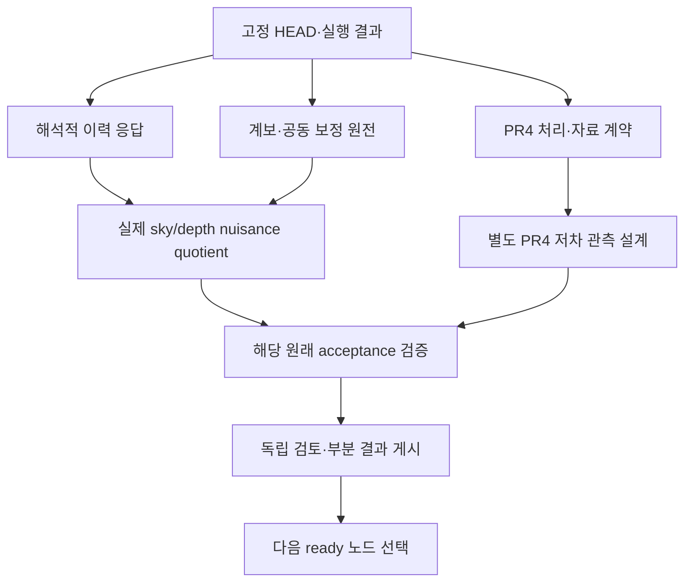

# 실행 목표와 subagent DAG

최종 목표는 원래42개 노드의 acceptance를 그대로 충족하는 solver-free 결과를 축적하는 것이다. 자료·논문·코드의 존재를 과학 완료로 바꾸지 않는다. 원래 입력이 확보되지 않으면 정확한 조건부 하위 결과를 보존하고 다른 실행 가능한 노드로 이동한다. 원래 scientific-ready가0이어도 새 이론 유도·원전 확인·자료 취득이 가능하면 계속한다. 모든 독립 경로가 실제 외부입력을 기다리는 경우에는 그 입력과 재개 명령을 기록한다.

[현재 machine-readable 계획](../OPEN_INPUTS_20261018/CONTINUATION_TASKS.json)은 원래42개 acceptance/dependency를 포함하며, packet 도구가 live DAG와 대조한다. D01–D08은 기존 실행 근거를 재사용한다. D09의 의존성은 전부 완료되어야 시작하는 전역 barrier가 아니다.

## 논문별 목표와 완료 조건

| 논문 / 노드 | 다음 구체 목표 | 반드시 필요한 입력·판별 | 완료 이후 |
|---|---|---|---|
| P1 / S02–S06 | 공통 물리 상태에 조건부 pushforward·외부구간 연결 | 실제 source response, remainder, 선정된 공동법칙. 기존2048 ID와 unknown mass를 보존 | S03→S04→S05→S06 원래 순서 |
| P2 / L03–L06 | PR3 공동법칙 해소 또는 명시적 PR4 대안의 estimator·null 계약 | 동일 release/mask/beam/foreground/선택. A/B shared sky, 실현 ID 독립성, NESTED/RING 처리. source-only 자료를 coverage로 승격하지 않음 | L04–L06; 새 release 결과는 PR3 결과와 별도 |
| P3 / H02,H04–H06 | 보정 dipole과 깊이별 velocity dipole의 실제 quotient | 공개 total covariance를 한 번만 쓰는 조건부 mean 연구는 가능. 원래 H02에는 전체 선택·공동오차법칙과 source null 필요 | H04–H06 |
| P4 / V03–V06 | 해석적 보상 다유체 이력의 실제 표본 사영 | declared IC/normal/matter/observer, 작은 속도와 redshift 범위, 물리·관측 remainder. 원래 전체 transfer 의무 유지 | V04–V06; 제한 하위 결과를 먼저 완성 |
| P5 / B02–B05 | 기존 물리 T/E/B all-m atlas 또는 정당한 제한 subset intake | 실제 수치 payload, IC/모드/단위/편광/기준계/해상도. 그림·chain·온도-only fixture로 대체하지 않음 | B03–B05; native family ID 금지 유지 |
| P6 / K03–K06 | 비방사 물리 channel과 CF4 공통-frame 부분식별 | proper-motion/clock/NNR 공동오차와 response; 공개 position covariance를 PM covariance로 대체하지 않음 | K04–K06, null sector는 unbounded/undefined |

## 작업자와 자원

이 세션 도구에서 호출 가능한 모델을 기준으로 요청 설정을 추천한다. 관측된 backend 증거가 없으면 `UNKNOWN`을 유지한다.

| 역할 | 요청 모델 / 사고 | 독립 산출물 |
|---|---|---|
| Parent / 통합·코딩 | gpt-6.1-sol / high | live DAG 확인, 실행 선택, 소비 코드·문서, 유일한 publisher |
| 이론 유도 | gpt-6-astra / xhigh | frame/IC/단위/극한, 정확식·반례·오차 의무 |
| 자료·통계 구현 | gpt-6.1-sol / high | 원천 payload 계약, 실제 소규모 계산·검증 |
| 단순 metadata 정리 | gpt-6-luna / medium | 고정 스키마와 URL/크기 정리; 과학 승인 권한 없음 |
| 별도 독립 reviewer | gpt-6-astra / xhigh | 실제 식·코드·새 증거 검토, 구체 수정 후 targeted closeout |

동시에 parent 포함4개 이하, 중첩 spawn 없음, fresh bounded packet과 파일 소유권 분리. 기존 checkout에서 작업하며 clone/worktree/전체 사본을 만들지 않는다. 외부 입력은 저장 공간과 manifest 상한을 보고 작은 묶음으로 자율 취득한다. 기본 검증 범위는 새 식·새 데이터 semantic·변경된 consumer다. 완료된 고비용/1회성 캠페인을 재실행하여 검토 근거를 만들지 않는다.

## 후속 PR 계획

아래 이름은 계획이며 이미 열린 PR 번호가 아니다. 현재 결과는 기존 draft#561에 게시한다. 각 PR은 독립적으로 검토할 수 있는 실제 결과가 생겼을 때 연다.

| 순서 | 계획 PR | 내용 / 종료 기준 |
|---|---|---|
| 현재 | #561 frontier continuation | 새 해석적 유도, source 조사, 실제 실행 상태에 맞춘 계획과 자율획득 계약 |
| 병렬 A | analytic-history-data-projection | cached 실제 방향·redshift·nuisance에 두 응답을 사영; residual rank/angle/조건수와 실패 영역 보고 |
| 병렬 B | distance-calibration-flow-quotient | 공개 covariance를 한 번만 사용한 deterministic mean quotient; selected-law 조건을 명시하고 식별된 대비만 보고 |
| 병렬 C | npipe-pr4-source-contract | 정확한 CMB frame/Q/U/단위와 total/foreground 제품을 결합; 관측·모의 처리 계약과 한 실현 byte 예산을 고정 |
| 조건부 D | qualified-null-or-physical-subset | C가 충족되면 작은 PR4 pilot; 새 외부 atlas/NNR 자료가 확보되면 해당 원래 노드 intake |
| 후속 | paper-specific-results | 원래 acceptance 충족 범위의 plot/report와 publication 판정. 여섯 논문 일괄 투고 상태 변경 금지 |
