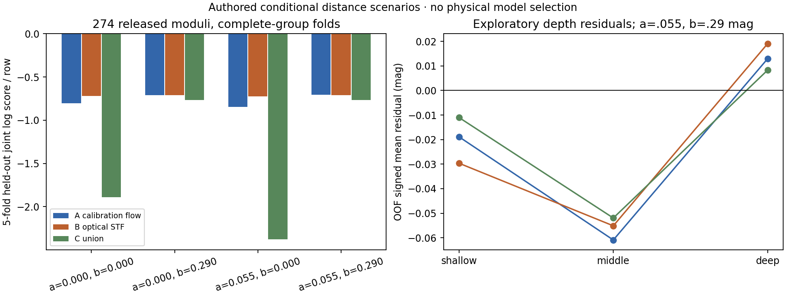

# R24 solver-free 연구 실행 — 진행 중

Owner: HTT/obsstat. 날짜: 2026-10-23. 시작 HEAD: `dfaf171c37f2636c942a99bf2b9803b57295ac14`. C0 조건부 관측/방법 연구이며 transfer_source는 none이다. native Boltzmann solver나 ODE를 실행하지 않는다. 이 파일은 진행 checkpoint이며 전체 frontier 완료 보고가 아니다.

원래 acceptance는 external-output **17/42**, V03 analytic alternate **18/42**다. 기존 48-task state, R9/UNKNOWN, 소진된 R23-COMMON-E1·R23-Q ultra와 과거 실패는 보존한다. 새 조건부 작업은 원래 acceptance를 자동 승격하지 않는다.

## 검토를 마친 실제 결과

- Controller는 기존 state에 append-only frontier, typed all/any 의무, 후보와 독립 검토에 묶인 product qualification, 의미상 재개와 미ack transport 복구를 지원한다. 세 개의 실제 검토 반례를 고쳤으며 54개 controller/builder 검사가 통과했다. [독립 코드 검토](CONTROLLER_REVIEW_FINAL.json).
- [동일 274행 거리 모델 비교](distance/REPORT.md)는 세 모델·네 공분산 scenario, 60개 whole-group held-out 적합을 실제 실행했다. 628개 선택 표식과 354개 미정의 거리를 보존했다. A calibration/flow와 B optical STF의 예측 순위가 group covariance 가정에 따라 바뀐다. 모든 scenario를 보고하며 단일 물리 모델을 채택하지 않는다. [독립 검토](DISTANCE_REVIEW_RAW.json).
- 거리 예측은 training ML scale을 대입한 normalized Gaussian working law다. 계수/scale 불확실성을 포함한 predictive coverage나 source-qualified selected law를 뜻하지 않는다. PGC9031의 Vcmb=317 km/s에서 C union의 두 b=0 scenario는 `(n·v_flow)/Vcmb=2.261954, 2.445192`로 작은 속도 근사를 위반한다. 해당 행과 적합을 지우지 않고 적용영역 실패로 기록한다.

## 계속 실행하는 경로

CMB full STF/orbit 후보는 harmonic-to-STF convention 오류를 독립 검토에서 발견해 첫 후보를 보존하고 표적 수정을 수행했다. 새 후보의 fresh 독립 검토가 진행 중이다. K03 retained-summary 오차/검정력 분석, 공개 SN release의 total-covariance 분석과 새 within-bin reported-z VSH moments를 이어간다. 이후 selection envelope, optical STF/shear scenario, boost/acceleration quotient, full tensor bundle와 depth images를 소비한다.

전체 `(x,F,Pi,Q,G_F)`를 유지한다. x는 rank/parity가 있는 functional bundle, Q는 적격 anchor gauge/margin, F는 support/pushforward/occupancy의 구별, Pi는 explicit-law surface, G_F는 원 Y 또는 `(Y0,DeltaY)`와 전체 cross covariance 경로다. physical anchor/law 부재는 unavailable/unknown으로 유지한다. scalar legacy projection으로 대체하지 않는다.

## 실행과 provenance

실제 controller state는 `.agent-harness/runtime/r23-continuous/STATE.json`이다. 재초기화하지 않는다. 원래 state의 보존본과 실제 packet·ack·raw-result·record 기록은 그 안의 `r24/`와 state history에 있다. 새 host task spec은 이 디렉터리의 `FRONTIER_*.json`이며 METHOD_REBOOT의 계획 JSON을 직접 입력하지 않았다.

모델/effort는 현재 transport 지원을 확인해 요청했다. 일상 코딩은 gpt-6.1-sol/medium, 수치 구현은 gpt-6-sol/high, 이론·독립 검토는 gpt-6-astra/xhigh다. 독립 관측 runtime identity는 UNKNOWN이다. 추가 ultra는 사용하지 않았다.

공개 raw 자료는 cache 우선으로 외장 드라이브에 보관한다. 다섯 추가 PGC 좌표의 공개 query 원문도 Git 밖에 있고 source_queries receipt가 URL·hash·size를 연결한다. figure와 수치 검증은 각 결과의 manifest/receipt에 연결된다. merge·투고 권한은 사용하지 않는다.
