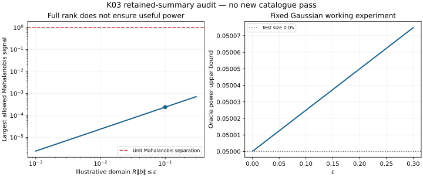

# 17/42 정체를 넘기 위한 solver-free 방법론 재설계

2026-10-23 · PR #561의 `cd2bf729f12a4229f0bb423850372a511dcff78b`를 기준으로 연구했다. 원래 external-output acceptance **17/42**, V03 analytic alternate 기준 **18/42**는 바꾸지 않았다. 이 문서는 추가 문헌 조사, 실제 유도·요약자료 계산과 적대적 감사 결과다. 원래 25개 미충족 기준의 완주 보고서가 아니다.

핵심 결론은 **외부 입력이 실제로 필요한 물리 주장과, 지금 시작할 수 있는 통계·관측 연구가 현재 실행 DAG에서 지나치게 결합되어 있다**는 것이다. 기존 HOLD 판정은 원래 acceptance에 대해서 타당하다. 그러나 고정된 48-task 목록의 `ready:[]`는 가능한 연구방법이 모두 소진되었다는 뜻이 아니다. 특히 원래 R9는 이미 제품별 독립 진행과 함수·집합·경로 추론을 허용했다. 새로운 완화 정책을 발명하기보다 이 원칙을 복원하는 것이 맞다.

## 이번에 실제로 수행한 일

- 최신 checkpoint, 실제 controller/builder, 기존 tensor/MES 계획과 R9 revision 2, scalar 구현과 tensor/depth 구현을 대조했다. 서로 다른 branch에 존재한다는 사실과 현재 branch에 통합되어 있다는 사실을 구별했다.
- 선택·부분식별·관측 응답·CMB split·거리 cosmography·K03 검정력·작업 하네스를 병렬 검토했다. SciSpace와 Exa로 문헌을 찾고 원 논문·공식 자료를 확인했다. Wolfram 각도 적분과 별도의 수치 검산을 수행했다.
- [THEOREMS.md](THEOREMS.md)에 조건과 증명이 있는 7개 정리 묶음을 작성했다. 확립된 결과의 HTT 적용이며 문헌 최초의 정리라는 주장은 하지 않는다.
- 원래 K03의 보존된 covariance/information 요약을 정확히 추출해 **유효 영역 안의 검정력 상계**를 새로 계산했다. 대형 catalogue를 다시 돌리지 않았다. [analysis.py](analysis.py), [입력](K03_INPUT.json), [결과](RESULT.json), [그림](K03_POWER.svg), [독립 검토](REVIEW_MATH.md)가 연결된다.
- 새 연구 frontier와 하네스 수정 명세를 작성했다. **production controller/state에 설치하거나 owner cache에서 새 실자료 분석을 실행한 것은 아니다.** 이번 요청의 중심인 조사·유도·감사·수정안과 재현 가능한 요약자료 계산을 수행했다.

## 왜 계속 17/42로 돌아오는가

| 원인 | 확인한 근거 | 수정 원칙 |
|---|---|---|
| admission과 research readiness의 혼동 | controller는 이미 작성된 task의 모든 `depends_on`이 완료되어야 실행한다. 새로운 방법/estimand를 append하는 API가 없다. | 기존 acceptance HOLD를 유지하면서 별도 조건부 연구 작업을 추가한다. 원래 claim 통과와 연구 실행 가능성을 분리한다. |
| 대체 경로를 AND로 합침 | builder가 같은 node를 `enables_nodes`로 가리키는 모든 action을 필수 prerequisite로 만든다. 하나 완료/하나 HOLD인 fixture에서도 소비 node가 막혔다. | 같은 의무에 각각 충분한 경로만 OR로 표현한다. 다른 estimand를 OR로 바꿔 원래 claim을 통과시키지는 않는다. |
| 전체 물리 source를 너무 이른 단계에서 요구 | S04에는 좁은 functional 허용 문구가 있지만 S02/S03의 전체 source 선행 조건이 붙는다. | optical coefficient·shear-sector·tensor morphology 각각의 관측 질문을 먼저 정의하고 필요한 입력만 연결한다. 물리 해석 단계에서 해당 source 계약을 적용한다. |
| 사용자의 tensorized 연구가 scalar acceptance로 축소 | July 계획과 R9는 `x=sample×functional`, anchor gauge, support, exceedance surface, depth path를 명시한다. 최신 scalar scope는 그 일부다. | `LegacyXQPiFGView`를 주 객체로 쓰지 않는다. tensor state·공동집합·functional별 의미를 복원한다. |
| 새로운 정보와 새로운 파일의 혼동 | `resume`은 바뀐 identity 문자열을 수용할 수 있지만 같은 자료에 대한 새로운 정리/방법의 명시적 유형은 없다. | data/method/assumption/counterexample를 구분하고 짧은 의미 차이를 독립 검토한다. hash 변경만으로 재개하지 않는다. |
| 실행 장애와 과학 장애의 혼동 | prelaunch transport refusal 뒤 transport만 복구한 재개는 거절된다. | 미실행·미ack packet만 별도 복구한다. 이는 현재 8개 과학 input cut의 원인으로 입증된 것은 아니다. |
| rank를 성과로 사용 | K03는 rank6지만 허용되는 작은 신호의 검정력이 거의 유의수준과 같다. | rank, 유효 parameter domain, discrepancy, power를 함께 보고하고 실제로 구별 가능한 조합을 연구한다. |

세부 코드 위치와 재현 fixture는 [독립 DAG 감사](agent_dag_audit.md)에 있다. 현재 과학 HOLD는 ultra 조건보다 먼저 처리되므로 **“ultra 횟수만 풀면 해결”은 근거 없는 진단**이다. 기존 one-use와 R9/UNKNOWN을 보존한다.

감사자의 “최대 두 대안 후 park” 제안은 **영구 종료 규칙으로 채택하지 않는다**. 두 차례 실패는 재설계·우선순위 검토의 신호로 사용할 수 있다. 새로 구별 가능한 방법·입력·반례가 있으면 계속한다. 반대로 이름만 바꾼 동일한 실패를 반복하거나 audit 문서량을 성과로 세지 않는다.

## 사용자의 `(x,F,Π,Q,G_F)`를 실제로 유지하는 방법

원래 July tensor 계획과 [R9 revision 2](https://github.com/cosmosapjw-quantum/htt_base/blob/cd2bf729f12a4229f0bb423850372a511dcff78b/docs/research_program/tensor_joint_r9/revision2/MODEL_TO_DATA.md)의 설계가 출발점이다. `Q`라는 글자를 CMB quadrupole, anchor gauge, scalar ratio로 혼용하지 않는다. 여기서는 CMB 텐서를 `T₂,T₃`로 쓴다.

| 객체 | 이번 연구에서 유지할 의미 | 관측·통계 연결 |
|---|---|---|
| `x` | typed joint state에 적용한 functional들의 표본×함수 배열; vector/STF/parity 정보를 보존 | optical STF, full CMB Q/O, radial response, calibration residual, depth별 tensor를 각자 frame/window와 연결 |
| `Q` | 적격 anchor body의 gauge/margin. scalar `x_C/Uσ`는 제한된 투영 | 공동 state–anchor 신뢰집합에 대한 gauge interval. anchor 미확보를 0으로 채우지 않음 |
| `F` | directional support, sample pushforward, 명시적 measure의 occupancy를 별개 타입으로 보존 | `h_K(u)/h_A(u)`는 support profile. 부호 있는 값은 occupancy 확률이 아님 |
| `Π` | law가 명시된 `(functional, threshold)` exceedance surface | HTT posterior·MIO matched null·confidence image를 구별. physical unknown mass=1은 그대로 보존 |
| `G_F` | covariance를 포함한 구조화된 functional depth path | `Y` 또는 `(Y₀,ΔY)` 전체를 보존. 부호/0을 지나는 경로는 차분·집합 경로를 사용. legacy ratio는 양의 1차원 subcase만 |

공통 신뢰집합 `C(D)`가 실제 state·nuisance·anchor·remainder를 함께 포함하면 모든 `φ(C)`가 같은 신뢰사건의 함수상이다. 이를 위해 매 functional마다 별도 전체 source를 다시 만들 필요는 없다. 그러나 `C`에 없던 물리 response나 jet를 나중에 넣어 같은 coverage라고 할 수는 없다. 공유 nuisance를 가진 제품은 **공동 상태에서 교차한 뒤 사영**해야 한다.

## 수학적으로 얻은 구체적 연결

**1. 광학 사중극에서 전단 sector로.** 동일한 congruence `u`, local optical vertex와 적격 오차 아래

\[
\mathcal H_u(n)=H_u-A_u\!\cdot n/c+\sigma_u:nn,
\qquad \Sigma_u^2=\frac54\langle(h_2/H_u)^2\rangle.
\]

`h₂`의 L² 오차 `r`, `0<H₋≤H≤H₊`가 같은 신뢰사건에 있으면

\[
\frac54\frac{(\|\hat h_2\|-r)_+^2}{H_+^2}
\le\Sigma_u^2\le
\frac54\frac{(\|\hat h_2\|+r)^2}{H_-^2}.
\]

이는 전체 `x_C`를 먼저 복원하지 않고 전단 sector를 연구할 수 있는 정확한 연결이다. 유한-z fit은 우선 effective optical coefficient다. `u=G` 또는 적격 frame/congruence map과 remainder가 확인되어야 원래 물리 전단으로 해석할 수 있다. vorticity는 이 국소 radial contraction에서 사라지므로 이를 radial 자료만의 와도 측정으로 부르지 않는다.

**2. dust 가정을 명시적으로 시험하는 대안.** 에너지 frame, 보존되는 물질 stress, `P=pI+π≥0` 아래

\[
A=-c^2(\epsilon I+P)^{-1}(Dp+\operatorname{div}\pi),
\qquad \|A\|\le c^2\|Dp+\operatorname{div}\pi\|/\epsilon.
\]

이는 2026년 Clarkson–Maartens kinetic-cosmography preprint의 정확한 운동량 제약에서 얻는 대수적 응답이다. ODE나 Boltzmann hierarchy를 풀지 않는다. 따라서 관측 dipole의 후보를 observer boost, velocity-dispersed matter acceleration, 보정/선택으로 나누어 비교할 수 있다. pressure-gradient 자료와 tracer→matter 가정 없이는 이 항을 측정했다고 할 수 없고 `A²`를 임의로 `x_C`에 추가하지 않는다.

**3. tensor shape와 anchor의 안정성.** STF 직합 공간에서 회전 불변 norm을 쓰면

\[
d_G([v],[w])=\min_R\|v-\rho(R)w\|,
\quad |d_G(v,w)-d_G(v',w')|\le\|v-v'\|+\|w-w'\|.
\]

축이 퇴화한 sample도 제거하지 않고 비교할 수 있다. `rB⊂A`인 convex balanced anchor에서는 `|γ_A(v)-γ_A(w)|≤||v-w||/r`. compact convex 집합은 `d_H(K,L)=sup_{||u||=1}|h_K(u)-h_L(u)|`로 support profile과 연결된다. 비볼록 strata는 convex hull의 support만으로 복원되지 않으므로 별도로 보존한다.

**4. 전체 generator 대신 좁은 robust inference.** 고정 nuisance별 유효한 `pη`와 `1−γ` nuisance confidence set이 있으면 Berger–Boos의 `min(1,supη pη+γ)`가 유효하다. bounded bias와 부분식별, selection sensitivity는 원래 full generator 없이 **새롭게 명시한 더 좁은 실험**을 연구하는 표준 통계 도구다. 출처 없는 유한 prior를 붙이거나 grid maximum을 supremum으로 부르면 이 보장이 사라진다.

**5. K03의 실제 새 결과.** 보존된 6-parameter information에서 local nuisance를 profile한 `C_bb`를 사용했다. `R||b||≤ε`인 예시 small-domain에서

\[
d_{\max}^2=(K_H\epsilon/R)^2\lambda_{\max}(C_{bb}^{-1}),
\quad \operatorname{power}_{.05}\le\Phi(\Phi^{-1}(.05)+d_{\max}).
\]

`ε=.1`에서 `dmax=0.00024179087493`, power 상계는 **0.050024942216**다. 따라서 이 고정 Gaussian summary 실험에서 rank6은 유용한 분리력을 뜻하지 않는다. 새 catalogue pass보다 관측량·depth kernel·오차 구조·물리 parameterization을 바꾸는 설계가 필요하다. 이것은 Gaussian working model에 대한 조건부 결과이며 실제 quasar→matter 법칙이나 보편적 no-go가 아니다. `ε` 자체도 remainder 인증은 아니다.

## 각 blocker에 적용할 문헌 방법과 다음 실험

아래는 문헌에서 사용되는 **대안적 방법군**이다. 모든 논문이 같은 가정을 채택한다는 의미는 아니다. 선택한 법칙의 adequacy를 반드시 검사한다. [관측 문헌 검토](agent_observables.md), [선택·부분식별 검토](agent_selection.md), [서지와 공개 자료](BIBLIOGRAPHY.md)에 근거와 실패 조건이 있다.

| 원래 blocker | solver 없이 시작할 연구 | 이 연구만으로 충족되지 않는 것 |
|---|---|---|
| H02 / H04–H06 | selected-sample hierarchical distance likelihood에 selection normalization·method zero point·group/shared calibration을 넣는다. 같은 표본에서 joint calibration/PV 모델과 covariant cosmography를 비교한다. 선택 불확실성은 bounded selection odds/overlap 민감도로 보고한다. | CF4 원저자 full source null 재현 및 parent selection의 실증적 확보 |
| S02 / S03–S06 | 위 광학 STF와 적격 shear-sector interval, frame 변환, finite-z remainder 민감도. full source로의 pushforward와 optical inference를 분리한다. | 기존 2048 ID의 normalized physical kernel. unknown mass1을 바꾸지 않음 |
| S04 | source가 허용하는 좁은 functional을 공동집합에서 사영; finite/nonvacuous bound 또는 vacuity witness를 계산한다. | 형식적인 local identity만으로 실제 선택 likelihood coverage가 생기지 않음 |
| L03 / L04–L06 | 관측 Q/O full tensor와 orbit/support profile; split contrast의 common-mode kernel을 명시하고 frequency/template nuisance envelope를 비교. 적격 reference에서만 p/rank, 그 외 sensitivity curve. | 같은 실현 PR3 FULL/HM/OE joint physical ensemble. 작은 split 차이로 common foreground를 상계할 수 없음 |
| V03 / V04–V06 | local radiation boost의 주파수 응답·observer-frame covariance와 finite-depth optical 대안을 비교. observer shift와 intrinsic matter acceleration을 분리하는 response-rank/power 설계. | 원래 global-tilt external history response. analytic bolometric subcase를 외부 history로 바꾸지 않음 |
| B02 / B03–B05 | full Q/O의 rotation/orbit/parity, anchor support와 mask/common-contaminant 안정성을 연구. physical atlas 없이도 morphology 논문 후보를 만든다. | 실제 Bianchi physical-family identification 및 all-m T/E/B history atlas |
| K03 / K05–K06 | 이번 power 진단을 spatial/systematic covariance sensitivity와 depth별 VSH response 설계로 확장. optical/radio frame·NNR 차이를 nuisance로 명시. | photocentre→matter 법칙, finite physical remainder, 원래 curl/tilt 물리 전달 |
| K04 | 적격 optical/distance 부분의 동일 frame functional만 먼저 결합. 공유 calibration을 공동집합에 유지. | undefined/null sector와 full CF4/matter source를 복원한 것으로 계산하지 않음 |
| SN processing Jacobian | 공개 release-level distance/covariance functional, calibration response에 대한 sensitivity와 독립 재적합 질문. total covariance는 한 번만 사용. | 특정 옛 training/model/FITRES의 exact replay. README의 nominal 표현은 byte parity 증거가 아님 |

2026년 CF4 문헌 두 경로의 비교가 특히 중요하다. Kalbouneh 등의 directional cosmography와 Stiskalek 등의 calibration/velocity joint inference는 서로 다른 표본·가정에서 서로 다른 역할의 anisotropy를 분리한다. 어느 한쪽의 수치로 현재 표본을 대체하지 말고 **같은 selected cohort, 같은 frame/window에서 모델별 예측·잔차·민감도를 비교**한다. 이미 관측한 `T=4.5553218238,p=.0009763241396` 실패를 보고 새 null을 고른 경우 새 분석은 exploratory다. 독립 holdout이 없으면 선택 전체를 반복하는 calibration 또는 명시적 exploratory 보고가 필요하다.

## 논문화 후보와 추가로 얻을 수 있는 결과

모든 여섯 논문은 현재 **NOT_READY_TO_SUBMIT**다. 원래 acceptance 수와 논문 성숙도를 동일하게 취급하지 않는다.

| 축 | 현재 근거가 있는 후보 | 투고 수준까지 필요한 추가 분석 |
|---|---|---|
| S: tensorized inference | full functional/set/path 구조, 정확한 shear/gauge/support 연결, source별 부분식별 원리 | 기존 통계/기하 결과 대비 독창성 정리, 적격 실자료 confidence bundle과 coverage/power, scalar projection 대비 이득 |
| L: low-ell CMB | 처리·split 실험과 common-mode 미식별 구조; 퇴화에 안전한 full tensor 비교 | 실제 선택/처리를 맞춘 calibrated morphology 또는 정당화된 sensitivity bounds, map/frequency 안정성 |
| H: distance/selection | 실제 실패한 selected likelihood의 진단; selection transport/sensitivity 대안 | 다른 likelihood의 held-out 또는 selection-aware 검증, 방법/깊이/방향 calibration과 신뢰집합 폭 |
| V: local/global distinction | 제한된 observer-equivariant analytic subcase와 response 대비 | 적격 데이터의 local-boost 결과와 intrinsic/calibration 대비. 원래 global history 주장은 external response 필요 |
| B: morphology vs family | orbit/strata/anchor 표현과 물리 identification의 구별 | 실제 CMB morphology·혼동/안정성 실험. family 결론은 atlas 확보 전 보류 |
| K: astrometric identifiability | 실제 retained summary의 valid-domain power 상계와 rank의 한계 | spatial/common-error sensitivity, realistic response/remainder와 대안 관측 설계. 현재 조건부 상계만으로 독립 논문 확정 불가 |

추가 분석의 가치가 큰 결과는 (a) nuisance 허용량에 따른 functional interval 폭과 비자명성 경계, (b) 같은 표본의 optical STF 대 calibration dipole 식별 범위, (c) scalar 통계가 놓친 tensor orbit/parity 차이, (d) 초기 블록을 보존한 depth path가 차분만 쓴 경우보다 유지하는 정보, (e) K03가 필요로 하는 정보량/관측량 변화, (f) 원래 물리 주장에 꼭 필요한 최소 외부 입력의 축소다. 결과가 모델 반박이나 “이 반경부터 vacuous”여도 정량적 연구 결과로 남긴다.

## 작업을 다시 막지 않는 실행 계획

기계 입력은 [METHOD_FRONTIER.json](METHOD_FRONTIER.json), host용 지시는 [HANDOFF_PROMPT_KO.md](HANDOFF_PROMPT_KO.md)다. 이것은 기존48-task state를 대체하는 새 캠페인이 아니라 **append할 수 있는 별도 연구 계획**이며 아직 controller에서 실행된 state가 아니다.

첫 실자료 우선순위는 같은 cohort의 거리 likelihood 비교와 existing CMB tensor/support sensitivity다. 이 둘을 대형 원자료 재다운로드보다 먼저 수행한다. 동시에 작은 controller 패치로 append/typed obligation/evidence-kind를 지원한다. 변경은 기존 코드 한 묶음과 이를 소비하는 한 실제 분석으로 검토한다. 작업 시작 전에 모든 25개 input gap을 닫으려 하지 않는다.

한 작업 종료 뒤 ready 독립 작업으로 즉시 이동한다. 과학 blocker에는 실패 지점·새 가정·최소 판별 계산을 만들어 기존 router에 전달한다. `gpt-6.1-sol/medium`은 자료 adapter/반복 코드, `gpt-6-sol/high`는 수치 구현, `gpt-6-astra/xhigh`는 이론·독립 적대 검토에 사용한다. `gpt-6-astra/ultra`는 기존 정책이 허용하는 미소진의 구체적 issue에만 사용하며 같은 문제를 새 ID로 감싸 소진 기록을 지우지 않는다. requested profile과 observed model은 별도 기록하고 실제 검증이 없으면 UNKNOWN이다.

완료 목표는 “42를 어떤 방식으로든 PASS로 만들기”가 아니라 **원래 목표를 최대한 달성하면서 모든 실행 가능한 연구 경로에서 판별 가능한 결과를 얻는 것**이다. 새 결과가 원래 acceptance를 충족하면 별도 mapping/review로 승격한다. 실제 외부 history/atlas 부재가 남으면 정확한 재개 조건을 유지한다. 새 방법이 있는데 ready가 비었다면 frontier를 확장하고, 새로운 과학 질문이 전혀 없는 반복만 남았을 때에만 그 경로를 보류한다.

## 자료와 검증 범위

이번 유도·K03 요약 계산에는 신규 대형 관측 다운로드가 필요하지 않았다. 다음 분석은 기존 CF4/Planck/Gaia/Quaia/Pantheon cache를 먼저 쓴다. 필요한 추가 공개 비교 자료는 CF4 원 표/TF 입력, SFI++·2MTF, 같은 release의 Pantheon 거리 벡터와 total covariance, Planck PR3의 실제 matching maps/masks/beams/noise 제품, Gaia-CRF3/Quaia 및 적격 radio frame catalogue다. 데이터별 정확한 경로·목적은 서지의 intake 표를 따른다. 공개되어도 원래 joint generator나 calibration law를 포함한다고 가정하지 않는다.

raw data는 Git 밖에 둔다. `/mnt/extdrive`의 실제 mount와 가용 공간을 매 실행 확인하고 기본2GiB reserve/streaming 검사를 유지한다. 파일별·누적 다운로드 한도는 두지 않는다. 여기서 owner mount를 다시 검증하거나 데이터를 받은 것으로 기록하지 않았다. 저자에게 메시지를 보내지 않았으며 인증을 우회하지 않았다.

재현은 이 디렉터리에서 `OPENBLAS_NUM_THREADS=1 python analysis.py`로 수행한다. NumPy/SciPy/Matplotlib 버전은 RESULT에 있다. 독립 reviewer가 covariance 추출, Schur profiling, power, 각도 항등식, selection LP와 interval 성질을 검토했다. 상세 결과는 REVIEW_MATH와 REVIEW.json을 따른다. 대형 catalogue, 전체 repo CI, production controller의 실제 재가동은 이 연구 패키지의 실행 사실에 포함되지 않는다.
