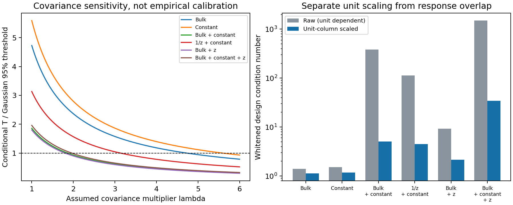

# 1. Result and scientific objective

The retained programme can advance through response-qualified observable inference without a new Einstein–Boltzmann solver. This reconciliation supplies an exact covariance-transport implementation, a reproducible audit of six H03 depth fits, a corrected astrometric history response, and executable contracts that consume the recovered radiation, optical and geometry results. Its central question remains physical: which measured angular and depth-dependent combinations constrain radiation stress, matter motion and spatial geometry?

The current reference is the active branch `research/htt-adaptive-methods-20261023`.

Its pinned head is `a55036ad09c5` (full identity in `RUN_CONTRACT.json`). The latest merged PR is #562. All nine R32 publication companions are recorded complete. The original external-output acceptance remains **17/42**; **18/42** is the separate analytic V03 scope. These are distinct ledgers. The checkpoint contains 29 residual held branches, including historical execution conditions. Completion of a new conditional product will be recorded in its own ledger and then assessed against any original contract it informs.

Two recovered packages preserve the five earlier theory loops, v15 extension and cosmological applications. This integration includes 120 source/figure/report files and a 156-file scientific evidence manifest. Seventy-one review-bound scientific source identities match the recovered packages. Three older literature-fetch receipts were unavailable; the import manifest names them. Existing review records retain their original scope and date. The supplied external audit is preserved byte-for-byte under `external/`, with the present adjudication alongside it.

The local desktop host was offline during this work. No live runtime state, external-drive cache or current dirty checkout was observed. The change was prepared from selected pinned GitHub files, without a clone or worktree. Uptake of the new frontier therefore occurs in the existing local session after a read-only state-aware preflight.

# 2. The external audit: corrections that change the next experiment

The audit correctly identifies a physical gap between a fitted CF4 window tensor and a congruence shear. It also correctly objects to a direct four-acceleration interpretation of a finite-window dipole. Its T12 numerical conclusions can be tested on the retained H03 summary. Four proposed restrictions, however, would stop valid research unnecessarily.

First, selected catalogue mocks are one route to an empirical covariance law. They are not required to derive and test the propagation of a stipulated correlated law through the exact frozen estimator. Second, low astrometric power under one local amplitude and selected CMB histories does not establish absence of an astrometric response in every regime. Third, the local PM response needs a two-time history term; dropping it even reverses the nearby-source sign. Fourth, a universal one-percent split cross-spectrum threshold does not prove shared simulation genealogy.

The constructive replacements are explicit: exact estimator transport; history-qualified PM response and power; an observer-chart adapter for the optical inverse; release-bound simulation intake; a dimensional complex foreground budget; and a public released-magnitude supernova comparator. Detailed source adjudications are in `research/PHYSICAL_AUDIT.md`, `DATA_ATLAS.md` and `INTERNAL_INTEGRATION.md`.

# 3. H03 numerical replay and the covariance bridge

## 3.1 What the saved data establish

The source summary represents 35,970 released groups, four overlapping windows, and nine coefficients per window. The replay selects the three dipole coordinates in each window and retains the inherited cross-window covariance. Its law assumes diagonal working scatter across source rows, including a 250 km/s term in the weights. That term is not automatically an independently calibrated error component.

The external attachment contains T01–T07 and T11 code but no T12 execution receipt. `covariance/replay_h03.py` supplies a separate replay using Cholesky whitening and column-scaled SVD. The six statistics agree with the reported values:

| Mean design | Quadratic statistic | Residual dimension | Unit-column condition |
|:--|--:|--:|--:|
| Source bulk response | 79.987013 | 9 | 1.136 |
| Constant angular dipole | 94.598317 | 9 | 1.177 |
| Bulk + constant | 23.396721 | 6 | 5.096 |
| $1/z$ proxy + constant | 39.460673 | 6 | 4.467 |
| Bulk + $z$ | 22.668786 | 6 | 2.162 |
| Bulk + constant + $z$ | 15.316002 | 3 | 34.237 |

These are conditional model checks under the retained covariance. They reject these finite mean designs under that working law; they do not exhaust the class of cosmological velocity fields. The bulk-only amplitude is 294.950637 km/s towards Galactic $(286.562924^\circ,-5.499875^\circ)$. Its delta-method standard deviation is 19.441892 km/s. The external value 18 km/s is not reproduced under that specific definition.

The raw conditions 384.439 and 1495.736 mix velocity and expansion-rate units. Scaling each whitened column gives 5.096 and 34.237 for the same two designs. Column scaling does not remove physical overlap: the whitened principal angles between the saved bulk response and the window-centre $1/z$ proxy are $4.812^\circ$, $7.168^\circ$, $8.919^\circ$. Their numerical rank is six, so this particular proxy comparison is near-overlap, rather than an exact rank deficiency.

{width=100%}

## 3.2 An exact covariance transport that avoids a dense catalogue matrix

Freeze the estimator $\widehat\theta=Ay$ and its row order, windows, nuisance projection and units. Let the source error decompose into mutually independent classes,

$$y-m=\epsilon+V\xi+K_0\eta,\qquad
\operatorname{Cov}(\epsilon)=\operatorname{diag}(D),\quad
\operatorname{Cov}(\xi)=I,\quad\operatorname{Cov}(\eta)=\Sigma.$$

Then, writing $K=AK_0$,

$$C_\theta=A\operatorname{diag}(D)A^T+(AV)(AV)^T+K\Sigma K^T.\tag{1}$$

This follows directly from covariance bilinearity. Correlated classes must instead enter a joint factor with their cross terms. If calibration/PV uncertainty is already in $D$, an added factor must replace or separate that component rather than count it twice. The implementation checks shapes, positivity, symmetry and source ownership, and preserves cross-window terms. Eight focused tests compare it with dense reference algebra and exercise rank-deficient and invalid-input cases.

A conditional linear-theory radial velocity kernel is

$$\Psi_{ij}=(aHf)^2\int\frac{d^3k}{(2\pi)^3}P_\delta(k)
\frac{(n_i\cdot k)(n_j\cdot k)}{k^4}e^{ik\cdot(r_i-r_j)}.\tag{2}$$

Positive quadrature weights give a sine/cosine feature factor $\Psi\simeq BB^T$. With the actual velocity-to-observable derivative $R$, each vector $ARb_\alpha$ contributes one positive semidefinite outer product. The output covariance can remain $36\times36$ without constructing a $35970\times35970$ matrix. The local continuation must first recover the existing producer's exact $A,R$; using $1/z$ at window centres for only one physical component changes the inference problem.

At leading low redshift, constant source bulk and observer motion enter as relative radial velocity. Their exact common-operator design is $[AN,-AN]$, with null vectors $(h,h)$. Only the difference is identifiable at this order. A proxy-induced rank increase cannot separate the two physical vectors. An independent frame constraint or an explicitly derived higher-order response can add information through a joint likelihood.

For 64 Gaussian mocks and a 36-dimensional summary, the Hartlap inverse correction is $26/63$. This does not make the resulting quadratic statistic Gaussian or calibrate a selected analysis. The complete selected statistic or an applicable covariance-marginalized likelihood must retain finite-simulation uncertainty [Hartlap et al.; Sellentin & Heavens].

# 4. A history-aware astrometric bridge

Use $(-,+,+,+)$, outward source direction $n$, $P_n=I-nn^T$, nonrotating observer axes and proper time $t$. For weak fixed-axis Bianchi I,

$$ds^2=-c^2dt^2+a(t)^2[e^{2B(t)}]_{ij}dx^i dx^j,
\quad B=B^T,\quad\operatorname{tr}B=0.$$

For comoving source and observer, define $\chi_{so}=c\int_{t_s}^{t_o}dt/a(t)$ and $D_{so}=a_o\chi_{so}$. The convention-translated first-order response from Marcori et al. is

$$\mu(n,z)=P_n A_{\rm PM}(z)n,\qquad
A_{\rm PM}=\frac{2c}{D_{so}}(B_o-B_s)-\dot B_o.\tag{3}$$

The first term carries the source-observer history; the second is the local aberration term. For any STF $A$, spherical moments give

$$\langle|P_nAn|^2\rangle=\tfrac13\operatorname{tr}A^2-	frac2{15}\operatorname{tr}A^2
=\tfrac15\|A\|_F^2.\tag{4}$$

For nearby sources, $D_{so}\simeq c\Delta t$ and $B_o-B_s\simeq\sigma_o\Delta t$, hence $\mu\simeq+P_n\sigma_o n$. Differentiating $n=r/|r|$ with $\dot r=(HI+\sigma)r$ confirms the sign. An actual Wolfram evaluation returned zero for all three components of the derivative residual; the finite check has error $8.14\times10^{-12}$, while the opposite-sign formula gives 0.09 in the same dimensionless fixture.

If $\|\dot\sigma\|_F\le L_\sigma$ throughout the interval, then

$$\|A_{\rm PM}-\sigma_o\|_F\le
2\left|\frac{c\Delta t}{D_{so}}-1\right|\|\sigma_o\|_F
+\frac{cL_\sigma\Delta t^2}{D_{so}}.\tag{5}$$

Integrate $\sigma(t)-\sigma_o$ to prove (5). It converts missing history into a finite nuisance bound when $D$, $\Delta t$ and $L_\sigma$ are supplied. Equal endpoint deformation need not determine PM: $\delta B=\varepsilon\tau(1-\tau)T$, $\tau=(t-t_s)/\Delta t$, leaves $B_s,B_o$ fixed but changes $A_{\rm PM}$ by $\varepsilon T/\Delta t$. This is a kinematic history discriminator, without evolving any field equation.

For an observed PM design $J$ and nuisance design $N$, the whitened projected information is

$$\mathcal I=J^TV^{-1/2}(I-P_{V^{-1/2}N})V^{-1/2}J.\tag{6}$$

Its noncentrality determines power for the declared physical domain. A small value supports a scoped low-power conclusion; it does not remove the physical response. An unconstrained catalogue spin removes three common B1 directions. Quasar centroid-to-matter response, source depths and Gaia/radio cross-errors remain data contracts for physical inference.

Mode dependence matters. Saadeh et al. quote vector and regular-tensor shear bounds of $4.7\times10^{-11}$ and $10^{-6}$ within their respective histories. Neither is a universal limit on an arbitrary late-time local tensor. The repaired task therefore computes a response and sensitivity frontier before a source-specific physical claim.

# 5. Optical kinematics and the joint dipole–octupole test

For sources and observer in the same smooth congruence,

$$\mathcal H(n)=H-A\cdot n/c+\sigma:nn,
\qquad d=-A/(cH),\quad S=\sigma/H.\tag{7}$$

Separately conserved geodesic dust has $A=0$. A coordinate gravitational acceleration is not $A$. A smoothed effective flow can acquire stress/dispersion terms, so its acceleration requires its own averaging law. These facts constrain the physical referent of a fitted dipole without invalidating (7).

The retained logarithmic magnitude response has $O_\mu=\kappa L_Sd+R_3$, with $L_Sd=\operatorname{STF}(d\otimes S)$ and

$$M_S=L_S^*L_S=\tfrac13(S:S)I+\tfrac25S^2,\qquad
\widehat d=\kappa^{-1}M_S^{-1}(\widehat O:S).\tag{8}$$

The physically useful consistency test uses one shared error budget:

$$\|\widehat O-\kappa L_Sd_{\rm obs}\|^2
=\|\widehat O_\perp\|^2+
\kappa^2(\widehat d-d_{\rm obs})^TM_S(\widehat d-d_{\rm obs}).\tag{9}$$

Thus separate normalized residuals of 0.8 and 0.8 fail the joint unit budget: their joint score is $1.13137$. With uncertain $S$, the finite radius contains

$$E_3+e_O+B_z+B_{\rm sel}+|\kappa|\sqrt{3/5}\,e_SD_{\max}.\tag{10}$$

Profile the second term in (9) over the joint direct-dipole uncertainty region. At $S=0$, use direct response membership rather than an inverse. The test detects incompatibility with the declared response-plus-error class. A failed test alone does not uniquely attribute it to finite redshift, selection or a different physical model.

A moving observer relative to geodesic matter has a different target. Maartens et al. give, to first order,

$$d_{\rm boost}=-2(I+S)\beta+O(\beta^2),\qquad
\widehat\beta=-\tfrac12(I+S)^{-1}\widehat d.\tag{11}$$

The second map requires invertibility and a correctly constructed optical slope chart. The distance is $d_{L*}=d_L/(1+z)^2$, and the observer change shifts the vertex redshift. An uncorrected luminosity-distance slope produces a spurious octupole. A nonlinear magnitude octupole and this chart artefact are different contributions. The continuation must derive the catalogue-to-target response before interpreting a CF4 or SN harmonic as acceleration or observer velocity.

# 6. Recovered radiation results supply a second physical channel

The tensorized carrier separates passive rotations, spacetime gauge, observer changes and statistical nuisance directions. It also separates an invariant of a sky summary from an observed quantity and from a physical quantity inferred through a response. For example, a parity-odd STF contraction can be rotation-invariant while its sampling significance still depends on the processed-sky null.

Let $I$ be bolometric energy density per solid angle, in J m$^{-3}$ sr$^{-1}$: $I=c^{-1}\int I_\nu^{\rm radiance}d\nu$. For outward direction $n$, the retained adapter is

$$J_{A_\ell}=(-1)^\ell\int I(n)n_{\langle A_\ell\rangle}d\Omega,
\qquad \rho=J,\quad q_a=cJ_a,\quad\pi_{ab}=J_{ab}.\tag{12}$$

For photons, velocity-dressed radial hierarchy indices coincide because $cq/E=1$; independent spectral moments still require independent kernels. An E-polarization map is not positive bolometric intensity.

Let $f=q/(c\rho)$, $P=\pi/\rho$. On $\rho>0$, $|f|<1$, the exact perfect-radiation stress criterion is

$$\mathscr D=P-\frac{3}{2+\sqrt{4-3|f|^2}}\operatorname{STF}(ff^T)=0.\tag{13}$$

It tests whether the stress has a timelike isotropic-pressure rest frame. Higher angular harmonics can remain even when stress is perfect. The rest-pressure anisotropy $\mathcal A_\gamma$ is computed on the unique timelike eigenbranch. A joint physical moment confidence set maps to regions for $\mathscr D$ and $\mathcal A_\gamma$; its five coordinates do not automatically have a chi-square null.

Retained pure-boost residuals are at most $1.65\times10^{-16}$. The CMB-scale static example gives $\mathcal A_\gamma=3.2659863\times10^{-6}$ and a residual lower bound $2.7412264\times10^{-6}$ under its declared toy errors. These validate the method; the Planck empirical channel still needs calibrated intensity/spectral completion.

The response to differential expansion is

$$\mathcal L_I S=\frac{8\rho}{15}S+
\frac{10}{7}\operatorname{STF}(S\pi)-H_4:S,\tag{14}$$

with the symmetrized STF product understood. Its quadratic form is

$$\langle S,\mathcal L_I S\rangle=
\int I(e)\{2|Se|^2-(e^TSe)^2\}\,d\Omega.\tag{15}$$

All response kernels occupy angular sectors 0, 2 and 4. Matching those energy moments therefore preserves the whole operator, even if unresolved entropy and higher harmonics remain. The retained numerical experiment reduces the response error from $0.00654243536\rho$ at $L=2$ to approximately $1.2\times10^{-15}\rho$ at $L=4$, while the angular entropy residual is still $9.37160903\times10^{-5}$. This gives a target-specific stopping rule that avoids unnecessary reconstruction.

An entropy inequality supplies one sufficient coercivity certificate. Its failure should trigger evaluation of the actual five-dimensional operator spectrum. The retained positive family at entropy deficit 0.294552 still has $\lambda_{\min}/\rho=0.128233$. For the declared collisionless geodesic irrotational transport branch, $\mathcal L_I\sigma=-R$. If $\widehat\lambda>\epsilon_L$,

$$\|\sigma-\widehat\sigma\|\le
\frac{\epsilon_R+\epsilon_L\|\widehat\sigma\|}{\widehat\lambda-\epsilon_L}.\tag{16}$$

The operator can be finished before the derivative residual $R$. One-event moments do not supply that derivative. This separation is the precise change needed in the research DAG.

The population ratio $\mathcal N^4/(\mathcal D\mathcal E^3)$ has pointwise Doppler weight zero but remains an aberrated scalar field. It becomes an independent physical channel only when number and energy, or equivalent distinct spectral responses, are available. Computing both from one imposed blackbody temperature adds no independent information. The recovered detector-entropy frontier likewise requires a physically supplied budget; it cannot be inferred from an arbitrary foreground radius.

# 7. Morphology, foregrounds and geometry

## 7.1 A measured morphology example and its reference law

The retained PR3 E-mode main row, processed at $\ell_{\max}=32$, is

$$ (r,\mathcal C,E,U)=(0.0582918,-0.0967707,0.808141,0.1197448).$$

Under the independent isotropic Gaussian ideal octupole law, $U=3\sqrt3|z_1z_2z_3|$ with $z$ uniform on $S^6$. The retained 1,048,576-draw simulation places 662,397 values below the observation: CDF 0.631711, upper tail 0.368289. This is an ordinary ideal-reference position. A processed-Planck rarity requires its own simulation law. All 60 retained carriers have individually certified sign stability at relative radius $10^{-6}$; their signs need not agree, and that radius is not an estimated instrumental error.

NPIPE supplies a possible separate processed-null experiment. The release documents common input CMB realizations, but each selected filename must still be bound to iteration, input sky, split and processing role. In 30/44 GHz, A/B are time splits. For unequal split noise, even a common sky can have nonzero $(A-B)\times\mathrm{full}$ expectation. The static counterexample gives exactly -1.5. Replace the external universal one-percent gate by genealogy and transfer-aware diagnostics.

## 7.2 A finite complex foreground budget

Polarization moments use complex $Q+iU$ weights. Oppositely oriented components can cancel the reference amplitude while leaving spectral moments nonzero. The static fixture has zero net reference amplitude, total-variation amplitude 2 and nonzero frequency signal. Its maximum truncated-series error 0.00443955 lies below the explicit total-variation bound 0.00503235.

For a Taylor response $f(\beta)$ around $\beta_0$, a line-of-sight mixture with complex measure $w$ and $|\beta-\beta_0|\le\Delta$ has remainder bounded by

$$|R_{p+1}|\le \|w\|_{\rm TV}
\sup_{|u-\beta_0|\le\Delta}|f^{(p+1)}(u)|
\frac{\Delta^{p+1}}{(p+1)!}.\tag{17}$$

If the retained coefficient uncertainty is an ellipsoid $b^TC^{-1}b\le r^2$, its linear response in direction $a$ has support $r\sqrt{a^TCa}$. These are finite, dimensional response bounds. The new task must estimate or justify $C,r,\Delta$ using actual channels and a heldout/calibrated model. Scalar spectral-index variance and net polarized amplitude alone cannot supply the bound [Chluba et al.; Vacher et al.].

## 7.3 Geometry and directional distance jets

The earlier finite geometry loop constructs Bianchi II with $n=(u,0,0)$ and VII$_0$ with $n=(0,2u,u)$ sharing expansion, diagonal shear, normal dust density, zero momentum and scalar curvature $-u^2/2$. Their spatial Ricci tensors are respectively

$$\frac{u^2}{2}\operatorname{diag}(1,-1,-1),\qquad
\frac{u^2}{2}\operatorname{diag}(-1,3,-3).\tag{18}$$

Their spectra expose the extra curvature information needed to distinguish them. Flat I and equal-parameter flat VII$_0$ instead give the same local spatial Euclidean geometry. A finite compatibility image can therefore be computed now; original physical CMB family identification retains its source-qualified native-atlas, null, mask, covariance and family-equivalence requirements. An external product can support only its separately declared transfer-conditional compatibility claim. The AniLoS IX mode has physical $\ell=|m|=2$, not general $\ell\le3$ coverage inferred from an array sentinel.

The retained optical jet determines the combination

$$\mathcal J=h_2+\tfrac12h_0R_{KK}
=\frac{3h_1^2}{h_0}-6h_0^4d_3.\tag{19}$$

Ray evolution and curvature focusing remain coupled unless another response is supplied. Finite-redshift $cz/D_L$ and $c/\partial_z[D_L/(1+z)]$ differ at first order; they require explicit labels rather than a universal local-Hubble interpretation.

# 8. How the tensorized statistics enter physical inference

Retain a channel-labelled carrier $X$ and functionals $x_{ij}=\phi_j(X_i)$. Use $Q$ for a gauge/margin relative to a declared anchor body, not interchangeably with the sky quadrupole. Directional support utilization $F_{\rm sup}$ needs a positive denominator; occupancy $F_\nu$ needs a measure; legacy ceiling utilization $F_{\rm cert}$ is a different quantity. The probability $\Pi$ belongs to a named joint null or posterior law. The depth/transport object $G_F$ requires shared latent realizations, frames and cross-window covariance.

For each physical response $Y=R(\vartheta,\eta)$, push an explicit observation/nuisance confidence set through the response image, or profile the discrepancy over $\eta$. Equations (1), (5), (9), (13), (16) and (17) provide concrete response/error classes. The corresponding tensorized margins and exceedances can then be compared on common input data and budgets. Scalarization comes after identifying the physical target; otherwise signed orientation or depth information needed to separate effects can be lost. The retained identity $I_Y-I_{T(Y)}=E[\operatorname{Cov}(s(Y)\mid T(Y))]\succeq0$ makes that information loss explicit.

The next papers should demonstrate an advantage at matched data and nuisance assumptions. The strongest immediate additions are shared-budget optical compatibility, response-preserving moment compression, the exact radiation-stress confidence image, and the measured morphology with its clearly labelled ideal law. Novelty assessment belongs in a research memo. Established Lorentz, STF, cosmography, VSH and entropy ingredients are not claimed as first results because they are combined in tensorized notation.

# 9. Data and execution contracts

The public Pantheon+ table and total covariance are pinned to release commit `c447f0fea703` (full identity in the source contract): 579,283 and 33,284,960 bytes, respectively; together **33,864,243 bytes (32.30 MiB)**. Their exact URLs and Git blob identities are in `research/DATA_ATLAS.json` and the existing acquisition manifest. Use 1,701 observations in released order, retain duplicate-observation covariance, use total covariance once, bind zHEL/zCMB/zHD, and profile the additive magnitude calibration for an anisotropy comparator. This route estimates a released-observable quantity; it does not establish nominal SALT2 training parity.

Other physical consumers need the exact existing H03 estimator/source rows and covariance components; release-qualified NPIPE CMB/noise/processed products; actual low-frequency/high-frequency map and noise responses for the complex foreground budget; PM centroid/depth/reference-frame laws; and existing external polarized numeric atlases. New no-auth products may be acquired locally without a byte cap, after cache/receipt checks, with streaming free-space checks and a 2 GiB reserve. Large data stay outside Git. An author-only or authenticated payload is an explicit source gap, not permission to bypass access or contact authors.

Eleven new tasks are appended to the existing canonical DAG; nine have no new-product prerequisite. R36-02 consumes the exact operator from R36-01. R36-11 consumes **any one** qualified scientific result from the response/data lanes, so manuscript progress does not wait for every atlas or source law. A completed intake or gap report does not qualify that scientific dependency. The PR contracts, frontier and original-node mapping are machine readable. No original node or historical one-use outcome is rewritten.

The sole harness code change parameterizes the existing read-only preflight by frontier and manifest path, preserving its R32 default and controller API. It checks source hashes, bounded ownership, overlapping active writers and append preservation. The controller itself is unchanged. Old R32 output-DAG counts remain historical; a dated current projection records 9/9, avoiding an apparent fresh 0/9 programme.

The host loop remains actual dispatch, acknowledgement, raw record, one scoped independent review, record, next. A subagent return is not a campaign boundary. A held physical branch sends the host to another ready branch. A real finding can invoke the existing native escalation route with its current budgets; a hash change or renamed question cannot reset an exhausted action. Live-state append and subsequent execution are still local-host work.

# 10. Research-loop record and next scientific outputs

| Loop stage | Concrete output in this reconciliation |
|:--|:--|
| 1. Target | Observable-to-physical inference without new solver evolution |
| 2. Evidence | Pinned active branch, external audit, two recovered internal packages |
| 3. Hypotheses | Correlated covariance, history response, chart correction, finite foreground budget |
| 4. Mathematical objects | Explicit frames, units, STF carriers, source operators and nuisance classes |
| 5. Derivation | Equations (1)–(19), with reused and newly checked scope distinguished |
| 6. Computation | Six H03 fits; eight covariance tests; Wolfram PM identity; four data fixtures |
| 7. Falsification | Wrong PM sign, proxy rank, shared-budget failure and same-sky cross counterexample |
| 8. Interpretation | Conditional law versus source-qualified physical constraint, recorded per consumer |
| 9. Integration | Canonical PR cards/status/mirrors, eleven typed tasks, parameterized preflight |
| 10. Review and continuation | Candidate review and focused validation receipts; existing-session handoff |

The immediately useful outputs are a source-exact CF4 covariance sensitivity result, the history-aware PM information image, the joint optical compatibility test, a radiation-response comparison and finite geometry uncertainty images. PR4 morphology and released SN provide distinct data branches. The remaining original requirements are mapped in `BLOCKER_MATRIX.json`, including irreversible historical conditions that cannot be repaired by another timed run. None of these conditions should become a global ban on independent response mathematics or a newly declared observation model.

# Primary references and source records

- Marcori, Pitrou, Uzan and Pereira, *Direction and redshift drifts for general observers and their applications in cosmology*, Phys. Rev. D 98, 023517 (2018), [arXiv:1805.12121](https://arxiv.org/abs/1805.12121), especially section 5.
- Heinesen, *Multipole decomposition of the general luminosity distance Hubble law*, Class. Quantum Grav. 38, 065004 (2021), [arXiv:2010.06534](https://arxiv.org/abs/2010.06534).
- Maartens et al., *Covariant cosmography: the observer-dependence of the Hubble parameter*, JCAP 09 (2024) 070, [arXiv:2312.09875v3](https://arxiv.org/html/2312.09875v3), observer boost and corrected distance slope.
- Saadeh et al., *How isotropic is the Universe?*, Phys. Rev. Lett. 117, 131302 (2016), [arXiv:1605.07178](https://arxiv.org/abs/1605.07178).
- Hartlap, Simon and Schneider, *Why your model parameter confidences might be too optimistic*, A&A 464, 399 (2007), [astro-ph/0608064](https://arxiv.org/abs/astro-ph/0608064).
- Sellentin and Heavens, *Parameter inference with estimated covariance matrices*, MNRAS 456, L132 (2016), [arXiv:1511.05969](https://arxiv.org/abs/1511.05969).
- Planck Collaboration, *Planck intermediate results LVII: Joint Planck LFI and HFI data processing*, A&A 643, A42 (2020), [official paper](https://www.aanda.org/articles/aa/pdf/2020/11/aa38073-20.pdf), sections 4–5 and appendices.
- Chluba, Hill and Abitbol, *Rethinking CMB foregrounds: systematic extension of foreground parameterizations*, [arXiv:1701.00274](https://arxiv.org/abs/1701.00274).
- Vacher et al., *High precision modeling of polarized signals: Moment expansion method generalized to spin-2 fields*, A&A (2023), [doi:10.1051/0004-6361/202243913](https://doi.org/10.1051/0004-6361/202243913).
- *CMB line-of-sight integrators for nearly-isotropic cosmological models*, [arXiv:2506.07786v2](https://arxiv.org/html/2506.07786v2); existing author code is an intake lead, not an admitted numeric atlas.
- Pantheon+ author [pinned data release](https://github.com/PantheonPlusSH0ES/DataRelease/tree/c447f0fea703fcd0fff57de5000947b5ca81286b/Pantheon%2B_Data/4_DISTANCES_AND_COVAR). Field/row/total-covariance instructions were read from its release README.

Exact retrieval, derivation and numerical receipts appear in the lane JSON files. Imported proofs and previous literature records remain under `imports/`; their identities are listed in `IMPORT_MANIFEST.json`.
