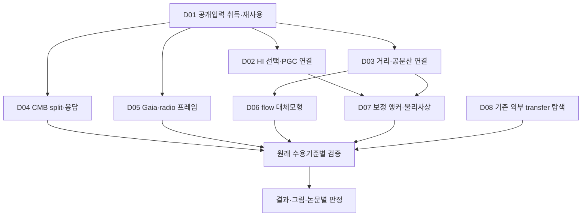

# 끝까지 실행하기 위한 개발 DAG

목표는 원래42노드를 증거에 따라 완성하는 것이다. 자료가 필요하면 공개자료를 스스로 취득한다. Scientific ready가0이어도 아래자료/이론작업이 가능하면 계속한다. 연구의완료조건을달성할수없는외부입력을가짜값·합성성공·희망적가정으로대체하지않는다.

## 두 종류의 의존성을 함께 관리

원래 scientific DAG는 `../PUBLICATION_DAG.json`이 authoritative하다. `CONTINUATION_TASKS.json`은 원래42노드의목표/acceptance/의존성을보존하면서8외부blocker에자료취득·이론작업을연결한다. 새로운업무D01–D09는과학완료카운트를늘리는노드가아니다.

화살표가모든lane이끝나야과학작업을시작한다는barrier는아니다. 어느원래노드든dependency와actualinput이충족되면즉시진행한다. 예를들어P3의조건부분석을V03/B02외부atlas대기때문에멈추지않는다. 준비되지않은원래노드는그실제이유와최소추가입력을보존한다.

## 다음 PR 목록: 계획과 실제 게시 구분

| 계획된 작업 묶음 | 포함할 구체 결과 | 시작 조건 | 맡길 agent |
|---|---|---|---|
| 이번 open-input/theory PR | 새입력경로·628target실측·anchor정리·다운로더·계획/handoff·CI수정 | 이번산출물검증·독립검토 | parent publisher |
| 다음 distance selection PR |628PGC join, 관측/실패 conditional likelihood, releaseholdout 계보 | D01원본과기존TF/CF4cache | distance worker |
| 다음 correlated distance PR | Pantheon+실제covariance+CF4 crosswalk/공동calibration민감도 | D03개별table/schema검사 | distance inference worker |
| 다음 Planck null-input PR | ID00000의4splitnoise 처리, 실제crosssplit/beam/weight조건 검증 | 약2.42GB신규입력+기존operatorcache | CMB worker |
| 다음 astrometry PR | 전체CRF3+radio VSH, frameprojection/상관민감도 | D05완전한query결과 | astrometry worker |
| 다음 identified-set PR | methodgamma공유한anchor/optical집합과flow대체model | D02/D03실제결과·D07조건 | theory/htt worker |
| 외부 transfer intake PR | 이미계산된source/frame/IC검증된숫자atlas/전송 | 적격payload발견시 | BASS adapter worker |
| 논문별 결과 PR | P1–P6원래scientificacceptance를충족한표·그림·원고·decision | 각각의실제DAGdependency | parent+독립reviewer |

후속행은아직열리지않은계획이다. 실제GitHub번호를만들어기록하지않는다. 검증된coherentincrement마다push하고draftPR을연다. 기존branch/원본/실패기록을보존하며 main merge나저널제출은하지않는다.

## 실행 알고리즘

1. 현행HEAD,원래DAG,이번JSON을읽고기존완료와새upstream변경을확인한다. 오래된14/42snapshot을상태기준으로삼지않는다.
2. 이미다운로드/처리된원본·cache의identity를재사용한다. 새공개입력은manifest의예산안에서Codex가다운로드한다. 인증·유료자료가막히면공개대체경로로전환하고다른lane을계속한다.
3. parent포함최대4agent,자식의자식없음. writer소유파일을분리한다. 시작packet에는이번goal,원래acceptance,필요한source만넣는다.
4. deterministic조인·파싱·rank검사를먼저하고그결과가요구하는통계분석을실행한다. 자료입수가과학노드완료를뜻하지않는다. 실패하면가장작은반례/근거로수정한다.
5. actual결과JSON/figure/sourcecommand를남기고한번의독립검토를받는다. 구체finding만수정해닫는다. 검토문서만반복생산하지않는다.
6. 실제원래acceptance가완료된노드만canonical상태와소비되는queue에반영한다. 하나끝나면다음ready노드를고르고같은세션에서계속한다. context가부족하면최소checkpoint/handoff후정확한goal에서재개한다.
7. 모든원래노드가완료되거나, 남은모든lane이실제로외부자료/physicalresponse에막혔고공개대체입력조사·가능한부분연구까지소진됐을때만그경계를보고한다. 완료불가능상태를completed라고쓰지않는다. 공표가능한조건부/negative결과가있으면그범위의원고를작성하되원래물리목표를몰래축소하지않는다.

## 모델·사고모드

- 기본실행·조율: `gpt-6.1-sol / high`.
- 핵심물리·식별정리·최종독립검토: `gpt-6-astra / xhigh`. 좁은단위의추가비용이정당한지확인하고일상자료정리에고정사용하지않는다.
- 열이름/URL/metadata분류등경계가명확한작업: `gpt-6-luna / medium`. 통계적가정·물리해석·acceptance승인은상위역할이검토한다.

이는이작업에대한운영권고이며모델간벤치마크결과가아니다. [공식reasoning문서](https://developers.openai.com/api/docs/guides/reasoning), [Sol](https://developers.openai.com/api/docs/models/gpt-6.1-sol), [Luna](https://developers.openai.com/api/docs/models/gpt-6-luna)를2026-10-18확인했다. 계정/런타임별노출모델과effort를시작시확인한다. 이번실제dispatch는두자료worker Sol/high,이론/reviewer Astra/xhigh로요청했고transport가수락했다. 관찰된backendmodel/effort는UNKNOWN으로기록한다.

실행packet은 `.venv/bin/python scripts/htt_open_input_packet.py --node H02` 또는 `--task D02`로작게읽을수있다. 실시간원래DAG의acceptance/dependencies와plan이다르면조정필요오류를내고,완료상태는liveDAG에서읽는다. 자동scheduler나완료판정기는아니다.
