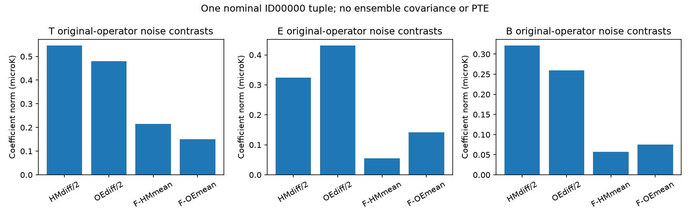

# D04: 실제 HM/OE noise의 원래 공통처리 비교

Owner `obsstat`, `DIAGNOSTIC_ONLY`, external Planck PR3 FFP10 simulation
processing diagnostic. 실제 원자료와 고정 처리 비교이며 null covariance,
anomaly significance 또는 L03 physical coverage를 제공하지 않는다.
Requested Sol/high, observed UNKNOWN. 기존 primary checkout/intake1528ebd3,
실행 당시 HEAD3677216f. 새 checkout/native solver/ODE/추가 SHT는 없다.

## 실제 입력과 연산자

공식 PLA HTTPS의 ID00000 HM1/HM2/OE1/OE2 네 noise 파일을 받았다.
각603987840bytes, 총2415951360bytes이며 원본/receipt는 Git 밖
`/mnt/extdrive/workdir/htt_open_data/planck/PR3/split_noise/`에 보존했다.
FETCH_FIRST.log의 실제 완료 기록과 RESULT.json의 재계산 SHA가 일치한다.
FITS의 RING/NSIDE2048/정확한 I,Q,U 열/K_CMB/총 pixel 수를 검사했다.
COORDSYS 부재 시 Galactic이라는 release convention을 명시하되 header에서
읽었다고 꾸미지 않았다. 같은 nominal ID는 완전한 latent coupling의 증명이 아니다.

기존 검토된 source_matched_pilot.py를 그대로 import했다. Native T/P mask
SHA, 원래 T26846/P30021 coarse support, .995 retained-native-child coverage를
재현했다. RING→NESTED parent를 통해 원래 포함된 native children의 masked
mean을 계산하고, T l0…5 simultaneous36열에서 monopole/dipole4열을 제외한32,
spin2 l2…5의 interleaved E/B64열을 회귀했다. Q/U는 원래 연산자와 동일하게
local Galactic basis에서 평균하며 새 parallel transport는 하지 않았다.
조건수T3.60137853/P3.13096228, projector identity residual 각각
3.997e-15/2.665e-15다. 선택된 원본 child의 invalid 값은 거부하며,
작업용 배열의 선택 밖0은 미측정 물리량을 채운 값이 아니라 계산되지 않는 support다.

FULL ID0 noise 계수는 기존8-pair pilot NPZ SHA75a9a46c…에서 읽었다.
그 FULL raw나 기존 관측5지도/8쌍 실행은 재계산하지 않았다. 새4지도만 처리했다.
원래 archived spin chart SHA900e6c6f…와 L02 kernel을 재사용해5noise 행 및
4contrast에 동일 T/E/B tensor/교차 morphology를 적용했다. 486field 및
486cross-pair metamorphic checks가 PASS, 최대 오차4.84e-14이다.
이 finite checks는 모든 입력의 형식 증명이나 family-identification이 아니다.

공식 SMICA propagation tar의 README/ASCII weights를 읽고 실행하지 않았다.
T weights9×4001/6×4001, polarization14×4001→2×7×4001을 확인했다.
README가 beam correction과 LFI renormalization의 내장을 명시하므로 새로운
beam/deconvolution을 적용하지 않았다. 이 문서/shape만으로 split-specific
physical response나 foreground/weight-selection law를 얻었다고 주장하지 않는다.

## 실제 결과

아래 값은 l2…5 실수계수 벡터 norm, 단위microK다. 선택 T/P support가 다르므로
full-sky power spectrum이 아니다. /2는 선언한 contrast normalization이다.

|contrast|T|E|B|
|---|---:|---:|---:|
|(HM1−HM2)/2|0.545508|0.324094|0.320887|
|(OE1−OE2)/2|0.479159|0.430881|0.259103|
|FULL−(HM1+HM2)/2|0.214999|0.055585|0.057501|
|FULL−(OE1+OE2)/2|0.150580|0.142359|0.074913|

FULL noise normsT/E/B=1.044106/0.683811/0.427920microK.
Full noise와 split 평균의 차이는 이 한 nominal tuple에서0이 아니다.
같은 하늘 의존성을 무시한 독립 표본 분산이나 정확한 equality를 가정하지 않는다.
이 표만으로 평균/차이의 확률법칙 또는 오차막대를 추정할 수 없다.



Figure owner obsstat; claim DIAGNOSTIC_ONLY; allowed use original-operator
same-ID processing sensitivity; transfer external Planck simulations;
null ensemble unavailable; covariance UNKNOWN. PTE, independent-sky count,
physical anomaly/family inference에 사용 금지다. PDF와 전체 tensor family는
동일 생성 결과다.

## 검증과 다음 실제 장벽

전체 source stream session51176 exit0,138.15seconds. 새 affected suite6tests는
유한 contrast/common-mode/invalid 입력, source schema, 외부 compact cache에서
원래 연산자의4계수 재현, cachedFULL 동일성, 고정 chart 및 HOLD semantics를 검사한다.
재사용 streaming kernel의 실제-vector layout/마스크 invalid/정렬 테스트4개도
PASS(16deselected)였다. 기존 native solver/전체과학 실험은 재실행하지 않았다.

```
OPENBLAS_NUM_THREADS=2 OMP_NUM_THREADS=2 .venv/bin/python docs/research_program/observational_publication_20261015/OPEN_INPUTS_20261018/EXECUTION_20261018/D04_SPLIT_NOISE/split_stream.py
OPENBLAS_NUM_THREADS=2 OMP_NUM_THREADS=2 .venv/bin/python -m pytest -q docs/research_program/observational_publication_20261015/OPEN_INPUTS_20261018/EXECUTION_20261018/D04_SPLIT_NOISE/test_split_stream.py
```

생성은 create-only다. 이미 완성한 raw/coeff/cache를 삭제하거나 위 run을 반복하지
말고 RESULT/COEFFICIENTS/외부 compact cache를 재사용한다. 독립 검토 대기.
L03는 HOLD다: 2018 half-mission CMB signal 부재, 공동 foreground/weights/
selection response, cross-split latent law 및 statistic-specific coverage가
남아 있다. 추가 nominal noise ID 개수만 늘려 이 missing law를 대체하지 않는다.
