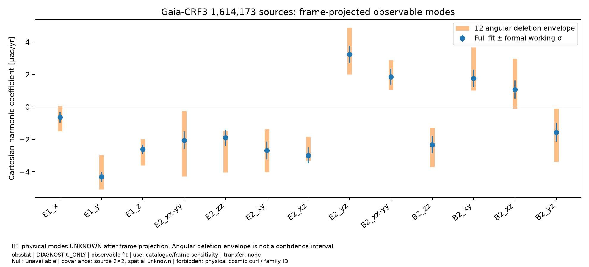
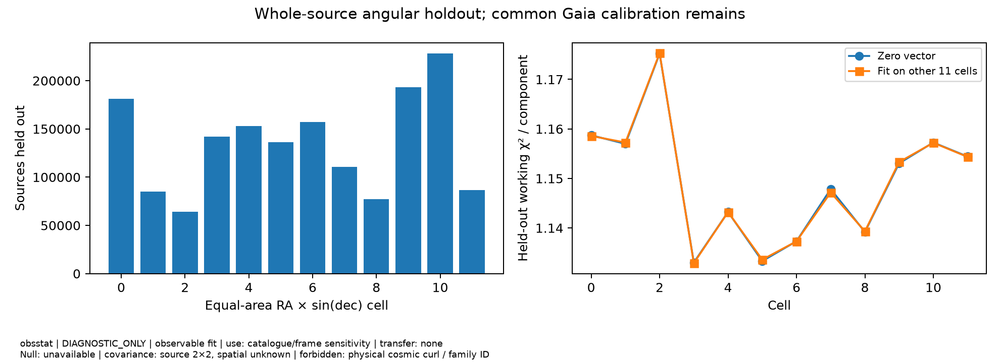

# D05 실제 Gaia 전체 관측량 분석 — 2026-10-18

Owner `obsstat`; claim `DIAGNOSTIC_ONLY`; artifact mode `OBSERVABLE_FIT_AND_SENSITIVITY`;
transfer `none`; null `NOT_AVAILABLE`; covariance `published per-source 2×2,
cross-source/frame joint law unknown`. 허용 용도는 공개 catalogue의 관측 VSH와 프레임·선택 민감도다.
물리적 cosmic curl/물질 vorticity/모형 family 판정이나 검출 유의도에 사용할 수 없다.

전체 취득과 관측량 계산을 실제로 마쳤다. K03의 원래 acceptance
`Independent source qualification and nonradial response demonstrated`는 아직 **HOLD**다.
동일 물질 congruence의 curl/acceleration/tilt 응답과 프레임·보정 전달 및 joint covariance가 없다.
독립 Astra 검토는 아직 PENDING이며, 이 보고서가 원래 과학 노드를 완료 처리하지 않는다.

## 전체 질의 검증

ESA 공식 회원목록 1,614,173개, ARI 별도 COUNT
1,614,173개, 실제 반환 1,614,173개다.
모두 고유 source_id이며 세트가 정확히 같다. 전체/COUNT/frame VOTable의
QUERY_STATUS는 OK, OVERFLOW 없음이다. TOP smoke를 전체 표본으로 사용하지 않았다.
full result는 192,359,368 bytes이며 UWS 고지 크기와 일치한다.
SHA256 `e8454190bb3be7d10203ecfe6fe90b34d245fb13b9bb72a155242f85e4271810`.
질의/작업/원본 hash와 단위는 [RESULTS.json](RESULTS.json)에 있다.
외장 디스크 원본 외에 Git 안으로 source 행을 복사하지 않았다.

- full UWS: https://gaia.ari.uni-heidelberg.de/tap/async/1792320789985
- COUNT UWS: https://gaia.ari.uni-heidelberg.de/tap/async/1792320790633
- frame UWS: https://gaia.ari.uni-heidelberg.de/tap/async/1792320802786

유효 공분산·좌표·고유운동 조건을 만족한 1,614,173개를 모두 사용했다.
추가 proper-motion/RUWE cut은 없다. five-parameter 1,215,942개,
six-parameter 398,231개다. 원래 CRF3 회원 선별 자체는 astrometry와
proper motion에 의존하므로, 전체 회원 수 재현은 미선택 QSO 모집단의 무편향성을 뜻하지 않는다.

## 실제 VSH / frame quotient 결과

ICRS RA/Dec는 도, Gaia `pmra=mu_alpha*cos(dec)`, `pmdec=mu_delta`는 mas/yr에서 μas/yr로 변환했다.
source 내부 covariance는 `[[σra², ρ σra σdec], [ρ σra σdec, σdec²]]`를 그대로 쓴다.
방향은 측정값에 조건부로 고정했고, position-motion 상관 열은 원본에 보존하되 이 조건부
고유운동 fit에 방향 오차로 전파하지 않았다. 천체 간 covariance가 없다는 사실을 0의 측정으로 취급하지 않는다.

`E1=P g`, `B1=omega×n`, `E2=P S n`, `B2=n×S n`의 l=1+2 16성분을 함께 fit했다.
STF basis/계수 순서는 JSON과 코드에 명시했다. 이 계수는 Cartesian/STF 좌표이며
정규화된 Ylm 계수나 harmonic power가 아니다. normal rank 16, condition number
7.72740, working reduced χ² 1.148288다.
숫자 χ²는 독립-source Gaussian working model 요약이며 유효성 검정 p-value가 아니다.

| coefficient | full fit [μas/yr] | formal working σ | angular deletion min–max |
|---|---:|---:|---:|
| E1_x | -0.63924 | 0.31865 | -1.49074 … 0.07257 |
| E1_y | -4.31228 | 0.29903 | -5.06833 … -2.97780 |
| E1_z | -2.61280 | 0.28697 | -3.60046 … -1.98809 |
| B1_frame_x | 3.90895 | 0.29416 | 2.47017 … 4.43903 |
| B1_frame_y | 1.52837 | 0.28087 | 1.23675 … 1.84270 |
| B1_frame_z | -1.08702 | 0.31449 | -1.93469 … -0.06556 |
| E2_xx-yy | -2.05058 | 0.54755 | -4.27085 … -0.25007 |
| E2_zz | -1.90346 | 0.50812 | -4.03767 … -1.45102 |
| E2_xy | -2.68097 | 0.55492 | -4.01483 … -1.36999 |
| E2_xz | -2.99206 | 0.49721 | -3.32932 … -1.84748 |
| E2_yz | 3.23664 | 0.53343 | 2.00039 … 4.89782 |
| B2_xx-yy | 1.85155 | 0.51221 | 1.05488 … 2.90019 |
| B2_zz | -2.33022 | 0.54083 | -3.71398 … -1.28448 |
| B2_xy | 1.76609 | 0.52641 | 1.01180 … 3.66578 |
| B2_xz | 1.06912 | 0.56537 | -0.10795 … 2.97145 |
| B2_yz | -1.56686 | 0.55999 | -3.37268 … -0.10175 |

B1 세 성분은 arbitrary frame spin과 정확히 같은 열이다. frame nuisance를 Schur projection하면
남는 observable quotient rank는 13이며 세 물리 B1은 UNKNOWN이다.
joint fit 대비 quotient 계수 차이는 9.33e-15 μas/yr다.
표의 B1은 공개 frame에서의 관측값일 뿐 cosmic rotation 제약이 아니다.

전체 frame 표는 429,249행이며 428,034개 spin-used 중 CRF3와 겹치는
428,032개, orientation-used 2,007개를 확인했다.
spin-used와 나머지 집단의 in-frame B1은 각각
`[-0.33117, 0.67319, -0.12149]`와
`[10.35433, 2.67796, -2.41962]` μas/yr다.
하위집합 차이는 frame/selection sensitivity이며 독립 검증이나 물리적 비등방 신호가 아니다.
Gaia DR3/EDR3는 동일 astrometry로 독립 재관측이 아니다.

이 그림은 obsstat/DIAGNOSTIC_ONLY/observable-fit 결과다. source 2×2 공분산의 formal σ와
12 angular deletion 범위를 표시한다. 전자는 full joint uncertainty가 아니고 후자는 confidence interval이 아니다.
transfer 없음, joint null 없음, 물리 cosmic curl/family 판정 용도로 금지한다.

## 공간·holdout 민감도

RA 4분할 × sin(dec) 3분할의 같은 면적 12개 셀을 통째로 뺐다. 각 source의 두 성분을 함께
holdout하여 component leakage를 피했다. heldout working χ²/component 범위는
1.132902–1.175298다.
E1의 block-score sensitivity scale은 `[1.11286, 1.26211, 0.65574]` μas/yr로,
formal σ `[0.31865, 0.29903, 0.28697]` μas/yr보다 크다. 이것은 단지 12개 큰 셀의
공간 민감도이며 작은 각도 상관이나 셀을 넘는 보정 공분산을 보장하지 않는다.
공통 Gaia frame/calibration이 train/test에 남아 있어 독립 외부 predictive validation도 아니다.

Owner/claim/mode는 obsstat/DIAGNOSTIC_ONLY/observable sensitivity다. 공개 source covariance에
조건부인 진단이며 joint null과 실측 spatial covariance는 없다. 검출 유의도·물리 curl·family 판정은 금지한다.

## 라디오 713 및 실제 crosswalk

D01이 받은 CDS table6/ReadMe를 재사용했다. 713개를 전부 파싱했고 새 fetch는 하지 않았다.
1 arcsec 안의 unique Gaia positional match는 621개, ambiguous 0개,
unmatched 92개다. 0.1 arcsec 이내는 619개다.
그중 IERS/OCARS 이름까지 일치한 것은 581개이며,
나머지 40개는 positional compatibility candidate다.
이 행별 crosswalk와 미매칭 행은 외장 디스크에 남겼다. 위치 일치만으로 원천 동일성·오차 독립성을 증명하지 않았다.

CDS ReadMe는 RA proper motion에 cos(dec)를 명시하지 않는다. 원 논문의 표/식도 이
표기 문제를 명시적으로 해결하지 않으므로, RA를 tangent로 해석한 경우와 coordinate rate로
해석해 cos(dec)를 적용한 경우를 모두 보존했다. 누락된 cross-component covariance는 0이 아니다.
각 규약에서 nonzero ρ=-0.9,-0.5,+0.5,+0.9의 8개 조건부 fit을 실행했다.
working reduced χ² 범위는 9.2730–47.4638다.
이 common-ρ family는 모든 source별 ρ 조합의 엄밀한 bound가 아니며 calibrated uncertainty도 아니다.
713개 전체를 retained하여 원 논문의 cut/fit과 동일한 재현 실험으로 주장하지 않는다.

라디오 jet, radio-optical 구조/epoch 차이, ICRF 중첩, Goddard 2017a의 다섯 NNR solution과
공통 celestial axes 때문에 Gaia/radio를 독립 관측으로 결합하지 않았다. NNR이 제거한 mode의
전달 연산자는 없음으로 남겼다. cosmic curl/kinematic transfer나 source-matched physical
응답을 만들지 않았으므로 K03는 여전히 HOLD다.

## 검증 / 재사용 / 다음 조건

새 algebra/GLS tests 7 passed; 정상/음수 회전 부호, covariance inverse, STF,
정확한 계수 회수, arbitrary frame-spin 불변성, chunk/dense parity, trailing OVERFLOW/ERROR 거부를 확인했다.
저장된 충분통계로 full와 12 holdout의 계수를 별도 재계산한 최대 차이는
3.11e-15 μas/yr다. raw catalogue fit은 이 확인에서 재실행하지 않았다.
기존 4,756개 frame/correlation 결과는 읽고 재사용했으며 재실행하지 않았다.

[README](README.md)에 실행 명령, 규약, source 문헌과 kill switch가 있다.
[VALIDATION.json](VALIDATION.json)에 집중검증과 최초 취득 실패 보존이 있다.
논문/외부 해석의 다음 조건은 source-matched same-congruence physical response,
radio RA 규약 확인, frame/NNR 전달과 source/systematic joint law 또는 정당화된 bound,
그리고 새 Astra 독립 검토다. 원래 acceptance나 HOLD를 완화하지 않는다.
