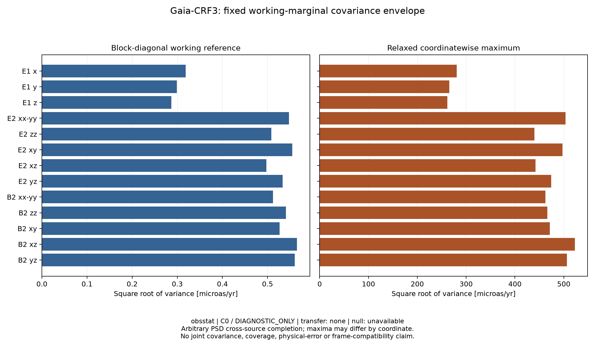

# Gaia working-marginal covariance envelope

Owner obsstat; C0 / DIAGNOSTIC_ONLY. This is a floating-point evaluation of the analytic, coordinatewise sharp bound in the relaxed PSD completion class with fixed published 2×2 working marginals.

The single raw pass retained all 1,614,173 sources and verified the complete XML, OK QUERY_STATUS, raw SHA256, source FD/path identity and exact row count. The existing D05 full 16-column normal matrix defines the fixed 13-coordinate Schur/frame quotient. No RHS, fit, holdout or radio calculation was rerun.

For each coordinate k, s_ki²=ell_ki C_i ell_kiᵀ, v_ref=Σ_i s_ki² and v_max=(Σ_i s_ki)². v_ref is a block-diagonal working reference; it does not establish source independence. The displayed square roots are scales of these variances, not calibrated confidence intervals.

| Coordinate | v_ref [microas²/yr²] | v_max [microas²/yr²] | sqrt(v_ref) [microas/yr] | sqrt(v_max) [microas/yr] | v_max/v_ref |
|---|---:|---:|---:|---:|---:|
| E1_x | 0.101538975452 | 78861.6640807 | 0.318651809115 | 280.823190069 | 776663.972919 |
| E1_y | 0.0894208641662 | 70485.0575303 | 0.299033215824 | 265.490221158 | 788239.503024 |
| E1_z | 0.0823514349342 | 68451.5719902 | 0.286969397208 | 261.632513251 | 831212.862835 |
| E2_xx-yy | 0.299805541638 | 253446.629723 | 0.547545013344 | 503.434831655 | 845370.063337 |
| E2_zz | 0.258184400491 | 193416.640175 | 0.508118490602 | 439.791587203 | 749141.465583 |
| E2_xy | 0.307938416623 | 247252.225233 | 0.554921991476 | 497.244633187 | 802927.507209 |
| E2_xz | 0.247217792521 | 195662.066157 | 0.497210008468 | 442.337050401 | 791456.246582 |
| E2_yz | 0.284548631594 | 225068.659163 | 0.533430999844 | 474.414016617 | 790967.287039 |
| B2_xx-yy | 0.262361648003 | 213697.952771 | 0.512212502779 | 462.274758959 | 814516.734428 |
| B2_zz | 0.29250033804 | 217304.016006 | 0.540833003838 | 466.158788403 | 742918.854253 |
| B2_xy | 0.277104893651 | 222359.830347 | 0.526407535709 | 471.550453661 | 802439.204222 |
| B2_xz | 0.319640317229 | 273101.207057 | 0.565367417906 | 522.590860097 | 854401.626879 |
| B2_yz | 0.313585035058 | 256269.426585 | 0.559986638286 | 506.230606132 | 817224.669337 |

Maximum actual-stream relative working-reference difference: 5.07220830382e-15 (frozen limit 1e-10, atol=0). Frame annihilation maximum absolute residual: 6.16755859708e-15 (limit 1e-10). Finite/parser control details are in CONTROLS.json and the create-only raw controls log. The locked NUMERICAL_USAGE.jsonl records cumulative wall time, exact commands and sampled resources.

The 13 maxima need not be jointly attainable. Their diagonal is neither a joint covariance nor a Loewner upper bound. Compatibility with actual Gaia source/frame constraints is UNKNOWN. Published working marginal correctness after selection, missing systematic errors and bias are not resolved. Physical B1 remains UNKNOWN. There is no coverage, physical-error, cosmic-curl, vorticity, family or K03 admission.

Plot/table metadata: artifact_mode=CONDITIONAL_RELAXED_COORDINATEWISE_ENVELOPE; allowed_use=working-marginal coordinate envelope; transfer_source=none; null_mock_status=NOT_AVAILABLE; covariance_status=fixed working marginals with arbitrary relaxed PSD completion; sky_support=selected CRF3 membership/directions fixed. Forbidden uses are joint covariance, calibrated coverage, physical error or native family identification. PLOT_PROVENANCE.json binds the figure source.

Implementation/requested runtime: gpt-6.1-sol/high; observed model/effort UNKNOWN. Fresh independent read-only Astra review is pending. Original 17/42 and all six NOT_READY_TO_SUBMIT statuses remain unchanged.

Contract SHA256: `d0ceb037506d7ac94e4275194544b3572f927f9a865faeeecd00db05453e44ea`. Source SHA256: `e8454190bb3be7d10203ecfe6fe90b34d245fb13b9bb72a155242f85e4271810`. Code SHA256: `4e7465a0525baf36ce969f7add57232d5e46102a5ef3310c7510fc6b16bfba3b`.

Protocol/source references (qualified in the frozen contract): [VOTable 1.4](https://www.ivoa.net/documents/VOTable/20191021/REC-VOTable-1.4-20191021.html), [TAP 1.1](https://www.ivoa.net/documents/TAP/20190927/REC-TAP-1.1.html), [DALI 1.1](https://www.ivoa.net/documents/DALI/20170517/REC-DALI-1.1.html), [Gaia-CRF3](https://arxiv.org/html/2204.12574v2).
