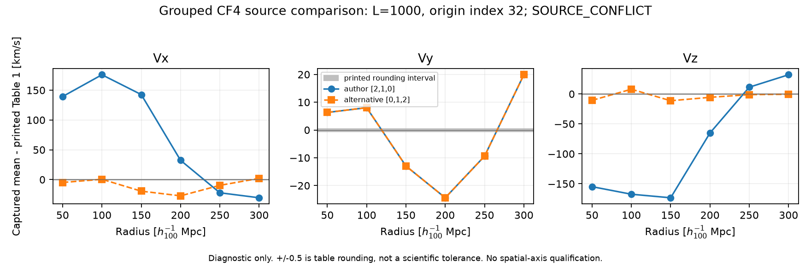

# Grouped CF4 source-convention comparison

Status: **SOURCE_CONFLICT**; producer64 geometry and downstream H02 physical-flow use remain **HOLD**.

Owner obsstat; C0 / DIAGNOSTIC_ONLY; non-claim-bearing source comparison. Transfer source: none.

The capability delivered here is a source-bound comparison of an already captured sphere probe against six literal grouped-CF4 Table 1 rows. It resolves neither the producer estimator nor a physical correction.

## Sources and conventions

[Courtois et al., arXiv:2211.16390v4, Table 1](https://arxiv.org/html/2211.16390v4#S4.T1) provides grouped vectors at radii 50–300 h_100^-1 Mpc, in km/s in the CMB rest frame. Its section 4 describes a 64-cubed grid and approximately 8 h^-1 Mpc voxels; that approximation does not define an exact 500 h^-1 Mpc box.

[Giani et al., arXiv:2311.00215v2, section II.1](https://arxiv.org/html/2311.00215v2#S2.SS1) describes the public grouped field over 1 (Gpc/h)^3 and links its author notebook. The pinned notebook is [main.ipynb at c9351d81](https://github.com/Leolardo/Laniakea_Backreaction_nb/blob/c9351d81ea224abec0e75ad4ce03d6a0ed6722b0/main.ipynb). Only its HTTP-206 first 13,001-byte prefix was acquired; the reported 16,369,673-byte full notebook was neither downloaded nor executed.

The prefix directly gives index=32+position*(64/1000), spatial lookup data[:,iz,iy,ix], velocity channels 52*(data[2],data[1],data[0]), and scalar error times 52. Thus N=64, spacing=15.625 h^-1 Mpc and sample nodes span [-500,484.375] h^-1 Mpc. These are sample-node extents; voxel boundaries are UNKNOWN. Nearest rounding in this example is not a general interpolation contract. Later inconsistent interpolation code is not adopted.

The source-intake agent reported that the notebook's velocity/error Git blobs d4bb7fa221686e414f325bcfc54dc77254fdf201 / 9a83b407520f24eb863e01cec080ee3f0979e052 match the D06 originals. This comparison reuses the D06 acquisition seals and does not reopen the FITS grids. Byte identity cannot establish producer centering, component order or estimator equivalence. Producer centering and component order remain UNKNOWN; the scalar error is not a radial covariance.

## Finite result

The comparison tests only author reversal [2,1,0] and the explicitly named alternative [0,1,2]. For the source-supported L=1000, origin-index=32 case, the R=50 vectors are respectively (-90.619601,81.318112,-234.821611) and (-234.821611,81.318112,-90.619601), versus the printed (-230,75,-80) km/s.

| L (h^-1 Mpc) | Origin index | Component order | Max absolute residual (km/s) | Rows with table rounding parity |
|---:|---:|---|---:|---:|
| 1000 | 32 | [2, 1, 0] | 175.925932 | 0/6 |
| 1000 | 32 | [0, 1, 2] | 27.210855 | 0/6 |
| 1000 | 31.5 | [2, 1, 0] | 186.097652 | 0/6 |
| 1000 | 31.5 | [0, 1, 2] | 47.259593 | 0/6 |
| 500 | 32 | [2, 1, 0] | 244.409558 | 0/6 |
| 500 | 32 | [0, 1, 2] | 248.100332 | 0/6 |
| 500 | 31.5 | [2, 1, 0] | 242.798027 | 0/6 |
| 500 | 31.5 | [0, 1, 2] | 250.179920 | 0/6 |

No scenario has TABLE_ROUNDING_PARITY for all six rows. The +/-0.5 km/s criterion is only compatibility with printed nearest-integer rounding, including closed half-unit ties; it is not a physical residual tolerance, likelihood, uncertainty model or scientific-agreement test. A mismatch may reflect estimator, averaging, reconstruction, centering or convention differences; it does not prove an upstream scientific bug. The alternative order being closer does not authorize adopting it.

L=500 and origin=31.5 cases are preserved as illustrative, unoptimized alternatives. L=500, R=300 rows are marked sphere-truncated/invalid, retained in the JSON, and excluded from full-sphere qualification. The 250 h^-1 Mpc threshold only flags the unambiguous R>250 truncation; exact voxel support remains unqualified. No scenario qualifies a full-sphere producer estimator. Spherical masks are invariant under spatial-axis permutations and cannot qualify their order.

Figure: captured means minus literal printed grouped Table 1 vectors for L=1000, origin-index 32, with the two frozen component orders. The narrow band is printed-table rounding only. This is an external-source diagnostic, not an independent atlas or physical flow correction.

## Execution and review boundary

The historical probe transcript reports one read-only grid probe by requested gpt-6-astra/xhigh, observed UNKNOWN, exit 0, wall 0.989577891 s, HEAD b4a93016afb57a5b115bff4dbfa65bc3d56d4b65. Its launch time was not independently verified here. Its exact command, counts and stdout remain unchanged at the sealed external SPHERE_PROBE_TRANSCRIPT.txt path.

The present worker requested gpt-6.1-sol/high, observed UNKNOWN, runs parser/tests/finite comparison only. RUN_RECEIPT.json records actual interpreter, command, execution HEAD, start/end, environment and exits; raw test/comparison stdout and any first failure are retained. CANDIDATE.json binds local review files and exact external inputs. Fresh independent Astra review is pending; original 42 nodes, permanent registry and DAG gates are unchanged.

No grid rerun, physical-host query, radial error propagation, optimized convention, ODE, solver or physical admission occurred. Next executable action is fresh read-only review of CANDIDATE.json; H02 physical-flow use requires a source-qualified producer geometry/component/estimator contract.

## Scoped skill audits

Physics/math: length and velocity units, CMB frame and sample-node interpretation are explicit; producer convention conflict is fatal to physical-flow use. No derivation or geometry/family claim is made.

Claim audit: source comparison / obsstat / DIAGNOSTIC_ONLY / captured artifact plus primary citation / C0. No claim is upgraded. Physical mapping stays HOLD. Risk and kill switch: immutable-input mismatch, malformed rows, missing/duplicate conventions or nonfinite values abort execution. No permanent claim-ledger row is needed because no claim admission is requested.
