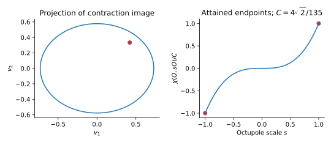
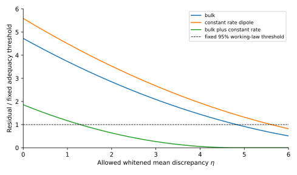
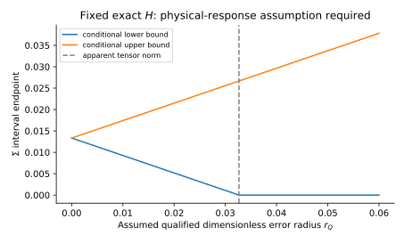

# Publication acceleration from retained physical results

This integration turns the retained 88-page physical synthesis into nine bounded publication-output tasks. Seven can start from retained evidence; two manuscript consumers require exact qualified upstream products. The first deliverable is a focused paper on sharp quadrupole–octupole geometry and its local optical realization. The six original observational papers and all 42 original node contracts remain unchanged.

The original external-output checkpoint is 17/42; the analytic V03 alternate was reported separately as 18/42. Neither is increased by importing a manuscript, producing these reuse figures, appending this frontier or finishing a companion paper. Read the live controller for current execution state; these historical counts are not a new audit of the owner's machine.

## Scientific reuse and production order

| Product | Existing scientific center | Concrete closure |
|---|---|---|
| QO methods, linked to P2/P6 | Attained chirality bound, contraction ellipsoid and 4D fibre; logarithmic optical coupling and inverse | One proof-centered English paper with equality/degenerate cases, optical mechanism, figures and formula-specific comparison |
| P1 selected-cohort companion | Actual 274-row likelihood, 15-coefficient F region, covariance-shape sensitivity, 354/628 missing outcomes | Coherent selected-cohort tensor/identified-set manuscript; existing physical unknown mass retained |
| P3 H03 response result | Full-covariance 12D residual T=23.3967205227, 6 df; conditional tail 0.00067393342 | A structured response/error frontier, then a focused observational-methods paper |
| P2 bandpass result | Released seven-frequency first-order rank24 versus free second-order rank0 target | Bounded moment compensation budget and an amplitude-dependent identified set, then a methods paper |
| P6 optical inverse | Common-congruence identities and corrected apparent dimensionless CF4 tensor | Finite observable error-region image and useful inverse sector |
| P4 response design | Two-radius rank13 example and history/endpoint degeneracies | Conditioned response design and a concrete extra measurement that removes one degeneracy |
| P5 algebraic companion | LRS Bianchi V normal-frame constraint and equivalence relations | Admissible physical region and same-observable/different-history example, without an evolution solver |

The first two papers reuse results already obtained. Consolidating them is publication progress, not a new statistical detection. New analysis is concentrated on a structured H03 discrepancy and bounded foreground moments, where a small calculation changes the scientific question.

The corrected CF4 quotient coefficients are already dimensionless. Its eigenvalues are approximately (-0.0237272, 0.00132795, 0.0223992); its Frobenius norm is 0.0326568. Do not divide them by 5/ln(10) again or import the earlier R28 magnitude-unit interpretation. This apparent tensor becomes a physical shear constraint only through a specified response and error region.

## Why the previous execution stalled

Full source-law and transfer requirements are appropriate for the original physical claims. Applying those same dependencies to deterministic geometry, conditional identified sets and finite inverse designs unnecessarily stops useful scientific products. [PUBLICATION_STRATEGY.md](PUBLICATION_STRATEGY.md) gives a result-level correction for all six papers; [EXECUTION_AUDIT.md](EXECUTION_AUDIT.md) audits the actual controller.

The controller already implements additive frontiers. This change does not introduce a new scheduler, reset a campaign, overwrite a frozen contract or treat a plan as a launched worker. The original `htt_publication_dag.py --ready` now exposes the companion-route pointer while preserving its original ready list. Canonical YAML/JSON backlogs and compatibility mirrors contain the nine new output cards as pending. [FRONTIER.json](FRONTIER.json) is the executable controller input, and [OUTPUT_DAG.json](OUTPUT_DAG.json) is its compact machine-readable paper map.

One held root task blocks only its own manuscript consumer. For example, a missing physical atlas does not prevent the QO paper. A completed gap report does not qualify a structured-frontier or bounded-moment product. The two gated consumers use typed `qualified` dependencies rather than mere task completion.

The current controller serializes scientific workers. This integration does not promise simultaneous writer execution. A planned/running packet is preserved; the host continues it and calls `next` again after its actual receipt. Read-only literature/source work can be delegated independently under existing ownership rules. Model unavailability and absent data do not themselves justify another ultra allocation.

## Reproducible scientific seed

Run from the repository root with an environment providing NumPy, SciPy and Matplotlib:

```bash
python docs/research_program/observational_publication_20261015/PUBLICATION_ACCELERATION_20261025/reproduce_reuse.py
```

This produces [H03_TABLE.csv](reuse/H03_TABLE.csv), [REUSE_RESULT.json](reuse/REUSE_RESULT.json) and three vector figures. It consumes saved finite estimates; it does not fit a new raw catalogue or sky map.







The H03 curve uses an unrestricted whitened mean-error ball. Its radius is a sensitivity parameter, not an observed calibration error. The physical-error plot assumes the response identity and an exact H normalization, showing the error radius needed for a useful constraint.

The imported physical analysis and its independent implementation remain runnable:

```bash
python docs/research_program/observational_publication_20261015/PUBLICATION_ACCELERATION_20261025/evidence/research/independent_physical_check.py
```

`evidence/research/physical_checks.py` is the original producer and writes regenerated results/figures inside the evidence directory. For experiments, copy the small evidence pack to a scratch output directory first; otherwise a changed numerical serialization can deliberately fail the frozen hash preflight. The independent checker is read-only. The manifest records exact imported bytes, rather than declaring every historical theorem freshly reproved.

## Literature and writing

[QO_COMPARATOR.md](QO_COMPARATOR.md) records the closer invariant-theory and 2026 chirality comparisons. The exact novelty question concerns the attained image/bound and its optical construction. Generic tensor morphology, covariant cosmography, foreground moment expansions and a deterministic chirality pseudoscalar already have substantial prior literature. Comparison notes belong in research documentation; the manuscript should develop the actual mechanism, theorem and result with normal citations.

Keep prose physically explicit. Explain what a coefficient measures, which operator maps it to geometry, and what finite remainder changes the interpretation. Use one scope statement at the relevant equation rather than repeating defensive paragraphs. Figures and numerical tables should carry units, frame and source identity.

The retained [88-page report](https://chatgpt.com/library?file_id=libfile_118673d0ed2081918c129fbd85e80f12&account_id=personal) and [complete source bundle](https://chatgpt.com/library?file_id=libfile_1a9f0dc3a7a481919a9bcd597b488cef&account_id=personal) are owner-accessible references. The evidence needed for these first tasks is included here so local continuation does not depend on ChatGPT Library authentication. Some historical links inside copied chapters retain their original report-relative locations; use EVIDENCE_MANIFEST.json, the original repository paths and the full source bundle to resolve those historical citations.

## Existing-session activation

Use [HANDOFF_CURRENT_SESSION.md](HANDOFF_CURRENT_SESSION.md). Static preflight is read-only; runtime append is performed once by the existing host after its current checkpoint. This push records source delivery, not observed local activation. `STATE.json`, active workers, attempts, review authors, R9/one-use constraints and consumed ultra budgets stay with the existing session.

No large acquisition is needed for the first seven candidates. If a later task needs new open data, reuse receipts/cache first and verify release/schema/units/frame. Preserve the existing no-download-cap preference and streaming free-space checks with the default 2 GiB reserve; keep data outside Git. Authentication walls or author requests remain branch-specific input issues.
