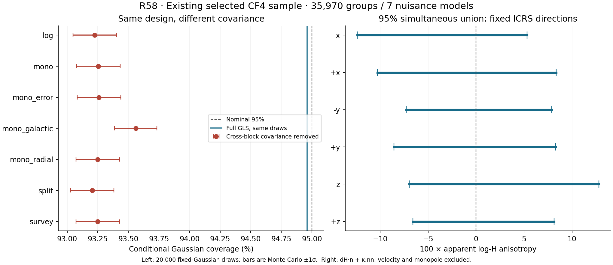

# R58: 기존 CF4 자료의 mixed tensor likelihood와 출판 수렴

작성일 2026-11-17 KST. 기준 commit `77f61c17ba33ff28ff4f16a7d42621d8041e5ce4`. HTT inference / C0. 새 관측자료 다운로드 없음.

## 판단

현재 근거는 우주적 tilt 검출·Bianchi family 판별·새 중력/우주론 이론의 우월성을 주장하는 논문을 지지하지 않는다. 가능한 수렴점은 기존 CF4 분석에서 공동 polar–STF covariance와 보정모형 불확실성을 유지할 때 어떤 겉보기 운동학 조합을 추론할 수 있는지 보이는 제한된 방법론/응용 논문이다. 표준 Gaussian GLS 대비 정보 증가 주장은 기각한다. 이번 실제 계산은 그 논문의 구체적 내용 후보이며 외부 학술적 신규성 또는 게재 가능성을 보증하지 않는다.

R7–R9의 confidence union, nuisance-max p, tensor functional image와 R39의 직접/혼합 kinematic x를 재사용했다. 프레임워크 재발명이 아니다. R54/R57의 중단 결정은 역사 그대로 보존하고, 이번 사용자의 명시적 요청을 근거로 새로운 관측 계산을 포함하는 R58만 제한적으로 수행한다. 뒤에는 native 재현과 집필을 묶은 단일 종료 노드 R59만 둔다.

## 실제 관측 분석

기존 선택 CF4 35,970 그룹, 기존 7 nuisance 모델, 기존 exact LCDM cosmic-covariance cache를 이용했다. 데이터의 창별 dipole 12개와 STF quadrupole 20개를 **하나의 32차원 실험**으로 결합했다. 다른 nuisance 모델의 압축자료를 서로 독립 관측처럼 곱하지 않는다.

\[
\eta_i=N_{m,i}\gamma_m+g(z_i)\hat n_i\cdot V+
\hat n_i\cdot d_H+\sum_{A=1}^{5}\kappa_A E^A_{ab}\hat n_i^a\hat n_i^b+\epsilon_i,
\quad y_m=O_m\eta,\quad X_m=O_mD.
\]

V는 km/s, d_H와 κ는 무차원이며 정규직교 STF5 basis는 기존 R54 그대로다. 모든 방향은 ICRS/J2000 관측자→광원, 입력 적색편이는 고정된 z_CMB convention이다. redshift response g(z), log-distance error와 nuisance projection은 frozen R54 구현을 재사용한다. 디자인의 velocity→STF 누출도 실제 O_m으로 보존한다. H 기준과 distance-zero-point 자유도 때문에 절대 H0 측정으로 읽으면 안 된다.

\[
-2\log L_m(\alpha)=q_0-2t^T\alpha+\alpha^TJ\alpha+
\log|C_m|+32\log(2\pi),\quad
\alpha=(V_3,d_{H,3},\kappa_5),\quad
J=X_m^TC_m^{-1}X_m,\quad t=X_m^TC_m^{-1}y_m.
\]

실제 구현은 Cholesky whitening + scaled SVD residual을 평가한다. 큰 비식별 방향에서 위 전개식의 cancellation을 피한다. J,t만으로 normalized likelihood를 복원하지 않고 q0, logdet와 안정적인 factor도 유지한다. 서로 다른 O_m의 normalized likelihood 값을 model evidence로 비교하지 않는다. Rank 판정이 unit-equilibrated 검사와 불일치하면 p값을 출력하지 않고 오류로 종료한다.

| 결과 | 실제 값 | 의미 |
|---|---:|---|
| 원래 7모형 marginal 재현 최대 절대오차 | 2.45e-12 | 동결 계산과 수치적 일치 |
| 11성분 공통 target rank | 11/11 | 선언한 겉보기 모수 공간 |
| polar–STF 최대 canonical correlation | 0.80365–0.84256 | joint geometry를 scalar화할 때 잃는 결합 |
| 교차 covariance 삭제 시 실제/명목 분산 고유값 비 | 약 0.535–1.473 | 같은 design에서 covariance만 삭제한 ablation |
| 해당 근사 95% 타원체 coverage, 20,000 draws | 93.205–93.560% | 고정 Gaussian law 내부 calibration |
| full GLS, 같은 draws | 94.960% | 같은 조건부 reference |
| 독립 60,000 draws 재검산 | 근사 93.288–93.728%, full 94.97–95.07% | 별도 구현, 동일 조건부 법칙 |
| 공통 11성분 α=0 Wald nuisance-max p | 0.01534274 | selected/post-hoc apparent mean null |
| 원래 32행 y의 zero-mean omnibus nuisance-max p | 0.11221289 | 위 검정과 다른 null/대립공간 |
| model adequacy p, 21 dof | 0.4338–0.8883 | rejection 없음이 physical truth를 입증하지 않음 |

각 좌표의 simultaneous 95% union projection은 모두 0을 포함하지만, joint 11차원 confidence union은 원점을 제외한다. 좌표별 zero 포함 여부만으로 joint null을 판단할 수 없다는 실제 사례다. 이 구간들은 nuisance-model union의 각 좌표에 대한 interval hull이며, Cartesian box와 원래 confidence union은 같은 집합이 아니다.

Coverage는 **가정한 고정 Gaussian C 아래의 모의실험**이다. 실제 survey의 반복실험 coverage, cosmic-covariance model의 진실성 또는 미모형화 systematic 통제의 검증이 아니다. 선택된 catalogue·7개 보정모형은 불확실성을 완전히 포괄하지 않으며 이 사후 분석을 우주론적 검출 유의도로 승격하지 않는다. cosmic pair sum은 재실행하지 않았다. cache operator byte fingerprint 차이는 입력/label/model identity와 수치 parity로 재사용했다고 표시했고 byte replay라고 쓰지 않았다.

## 직접 운동학 변수에 대한 likelihood

국소 저적색편이, 같은 congruence의 1차 응답을 **조건부 가설**로 두면
\[
H_{\rm dir}/H=1+\sigma_{ab}\hat n^a\hat n^b/H-A_a\hat n^a/(cH)+O(z,\epsilon^2).
\]
이 식의 n 부호는 photon propagation 방향 정의에 따라 바뀌므로 관측자→광원 convention 및 선택된 response를 함께 저장한다. 물리변수의 이름만 바꿔 식별됐다고 주장하지 않는다. 구현의 22성분 정규화 좌표는
\[
\theta=(\sigma/H[5],\omega/H[3],A/(cH)[3],\beta_{MR}[3],d_{cal}[3],q_{cal}[5]),
\quad V=c\beta_{MR},\ d_H=-A/(cH)+d_{cal},\ \kappa=\sigma/H+q_{cal}.
\]
U·U=−c², A=∇_U U, β_MR=(v_M−v_R)/c이며 양의 V·n은 radial redshift를 증가시킨다. 여기서 ω/H는 각속도 convention, β_MR는 matter–radiation 상대속도/c다. 이 지도 K를 사용한 L_m(θ)=L_m(Kθ)의 rank는 11, nullity는 11이다. 자유로운 dipole/STF calibration은 A와 σ를 상쇄하며 ω는 이 scalar-distance response에 열이 없다. 따라서 이 분석으로 σ,ω,A의 개별 유한구간을 얻을 수 없다. β의 구간도 constant velocity response와 frame 가정에 조건부다. a_lm·고적색편이·일반 Bianchi의 동역학 transfer를 계산한 것이 아니다.

5개 view의 구현 결과는 RESULTS/FIVE_VIEW_RESULT.json이다. x는 공동 carrier 및 직접 θ pullback, Q는 선언된 noise ellipsoid의 gauge, Π는 명시한 같은 χ² 법칙의 tail, F_support는 directional support image, G_F는 초기 level과 **모든 교차 covariance**를 유지한 depth contrasts다. 물리적 admissible ceiling와 measure가 없으므로 F_occupancy는 UNAVAILABLE로 남긴다. F_support를 filling fraction이라고 바꾸지 않는다. depth path의 변환은 determinant 절댓값1인 가역변환이고 normalized log-likelihood 오차는 2.84e-14였다. 5개 view는 단일 likelihood의 연관된 표현이며 독립 likelihood 5개가 아니다.

## 과장된 정리와 코드 교정

1. 비식별 방향의 likelihood가 평평해도 correlated prior를 통해 marginal posterior 폭은 줄 수 있다. Σ=[[1,r],[r,1]], 첫 좌표 관측 precision n에서 두 번째 분산은 1−nr²/(1+n). 조건부 prior와 비식별성, data-derived identification을 구분한다.
2. finite-MC inverse-Wishart 관계에는 정수 count, n≥p의 가역성, 해당 inverse moment 존재조건이 필요하다. 입력 검증 추가.
3. rho_ratio의 exp overflow를 expm1 음의 지수식으로 교정하고 비유한/음의 시간 거부.
4. V(z)=constant에 대한 closure 검정을 모든 homogeneous global tilt의 검정으로 부른 문구를 CONST_V submodel로 제한했다. 시간진화 tilt는 별도 transfer가 필요하다.
5. 무제약 shear-history 함수공간의 null 방향과 물리적 energy/norm budget이 제한된 클래스의 upper bounds를 구분했다. 기존 광범위한 no-go 문장을 축소했다.

수학/모듈 검토와 관측 계산 검토는 별도 검토자가 수행했다. 최종 검증 결과와 범위는 VALIDATION.json 및 REVIEW/를 본다. 원래 결과 파일은 덮어쓰지 않는다.

## 종료 계획

THEORY_LOOPS.md의 6개 lane은 독립 R1–R10으로 검토한다. 현재 자료로 Bianchi family, vorticity 및 arbitrary tilt를 판별할 수 없다는 범위 결론도 결과로 보존한다. BENCHMARK_CONTRACT.json과 LOCAL_AGENT_CONTRACT.json에 따라 현행 기본 checkout에서 재현하고, 이 제한된 주제의 manuscript와 최종 BOUNDED_METHODS_APPLICATION 또는 NO_PAPER 결정을 작성한 뒤 종료한다. 입력이 없는 경로를 새 다운로드·반복 감사·가짜 null/transfer로 대체하지 않는다.

## 방향별 관측량의 구체적 projection

고정 ICRS 좌표방향에서 h(n)=d_H·n+κ:nn의 simultaneous 95% nuisance-union interval hull이다. coherent velocity와 monopole을 제외한 겉보기 log-H 비등방이며, 수치는 1차 fractional-H 근사값과 대응한다.

| ICRS 방향 | 하한 | 상한 |
|---|---:|---:|
| -x | -0.123859 | 0.053070 |
| +x | -0.103015 | 0.083412 |
| -y | -0.072743 | 0.078719 |
| +y | -0.085784 | 0.082832 |
| -z | -0.069540 | 0.127957 |
| +z | -0.066042 | 0.081484 |

축은 관측 최댓값을 찾아 선택하지 않은 좌표축이다. 이 표만으로 최적 방향, 축비 또는 물리 shear 검출을 선언하지 않는다. 원점 제외 여부는 11차원 공동집합의 별도 사실이다.

