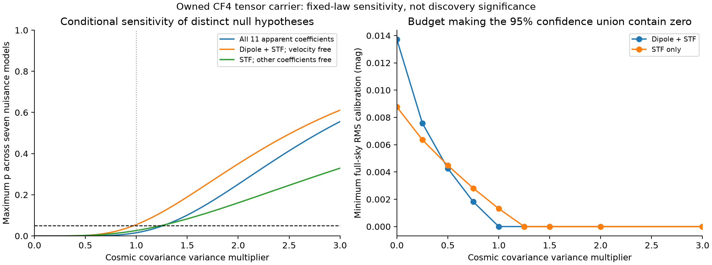

# R60: 실제 관측 텐서의 보정·공분산 민감도와 출판성 재평가

기준일: 2026-11-17 KST. 기준 commit: 6fe19c5139004a1f281ec85c592e5ab4c7590d5f. 기존 R58/R59의 수치·판정은 보존한다. 이번 결과는 같은 자료에 새로 명시한 보정 허용집합, 공분산 진폭, 유한 속도 진화 응답을 적용하고, 보유 Commander 및 count-dipole 자료를 재해석한 것이다. 현재 요청에 따라 로컬 coding-agent용 재개 프롬프트는 작성하지 않았다.

## 1. 결론

현재 자료는 새로운 우주론, 전역 tilt 검출, 일반 Bianchi 유형 식별을 지지하는 완결된 결과가 아니다. 그러나 기존의 단일 유의확률보다 구체적인 결과를 얻었다. CF4의 apparent STF 신호가 어느 정도의 우주분산과 방향별 거리 보정에 민감한지 계산했고, 물리량 추론에 필요한 외부 보정 정확도를 정량화했다. Commander에서는 하나의 축으로 요약할 때 거의 90도 차이처럼 보이는 변화가 실제 전체 고유틀에서는 약 2도 변화임을 직접 확인했다.

출판 방향은 **관측 텐서의 불확실성을 보존하고, 물리적 해석이 성립하는 보정 조건을 측정하는 methods/application 논문**으로 수렴한다. 텐서화·GLS·score compression 자체의 최초성을 주장하지 않는다. 현재 확보한 새 수치 결과는 원고를 발전시킬 근거가 되지만, 표본과 likelihood를 맞춘 선행연구 비교 및 survey 수준 calibration이 완료되어야 강한 물리 주장으로 나아갈 수 있다.

상세 유도는 [THEORY_LOOPS.md](THEORY_LOOPS.md), 직접적인 물리 likelihood는 [TENSOR_PHYSICAL_LIKELIHOOD.md](TENSOR_PHYSICAL_LIKELIHOOD.md), 실행 가능한 후속 과학 의무는 [RESEARCH_PLAN_KO.md](RESEARCH_PLAN_KO.md), 완료·미완료 의존성은 [RESEARCH_DAG.json](RESEARCH_DAG.json)에 기록한다. 본문의 결과는 established/literature-supported, derived, numerically checked, implementation-verified, unresolved 상태를 구분한다.

## 2. 내부 연구 history에서 재사용한 것

기준 HEAD의 tracked entry 33,160개, HEAD 도달 commit 2,182개, 현재 확보된 모든 ref에서 도달하는 commit 3,440개, ref 582개를 다시 색인했다. 기존 PR inventory의 575개 PR metadata와 최신 scientific delta 5 commits/89 paths를 대조했다. July 30 vector/tensor 계획, tensor_joint_r7/r8/r9, R39 직접 kinematic state, R49–R59의 실제 likelihood·관측·실패 기록을 연결했다.

이는 **전체 metadata 색인과 명시한 핵심 문서의 의미 검토**다. 모든 33,160개 파일 본문과 575개 원 PR diff를 이번에 새로 읽었다는 뜻은 아니다. 실제 읽은 범위·미확보 ref·hash는 [REVIEW/history_audit.md](REVIEW/history_audit.md)에 보존한다.

이미 확보되어 있던 요소는 다음과 같다.

- R39의 이질적인 vector/tensor/functional x와 frame·congruence·epoch·unit·parity 타입.
- R7–R9의 nuisance-model confidence union, gauge minimum, support 및 공통 초기값을 유지하는 경로 통계.
- R54/R58의 35,970 CF4 그룹, 네 redshift window의 polar3+STF5, 전체 32차원 공분산, 일곱 nuisance operator.
- R58의 rank-11 apparent parameter와 rank-11/nullity-11인 22성분 physical/calibration pullback.
- R28의 실제 calibration-covariance mimic 계산. 이번 평균 보정 frontier는 그 covariance-mimic estimand와 다르다.
- I1/R7에서 이미 지적했으나 production helper에 남아 있던 covariance-amplitude MLE 오류.

R59의 BOUNDED_METHODS_APPLICATION 및 당시 자동 후속작업 중단 결정은 역사적 판정으로 유지한다. 현재 사용자의 연구 재개 요청과 새로 실행한 과학 질문에 한해 PR-R60을 추가했다. 이전 STOP을 삭제하거나 기존 결과를 소급해서 덮어쓰지 않았다.

## 3. 실제 CF4 likelihood와 서로 다른 영가설

사용한 관측식은 다음과 같다.

$$
\eta_i=M_{m,i}\gamma_m+g(z_i)\hat n_i\cdot V+
\hat n_i\cdot d_H+\sum_{A=1}^{5}\kappa_A E_A:\hat n_i\hat n_i+\epsilon_i,
$$

$$
y_m=O_m\eta,\qquad X_m=O_mD,\qquad
C_m(\lambda)=N_m+\lambda S_m .
$$

O_m은 R58에서 고정한 일곱 보정모형의 operator이며, S_m은 기존 exact pair sum의 선형 LCDM cosmic covariance다. 이번에 pair sum이나 새로운 survey mock을 생성하지 않았다. lambda는 **분산** 배수다. 평균 parameter는 alpha=(V[3] km/s,d_H[3],kappa[5])이고, d_H와 kappa는 무차원이다. 방향은 ICRS/J2000 sourceward, 적색편이는 기존 z_CMB를 유지한다.

기준 lambda=1의 일곱 모형 최대 p는 아래와 같다. 각각 다른 영가설이며, nuisance인 나머지 평균 성분을 profile했다.

| 영가설 | 자유도 | model-max p |
|---|---:|---:|
| V=d_H=kappa=0 | 11 | 0.0153427383 |
| d_H=kappa=0, V 자유 | 8 | 0.0549608897 |
| kappa=0, V와 d_H 자유 | 5 | 0.0261896826 |
| d_H=0, 나머지 자유 | 3 | 0.8099460594 |
| V=0, 나머지 자유 | 3 | 0.7569345883 |
| 관측 carrier의 전체 평균 32성분=0 | 32 | 0.1122128922 (R58 재사용) |

11D 결과와 32D omnibus의 차이는 서로 다른 대립공간에서 나온다. 11D 기각이 속도 성분의 검출이라는 뜻도 아니다. 개별 좌표의 신뢰구간이 모두 영점을 포함해도 공동 영점은 제외될 수 있다.

일곱 O_m은 같은 자료를 변환한 실험이다. 서로의 likelihood를 곱하거나 정규화 likelihood 높이로 모형확률을 만들지 않았다. model-max p/집합의 합집합은 포함된 모형 중 하나와 그 covariance law가 맞다는 조건에서의 보수적인 처리이며, 선택하지 않은 모든 systematic을 포괄하지 않는다.

근거: [SENSITIVITY_RESULT.json](RESULTS/SENSITIVITY/SENSITIVITY_RESULT.json), [COVARIANCE_SCAN.csv](RESULTS/SENSITIVITY/COVARIANCE_SCAN.csv). 상태: numerically checked, implementation-verified; 관측 유의도 해석은 고정 Gaussian working law에 조건부다.

## 4. 새 관측 결과: 공분산과 보정 허용량

### 우주분산 민감도

일곱 모형 최대 p가 0.05를 지나는 위치는 11D에서 lambda=1.2646166826, STF5에서 1.2426705608이다. 즉 기존 cosmic covariance를 약 26.46% 또는 24.27% 증가시키면 해당 기각이 사라진다. 전자는 cosmic 표준편차의 약 12.46% 증가에 해당한다. 이 값은 실제 우주분산 오차나 성장률의 측정값이 아니다.

검정된 유한 grid의 모든 sign crossing을 기록하고 각 구간을 root solver로 세분했다. PSD covariance 증가가 fitted Wald를 항상 감소시킨다는 명제는 틀리므로, 연속 범위의 전역 단조성·유일한 root를 주장하지 않는다. 반례 및 검증은 THEORY_LOOPS와 테스트에 있다.

고정 zero-mean amplitude 최대값은 모형별 약 1.43–2.55이나, 11개 평균을 제거한 21개 고정 contrast의 restricted likelihood에서는 약 0.55–0.86이다. coherent mean을 covariance로 흡수하는 효과가 있음을 보여준다. 후자는 REML/contrast likelihood이고 normalized profile-mean likelihood와 다르다. fitted lambda를 알려진 covariance의 chi-square 식에 대입한 발견 p는 산출하지 않았다.

### 방향별 거리 보정의 임계값

보정장을 b(n)=d_cal.n+Q_cal:nn으로 두면, orthonormal STF basis에서

$$
\rho^2=\langle b^2\rangle_{\mathbb S^2}
=\frac{|d_{\rm cal}|^2}{3}+\frac{2}{15}\|Q_{\rm cal}\|_F^2,
\qquad \delta\mu_{\rm RMS}=\frac5{\ln10}\rho .
$$

rho는 **전천 RMS log-distance** 허용량이다. 표본 mask에서 측정한 RMS, 무작위 보정오차의 표준편차, prior는 아니다. confidence ellipsoid 안의 최소 gauge를 계산하여 영점과 처음 양립하는 보정장을 직접 구성했다.

| 모형 | angular8 임계 RMS [mag] | STF5 임계 RMS [mag] |
|---|---:|---:|
| log | 0.013618785 | 0.007721357 |
| log_mono | 0.008439537 | 0.009849716 |
| log_mono_error | 0.007397125 | 0.009042038 |
| log_mono_galactic | 0 | **0.001314748** |
| log_mono_radial | 0.006433887 | 0.008209440 |
| log_split | 0.004590256 | 0.005564068 |
| log_survey | 0.004729530 | 0.006106558 |

따라서 일곱 모형 합집합의 STF5 결과는 적대적으로 정렬된 특정 quadrupolar calibration이 전천 RMS **1.315 millimag**이면 95% 수준에서 영점과 양립한다. 같은 RMS의 임의 보정장이 모두 신호를 지운다는 뜻이 아니다. 이 수치는 물리적 shear 해석을 위해 독립적으로 점검해야 할 angular calibration 수준을 준다.

angular8은 이미 영점을 포함하므로 최소 예산이 0이다. STF5와 angular8은 자유도와 신뢰집합이 다르다. 보정 최적화 후 거리 자체를 chi-square 확률변수로 간주하지 않고, 원래 confidence set의 교차 여부를 사용했다.

근거: [CALIBRATION_FRONTIER.csv](RESULTS/SENSITIVITY/CALIBRATION_FRONTIER.csv)와 JSON의 실제 witness. Q_min 및 F_support의 계산된 응용이다.

## 5. 새 관측 결과: tensor shape, radial velocity, Commander

### CF4의 axisymmetric compatibility

STF kappa의 5D 95% marginal ellipsoid에 축대칭 형태 a sqrt(3/2)(nn-I/3)가 들어가는지 조사했다. 고정 n에서 최적 a는 해석적으로 구했고, 실제 feasible tensor를 저장했다. 일곱 거리 값은 1.091–5.029이며 모두 chi-square_5(.95)=11.0705보다 작다.

따라서 최적 적합 tensor가 세 고유값을 구별하더라도, 현재 오차까지 포함하면 triaxiality가 요구되지 않는다. 각 witness의 전체 11성분 profile lift를 직접 구성해 같은 likelihood distance를 확인했다. chi-square_5의 marginal95%와 chi-square_11의 joint95%를 동일한 집합으로 부르지 않는다. 축대칭 witness는 어떤 특정 논문의 공통 축·redshift evolution·Bianchi 해를 재현한 것도 아니다.

근거: [AXISYMMETRIC_WITNESSES.json](RESULTS/AXISYMMETRIC_WITNESSES.json).

### 유한 속도 진화의 영향

같은 자료·covariance에서 V(z)=V0+V1 z/0.05를 추가했다. 저-z 전개

$$
czg(z)=1-\frac{1+q_0}{2}z+O(z^2)
$$

때문에 V1의 주된 효과는 상수 d_H와 겹친다. 안정적인 chart d_eff=d_H+V1/(c z_star)를 사용한 뒤 d_H와 전체 covariance로 역변환했다. 직접 원래 design을 적합한 결과와 대조했다.

자유 14D 적합은 rank14이며 V1=0에 대한 nested test의 모형별 p는 0.190–0.858이다. d_H 표준오차는 기존보다 125–141배 증가했다. 그런데 무제약 최적 적합은 표본 끝에서 0.159–0.531c를 요구한다. 이는 물리적 속도·tilt 결과로 채택할 수 없는 first-order response의 외삽이다.

이에 원래 11D estimator를 유지하면서 ||V1||<=300,1000,3000 km/s라는 유한 sensitivity body를 별도로 계산했다. alpha_hat의 bias map H를 전체 covariance로 구하고, E+(-H ball_b)의 support/교차를 평가했다. 선언한 모든 예산에서 일곱 모형의 STF5 영점 제외는 유지된다. 반면 ||V1||=1000 km/s가 허용되면 d_H 각 성분의 support는 약 0.065씩 넓어질 수 있다. 이 응답에서는 radial flow와 apparent Hubble dipole의 구별이 특히 취약하다.

무제약 선형 모델의 STF 영점 교차 threshold는 최소 22,506 km/s이나, 이것도 유효범위 밖의 **형식적 threshold**로만 저장한다. 결론은 유한 0–3000 km/s 예산에서의 감도와 응답 degeneracy로 제한한다. 이 예산은 외부 관측으로 측정한 prior가 아니다.

근거: [RADIAL_VELOCITY_RESULT.json](RESULTS/RADIAL/RADIAL_VELOCITY_RESULT.json), pinned raw operator로 재구성한 [RADIAL_RESPONSE_CARRIERS.npz](RESULTS/RADIAL/RADIAL_RESPONSE_CARRIERS.npz).

### Commander의 tensor morphology

보유한 PR3 Commander masked-estimator T_2 coefficients를 정확한 harmonic↔STF 변환으로 계산했다. Galactic frame, 단위 microkelvin에서

$$
Q_T=\begin{pmatrix}
-6.173408&14.765972&3.210111\\
14.765972&0.881715&6.867990\\
3.210111&6.867990&5.291693
\end{pmatrix}.
$$

C2=207.0624434 microkelvin², quadrupole RMS=9.0767576 microkelvin, ordered eigenvalues=(-17.9675337,0.8088642,17.1586694) microkelvin이다. 이는 현재 estimator의 representation이며 full-sky unbiased estimate나 current shear 측정이 아니다.

동일 estimator의 SMICA와 비교하면 tensor Frobenius 차이는 8.274%, 대응 cold/middle/hot 고유축 차이는 2.0665°,2.4303°,2.5077°다. 그러나 largest-|eigenvalue| axis 하나만 쓰면 88.4993° 차이가 난다. 중간 고유값의 부호가 바뀌며 선택되는 cold/hot branch가 바뀌었기 때문이다. 전체 tensor는 가까운 상태다.

이는 scalar/axis-only 요약의 실제 정보 손실 사례다. STF/고유값 수학의 최초성이나 우주론적 anomaly significance는 주장하지 않는다. Commander-matched MC가 불완전하므로 SMICA covariance를 옮겨 p를 만들지 않았다. 저장된 masked template inverse도 SMICA beam을 쓴 reference coordinate임을 분리했다.

근거: [COMMANDER_MORPHOLOGY.json](RESULTS/COMMANDER_MORPHOLOGY.json), [COMMANDER_MORPHOLOGY.md](COMMANDER_MORPHOLOGY.md).

## 6. Count dipole의 실제 재분석

R54의 Quaia_G20/NVSS excess vector와 보유 covariance를 재사용했다. 이번에는 C(lambda)=C_mock+lambda(C_total-C_mock), 0<=lambda<=1의 **nominal Gaussian sensitivity**를 계산했다. C_mock은 500개 data-conditioned mocks에서 추정했으므로 정확한 known-covariance law로 승격하지 않는다.

| 관측량 | 원래 finite-mock Pi | nominal Gaussian p(0) | nominal Gaussian p(1) |
|---|---:|---:|---:|
| Quaia_G20 | 0.005988024 | 0.000417023 | 0.309208812 |
| NVSS | 0.329341317 | 0.322792035 | 0.421167779 |

Quaia에서는 기존 receipt systematic covariance의 lambda=0.253689111만 적용해도 nominal p가 .05를 지난다. 이 성분의 표준편차 배수로는 0.503676이다. Mock-only nominal95% ellipsoid를 영점과 양립시키는 최소 deterministic count-dipole offset norm은 0.0038996227이다. NVSS는 이미 영점과 양립한다.

두 종류의 tail은 서로 다른 법칙에 속한다. p=.006을 무시하고 p=.309만으로 anomaly 부재를 말하거나, systematic을 제거한 tail만으로 global tilt를 말하는 해석 모두 지원되지 않는다. 이번 결과는 **어떤 systematic 가정이 결론을 바꾸는지**를 실제 벡터와 방향을 보존해 측정한다. 속도로 변환하지 않았다.

근거: [COUNT_DIPOLE_SENSITIVITY.json](RESULTS/COUNT_DIPOLE_SENSITIVITY.json), [COUNT_DIPOLE_SENSITIVITY.md](COUNT_DIPOLE_SENSITIVITY.md). 상태: numerically checked nominal sensitivity.

## 7. 직접적인 theta likelihood와 5변수의 실질적 역할

(-,+,+,+), U.U=-c², H=Theta/3와 sourceward n에서 local directional rate는

$$
\mathscr H(n)=H+\sigma_{ab}n^an^b-\frac{A_an^a}{c}.
$$

antisymmetric vorticity는 이 contraction에 나타나지 않는다. 이 관계는 local d_L=cz/mathscr H(n)+O(z²)의 선도항이며, 유한 z의 추론에는 시간·공간 미분과 transport가 더 필요하다.

현재 CF4의 물리 map은 V=c beta_MR, d_H=-A/(cH)+d_cal, kappa=sigma/H+q_cal이다. 따라서 theta의 모든 성분을 직접 likelihood 좌표로 넣을 수 있지만, 자유로운 calibration과 omega가 만드는 nullspace를 보존해야 한다. 이를 pseudoinverse로 제거한다고 물리량이 측정되는 것은 아니다.

x는 단일 amplitude가 아니라 signed component, covariance 및 response를 가진 typed object다. sigma/H, omega/H, A/(cH), beta와 예측 a_lm뿐 아니라 beta^T(sigma/H)beta 같은 mixed functional도 허용한다. 다만 현재 자료에서 beta^T(sigma/H+q_cal)beta와 달리 순수 beta^T(sigma/H)beta는 calibration fibre에서 변한다.

| view | 이번에 실제 계산한 역할 |
|---|---|
| x | CF4 polar/STF likelihood, Commander full temperature tensor, counts excess vector |
| Q | confidence set과 보정 body 사이의 최소 RMS gauge, velocity-slope/calibration threshold |
| Pi | 영가설·차원·data law를 명시한 tail 또는 confidence-set inversion |
| F_support | calibration/velocity body를 포함한 물리 functional의 support |
| G_F | 전체 cross-depth covariance를 유지한 constant/evolving response와 고정 residual contrast |

F_occupancy는 물리적 measure와 ceiling이 정해지지 않아 unavailable이다. view 다섯 개는 같은 likelihood에서 나온 의존적인 함수들이며 서로 곱하지 않는다. 고정 C의 exact GLS와 정보량이 같다는 것이 현재 benchmark다. covariance가 parameter에 의존할 때는 y와 C(theta), logdet 및 quadratic score를 유지해야 한다.

## 8. 선행연구 대비와 출판 판단

[Heinesen 2021](https://arxiv.org/abs/2010.06534v2)의 general-spacetime cosmography, [Maartens et al. 2024](https://arxiv.org/abs/2312.09875v3)의 observer transformation, [Kalbouneh et al. v2](https://arxiv.org/html/2510.02510v2)의 CF4/Pantheon+ multipoles, [Vicente et al. v1](https://arxiv.org/html/2607.07821v1)의 STF/multipole vectors와 full cross-multipole covariance가 직접 선행한다. [Stiskalek et al. v2](https://arxiv.org/html/2509.14997v2)는 radial flows와 zero-point dipole의 혼동을 실제 forward model에서 다룬다. 이 논문들보다 HTT가 tensor·covariance·flow 구별을 처음 도입했다고 주장할 근거는 없다.

[Alsing & Wandelt](https://arxiv.org/abs/1712.00012v2)의 score compression과의 관계도 명확하다. 현재 fixed-C Gaussian linear model에서는 exact factorization으로 sufficient carrier가 성립하지만, 일반적인 nonlinear/covariance-dependent likelihood에 global sufficiency가 자동으로 확장되지는 않는다.

**실질적인 기여 후보**는 이 프로젝트의 원 관측 operator와 full covariance에서 계산한 calibration/covariance breakdown surface, bounded-flow에 따른 physical functional의 support, confidence-set shape witness, 실제 CMB scalarization failure를 하나의 추론 체계로 연결한 적용이다. 외부 논문의 수치적 주장에 대한 반박이나 보편적 우월성은 아직 성립하지 않는다. 세부 15-source 비교는 [REVIEW/literature_delta_report.md](REVIEW/literature_delta_report.md)에 있다.

심사 관점에서 가장 큰 위험은 novelty overlap, catalog compression의 손실 미평가, 사후 선택, 독립적인 survey calibration 부재, finite-z apparent coefficients와 local kinematic quantities의 간극이다. 현재 결과는 강한 cosmological discovery paper의 제출 기준에 못 미친다. 범위를 좁힌 methods/application 원고는 발전시킬 가치가 있으며, 다음 단계는 더 많은 형식 이름을 추가하는 것이 아니라 **동일 raw sample/forward law에서 경쟁 추론과 비교하고 보정 정확도를 검증하는 것**이다.

## 9. 코드 교정과 검증

기존 amplitude_mle는 score(0)<=0이면 boundary MLE를 반환하고 score 단조성을 가정했다. lambda=(100,1), p²=(0,20)에서 score(0)=-40.5지만 global maximum은 a=8.4470542918이며 log-likelihood gain=4.4485319395이다. production helper를 bounded global objective search로 교정했다. 이 결함은 R58 fixed-C fit의 경로에는 없으므로 R58 결과 전체를 무효화하지 않는다. 오래된 consumer 결과를 모두 다시 산출했다고 주장하지 않는다.

초기 branch bound는 실제 consumer 규모 400 modes에서 resource limit에 걸렸다. 독립 검토의 재현 사례를 회귀 테스트로 보존하고 aggregate-score Taylor 상한을 추가했다. 같은 사례가 54 intervals, numerical objective gap 4.26e-9로 해결되었다. 이 gap은 float 수치 상한이며 formal interval-arithmetic proof나 신뢰구간이 아니다.

새 nuisance-image helper에서 작은 비영 singular mode를 버리면 유한 budget의 결론이 틀리는 경계 사례도 수정했다. unresolved nonzero mode에서는 명시적으로 실패하고 현재 실제 H map은 해당 경계에서 충분히 떨어져 있다. 초기 calibration root의 1-ulp boundary 실패도 feasible witness 처리로 교정하고 실패 로그를 보존했다.

최종 테스트 명령·버전·독립 실제자료 oracle·finding closeout·hash는 [VALIDATION.md](VALIDATION.md), [REVIEW/final_science_review.md](REVIEW/final_science_review.md), [EXECUTION_RECORD.json](EXECUTION_RECORD.json)을 기준으로 한다. 구조 DAG 검증과 과학 검증은 별개로 기록한다.

## 10. 이번에 닫은 범위와 남은 의무

여섯 이론 루프는 각각 실제 정의·유도·판별 계산·판정을 갖춘 scoped 단위로 기록했다. CF4/Commander/counts의 새 재분석과 code fix는 완료 대상이다. 개별 shear·acceleration·vorticity 측정, 전역 tilt의 일반적 구별, 일반/강한 비등방 Bianchi 분류는 현재 미해결로 남는다. 이 상태를 새로운 no-go theorem으로 포장하지 않는다.

후속 연구는 하나의 primary CF4 문제와 그 physical-calibration 조건에 집중한다. Commander-matched calibration과 source-bound Bianchi transfer는 해당 물리 주장을 선택할 때 필요한 입력 의무이며, 불완전한 surrogate로 이를 대신하지 않는다. 다음 수행 순서·원자료·acceptance criterion은 RESEARCH_PLAN_KO.md와 RESEARCH_DAG.json에 고정한다.
