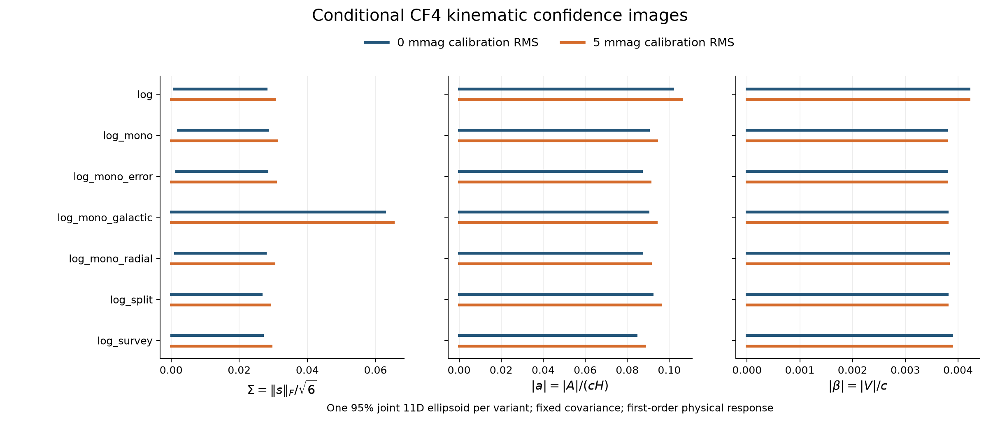
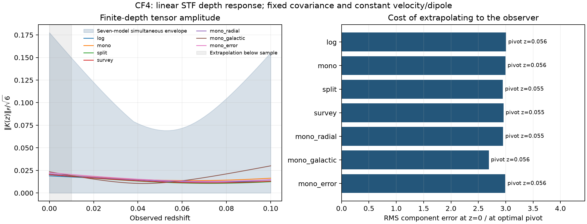

# R61 — Beyond-FLRW kinematic quantity measurement

One independent ten-stage theory/coding study, based on R60 commit `fb6ae9f21585e194ef29dabc91d79a529e0ac57e` and existing actual CF4 inputs.

- [Scientific report and publication assessment](REPORT_KO.md)
- [Convergent paper plan](RESEARCH_PLAN_KO.md)
- [Derivation and computational contract](THEORY.md)
- [Research DAG](RESEARCH_DAG.json) and [ten-stage execution record](RESEARCH_RECORD.json)
- [Validation, limitations and preserved failures](VALIDATION.md)
- [Generated numerical tables](RESULTS/NUMERICAL_TABLES.md)
- [Independent final review](REVIEW/final_review.md)

New calculations give conditional joint kinematic images, mixed contractions, actual STF depth contrasts and local-extrapolation/response sensitivities. No evidence requiring the selected linear STF depth slope is found. Absolute expansion and vorticity remain unmeasured by the retained distance experiment. Calibration and survey-law conditions are explicit.

Production code is in `scripts/r61`, `tests/r61`, and the three `htt/htt/htt/infer/r61_*.py` modules. Existing R54/R58/R60 source operators, covariance and finite velocity response are reused. `run_r61_study.py` runs verification and the three original actual-data components in order; `run_r61_box_comparison.py` reuses stored endpoints for the corrected comparison. Replays require an empty output directory. `summarize_r61_results.py` produces tables without refitting.

The study does not create a local-agent restart prompt or automatic successor loop. The research plan identifies concrete physical and observational inputs needed for a stronger paper.

The active depth result is `RESULTS/DEPTH_CORRECTED/KINEMATIC_DEPTH.json`. Original `RESULTS/DEPTH` preserves the reviewed preimage; its general endpoint-calibration wording is superseded by R61-F1. All original numeric results are unchanged.
