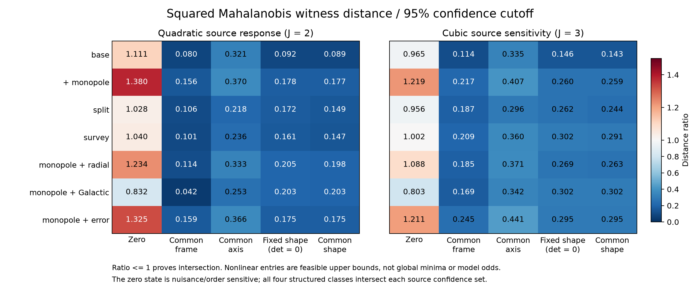
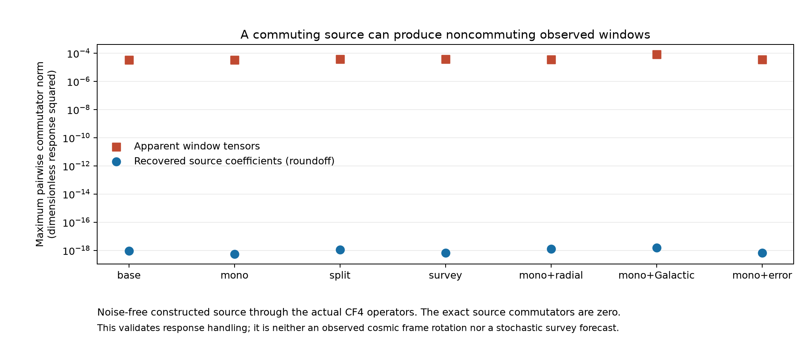

# R62 — 관측 tensor의 비등방성 분류와 조건부 Bianchi 귀속

작성일: 2026-11-17. 기준 commit: `c118982e56ee50d68dd0446aa10f16ffe65bd02b`. 작업 branch: `research/r62-anisotropy-classification-20261117`.

검토 상태: `PASS — APPROVED_FOR_SCOPED_RESEARCH_BRANCH`; 저널 제출 상태: `NOT_READY_TO_SUBMIT`. 독립 검토의 단위 의존 제약 오류 `R62-FR-01`(교정 기록명 R62-F1)은 수정과 재검산을 거쳐 닫혔다. 연구 범위는 anisotropy classification 하나이며, 이론·코딩 10단계의 한 루프다. 다른 연구 가지로 확장하거나 자동 후속 루프를 시작하지 않는다.

## 1. 결론과 출판 가능성

기존 CF4 35,970개 그룹의 관측 연산자와 전체 공분산을 재사용하여, **42개 tensor carrier에 대한 210개 class 판정**을 실제로 수행했다. 네 구조적 형태 클래스 — 공통 고유틀, 공통 축대칭 축, 공통 영 고유값 형태, 공통 일반 형태 — 는 모두 각 carrier의 95% 공동 신뢰영역과 교차하는 구체적 해를 갖는다. 깊이에 따라 변하는 tensor 성분도 모든 nuisance 처리에서 0과 양립한다. **현재 결과는 특정 Bianchi 종류·tilt·우주론적 주축 회전을 검출하거나 선호한다는 주장을 지지하지 않는다.** 이 판단은 선택한 공동 신뢰영역을 이용한 보수적 분류의 결과이며, 모든 가능한 통계 검정의 식별 불능 정리는 아니다.

동시에 실제 survey 응답을 생략하면 물리적 해석이 바뀌는 명시적 예를 확보했다. 공통 고유틀을 갖는 source tensor를 실제 관측 연산자에 통과시키면 apparent window tensor들은 서로 commute하지 않을 수 있다. source 응답을 포함한 역산은 원래의 공통 고유틀을 수치 정밀도까지 복원한다. 이 사실은 **관측 형태의 분류 → source 응답을 통과한 형태의 분류 → 물리적 운동학/기하 분류**의 구분을 실제 데이터 구조에서 구현해야 함을 보여 준다.

출판 판단은 다음과 같다. 현재 결과와 코드는 제한된 방법론·관측 결과 절의 초안을 작성할 수준이다. 그러나 독립적인 Bianchi 식별 발견 논문은 아직 준비되지 않았다. 가장 현실적인 주 논문은 **공분산과 관측 응답을 보존한 tensor 형태 분류, 공통 calibration의 quotient, 그리고 조건부 Bianchi 제약을 연결하는 방법론과 CF4 적용**이다. 새로운 기하 분류 정리, Gaussian likelihood의 정보량 증가, tilted IX의 최초 발견은 주장하지 않는다. 논문 제출까지 남은 과학적 입력과 종료 조건은 [연구계획](RESEARCH_PLAN_KO.md)에 고정한다.

## 2. 이전 연구에서 실제로 재사용한 부분

[history_map.md](REVIEW/history_map.md)와 [history_sources.json](REVIEW/history_sources.json)에 관련 PR·branch head·파일 blob·SHA-256을 남겼다. 현재 연결된 #571–#578의 계보와 R47–R61의 관련 source를 직접 확인했다. 과거의 전체 PR 목록과 legacy index는 이전 감사 산출물을 재사용했으며, 모든 과거 PR diff를 이번에 다시 읽었다고 주장하지 않는다.

| 이전 결과 | 이번에 재사용한 내용 | 유지한 제한 |
|---|---|---|
| R47 | Boltzmann hierarchy 없이 가능한 제한된 Bianchi-I endpoint/형태론 경로 | isotropic emission·collisionless 가정; 현재 shear의 직접 측정이 아님 |
| R48 | 전체 Bianchi algebra 분류, 구조/곡률 불변량, I/VII0 및 V/VIIh action 동치 사례 | sky tensor를 구조상수 `(a,n)`로 동일시할 수 없음 |
| R49 | 실제 vector-tilt state, exact Ricci·운동량 제약, typed source | R50에서 비판된 임의 response를 사용한 physical posterior는 재사용하지 않음 |
| R54 | Frobenius 정규직교 STF5, 실제 CF4 source 연산자, tensorized five-view 및 선택 규칙 | ideal-sky 결과를 masked-source 결과로 격상하지 않음 |
| R58 | dipole12+STF20의 공동 Gaussian carrier, 7개 nuisance 연산자, 전체 cross-window covariance | covariance는 고정된 working law; 7개 결과는 독립 자료가 아님 |
| R60 | 이미 완료된 단일 tensor 축대칭 witness, Commander deterministic 형태 | 단일 tensor 축대칭 검정을 반복하지 않음; SMICA MC를 Commander calibration으로 사용하지 않음 |
| R61 | source-bound affine-depth likelihood, trust-region quadratic image, calibration bias map | redshift slope를 proper-time shear derivative로 해석하지 않음 |
| R36-08 | 이미 정식 한정 검증된 Pantheon+ 두-depth signed magnitude carrier 및 전체 16D covariance | source-chart 형태만 사용; physical frame 및 CF4와의 shared-PV law는 UNKNOWN |

이번 연구가 새로 계산한 대상은 단일 축의 재측정이 아니라 **여러 깊이 tensor가 같은 고유틀/형태를 공유하는가**이다. R49 코드에서 발견된 canonical IX의 전역적 tilt 배제와 R48의 실제 velocity Jacobian 오표기도 해당 관측-기하 연결에 필요한 범위에서 교정했다.

## 3. 형태 분류의 수학적 계약

서명은 \((-+++ )\)이고, 물리적 식에서는 \(c\)를 유지한다. \(K_j\)는 공통 orthonormal frame에서 표현한 실대칭 trace-free tensor이며, \(x=\mathrm{vec}(k_{jA})\)는 STF5 성분들을 보존한 signed vector다. tensor marginal의 추정값과 공분산을 \((\hat x,V)\)라 하면

\[
\mathcal E_d=\{x:(x-\hat x)^T V^{-1}(x-\hat x)\le\chi^2_d(0.95)\}
\]

를 한 번 정하고, 같은 carrier의 모든 class 질문에 동일한 집합을 사용한다. 이때 tensor covariance는 polar nuisance를 자유롭게 적합한 뒤의 marginal covariance이며, polar nuisance를 알려진 값으로 고정한 conditional covariance가 아니다.

| 클래스 | 정확한 모형 |
|---|---|
| ZERO | 모든 \(K_j=0\) |
| SHARED_FRAME | \(K_j=R\operatorname{diag}(a_j,b_j,-a_j-b_j)R^T\), 공통 \(R\in SO(3)\) |
| SHARED_AXIS | \(K_j=b_j\sqrt{3/2}(uu^T-I/3)\), 공통 unoriented axis \(u\) |
| SHARED_ZERO_EIGENVALUE_SHAPE | \(K_j=b_jR\operatorname{diag}(1,-1,0)R^T/\sqrt2\) |
| SHARED_GENERAL_SHAPE | \(K_j=b_jS\), 공통 단위 STF \(S\) |

진폭은 양·음·0을 허용한다. 마지막 네 클래스도 영 상태를 포함한다. 축대칭 및 영 고유값 형태는 공통 일반 형태의 부분집합이고, 공통 일반 형태는 공통 고유틀의 부분집합이다. 여러 클래스가 같은 신뢰영역과 교차한다는 것은 서로 다른 가설에 부합하는 해들이 남는다는 뜻이며, 모든 가설이 동시에 참이라는 뜻이 아니다.

orientation/shape를 고정하면 진폭은 선형 GLS로 제거할 수 있다. 그 후 제한된 multistart variable projection으로 exact-class 상태를 구성한다. 저장한 상태가 \(\mathcal E_d\) 안에 있으면 `INTERSECTS`다. 최적화로 찾은 거리의 제곱은 **실현 가능한 상계**이며, 바깥의 local optimum을 발견했다는 이유만으로 배제하지 않는다. 반복 고유값·영 진폭에서는 orientation이 식별되지 않으므로 단순한 parameter-count Wilks 법칙이나 class posterior를 부여하지 않았다.

실대칭 tensor들이 공통 고유틀을 가질 필요충분조건은 쌍별 commutator가 0인 것이다. 각 signed commutator 성분은 \(x^TMx\)이므로 R61의 global quadratic image로 \(\mathcal E_d\) 전체에서 범위를 계산한다. 어느 한 범위라도 0을 제외하면 공통 고유틀과 그 부분 클래스들을 배제할 수 있다. 모든 범위가 0을 포함하는 것만으로 공통 해의 존재가 증명되지는 않으므로, 이번 계산은 별도로 실제 class witness를 저장했다. 유도와 계산식은 [THEORY.md](THEORY.md) 및 [tensor_classes_derivation.md](REVIEW/tensor_classes_derivation.md)에 있다.

공통 가산 calibration \(C\)에는 정확한 quotient가 있다.

\[
\exists C:\ [K_i-C,K_j-C]=0\quad\forall i,j
\iff [K_i-K_0,K_j-K_0]=0\quad\forall i,j.
\]

필요성은 commuting tensor들의 차분도 commute한다는 사실이고, 충분성은 \(C=K_0\)로 구성된다. 차분의 covariance는 \(LVL^T\)이며 모든 cross block을 유지한다. 이는 임의의 **공통** offset을 제거하는 명제다. calibration의 크기를 측정하거나 임의의 redshift-dependent calibration을 제거한 것은 아니다.

## 4. 실제 CF4 분석 결과

### 4.1 관측량과 likelihood

네 Gaussian window의 중심은 \(z_{\rm CMB}=(0.025,0.04,0.06,0.08)\), 폭은 0.012다. 같은 35,970개 그룹을 가중하는 중첩 estimator이며 독립적인 physical shell이 아니다. 보존된 `y32`의 순서는 dipole 12개 뒤에 STF 20개다. source velocity가 survey mask와 가중치를 통해 STF 행에도 들어오므로 observed dipole만 제거하는 것으로 이 효과가 사라지지 않는다.

실제로 적합한 source 평균은

\[
\eta_i=g_i\hat n_i\cdot V+\hat n_i\cdot d+
\sum_{j=0}^{J}P_j\!\left(\frac{z_i-0.055}{0.045}\right)
\hat n_i^T K_j\hat n_i,
\qquad X_m=O_mD_J.
\]

주 분석 \(J=2\)는 21변수, 차수 민감도 \(J=3\)는 26변수이며, 모든 nuisance 처리에서 두 scale convention의 rank가 각각 21, 26으로 일치했다. \(V\)의 단위는 km/s, \(d,K_j\)는 dimensionless log-distance response다. 이 다항식은 유한한 관측 response family이며 정확한 GR shear history가 아니다.

원래의 R58 carrier hash는 `42f6bc5158fdf2f876720db12c44b088bc2db9734887e0d84ae098b234a7e64d`, 새 source carrier hash는 `1d0f3c353ea9189bffbab5728f295264c6925d4a3d82561c4457e48746beefd2`다. 다른 native replay 파일의 byte identity와 혼동하지 않는다. 새 precision·score·q0·whitened likelihood factor·전체 covariance를 함께 저장했다.

### 4.2 공동 신뢰영역에서의 분류

아래 범위는 독립 자료의 반복 측정 구간이 아니라, 같은 자료에 대한 7개 명시된 nuisance 처리의 결과 범위다. \(p_0\)는 고정 Gaussian law에서 모든 tensor 계수가 0이라는 선형 가설의 nominal tail이며, 특정 Bianchi 모형의 확률이 아니다.

| Carrier | tensor 차원 | 95% cutoff | \(p_0\) 범위 | ZERO와 교차 | 네 구조적 클래스와 교차 |
|---|---:|---:|---:|---:|---:|
| apparent windows | 20 | 31.4104 | 0.002895–0.063863 | 1/7 | 각 7/7 |
| window 차분 | 15 | 24.9958 | 0.320946–0.771332 | 7/7 | 각 7/7 |
| source \(J=2\) 전체 tensor | 15 | 24.9958 | 0.002905–0.143263 | 1/7 | 각 7/7 |
| source \(J=2\) 비상수 tensor | 10 | 18.3070 | 0.620408–0.888056 | 7/7 | 각 7/7 |
| source \(J=3\) 전체 tensor | 20 | 31.4104 | 0.008157–0.193240 | 3/7 | 각 7/7 |
| source \(J=3\) 비상수 tensor | 15 | 24.9958 | 0.625604–0.939818 | 7/7 | 각 7/7 |

주 분석 \(J=2\)의 feasible squared Mahalanobis distance 범위는 공통 고유틀 **1.0430–3.9665**, 공통 축 **5.4591–9.2591**, 영 고유값 공통 형태 **2.2946–5.1131**, 일반 공통 형태 **2.2256–5.0772**다. 모두 같은 cutoff 24.9958보다 작다. 이 값을 서로 다른 차원의 모형에 대한 posterior 순위로 읽으면 안 된다.

응답 차수를 올릴 필요도 현재 working law에서는 검출되지 않았다. \(J=2\) 대 \(J=1\)의 5차원 추가항 검정은 \(p=0.3649\)–0.5742, \(J=3\) 대 \(J=2\)는 \(p=0.3606\)–0.7727이다. residual adequacy tail은 각각 0.2723–0.6681, 0.1784–0.4261이다. 높은 tail이 평균 모형이나 covariance의 물리적 진실성을 입증하지는 않는다.

따라서 기존의 특정 nuisance 처리에서의 amplitude 유의성을 유지하더라도, 이번 공동 tensor 분류에서는 축대칭·일반 형태·영 고유값 형태를 구별할 수 있는 배제가 생기지 않았다. model-union 기준에서는 전체 tensor zero도 남는다. 이 결론은 수렴 방향을 정한다. 같은 amplitude/axis 검정을 반복하기보다 **관측 응답과 외부 calibration을 개선하여 실제 물리적 class 사이의 구별 가능성을 높여야 한다.**

### 4.3 실제 관측 연산자를 사용한 반례

서로 다른 diagonal STF 3개를 한 공통 frame으로 회전시킨 source를 구성했다. 이 source의 tensor들은 정확히 commute한다. 이를 실제 7개 CF4 연산자에 통과시켰을 때 apparent window의 최대 pairwise commutator norm은 **\(3.3867\times10^{-5}\)–\(7.9682\times10^{-5}\)**였다. source response를 포함하여 복원한 계수들의 최대 commutator norm은 **\(1.5768\times10^{-18}\)**이고, scaled coefficient 복원 오차는 **\(6.4441\times10^{-15}\)** 이하였다.

이는 noise-free constructed injection이다. 실제 우주의 회전 신호나 survey의 false-positive 비율을 측정한 것은 아니다. 확실히 확인한 것은 **이 관측 연산자가 depth-dependent 고정-frame source의 commutativity를 apparent window 공간에서 일반적으로 보존하지 않는다**는 사실이다.

### 4.4 이미 계산된 Pantheon+ 결과의 즉시 재사용

계획을 정리하면서 R36-08-PUBLIC-SN의 정식 한정 검증 산출물을 다시 연결했다. 원자료와 STAT+SYS covariance는 이미 장치에 있으며, 두-depth signed coefficient 16개와 전체 covariance가 보존돼 있다. 새 다운로드나 source fit을 반복하지 않고, 그중 STF10 marginal과 high-minus-low STF5 contrast를 직접 계산했다. 8-vector의 순서는 dipole3+STF5다.

| 기존 선택 | 두 tensor STF10의 \(q_0\) / \(p_0\) | 차분 STF5의 \(q_0\) / \(p_0\) |
|---|---:|---:|
| primary 490행, \(0.0233\le z_{HD}\le0.15\) | 10.1568 / 0.426848 | 2.9292 / 0.710901 |
| lower-z sensitivity 705행, \(0.01\le z_{HD}\le0.15\) | 6.9253 / 0.732478 | 2.2287 / 0.816682 |

네 carrier 모두 영 상태가 각 95% ellipsoid 안에 있으므로, 동일한 영 tensor witness가 네 구조적 class와의 교차도 증명한다. 새로운 비선형 최적화는 필요하지 않았다. 두 bin의 공통 offset을 제거하면 tensor가 하나만 남으므로, 그 contrast의 공통 고유틀 조건 자체는 항상 만족되는 조건이다. calibration에 강건한 비가환성 분류를 하려면 독립적인 tensor contrast가 적어도 두 개 필요하다.

이 결과는 released magnitude residual law에 조건부이며 CF4의 log-distance response와 단위·redshift 처리·selection이 다르다. RA/DEC의 physical reference frame과 CF4 object overlap/shared peculiar-velocity law가 확정되지 않아 공동 likelihood나 물리적 축 일치 주장은 만들지 않았다. 기존 `PUBLICATION_STATUS.json`이 한정 검증의 authority이고 `RESULT.json`의 오래된 pending 문자열은 history다. 입력 hash와 실제 계산은 [INHERITED_SN_REUSE.json](RESULTS/INHERITED_SN_REUSE.json)에 보존했다.

## 5. Boltzmann solver 없이 가능한 Bianchi 추론

### 5.1 운동학만으로 가능한 조건부 배제

구조상수 \(a_i,n_{ij}\)는 fluid acceleration \(A_a\)와 다른 양이다. 현재 convention의 운동량 제약은

\[
D_i(\sigma)=-\bigl(\sigma_{jk}\epsilon_{kil}n_{lj}+3\sigma_{ij}a_j\bigr),
\qquad D_i+\kappa q_i=0.
\]

Type V에서 \(n=0\), \(a\ne0\), total normal momentum \(q=0\)이면 \(\sigma a=0\)이다. 알려지지 않은 \(a\)가 존재할 운동량 제약상의 필요충분조건은 \(\det\sigma=0\), 즉 STF 고유값이 \((\lambda,-\lambda,0)\) 형태라는 것이다. 알려진 \(a\)에는 kernel alignment도 필요하고, 양의 density와 Hamiltonian 제약은 별도로 만족해야 한다. tilt로 \(q\ne0\)가 되면 이 제한은 바뀐다.

더 강한 조건인 geodesic homogeneous normal·Fermi frame·\(\pi_N=0\)를 두면 I와 V에서 \({}^{3}S_{ab}=0\)이므로

\[
\dot\sigma_{ab}+3H\sigma_{ab}=0,
\qquad \sigma_{ab}(t)=b(t)^{-3}S^*_{ab},\quad \dot b/b=H.
\]

이 제한된 I/V 모형에서는 고정 형태가 필요하고, untilted V에는 영 고유값 형태가 추가로 필요하다. 따라서 독립적으로 복원한 **normal-frame shear history**가 이 형태를 벗어나면 해당 closure를 배제할 수 있다. 현재 CF4의 현상론적 \(K_j\)에는 그 shear/light-cone transfer가 아직 확정되지 않았으므로 이번 통계 결과를 곧바로 Type I/V의 신뢰구간으로 부르지 않는다.

### 5.2 교정한 IX tilt 판정

기존 생성자는 canonical \(n\propto I\)의 divergence rank 0을 IX 전체에 적용했다. 일반 IX에서는 \(n\)이 definite이면 되며 서로 다른 고유값을 가질 수 있다. 다음 geometrized fixture가 실제로 admissible하다.

\[
H=\kappa=1,\quad n=\operatorname{diag}(1,2,3),\quad
\sigma_{12}=\sigma_{21}=0.1,
\]
\[
\rho_N=4.99,\quad q_3=-0.1,\quad
\beta_3=-0.02004008016032064.
\]

rest dust density는 양수이고 \(|\beta|<1\)이다. 교정 후 생성자는 이를 수용하며 Gauss residual은 \(8.88\times10^{-16}\), Codazzi residual은 \(2.78\times10^{-17}\)이다. 이는 초기 slice의 제약을 만족하는 상태이며 전체 우주론적 history의 관측 적합은 아니다. tilted-dust IX 자체는 [Kwidzinski–Piechocki 2019](https://doi.org/10.1140/epjc/s10052-019-6701-z)의 이미 알려진 물리이므로 이번 성과는 프로젝트 오류의 교정이다.

실제 divergence map의 rank는 Class A에서 \(n\)의 고유값이 모두 같으면 0, 두 개가 같으면 2, 모두 다르면 3이다. Class B에서는 \(n_2n_3=-9a^2\), 즉 현재 convention의 \(h=-1/9\)에서 rank가 3에서 2로 떨어진다. 새 생성자는 실제 상태의 range를 검사하고 동일한 SVD cutoff의 pseudoinverse로 shear를 투영한다. type 이름만으로 generic rank를 강제하지 않는다.

### 5.3 geometry로 가는 추가 입력

geodesic homogeneous normal과 Fermi frame에서, \(H,\sigma\)를 s\(^{-1}\), normal energy density와 stress를 energy/volume으로 쓰면

\[
{}^{3}R=\frac{16\pi G}{c^4}\epsilon_N+2\Lambda
-\frac{6H^2}{c^2}+\frac{\sigma_{ab}\sigma^{ab}}{c^2},
\]
\[
{}^{3}S_{ab}=\frac{8\pi G}{c^4}\pi^N_{ab}
-\frac{D_t\sigma_{ab}+3H\sigma_{ab}}{c^2}.
\]

모든 항의 차원은 m\(^{-2}\)이다. 이 식은 Boltzmann hierarchy를 필요로 하지 않는다. 다만 실제 normal-frame history, density/stress, frame transport가 필요하다. tilted matter의 rest frame에서 perfect fluid여도 normal frame의 \(\pi_N\)는 일반적으로 0이 아니다. \(\pi_N\)를 모르면 곡률과 stress가 서로 퇴화한다.

[Ferrando–Sáez 2020](https://arxiv.org/abs/2004.01877v1)과 [Sáez–Mengual–Ferrando 2024](https://arxiv.org/abs/2409.15854v1)는 intrinsic Bianchi 분류를 이미 제공한다. 일반적인 경우 필요한 것은 Ricci 고유값만이 아니라 공간 connection 또는 curvature derivative 정보다. 한 worldline의 시간 변화가 그 공간 미분을 자동으로 제공하지는 않는다. I/VII0의 flat action, V/VIIh의 constant-negative-curvature action은 intrinsic geometry만으로 구별되지 않는 경우를 갖는다. 이런 경우에는 set-valued attribution을 유지해야 한다.

## 6. Tensorized five-variable 방법론의 실제 기여

| view | 이번 실행에서의 역할 | 인정하지 않는 확대 |
|---|---|---|
| \(x\) | signed polar/STF 및 tensor-series 계수, covariance, score/precision 보존 | scalar norm만으로 동일한 정보를 보존한다는 주장 |
| \(Q\) | 같은 신뢰영역에서 absolute Frobenius norm/gauge의 범위 | 주어지지 않은 물리적 ceiling으로 정규화 |
| \(F_{\rm support}\) | 선언된 방향의 선형 support와 별도로 명시한 quadratic commutator image | occupancy measure 없이 occupancy fraction 생성 |
| \(\Pi\) | 이름이 명시된 fixed-Gaussian zero/nested tail, 공동 신뢰영역의 class 교차 판정 | 비선형 class posterior 또는 naive Wilks significance |
| \(G_F\)/transport | 전체 cross-depth covariance, source coefficient의 형태/고유틀, 공통 offset quotient | redshift label을 proper-time evolution으로 동일시 |

signed tensor와 혼합 불변량은 본 질문에 실질적으로 필요하다. 각 tensor의 norm과 고유값을 보존하면서 한 tensor만 회전시키면 단일 tensor scalar 정보는 같지만 commutator는 달라질 수 있다. 반면 GLS, variable projection, 공동 diagonalization, confidence-set inversion은 기존 방법이다. [Golub–Pereyra 1973](https://doi.org/10.1137/0710036)와의 관계는 선형 진폭의 제거이며, 기존 방법보다 더 많은 정보를 얻는다는 주장은 성립하지 않는다. 이번 프레임워크의 평가 대상은 **같은 likelihood의 signed 정보와 nuisance·frame·depth 의미를 유지한 채 물리적 class 제약으로 전달하는 정확성 및 활용성**이다.

## 7. 검증과 남은 제한

변경 경로를 포함한 production 검사에서 **113 passed, exit 0**을 확인했다. 616개의 commutator quadratic enclosure가 계산되었으며 unresolved solver 결과는 0이었다. 최대 primal–dual gap은 \(6.74\times10^{-15}\), 저장한 class witness의 독립적인 SPD solve 교차검산 차이는 \(1.42\times10^{-14}\)였다. 이는 numerical verification이며 formal interval proof가 아니다.

독립 검토는 초기 momentum range guard의 단위 의존 회귀 오류 R62-F1을 찾아냈다. \(\kappa q\)를 `max(1, ...)`와 비교하면 작은 \(\kappa\)에서 불가능한 Type-I 단일 tilt가 통과할 수 있었다. range를 \(q\) 자체에서 검사하고 개별 source momentum norm의 합으로 정규화했으며, Jacobi·Ricci·Hamiltonian·Codazzi·shear residual도 각 방정식의 크기에 상대적으로 검사하도록 수정했다. raw residual과 정규화 scale을 모두 반환한다. 새 14개 unit/coupling regression을 포함한 해당 물리 경로 **100개가 수정 후 통과**했다. 보상되는 다중 fluid와 unit-equivalent IX는 유지되고, 작은 단위로 표현한 잘못된 Hamiltonian·shear는 거절된다. CF4 및 SN 통계 결과는 이 수정의 영향을 받지 않는다.

R58 source/operator parity 오차는 \(2.00\times10^{-15}\), R61 affine basis-change의 scaled mean/covariance 오차는 각각 \(2.71\times10^{-14}\), \(1.24\times10^{-13}\) 이하였다. 공통 source angular calibration 주입은 비상수 계수를 \(1.84\times10^{-16}\) 이내로 유지했다. 모든 수치는 [INTERPRETATION_SUMMARY.json](RESULTS/INTERPRETATION_SUMMARY.json)과 개별 receipt에서 추적된다.

실행 중 classification runner의 첫 시작에서 `einsum` 피연산자 하나가 빠진 구현 오류가 발생했다. 과학 계산 전 실패였고, 실패 script/log를 보존한 뒤 교정하여 전체 계산을 완료했다. 원격 실행·권한 문제나 물리적 반례로 잘못 분류하지 않았다. 기존 legacy `constraints.py`의 반대 Codazzi 부호 경로는 별도의 migration debt로 남으며 이번 active constructor 교정이 그 경로까지 검증한 것은 아니다.

주요 과학적 제한은 고정 Gaussian covariance, linear z=0 LCDM cosmic covariance, 관측된 redshift/design 조건부 처리, source mean의 유한 차수, 외부 calibration 부족, physical shear/light-cone transfer 미완료다. Commander의 unknown-sky likelihood, Gaia spin/physical vorticity 대응, 전체 Bianchi-family posterior를 새로 만들지 않았다. 다음 작업은 이러한 한계 중 실제 class 구별을 바꾸는 최소 입력에 집중하며, 10단계 종료 후 자동으로 새로운 감사 루프를 열지 않는다.

독립 검토는 저장한 42개 carrier와 210개 witness, 14개 source GLS fit을 별도의 QR 계산으로 확인했고, 재사용한 SN 네 carrier도 직접 검산했다. 이 검토는 현재 관측 결과와 한정된 물리 주장에 대한 research-branch 공개를 승인했다. 원자료 covariance의 경험적 보정, 전체 역사 PR diff의 재심사, 저널 원고의 제출 적합성까지 승인한 것은 아니다. [최종 검토](REVIEW/final_review.md), [검증 범위](VALIDATION.md), [10단계 연구 DAG](RESEARCH_DAG.json)에 완료 범위와 후속 논문 조건을 분리해 기록했다.
