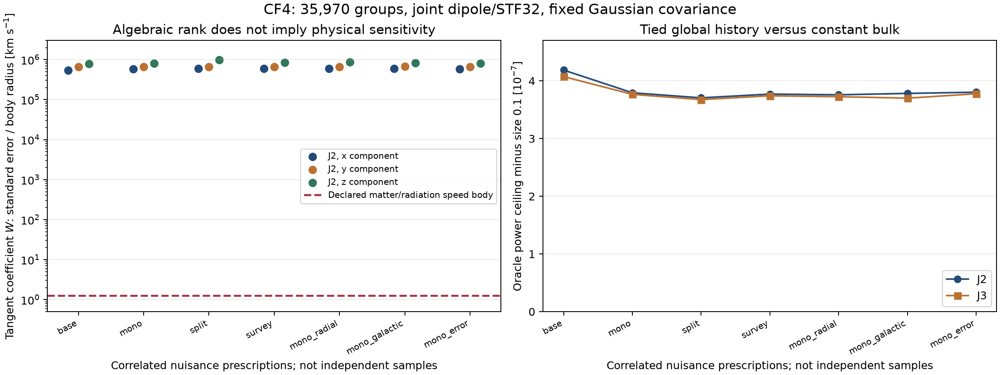
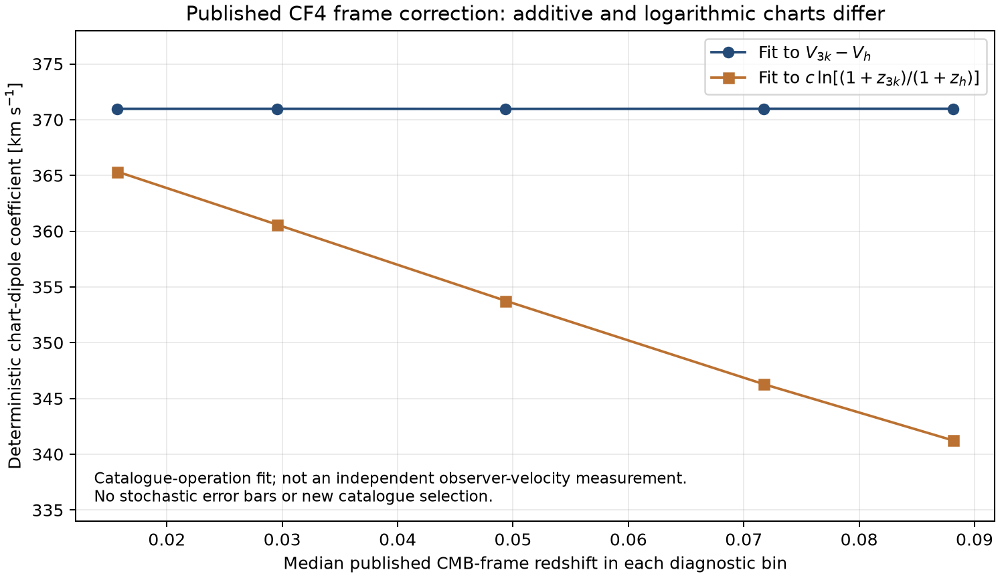

# R63: local observer boost와 global matter–radiation tilt의 구별

작성일: 2026-11-17. 기준 commit: `f29bbab420a33aecb1c398ddd961fd45097f536b`.
대상 논문: P4. 범위: 이 가지에 한정한 한 번의 순차적 10단계 이론·코딩 연구.
현재 과학적 지위: **C0, 실제 자료를 사용한 조건부 응답·식별성 결과**.
투고 판정: **NOT_READY_TO_SUBMIT**.

## 1. 이번에 얻은 결론

기존의 보상된 dust–radiation 물리 이력을 실제 CF4 source/window 연산자로
전파했다. 35,970개 그룹, \(0.0100036\le z\le0.0999992\), 네 개의 중첩된
관측 창, dipole12+STF20의 전체 공동 공분산을 사용했다. 일곱 nuisance
처리와 두 source-tensor 차수에서 자유로운 추가 history 계수는 필요하지
않았다. 실제 catalogue redshift chart 차이를 반영한 \(W=0\) 검정의
조건부 p 범위는 J2에서 **0.182325–0.713944**, J3에서
**0.277414–0.696765**다. 이것은 global tilt가 없다는 확률이나 검출률이 아니다.

더 강한 결과는 특정 물리 모형 사이의 구별력에 관한 것이다. 같은
distance experiment에서 보상된 homogeneous photon–dust tilt와 상수
coherent bulk를 비교하면, common calibration dipole과 STF nuisance를
제거한 뒤 남는 이력 응답이 극도로 작다. 선언한 선형 Gaussian 법칙에서
유의수준 0.1을 모든 상수-bulk nuisance에 대해 지키는 검정의 power는,
물질·복사 속도 조건이 주는 외접 구 전체에서도 **0.100000418731 이하**다.
이것은 현재의 32차원 압축 실험과 제한된 이력 모형에 대한 상한이다.
전체 CF4 원시 자료, 다른 관측량, 다른 global tilt 해에 대한 불가능성 정리가 아니다.

벡터·텐서화는 실제 기여를 했다. 동일한 STF nuisance를 허용하면 dipole12만의
history target rank는 0이지만, 공동 STF 정보를 포함한 32차원 실험에서는
3이다. 그러나 복원된 세 방향의 표준오차가 \(5.36\times10^5\)–
\(1.01\times10^6\,\mathrm{km\,s^{-1}}\)여서, algebraic identifiability가
유효한 물리적 측정으로 이어지지는 않는다. 큰 \(W\) 추정값은 선형 응답계수의
약한 식별성을 나타내며 초광속 운동의 관측이 아니다.

실제 CF4 redshift 보정도 원시 표에서 복원·점검했다. additive velocity
chart와 logarithmic-redshift chart의 차이를 교정한 후 tied-model의 유효
bulk 벡터 변화는 최대 **0.428161 km/s**였다. 이 교정은 기존의 공동 법칙을
유지한 알려진 평균 이동이며, 새로운 독립 관측자의 속도 측정이 아니다.

근거: [실제 계산](RESULTS/OBSERVED/FRAME_HISTORY_RESULT.json),
[chart 교정](RESULTS/CATALOGUE_CHART_TRANSPORT.json),
[해석 요약 및 모든 모델별 수치](RESULTS/INTERPRETATION_SUMMARY.json).

## 2. 기존 연구에서 무엇을 이어받았나

R58의 **원래** owned CF4 carrier와 전체 covariance를 사용했다. 동일한 이름의
native replay로 바꾸지 않았다. carrier SHA256은
`42f6bc5158fdf2f876720db12c44b088bc2db9734887e0d84ae098b234a7e64d`다.
R62의 J2/J3 source-STF likelihood를 기준 모형으로 재현했고, 그 추정값·공분산
일치를 확인했다. 새 source history는 기존 11변수 score에 억지로 넣지 않고
원래의 \(O_m\)를 source별 응답에 다시 적용했다.

물리 이력은 `FRONTIER_20261020/theory/THEORY.md`의 finite compensated
dust–radiation subcase를 재사용했다. PR255/256 및 실제 GitHub #363/#364의
local/global response geometry와 Schur 구성, 기존 finite Lorentz closure,
R39의 vector/tensor \(x\) 정식화, R54–R58의 Gaussian·five-view 구현을
함께 사용했다. 이전 synthetic calibration, 실제 관측 분석, 물리적 response
qualification을 서로 같은 증거로 세지 않았다.

이번 조사에서 frame API의 부호 의미가 서로 다르다는 사실도 확인했다.
R52의 `beta_RM`은 radiation relative matter이고, publication/common closure의
동명 변수는 matter relative radiation이다. 각각 명시된 기존 convention을
보존하고 새 식에서는 \(\beta_{X|Y}\)처럼 방향을 표시했다. 기존 API를 임의로 뒤집는
수정은 하지 않았다.

이력·정확한 hash: [내부 연구 조사](REVIEW/r63_history.md),
[내부 source manifest](REVIEW/r63_history_sources.json),
[frame 대응표](REVIEW/r63_frame_source_map.md),
[선행연구 원전 검토](REVIEW/r63_literature.md).
이번 작업은 관련 가지의 전수 source inventory와 필요한 본문을 재사용·재검토한
것이며, 프로젝트 전체의 모든 과거 PR diff를 새로 검증했다는 주장은 아니다.

## 3. 물리적 대상과 거리 응답

기본 signature는 \((-+++)\), \(c=299792.458\,\mathrm{km\,s^{-1}}\)다.
관측자 O, 물질 M, 복사 에너지 정지계 R, 전체 에너지 정지 normal N,
통계적 FLRW 기준계 F를 구별한다. 같은 사건에서

\[
\Gamma_{MR}=-U_M\!\cdot U_R/c^2
\]

는 관측 tetrad를 바꾸어도 변하지 않는다. 따라서 물질–복사 상대운동과
우리 관측자의 boost는 물리적으로 다른 대상이다. 이 local invariant만으로
상대운동의 공간적 균일성이나 cosmic-time history를 알아낼 수는 없다.

sourceward \(n\), \(\chi(z)=c\int_0^z dz'/H(z')\)를 사용하고

\[
A(z)=\frac{c(1+z)}{H(z)\chi(z)},\qquad
g(z)=\frac{A(z)-1}{c}
\]

로 둔다. velocity-only, first-order, bolometric standard-candle 조건에서
고정 관측 적색편이의 광도거리 응답은

\[
\delta\ln D_L=(1-A)n\!\cdot\beta_S+A n\!\cdot\beta_O.
\]

이 식은 새 정리가 아니다. [Hui–Greene Eq.15](https://arxiv.org/html/astro-ph/0512159v5),
[Davis et al. Eq.18](https://arxiv.org/html/1012.2912v2),
[Kaiser–Hudson](https://academic.oup.com/mnras/article/450/1/883/1010557)을
사용하며, metric/potential 항이 필요한 일반 long mode로 확대하지 않는다.

고정 catalogue redshift correction \(V_r\), distance correction \(V_d\),
common dipole calibration \(a_{\rm cal}\)까지 포함하면 natural-log residual은

\[
\eta=g\,n\!\cdot(V_S-V_O+V_r)
 +n\!\cdot\left[a_{\rm cal}+\frac{2V_r-V_O-V_d}{c}\right]+r.
\]

고정 \((V_r,V_d)\)에서 상수 source velocity의 정확한 일차 응답 fibre는

\[
(V_S,V_O,a_{\rm cal})\mapsto
(V_S+\delta,V_O+\delta,a_{\rm cal}+\delta/c)
\]

다. 이 모형에서 source와 observer 각각의 속도는 자유 calibration과 함께
개별적으로 정해지지 않는다. 반면 이력 조건이나 독립 관측을 추가하면
fibre가 줄어들 수 있다. 이 결과를 보편적 no-go로 사용하지 않는다.

전체 유도, 단위, 초기조건, 차원·극한 검사는 [THEORY.md](THEORY.md)에 있다.

## 4. 보상된 물리 이력이 만드는 관측식

별도로 보존되는 dust와 radiation, 공통 dust velocity, finite post-decoupling
구간, 독립적인 초기 relative velocity, 일차의 추가 density/metric mode 없음이라는
조건에서

\[
\beta_m(a)=b/a,\quad\beta_r=-R b,\quad
R=\frac{3\epsilon_{m0}}{4\epsilon_{r0}},\quad
\epsilon_m\beta_m+\frac43\epsilon_r\beta_r=0.
\]

이것은 일차 Einstein–matter 제약을 만족하는 제한된 subcase다. 이차
anisotropic stress는 일반적으로 남는다. 표준적인 tightly coupled 초기상태에서
이 IC가 생성되는 기작은 제시하지 않는다. 상대운동 배경의 기존 연구는
[Cembranos–Maroto–Villarrubia-Rojo](https://arxiv.org/abs/1903.11009)와
프로젝트의 FRONTIER 원전을 참조한다.

자유 응답 진단에서는

\[
\eta=g\,n\!\cdot V_p+zg\,n\!\cdot W+n\!\cdot d+
\sum_{j=0}^{J}P_j\!\left(\frac{z-.055}{.045}\right)n^T K_jn,
\qquad W=cb
\]

를 썼다. \(W=cb\)의 물리 해석은 위 이력 조건을 추가할 때만 성립한다.
common dipole \(n\!\cdot d\)를 제거하면

\[
h=1+z-zA=1-czg, 
P_\perp O[zg\,n]=-P_\perp O[h\,n]/c,
\quad h=\frac{3\Omega_m+4\Omega_r}{4}z+O(z^2).
\]

즉 저적색편이에서 history의 leading constant 부분은 calibration과 구별되지
않고, 작은 depth-changing 부분만 남는다. 단순한 이상적 두 shell의 rank와
실제 calibration-profiled survey rank를 구분해야 하는 이유다.

추가로 photon rest가 보상 radiation rest와 같고 실제 CMB-reference가 그
dipole을 사용한다면

\[
U=(1+R)W=V_p, 
\eta=g\left(1+\frac{z}{1+R}\right)n\!\cdot U+n\!\cdot d+\cdots.
\]

\(U\)는 present matter relative radiation, \(W\)는 matter relative total-energy
normal이다. 이번 선언된 benchmark는 \(\Omega_m=.3153,\Omega_r=10^{-4}\),
\(R=2364.75\)다. 이는 복사 밀도의 관측 추정이 아니다. \(U=300\,\mathrm{km/s}\)는
\(W=0.126815\,\mathrm{km/s}\)에 대응하며, 둘을 혼동하면 잘못된 물리적 기각을
하게 된다. 새 background의 광도거리와 옛 수치 chart 사이에는
 \(\ln(\hat\chi_{\rm old}/\hat\chi_r)\)
를 실제 연산자로 전파해 포함했다.

## 5. 관측 결과와 실질적인 tensor 기여

아래는 published chart correction까지 전파한 값의 요약이다. 모든 수치의
원본과 J3 결과는 [INTERPRETATION_SUMMARY.json](RESULTS/INTERPRETATION_SUMMARY.json)에
있다. 일곱 row는 서로 상관된 대안적 nuisance 실험이며 독립 측정이 아니다.

| Nuisance operator | J2: history \(W=0\)의 p | Tied \(\hat U\) ICRS [km/s] | Tied \(U=0\)의 p |
|---|---:|---|---:|
| `log` | 0.429448 | (-459.1, 9.1, -114.7) | 0.123898 |
| `log_mono` | 0.591987 | (-218.4, 9.4, -136.5) | 0.668319 |
| `log_split` | 0.182325 | (-255.1, 7.2, -134.9) | 0.590522 |
| `log_survey` | 0.517008 | (-225.5, 13.4, -211.5) | 0.540289 |
| `log_mono_radial` | 0.361193 | (-198.8, 25.5, -204.8) | 0.608346 |
| `log_mono_galactic` | 0.713944 | (-216.4, 4.8, -110.9) | 0.702202 |
| `log_mono_error` | 0.386927 | (-207.3, 5.6, -161.7) | 0.661272 |

Tied \(U\)는 source law를 가정한 유효 bulk 계수다. 이 표의 추정값으로
그 source law를 검증하거나 공간적으로 global한 흐름을 입증하지 않는다.
전체 공분산은 carrier에 보존했으며 성분별 오차만으로 새 법칙을 재구성하지 않는다.

모든 14개 자유-history fit은 J2에서 rank24, J3에서 rank29를 가졌다.
그러나 모든 \(\hat W\)의 norm이 \(c\)를 넘는다는 것은, 물리적으로 허용된
작은 범위에서 likelihood가 거의 평평함을 보여준다. 이를 실제 속도 posterior로
해석하거나 임의의 물리 prior를 넣어 data-driven 상한처럼 보고하지 않는다.
외접 물리 범위 \(|W|\le1.2677554\,\mathrm{km/s}\)에서 profiled
chi-square의 0 대비 변화에 대한 계산된 상한은 모든 경우에
\(7.073\times10^{-6}\) 이하다.

동일한 source-STF nuisance를 유지한 dipole12-only 실험은 nuisance rank12로
포화되어 history target rank0이다. 공동32 실험은 rank3를 회복했다. 이때
STF block이 주는 정보는 실제 covariance의 conditional innovation이다.

\[
C_{s|p}=C_{ss}-C_{sp}C_{pp}^{-1}C_{ps},\quad
X_{s|p}=X_s-C_{sp}C_{pp}^{-1}X_p.
\]

공동 precision은 \(X_p^TC_{pp}^{-1}X_p+X_{s|p}^TC_{s|p}^{-1}X_{s|p}\)로
분해되고, shared nuisance는 이를 합친 뒤 profile했다. 이 항등식과 실제
source injection을 검산했다. 이 결과는 선택한 finite tensor mean 아래의
정보 기여이며, 원시 자료의 모든 정보가 현재 압축에 보존된다는 뜻은 아니다.

## 6. 왜 이 거리 실험에서 physical history를 구별하기 어려운가

같은 radiative-background mean, 같은 \(C\), 같은 calibration/STF nuisance에서
상수 bulk와 tied history의 가장 가까운 평균 간 거리를 계산했다.

\[
D=\frac1{1+R}P_{N_0}^{\perp}C^{-1/2}O[zg_r n],\quad
S=D^TD,\quad\delta\(U\)=\sqrt{U^TSU}.
\]

어떤 검정이 상수-bulk null 전체에서 size ≤α를 유지한다면, 가장 가까운
단순 Gaussian null에 대해서도 그러해야 한다. 그 단순 쌍의
Neyman–Pearson power가 모든 그러한 검정의 상한이므로

\[
\mathrm{power}\(U\)\le\Phi[\Phi^{-1}(\alpha)+\delta\(U\)].
\]

선언한 \(\beta_*=0.01\)의 matter/radiation 속도 조건만 적용한 외접 구는
\(|U|\le2999.192335\,\mathrm{km/s}\)다. observer speed와 finite-z optical
조건은 이를 추가로 좁힌다. 이 구 전체에서 최대 δ는
\(2.3859501\times10^{-6}\), α=0.1의 power 상한은 **0.100000418731**다.
\(|U|=300\,\mathrm{km/s}\)에서는 **0.1000000418843** 이하다.

이 상한에는 **고정 Gaussian covariance, 선언한 mean family, calibration
공간, 실제32D 압축**이라는 전제가 있다. 비선형 metric/optical remainder,
새 전자기 관측, 원시 catalogue의 추가 modes에는 적용되지 않는다. 또한
pure observer boost와 상수 coherent bulk를 같은 null로 부르지 않았다.
CMB-redshift 보정과 자유 common dipole이라는 현재 가정 아래 pure observer의
남는 velocity coefficient는 0이고, 상수 bulk는 별도의 \(g\,n\!\cdot U\) 모형이다.

## 7. 실제 catalogue correction의 교정

원시 Table4와 selected NPZ의 DMzp, e_DMzp, V3k/c, J2000 direction은
group ID 대응에서 차이가 0이었다. [CF4 원 논문](https://arxiv.org/abs/2209.11238)과
[CDS release 정의](https://cdsarc.u-strasbg.fr/viz-bin/ReadMe/J/ApJ/944/94?format=html&tex=true)는
Dist를 luminosity distance로 명시한다. 다만 DMzp는 heterogeneous
distance-indicator calibration의 산물이며, raw bolometric flux 자체는 아니다.

공개된 정수 velocity pair에 대해

\[
V_{3k}-V_h\simeq n\!\cdot a, 
a=(-360.1906668,76.4697356,-45.1410299)\,\mathrm{km/s}
\]

이며 residual RMS는 **0.289467 km/s**다. 반면
 \(q_i=c\ln[(1+V_{3k,i}/c)/(1+V_{h,i}/c)]\)
를 고정 \(n\!\cdot b\)로 fit하면 RMS는 **5.497647 km/s**다.
고정 additive correction이 induced logarithmic correction에서는 깊이에
따라 달라지는 것을 실제 자료에서 확인한 것이다.

R63의 fixed-logarithmic reference response와 같은 chart로 비교하기 위해
알려진 평균 offset

\[
O_m\left[\frac{A_i+1}{c}(q_i-n_i\!\cdot a)\right]
\]

을 포함했다. 42개 fit의 affine transport와 직접 GLS는 scaled error
\(4.66\times10^{-12}\) 이내에서 일치했다. covariance와 design은 동일하고
알려진 offset만 이동했으므로 모형 간 separation 정보와 power 상한은 변하지
않았다. 완전한 photometry deboost (p), 방법별 response와 group mixing은
여전히 미확립이다. 이 계산은 exact nonlinear Lorentz catalogue를 새로 만든 것이 아니다.

추가로 정수 tabulation을 각각 ±0.5 km/s의 결정론적 구간으로 볼 때의 support를
실제 bias map으로 전파했다. 가능한 coordinate-wise \(W\) 이동의 support는
약 \(1.09\times10^4\)–\(3.28\times10^4\) km/s였다. 이는 최악 방향의
구간 민감도이며 통계적 반올림 오차나 동시에 실현되는 세 성분의 오차가 아니다.
이러한 source precision을 생략한 채 매우 작은 normal-tilt 상한을 발표할 수 없다.

## 8. 다섯 변수 방법론의 기여와 한계

\((x,Q,\Pi,F,G_F)\)는 하나의 공동 실험에서 나온 다섯 view다.

| View | 이번 구현과 의미 |
|---|---|
| \(x\) | signed \((V_p,W,d,K_j)\), full covariance, source response, Gaussian score/precision와 stable likelihood factor |
| \(Q\) | profiled W의 coefficient-noise ellipsoid gauge. 물리적 MES anchor와 구별 |
| Π | \(W=0\)의 명시된 fixed-Gaussian Wald 통계의 tail. tilt의 posterior probability가 아님 |
| \(F\) | 같은 신뢰영역의 signed directional support. 별도의 catalogue-rounding box support도 전파 |
| \(G_F\) | 공통 수준을 포함한 invertible depth path와 전체 covariance. likelihood 불변성을 검산; 시간 미분이 아님 |

새로 기여한 부분은 다섯 이름이나 GLS 재매개화가 아니라, 물리적 source history와
published frame correction을 실제 관측 연산자로 옮기고, full vector/STF
uncertainty 아래 남는 null/weak direction과 측정 한계를 계산한 것이다.
exact Gaussian likelihood보다 정보가 늘었다거나 새로운 확률 법칙을 발명했다고
주장하지 않는다. 물리적 ceiling과 occupancy measure가 없는 항은 unavailable로 남겼다.

## 9. 독립 관측으로 이어지는 구성적 경로

같은 제한된 모형에서 electrons가 dust를 따르고 photons가 compensating
radiation을 공유하면, remote electron frame의 dipole은

\[
w_{\rm eff}(n,z)=\left(1+\frac{z}{1+R}\right)n\!\cdot U.
\]

따라서 kSZ reconstruction의 평균은  \(b_vK_R n\!\cdot U\),
 \(K_R=\int W_v(\chi)[1+z/(1+R)]d\chi\)
다. 여기에는 distance의 작은 history 차이만을 측정해야 하는 억제가 없다.
우리의 local detector boost는 전자 사건의 matter–photon 상대운동을 생성하지
않지만, 실제 온도·은하 map의 endpoint calibration에는 영향을 줄 수 있다.

[Krywonos–Hotinli–Johnson v1](https://arxiv.org/html/2408.05264v1)의
published dipole 제한을 이 모형에 옮길 수 있는 식을 유도했다. 그러나 본문의
\(Y_{10}\) 계수 정의와 SM의 \(\sqrt{C_1}\) convention이 일치하는지 v1만으로
확정하지 못했다. Eq.36의 표시식도 cross-term normalization 확인이 필요하다.
이는 저자의 실행 결과가 틀렸다는 판정이 아니다. 해당 수치 26 km/s는 convention에
따라 \(12.70/K_R\) 또는 \(22.00/K_R\) km/s로 변환되지만 **어느 것도 이번의
채택된 95% 물리 상한으로 사용하지 않았다**. 2026-10-28 출판본의 초록은
확인했으나 full text는 접근 제한으로 normalization을 읽지 못했다.

정확한 response, optical-depth bias, photon/electron matching, window와 amplitude
definition을 확보하면 이 경로는 새 Boltzmann solver 없이도 restricted-mode
검정으로 연결된다. [상세 유도와 명시적 source 경계](REVIEW/r63_remote_dipole_map.md).
기존 aberration 결과도 [Ferreira–Quartin](https://arxiv.org/html/2011.08385v2)의
통계적 frame/lensing 가정을 유지해 사용할 수 있지만, 발표된 진폭·각도 오차로
새 Cartesian 공분산을 만들어 likelihood를 곱하지 않았다.

## 10. 출판성 심사 및 실행 기록

**현재 strengths:** 물리적으로 명시된 source law, 실제 데이터·공분산,
기존 scalar framework의 vector/STF 확장 활용, 실제 frame-processing correction,
관측 실험에 대한 명확한 식별 가능성·power 계산, 실행 가능한 독립 channel response.

**현재 치명적 약점:** CF4 method-level response/selection calibration과
nonlinear remainder가 닫히지 않았다. 독립 remote-dipole 또는 aberration likelihood를
이번 carrier와 함께 검증하지 못했다. 음성 결과만으로 새로운 우주론 또는
global tilt의 관측적 기각·검출을 주장할 수 없다. 특히 [Nusser–Tully 2026](https://arxiv.org/abs/2608.14265)는
이미 CF4의 실제 survey covariance와 calibration 의존성을 다루므로, 단순히
full covariance와 depth-dependent bulk를 썼다는 novelty 주장은 성립하지 않는다.

**판정:** 방법론·물리 response·관측 한계에 관한 원고의 핵심은 작성할 수 있다.
현재 결과만으로 강한 독립 우주론 논문의 scientific significance가 확보됐다고
판정하지 않는다. [유한한 논문화 계획](RESEARCH_PLAN_KO.md)은 catalogue response를
닫고 독립 photon–matter channel을 연결하는 한 경로에 수렴한다. 그 경로에서
새 물리 판별력이 생기지 않으면 기존 P4/methods 원고에 통합한다.

검증은 native Python3.12.3/NumPy2.5.4/SciPy1.18.1에서 진행했다.

- 영향받는 과학 코드와 기존 Gaussian/five-view: **54 tests passed**, exit0.
- 실제 CF4 history 실험: 첫 실행 성공, **2.283 s**, 14 free-history +42 baseline/physical +7 calibration-sensitivity fit.
- 실제 source projection, injection, h-quotient, R62 parity, Wald/LR, Schur precision,
  common-calibration 및 path invariance를 계산 중 확인.
- published chart correction: 42 affine/direct-GLS 비교 성공, exit0.
- Wolfram: processed-chart·compensation·history identity의 symbolic residual0.
  intermediate infinity 경고를 [원본 receipt](REVIEW/WOLFRAM_CHECK.json)에 보존.
- 독립 최종 심사: **PASS**, open finding 0개. 동결한 22개 파일의 hash와
  14개 carrier의 별도 QR·공분산·power 검산이 일치했다. 과학 코드 수정 없이
  심사를 닫았다. [심사 원문](REVIEW/final_review.md), [기계 판독 기록](REVIEW/final_review.json).

원래 42개 과학 gate와 P4의 acceptance는 유지한다. 자동 후속 연구 루프 및
local coding-agent 재개 프롬프트는 만들지 않는다.

DAG 반영과 검증도 완료했다. canonical backlog는 287개, completed는 222개이며
원래 42개 과학 node payload와 기존 P4 acceptance를 보존했다.
[연구 DAG](RESEARCH_DAG.json), [DAG 검증 기록](DAG_VALIDATION.json),
[완료한 10단계 기록](RESEARCH_RECORD.json)에 정확한 상태를 남겼다.
