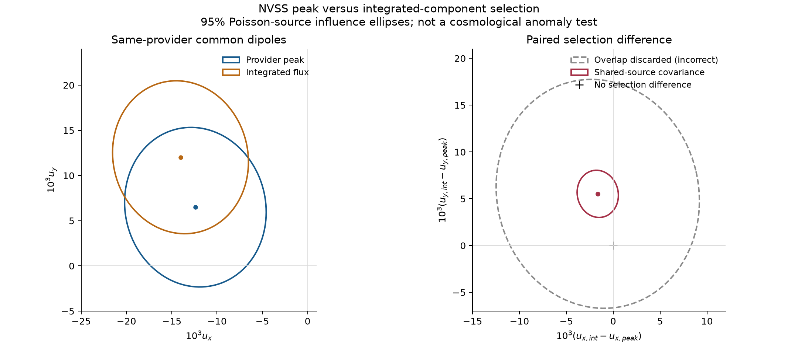
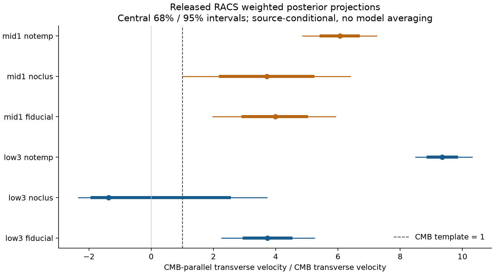

# R65 — Dipole anomaly: source 선택을 구분한 실제 벡터 추론

작성일: 2026-11-17. 기준 commit: `d76ef3a4e9b33c4703a02647b3aa850004d04253`.
작업 branch: `research/r65-dipole-anomaly-20261117`.

## 결과와 출판 판단

이번 연구에서 가장 중요한 결과는 **동일 NVSS provider의 peak_flux 선택과
integrated-component-flux 선택이 서로 다른 횡방향 dipole을 준다는 실제 측정**이다.
겹치는 component를 보존한 오차 계산에서 그 차이는 뚜렷하며, 두 분석을 독립으로
취급하면 차이의 오차를 크게 부풀린다. 이는 기존 프로젝트의 raw-peak 기반 count
결과를 integrated-flux 기반 물리적 응답으로 곧바로 해석하면 안 되는 이유를
구체적인 관측량과 공분산으로 보여 준다.

동시에, **이 차이의 조건부 통계적 유의도는 cosmological dipole anomaly의
유의도가 아니다.** 두 선택이 포함하는 population, catalogue component 구조,
peak detection과 flux correction이 다르다. 현재 계산은 이들이 결과에 미치는
합성 효과를 측정하며, 원인이 instrumental selection인지 물리적 population/LSS인지
분리하지 않는다. 실제 integrated flux를 확보하고 분석했으므로 입력 부재 문제는
해결했다. 남은 문제는 그 선택의 forward response와 joint fluctuation law다.

출판 경로는 **P4 companion으로 먼저 통합하고, 이 source-selection contrast를
중심으로 논문을 수렴시키는 것**이다. 새로운 estimator, 일반적인 covariance
법칙, 5변수 표기의 우월성을 주장할 근거는 없다. 실제 source 정의를 교정한
paired morphology 결과와 그 해석을 source-calibrated null 아래에서 완성하면
논문화할 만한 구체적 후보가 된다. 현재 투고 상태는 `NOT_READY_TO_SUBMIT`이며
원래 42개 scientific node와 P4 acceptance는 바꾸지 않는다.

이 보고서의 수치는 [INTERPRETATION_SUMMARY.json](RESULTS/INTERPRETATION_SUMMARY.json),
[원 raw-peak 실험](RESULTS/NVSS_OBSERVED_RESULT.json),
[provider 내 두 선택 실험](RESULTS/PROVIDER_NVSS_RESULT.json),
[RACS posterior 변환](RESULTS/RACS_POSTERIOR_PROJECTION.json)에서 직접 나온다.
상세 계획은 [RESEARCH_PLAN_KO.md](RESEARCH_PLAN_KO.md), 유도는
[THEORY.md](THEORY.md), 추가 입력의 admission은
[R8_SOURCE_REFINEMENT.md](R8_SOURCE_REFINEMENT.md)에 둔다.

## 1. 기존 연구의 재사용과 수정한 입력

R54의 기존 573-PR inventory와 R63/R64의 source map을 재사용하고, 이번 가지와
직접 관련된 L2/R54/R60 count loader, likelihood, saved result, CMB/remote-dipole
contract를 확인했다. 새 작업이 573개 PR diff 전체를 다시 읽었다는 뜻은 아니다.
읽은 파일·범위·identity는 [history map](REVIEW/r65_history.md)과
[source ledger](REVIEW/r65_history_sources.json)에 보존했다.

이전 L2의 NVSS slope 계산, R54의 real-catalogue fits, R60의 covariance sensitivity와
minimum calibration shift는 기존 결과로 인정하고 새 연구로 재포장하지 않았다.
R40의 오래된 literal dipole/high-significance 주장도 나중의 source-bound 결과를
대신하는 현재 증거로 쓰지 않았다. 독립 high-ell CMB boost three-vector likelihood와
R63 remote-dipole normalization/window 문제는 이번 count 실험으로 해결되지 않는다.

실제 원 NRAO FITS에는 `PEAK INT`가 `JY/BEAM` 단위로 저장되어 있다. 이는 단지
열 이름을 보고 정한 해석이 아니다. NRAO 공식 문서는 raw/fitted peak brightness와
deconvolved Gaussian-component integrated flux를 구분하고, raw 값에는 알려진
amplitude-bias correction이 없음을 설명한다. 이번에는 provider 공개 표의 첫
10개 component를 현재 FITS와 좌표 대조하여 그 차이를 직접 확인했다.
[NRAO catalogue help](https://www.cv.nrao.edu/NVSS/NVSShelp.html)

예를 들어 J000000.39+004100.0은 현재 FITS raw peak가 82.667 mJy/beam,
provider peak가 82.9 mJy/beam, integrated flux가 149.5 mJy다.
현재 FITS의 peak 값이 사실상 integrated flux를 담고 있다는 해석은 맞지 않는다.
[직접 source 대조 기록](REVIEW/r65_nvss_flux_source.md)

| 실제 입력 | identity와 역할 |
|---|---|
| 기존 NRAO `CATALOG.FIT` | 1,810,672 rows, 152,121,600 bytes; SHA256 `a357a688dc7e43ae81ecbe465fdce216dfed678aee977780a626841eceb5bde4`; raw peak 실험을 보존 |
| 공개 `Full_NVSS_combined_named.dat` | 1,773,488 finite positive paired rows, duplicate source name 0; 140,767,191 bytes; SHA256 `52eb576c1e3e71837f2fca26121789ccc0b316152cca3f25ea2f37ea8ef5a38e`; provider peak와 integrated flux를 같은 row에서 비교 |
| 공개 RACS `inference_products.zip` | 32,883,631 bytes; SHA256 `143cdcf32d85479ee171c8d5bc5da814178dd7123024ba12e5b5d9f9b9c94fc7`; full weighted posterior 6개를 변환 |

후자의 두 입력은 [저자 release v1.0.0](https://github.com/o-oayda/cracking-into-racs-i/releases/tag/v1.0.0)에서
실제로 내려받고 전체 SHA를 확인했다. RACS 내부 archive와 manifest member의
크기·SHA도 검증했다. Provider의 integrated column은 그 저자의 실제 flux-ratio
코드가 mJy로 사용하는 입력이다. 원 NVSS에서 named table을 생성한 extraction
program을 완전히 재현한 것은 아니므로 provider provenance로 구분한다.
이 보고서의 provider peak는 공개 표의 `peak_flux`다. Raw FITS와의 차이는
알려진 bias correction과 rounding에 부합하지만, 공급자의 정확한 보정 절차가
확인되거나 재현되었다는 뜻은 아니다.
또한 Gaussian component 하나가 물리적 galaxy 하나와 항상 같지는 않다.

## 2. 이론에서 구현으로 연결한 likelihood

방향은 sourceward ICRS/J2000, metric convention은 \((-+++ )\),
\(c=299792.458\,{\rm km\,s^{-1}}\)를 유지한다. \(u\)와 angular STF 계수는
무차원 count-field 계수다. 여기서 STF는 천구 count의 사중극자이며 spacetime
shear \(\sigma_{ab}\)를 측정한 것이 아니다.

Disjoint flux bin \(b\), HEALPix ring \(r\), pixel \(p\)에 대해

\[
 \lambda_{brp}=A_{br} E_{rp}\exp\!\left[
 u_{bx}n_x+u_{by}n_y+u_{bz}n_z+
 \sum_{j=1}^4 s_{bj}\,n^aE^{(j)}_{ab}n^b\right].
\]

각 \(A_{br}\)는 해당 bin/ring의 자유 진폭이다. 네 \(E^{(j)}\)는
Frobenius norm 1인 비축대칭 STF basis다. Pixel centre에서 \(n_z\)는 한 ring
안에서 일정하므로 ring count \(N_{br}\)에 조건화하면 \(A_{br}\)와 \(u_{bz}\),
axisymmetric STF 성분이 소거된다. 남는 feature vector를 \(f_p\), parameter를
\(\eta_b\)라 하면

\[
 q_{brp}(\eta_b)=
 \frac{E_{rp}e^{f_p^T\eta_b}}{\sum_{q\in r}E_{rq}e^{f_q^T\eta_b}},\qquad
 \ell_b=\sum_p N_{bp}f_p^T\eta_b
       -\sum_rN_{br}\log Z_r(\eta_b)+{\rm const}.
\]

Score와 negative Hessian은

\[
 s_b=\sum_r\!\left[\sum_{p\in r}N_{bp}f_p-N_{br}\langle f\rangle_{q,r}\right],
 \qquad J_b=\sum_rN_{br}\operatorname{Cov}_{q,r}(f).
\]

이 조건부 likelihood는 ring amplitudes를 profile한 Poisson likelihood와
parameter-independent constant만 다르다. 양의 노출을 가진 ring 내부 feature
차이가 생성하는 공간으로 rank를 판정한다. 정확한 sufficient statistic와
partition 입력을 저장했고, covariance를 의도적으로 diagonal로 바꾸지 않았다.

소거의 정확성은 이 **이산 pixel-centre log-linear 모형**에 대한 것이다.
실제 source의 연속 좌표나 유한 pixel 적분에 자동 적용하지 않는다. 물리적인
선형 density \(1+\boldsymbol d\cdot\hat n\)에서는 ring별 transverse coefficient가
\(\boldsymbol d_\perp/(1+d_z z_r)\)여서 \(d_\perp\ne0\)이면 고차에서 \(d_z\)
정보가 생길 수 있다. 따라서 물리적 axial dipole을 원리적으로 측정할 수 없다는
강한 no-go를 주장하지 않는다. 이번 quotient에서 관측하지 않는 축에는 유한한
오차나 임의의 prior variance를 배정하지 않았다.

구현은 `htt/htt/htt/infer/r65_count_quotient.py`, overlap covariance는
`r65_overlap.py`, weighted RACS 변환은 `r65_racs.py`다. Profile/conditional
identity, score/Hessian, null direction, full covariance/path와 frame 변환,
posterior weights, overlap의 source-event Gram을 실제로 검증했다.

## 3. 원 raw-peak 실험: 구간 차이와 형태 nuisance

원 실험은 4개 geometry와 dipole-only/dipole+STF의 8개 모형이다. 기본 geometry는
NSIDE64, pixel \(\delta>-37^\circ\), \(|b_{\rm Gal}|>10^\circ\)다. 33,000 pixel,
185 ring의 raw-peak bins `[20,40)`, `[40,80)`, `[80,infinity)` mJy/beam에서
count는 각각 115,906, 65,260, 55,581개, 총 **236,747개**다.

각 bin에 STF nuisance를 따로 허용한 common transverse vector는

\[
 \widehat u_\perp=(-0.01141192,\ 0.00685402),\quad
 \operatorname{SD}(\widehat u_x,\widehat u_y)=(0.00322895,\ 0.00364556).
\]

이는 inverse observed information의 조건부 표준편차다. Norm 0.0133120과
RA 149.0109°는 이 **2차원 vector의 파생량**으로, 완전한 3차원 dipole을 뜻하지 않는다.

세 bin의 independent vector를 common vector로 제한한 LR은 **1.87091**, 차원차
4다. 512개 conditional multinomial catalogue를 생성하여 같은 nuisance를 다시
적합했을 때 초과 375회, `(375+1)/(512+1)=0.73294`였다. MC 초과확률의 binomial
95% 구간은 `[0.69183,0.77031]`이다. 현재 조건부 law에서는 flux-bin 간 차이가
요구되지 않는다. 이 bootstrap은 fitted composite null의 근사 calibration이고
cosmological LSS mock이 아니다.

기본 geometry에서 STF를 자유롭게 하면 common vector는
`(-0.00077471,+0.00091167)` 변한다. 이는 확장 모형 marginal SD의 약 0.24/0.25배로,
paired-shift significance는 아니다. 각 bin의 polar–STF 최대 절대 상관은
0.207–0.217, STF profiling에 따른 dipole SD 증가는 약 1.3–2.5%였다.
NSIDE32, Galactic cut20°, bright-region exclusion의 결과도 모두 보존했다.
그 표본들은 source가 겹치므로 독립 재현으로 합산하지 않는다.

## 4. 핵심 새 관측 결과: 같은 provider의 peak와 integrated 선택

R8에서 공식 flux semantics와 실제 source 대조를 근거로 입력 refinement를
admit하고, 결과를 보기 전에 추가 범위를 같은 base64 geometry·같은 세 경계·
두 angular 모형으로 고정했다. 기존 raw-peak 결과를 바꾸지 않고 provider의
provider peak와 integrated component flux를 각각 분석했다.

| 선택, dipole+STF | count | \(u_x\) | \(u_y\) | marginal SD \((x,y)\) | norm | transverse RA |
|---|---:|---:|---:|---|---:|---:|
| Provider peak ≥20 mJy/beam | 241,892 | −0.01238604 | 0.00649807 | (0.00319332,0.00360615) | 0.0139871 | 152.317° |
| Provider integrated flux ≥20 mJy | 263,158 | −0.01403006 | 0.01202275 | (0.00306431,0.00345626) | 0.0184767 | 139.406° |

Integrated bins의 count는 **127,130 / 72,123 / 63,905**다. 두 선택의 공통
component는 241,892개이며 integrated 선택에만 21,266개가 추가된다. 아래
표의 row는 peak bin, column은 integrated bin이고 모든 항이 실제 같은 row의
membership에서 계산되었다.

| peak \ integrated | <20 | 20–40 | 40–80 | ≥80 |
|---|---:|---:|---:|---:|
| <20 | 1,172,716 | 20,345 | 808 | 113 |
| 20–40 | 0 | 106,785 | 11,795 | 434 |
| 40–80 | 0 | 0 | 59,520 | 6,782 |
| ≥80 | 0 | 0 | 0 | 56,576 |

각 source의 profiled common-vector influence를 \(a_{L,bp}\), \(a_{R,cp}\)라 하고
실제 shared count를 \(N^{LR}_{bcp}\)라 하면

\[
 C_{LR}=\sum_{bcp}N^{LR}_{bcp}\,a_{L,bp}a_{R,cp}^T,
 \qquad C_\Delta=C_{LL}+C_{RR}-C_{LR}-C_{LR}^T.
\]

이를 실제 source-Poisson influence covariance로 계산했다. 결과는

\[
 \Delta u\equiv u_{\rm int}-u_{\rm peak}
 =(-0.0016440241,\ +0.0055246718),\qquad
 \operatorname{SD}(\Delta u)=(0.0008983629,\ 0.0010299226).
\]

두 선택의 같은 축 상관은 **0.95961 / 0.95835**다. 이 cross block을 버리면
잘못된 SD는 `(0.00442570,0.00499515)`로 약 4.9배 커진다. 동일한 difference에
대해 full overlap covariance의 Wald quadratic은 **30.98947**인데, 독립으로
처리하면 **1.31544**가 된다. 전자의 조건부 source-Poisson/Gaussian tail은
`1.86519e-7`이다. 이 수치는 선택에 따른 apparent-vector 차이의 통계량이며,
우주의 isotropy 또는 CMB kinematic hypothesis를 검정한 값이 아니다.

단순히 marginal ellipses가 겹치는지 보는 방식으로 이 차이를 판단할 수 없다.
같은 관측 source가 대부분을 차지하여 두 추정 오차가 강하게 함께 움직이기
때문이다. 반대로 이 검정의 확률 law에는 spatial LSS correlation과 여러
component의 공통 parent galaxy가 포함되어 있지 않다. 관측량 차이 자체와
그 원인에 관한 물리적 해석은 분리해 둔다.

## 5. CMB 비교에서 질문을 구별해야 하는 이유

이상적인 integrated-flux bin의 first-order response는

\[
 k_b=2+(1+\alpha)
 \frac{S_{\rm lo}g(S_{\rm lo})-S_{\rm hi}g(S_{\rm hi})}{N_b},
 \qquad d_b=k_b\beta,
\]

이며 spectral law는 \(S_\nu\propto\nu^{-\alpha}\)다. 상한 경계도 포함해야 한다.
경계의 log-density를 고정한 log half-width0.10으로 추정하고 α=.5,.75,1을
모두 보존했다. Boundary-response 함수, spectral mixture, selection response
일반론과 disjoint-bin fitting 자체는 이미 선행연구가 있다.

α=.75에서 provider integrated response는
`(3.37055573,3.56879567,4.04082231)`이다. CMB template는
`v=369.82 km/s`, `(RA,dec)=(167.942°,−6.944°)`를 표준 kinematic 해석으로
채택했다. 이는 별도의 observed aberration three-vector likelihood를 확보했다는
의미가 아니다.

| 자료와 질문, dipole+STF | 조건부 결과 |
|---|---:|
| Raw peak: 여섯 independent bin components와 고정 CMB 비교 | LR 8.93367, df6, p=0.177343 |
| Raw peak: shared-beta 모형 안에서 CMB beta를 고정 | LR 7.15387, df2, p=0.0279613 |
| Provider peak: 여섯 components와 고정 CMB 비교 | p=0.105438 |
| Provider peak: shared-beta 모형 안의 고정 CMB | p=0.0156277 |
| Provider integrated: 여섯 components와 고정 CMB 비교 | LR 21.79848, df6, p=0.001316997 |
| Provider integrated: shared-beta 모형 안의 고정 CMB | p=0.0000658587 |

Omnibus6-df 검정과 shared-beta2-df 검정은 다른 질문이다. Integrated input에서
더 강한 working-law tension이 나온다는 사실을 숨기지 않되, 이를 최종 물리적
anomaly significance로 승격하지 않는다. Source SED의 boundary distribution,
parent catalogue의 peak-detection selection, component grouping, LSS와 angular
calibration의 joint law가 아직 해당 확률 계산에 들어 있지 않다. Pearson
dispersion만으로 이를 대신할 수 없다. 또한 raw-peak bootstrap을 integrated
experiment의 calibration이라고 재사용하지 않았다.

Integrated 자료에서 세 bin 간 common-vector LR은 2.68303, df4, p=0.61219다.
이것은 kinematic origin을 입증하는 결과가 아니다. 실제로

\[
 u_b=k_b\beta_\perp+d^{\rm res}_\perp
\]

라는 common residual을 추가한 local Gaussian carrier는 rank4이지만,
같은 축 beta–residual correlation이 약 **−0.997185**다. Beta의 표준편차는
`(0.01135668,0.01281239)`이며, `369.82 km/s / c` 단위로는 **9.206 / 10.386**이다.
즉 고정 response 아래에서도 실제 분리 정밀도가 낮다. 이 수치는 일반적인
불가능성 정리가 아니라 현재 bin·source·noise에서 계산한 precision 결과다.

## 6. Tensorized 5변수 방법론의 기여를 어디까지 인정할 것인가

정의는 기존의 \((x,Q,\Pi,F,G_F)\)를 그대로 사용했다. 여기서 x는 fitted primitive
다섯 개가 아니다. Signed dipole/STF 및 실제 공동 공분산을 가진 functional bundle이다.

| 관점 | 이번 실제 구현 |
|---|---|
| \(x\) | Bin별 signed vector/STF와 exact conditional sufficient statistic; provider 두 선택에서는 `(u_peak,u_int)` 및 source-overlap joint covariance |
| \(Q\) | 해당 identified carrier의 statistical coefficient-noise ellipsoid gauge; physical MES ceiling은 부여하지 않음 |
| \(\Pi\) | Named conditional LR/working Gaussian tail, fitted-null bootstrap, 또는 RACS source-posterior exceedance를 각각 다른 law로 저장 |
| \(F\) | 같은 region의 directional support와 antipodes; 관측하지 않는 axial 성분의 support는 unbounded |
| \(G_F\) | Bin path 또는 peak→integrated selection path에서 첫 level과 signed contrast, 전체 transformed covariance를 보존; 시간·redshift derivative로 해석하지 않음 |

실제 기여는 **겹치는 source와 함께 추정된 tensor 정보를 유지하여, 어떤
observable difference가 측정되었는지 일관되게 해석하는 구현**이다. 위 paired
contrast는 scalar amplitude와 개별 error bar만으로는 재구성할 수 없다.

다만 그 수학은 표준 covariance transport와 nuisance profiling이다. 원 raw-peak
carrier에서 같은 support/nuisance를 쓰는 one-step Fisher score와 exact MLE의
최대 information distance는 **0.03470**에 불과했다. 새로운 정보를 더 얻는
성능 우월성은 이번 결과로 입증되지 않는다. 원 bin carrier의 quadratic
17.1273252는 full-covariance path에서 동일하게 보존되고, path covariance를
diagonal로 잘못 대체하면 7.7839349로 바뀐다. 이는 정보 보존의 실제 예이지,
invertible transform이 정보를 생성한다는 증거가 아니다.

Provider 두 marginal count likelihood를 독립 factor로 곱하지 않았다. 두 선택의
joint object는 shared membership으로 계산한 local Gaussian influence carrier다.
이를 exact nonlinear joint count likelihood로 부르려면 보존한 joint categories의
공동 intensity 모형을 추가로 명시해야 한다.

## 7. RACS 공개 posterior에서 얻은 보조 결과

Oayda et al.의 low3/mid1 fiducial·no-clustering·no-temperature 모델 6개의
공개 chain을 읽었다. 원 nested weights와 zero-weight rows를 보존하고,
`observer_speed`의 단위 `369.82 km/s` 및 Galactic-degree 방향을 확인하여
ICRS vector로 변환했다. Posterior를 새 likelihood로 취급하거나 `logL`로
재가중하지 않았다. Source commit은 `f34f948752d2b6ceb8e2a0fdfb12a337f3c261bf`다.
[원 논문](https://arxiv.org/abs/2610.35207)

CMB 방향의 transverse 단위벡터를 e라 하고
`R_parallel=(v_xy·e)/|v_CMB,xy|`로 정의하면 다음과 같다.

| RACS 모델 | median \(R_\parallel\) | central95% posterior interval |
|---|---:|---|
| low3 fiducial | 3.73456 | [2.26271,5.24634] |
| mid1 fiducial | 3.98548 | [1.97934,5.91900] |
| low3 no-temperature | 9.34685 | [8.49234,10.30846] |
| mid1 no-temperature | 6.06792 | [4.86283,7.24405] |
| low3 no-clustering | −1.36686 | [−2.34419,3.71955] |
| mid1 no-clustering | 3.71681 | [1.02830,6.39976] |

Fiducial R_parallel과 temperature-response parameter의 posterior 상관은
low3 **−0.74124**, mid1 **−0.82222**다. 따라서 amplitude 한 개의 비교보다
signed vector와 nuisance coupling을 함께 제시하는 것이 실제 source model의
내용을 더 잘 보여 준다.

이 결과는 source posterior의 **기하학적 projection**이다. RACS의 declination
selection을 자유롭게 제거하고 다시 적합한 결과가 아니다. Ablation들은
동등하게 적합한 physical models로 인증되지 않았고 model averaging도 하지
않았다. RACS pseudo-clustering과 complete cosmological LSS는 같은 개념이
아니다. NVSS와의 source overlap/LSS cross-covariance를 확보하지 않았으므로
두 자료의 p-value 또는 posterior를 합쳐 joint cosmic significance를 만들지 않았다.

## 8. 선행연구와의 비교 및 심사 관점

| 선행 방법 | 이미 존재하는 내용 | 이번 연구에서 새로 실행한 부분 |
|---|---|---|
| Rubart–Schwarz2013, Siewert et al.2021 | Declination에 강한 2D estimator, flux-cut 비교, mask/direction bias | 실제 ring-conditional count law와 STF nuisance 아래 source-field contrast를 같은 component covariance로 계산 |
| Ellis–Baldwin 및 Takeuchi2026 | Kinematic count response와 일반 selection functional | 실제 provider integrated 입력을 확보하고 raw peak와의 차이를 source-bound 진단으로 분리 |
| Mittal–Lewis2026 | Disjoint flux bins를 함께 적합하는 방법 | 현재 NVSS의 bin path, source overlap, common-residual precision을 실제 데이터로 산출 |
| 표준 GLS/score/Schur covariance | Nuisance 제거와 충분통계·공분산 변환 | 기존 R58 kernel을 재사용하고 실제 full-covariance 결과를 5관점으로 연결 |
| Oayda et al.2026 RACS SBI | Temperature/source-multiplicity forward model과 공개 posterior | 원 weights를 보존한 common coordinate projection, signed nuisance sensitivity 및 독립성 없는 비교의 범위 정리 |

최근접 원전은 [Rubart–Schwarz2013](https://doi.org/10.1051/0004-6361/201321215),
[Siewert et al.2021](https://doi.org/10.1051/0004-6361/202039840),
[Takeuchi2026v2](https://arxiv.org/abs/2602.07389),
[Mittal–Lewis2026](https://doi.org/10.1088/1475-7516/2026/07/081)다.
읽은 범위·확인하지 못한 derivation도 [문헌 ledger](REVIEW/r65_literature.md)에
구분했다. 제한된 검색으로 estimator priority를 인증하지 않는다.

강점은 실제 source semantics의 교정, signed joint covariance를 가진 관측 결과,
가정에 따른 식별 가능성과 정밀도의 구분, 재현 가능한 코드다. 거절 가능성이
큰 주장은 “새 2D estimator”, “5변수 자체의 새 통계 정보”, “cosmic anomaly의
해결/검출”, “global tilt 또는 Bianchi 귀속”이다. 현재 가장 생산적인 원고는
선택 정의에 따른 radio-dipole morphology의 변화와 해석을 좁게 완성하는 P4
companion이다. Standalone 분량/차별성이 부족하면 기존 P4의 핵심 실데이터
section으로 통합한다.

## 9. 실행 범위와 남은 최소 과학 작업

이번에 실제로 실행한 것은 **12개 observed model**, **36개 independent bin fit**,
**102회 observed optimization**, 원 실험의 **512개 conditional bootstrap catalogue**
및 **2,048회 bootstrap refit**, **6개 공개 RACS posterior pushforward**다.
RACS SBI 재학습이나 새로운 RACS fit은 하지 않았다. Unit/semantic checks는
원 24개와 새 overlap 13개, 합계 **37개**, exact SymPy identity는 **11개**가
통과했다. Wolfram으로 quotient 소거, finite-bin power law와 linear-model
counterexample을 별도로 검산했다. [검증 기록](VALIDATION.md)

좁은 source-selection companion의 다음 작업은 이미 확보한 provider rows와
joint membership에서 한정된 selection/component null을 정하고, 같은 표본과
추정대상에서 standard estimator와 한 번 비교하여 원고에 통합하는 것이다.
이는 계획의 A/B/F 경로다. Bin-dependent LSS와 cross covariance는 **물리적
excess significance로 주장을 확장할 때** 필요하다. RACS의 동일 nuisance refit은
더 강한 survey 간 비교를 선택할 때의 추가 경로다. 현재 working-law covariance의
한계를 그대로 적되, 이 확장 입력을 좁은 companion의 무조건적인 선행 gate로
두지 않는다. 각 입력·산출물·stop condition은 계획과 DAG에 명시했으며, 원래
P4 acceptance와 `NOT_READY_TO_SUBMIT`은 유지한다.

연구 수행 완료와 저널 투고 준비 완료는 다른 상태다. 원 42개 scientific gate를
형식적으로 통과시키지 않고, 이번 관측 결과와 한정된 미해결 조건을 additive
companion에 기록한다. 추가 루프 자동 실행과 local coding-agent 지시문 작성은
이번 작업에 포함하지 않는다.
