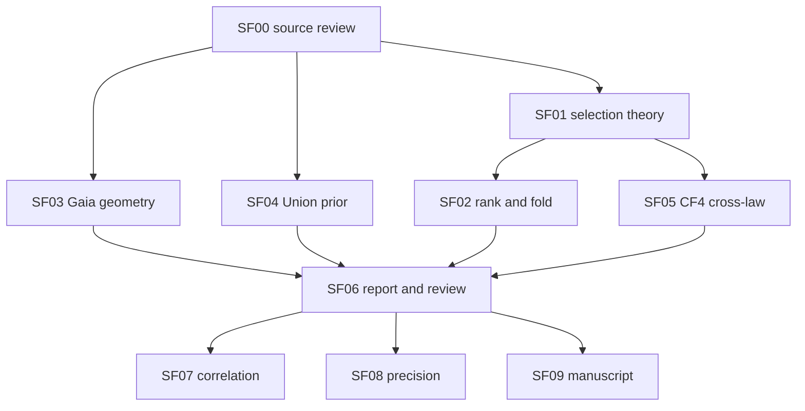

# Subagent 개발 DAG와 PR 카드

실제 열린 PR 번호와 계획상 PR-ID를 구분한다. 이번 게시 단위는 **PR-SOLVER-FREE-DOSSIER / [draft PR #533](https://github.com/cosmosapjw-quantum/htt_base/pull/533)** 하나다. 기존 PR #532를 base로 하는 새 branch이며 SF00–06을 묶는다. 이후 세 PR은 아직 열지 않은 제안이다. 정확한 입력/출력·acceptance·다음 행동은 PLAN.json에 있다.

| PR-ID | 내용 | 의존 | 최소 완료 조건 |
|---|---|---|---|
| PR-SOLVER-FREE-DOSSIER | 현재 source review, 이론·실제추가계산·plot·publication list | PR-OBS-REBOOT의 scoped code/results | 영향받는검증, 독립review, 같은source의보고서와그림, canonicalDAG/mirror, push |
| PR-SF-GAIA-CORRELATION | PSD angular correlation family에서robust frontier | SF03/06 | marginalcovariance보존, tangent-convention검증, block/dense작은대조, conditionalplot |
| PR-SF-CF4-PRECISION | cross-law calibration정밀도와선택폭민감도 | SF05/06 | 사전MCprecisiontarget, 독립seed/batch, 모든실패보존, law/scenario고정 |
| PR-SF-METHODS-MANUSCRIPT | 선택관측법칙또는robustoperator방법론원고 | SF06 | 선행방법대비구체기여, completeclaim-source map, 결과/반례/재현부록 |

SF10–14는 제품/물리 입력이 부족한 별도 lane이다. SF07–09를 막지 않는다. Bianchi atlas는 외부 공급만 기다리며 이번 queue에는 solver 구축 작업을 넣지 않았다.

## 역할과 실행 모델

- 부모/orchestrator: `gpt-6.1-sol`, **high**. goal 선택, 소스 귀속, 통합 및 production writer를 맡는다.
- 수치·통계 worker: `gpt-6.1-sol`, **high**. 단순 extraction/manifest는 `gpt-6-luna`, **medium**과 결정론적 검사로 낮춘다.
- 별도 물리·통계 reviewer: `gpt-6-astra`, **xhigh**. 초고난도 미해결 증명에만 ultra를 고려한다.
- 부모 포함 최대4개 active agent, production writer1명. 신선한12,000자 이하 selected-task packet을 주고 nestedagent를 만들지 않는다. 요청설정과관측runtime을분리해 UNKNOWN을허위로채우지 않는다.

일반적낮은비용업무를high모델로복제하거나review이름을바꿔반복하지않는다. 하나의coherentpatch에독립검토1회, 구체finding의수선과closeout으로진행한다. 실제paper기준미달이면source·comparison·calibration을추가하며gate문서만늘리지않는다.
