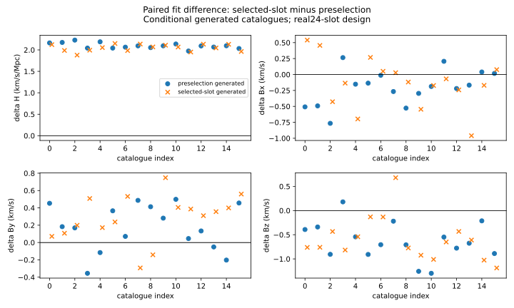

# Shared calibration and selection conditioning in a fixed-slot distance catalogue

**Draft methods manuscript · 2026-10-14 · HTT owner · conditional methodological result · submission status: not ready.** This manuscript treats 24 selected SNIa-only CF4 group summaries as a fixed design. It evaluates two declared likelihoods and their generated-data consequences. The group sample, modulus errors and directions come from the source-qualified [selected-law result](../observational_reboot_20261014/results/cf4/selected_v2/result.json). The population, selection, velocity and shared zero-point laws below are scenarios. They have not been inferred as the CF4 survey mechanism. Native Bianchi transfer, cosmological \(H_0\), physical shear and MES quantities do not enter this study.

## Abstract

Conditioning a catalogue on selection changes how a shared calibration nuisance enters its likelihood. We implement two normalized fixed-slot laws with the same 24 group design and latent-distance kernel. One law conditions the full preselection population and consequently tilts the shared zero-point distribution by the probability that all slots are selected. The other samples the zero point from its prior and conditions each slot separately. In a paired generated-catalogue experiment, both laws are fit to each catalogue, isolating the effect of the conditioning convention. At declared zero-point width 0.05 mag, 32 pooled catalogues per generating law give mean selected-slot minus preselection endpoint-scale differences of 2.09622 ± 0.01364 and 2.04113 ± 0.01129 km s⁻¹ Mpc⁻¹. At width 0.02 mag, 16 further catalogues per law give 0.33159 ± 0.00248 and 0.33253 ± 0.00185. Each uncertainty is a finite-campaign Monte Carlo standard error, and the 0.05-mag precision target was fixed before the added outcomes. These are controlled model comparisons rather than estimates of actual survey selection.

## 1. Question and source scope

Let \(S_i\) denote that fixed slot \(i\) was selected, \(d_i\) its observed modulus and redshift-derived velocity, \(\eta\) a shared modulus zero point, and \(\theta=(H,B_x,B_y,B_z)\). We ask: when the selected slots are generated under a single shared \(\eta\), how do two specific normalized selection conditionings alter the finite-catalogue endpoint-scale fit? This is an error-mechanism and sensitivity question. The physical survey selection function, overlap between distance methods, source motion, and shared calibration covariance across CF4/SDSS/other products remain external inputs.

The archived physical-count construction writes the unselected population weight as source current flux times area distance squared and affine length, with an event-clock factor when relevant. Its finite-bin response uses the full selected mass and a moving-selection derivative. Our fixed-slot experiment starts *after* choosing the 24 observed group summaries and specifies a normalized latent-distance scenario. The current-flux derivation constrains a future empirical law; it does not turn the fixed slots into a completeness estimate. See [dossier map](research/Dossier_MAP.md) and [measurement/selection bridge](research/THEOREM.md).

## 2. Observation law and competing conditionings

For a true angular diameter distance \(d_A\), true redshift \(z_t\), and observed modulus, use the joint reciprocity relation \(d_L=d_A(1+z_t)^2\). Set \(x=\ln(d_A/\mathrm{Mpc})\), \(t=c\ln(1+z_t)\), and \(y=c\ln(1+V_h/c)\), where \(c=299792.458\) km/s. The declared latent distance has support \(5\le d_A/\mathrm{Mpc}\le250\) and normalized density in \(x\) proportional to \(g(x)=\exp[(\alpha+1)x-e^x/100]\), where \(\alpha=2\) is dimensionless and 100 is a fixed scale in Mpc. With \(\theta=(H,\mathbf B)\), source direction \(\mathbf n_i\), and \(d_A=e^x\) Mpc, define

\[
m_i(x;\theta)=H d_A+\mathbf n_i\cdot\mathbf B+\kappa(75\,\mathrm{km\,s^{-1}\,Mpc^{-1}}\;d_A)^2/c,\quad
t_i\mid x,\theta\sim N(m_i,s_u^2),\quad y_i\mid t_i\sim N(t_i,s_{\rm spec}^2),
\]
\[
\mu_i\mid x,t_i,\eta\sim N\!\left(25+\frac{5}{\ln10}x+\frac{10}{c\ln10}t_i+\eta,\;\sigma_{\mu,i}^2\right),\qquad
\eta\sim N(0,s_\eta^2).
\]

The fixed coefficient 75 has units km/s/Mpc, making the finite-distance term a velocity; \(\kappa=0.725\) is dimensionless. We set \(s_u=250\) km/s, \(s_{\rm spec}=30\) km/s and initially \(s_\eta=0.05\) mag; SF08 also declares 0.02 mag. The observed \(V_h\) density includes the Jacobian from \(V_h\mapsto y\). Slots are conditionally independent given the shared \(\eta\) and \(\theta\) under these scenarios. The observed modulus interval is 31–35 mag; actual selected group IDs, directions and published error summaries are frozen by the input packet. The likelihood integrates \(x\) and \(\eta\) by quadrature and analytically marginalizes \(t\). Generation draws the shared \(\eta\) and each \(x\) on the weighted 256-distance-node × 64-zero-point-node quadrature grids, then draws the truncated Gaussian modulus and conditional Gaussian velocity and measurement noise. Thus generated catalogues approximate the continuous law on declared grids. Fits use 192×40 quadrature, checked at 256×64; the extension also checked selected higher-order grids. Details and implementation are in [`reboot_cf4_selected_law.py`](../../htt/htt/htt/infer/reboot_cf4_selected_law.py) and the [generating script](../../scripts/run_solver_free_cf4_crosslaw.py). These choices define a scenario rather than an empirical CF4 completeness fit.

At fixed \((\theta,\eta)\), write \(f_i(d_i\mid\theta,\eta)\) for the selected-data density before its slot normalization and \(Z_i(\theta,\eta)=\int_{S_i} f_i(d\mid\theta,\eta)\,\mathrm d d\) for its selected mass. The two fully normalized laws are

\[
L_{\rm pre}(\theta;d,S)=
\frac{\int p(\eta)\prod_i f_i(d_i\mid\theta,\eta)\,\mathrm d\eta}
{\int p(\eta)\prod_i Z_i(\theta,\eta)\,\mathrm d\eta},
\qquad
L_{\rm slot}(\theta;d,S)=
\int p(\eta)\prod_i\frac{f_i(d_i\mid\theta,\eta)}{Z_i(\theta,\eta)}\,\mathrm d\eta.
\]

The first is the conditional density for a preselection shared-\(\eta\) population given all slots selected. Its generating distribution of \(\eta\) is proportional to \(p(\eta)\prod_i Z_i\). The second is a distinct law that samples \(\eta\) from \(p(\eta)\) and then samples each slot conditional on selection. Both integrate to one on the stated selected-data support. Their different nuisance mixing rules remain different even if the marginal modulus error scale and selected interval are identical. The [analytic bridge](research/THEOREM.md) gives the corresponding quotient and selection-normalizer score. It also shows that a finite unnormalized count bound cannot control a selected mean without a positive selected-mass lower bound.

The distinction has an explicit limiting counterexample: if every \(Z_i(\eta)\) is constant in \(\eta\), both formulae coincide. When \(Z_i\) varies with \(\eta\), moving the normalization through the common nuisance integral generally changes the law. This paper calculates the size of that change for one declared CF4-design scenario.

## 3. Finite experiment and numerical checks

The truth is \(H=73\) km s⁻¹ Mpc⁻¹ and \(\mathbf B=(100,-200,50)\) km/s. Each law generated 16 independent catalogues under its own shared-\(\eta\) rule. Both laws were fit to the *same* catalogue in each pair, so the law difference is a paired statistic. The original campaign used deterministic, disjoint seeds recorded per catalogue in [result.json](results/cf4_crosslaw/result.json); the full generated arrays and individual fit/quadrature checks are retained alongside it. A checked-in fixture compares one preselection draw of `run_reboot_cf4_injections` with the new generator at seed `12345` and `n=1`; it does not assert byte parity for the historical 32-catalogue batch, which draws its nuisance values together. Fit-order 192×40 and independent 256×64 likelihood evaluations pass the frozen 10⁻⁶ log-likelihood criterion; high-order checks on the first two catalogues per law also pass. Every one of the 64 initial fits was accepted. The historical quadrature failure and its subsequent refinement remain preserved in the parent result tree.

For generating law \(g\), fitted law \(l\), and catalogue \(j\), define the endpoint error \(e_{glj}=\widehat H_{glj}-73\), and within-catalogue difference \(\Delta_{gj}=\widehat H_{g,\rm slot,j}-\widehat H_{g,\rm pre,j}\). We report \(\bar e\), \(\sqrt{n^{-1}\sum e_j^2}\), \(\bar\Delta\), and \(s_\Delta/\sqrt n\). This MCSE measures simulation variability of the *mean paired difference*. It is not measurement uncertainty on actual CF4, a likelihood ratio, or evidence.

| Generating law | Matching fit H bias / RMSE | Other fit H bias / RMSE | Mean paired \(\Delta_H\) ± MCSE |
|---|---:|---:|---:|
| Preselection shared prior | −0.2379 / 2.4007 | +1.8585 / 3.0779 | +2.0963 ± 0.0167 |
| Selected-slot prior | +0.0100 / 2.9896 | −2.0381 / 3.5537 | +2.0481 ± 0.0203 |

Every H entry is in km s⁻¹ Mpc⁻¹ and describes the declared generated scenario. The selected \(\eta\) mean under the preselection law is −0.06019 mag, compared with zero under the selected-slot law at fixed \(\theta\). A simple modulus-scale approximation predicts a +2.0519 km s⁻¹ Mpc⁻¹ law difference. The paired fits include finite-distance and latent-velocity effects that this approximation omits. The sign and magnitude agreement explain the mechanism without replacing the numerical fit.

The fixed-count [precision extension](SF08_CF4_PRECISION.md) increased the 0.05-mag experiment to 32 catalogues per generating law. Its pooled paired shifts were +2.09622 ± 0.01364 and +2.04113 ± 0.01129 km s⁻¹ Mpc⁻¹ for PRE and SLOT generation. Both achieved the predeclared MCSE ceiling of 0.015. The separate 0.02-mag scenario yielded +0.33159 ± 0.00248 and +0.33253 ± 0.00185. The baseline-minus-narrow-width shifts were 1.76463 ± 0.01387 and 1.70860 ± 0.01144; these compare disjoint generated samples, so their MCSE uses the sum of estimated variances. The 0.05-mag and 0.02-mag experiments change a **declared prior width** and cannot estimate CF4's actual calibration width. All 64 added valid catalogues and 128 primary fits are retained, as are 22 excluded seed-overlap candidates and first-failure records. The final seeds are pairwise distinct and disjoint from the first campaign.

## 4. Prior work and contribution boundary

| Primary source | Established method or result | This study's narrower addition | Open requirement |
|---|---|---|---|
| [Cosmicflows-4, Tully et al. 2023](https://arxiv.org/pdf/2209.11238) | §3.4, equations (1)–(2) fit additive catalogue modulus offsets by overlap likelihood and Bayesian calibration. §§4.1–4.2 treat magnitude-dependent FP truncation and numerical selection normalization; §§10.1–10.2 link grouped methods to distance anchors. | Two precisely stated common-\(\eta\) selection conditionings are cross-generated and cross-fit on one frozen 24-group design with paired errors and retained raw catalogues. | Bind \(Z_i\), calibration overlap and group provenance to the actual survey's selection. Existing CF4 work already handles selection; we do not claim to introduce selection correction. |
| [CF3 forward-model velocity field, 2019](https://doi.org/10.1093/mnras/stz078) | A latent-distance and peculiar-velocity forward model is established. The comparison here is limited to the primary abstract and the existing dossier's source audit; no equation-level equivalence has been certified. | The question here is the placement of a shared calibration mixture relative to selection normalization, with an explicit wrong-law generated-data comparison. | Read and map its full likelihood before asserting novelty relative to this exact implementation. |
| [CF4 parameter inference, Duangchan et al. 2026](https://doi.org/10.1051/0004-6361/202556645) | §3.1 gives the parameter posterior/forward model; §4 tests 64 mocks that emulate CF4 spatial and magnitude selection; §§5–6 use simulation-based corrections for CF4 flows. | This fixed-slot experiment reports a paired selection-semantics sensitivity, not a cosmological constraint or alternative catalogue release. | Compare exact released selection and calibration equations before claiming a new empirical estimator. Existing mock-selection work narrows this paper's novelty to the specific shared-\(\eta\) contrast. |
| [Gaia-CRF3, 2022](https://doi.org/10.1051/0004-6361/202243483) | §3.4 fits VSH through degree 12 and reports position-dependent proper-motion systematics; Appendix E gives weighted frame and covariance calculations. | A separate [fixed-cohort operator application](research/GAIA_GEOMETRY.md) gives sharp conditional bias geometry. | Empirical cross-source covariance and outcome-selection law for physical coverage. A coherent low-degree VSH error aligned with the six fitted modes is a concrete counterexample to trusting block-independent coverage. |

The quotient rule, shared-nuisance integration, sandwich covariance, convex dual support and finite Monte Carlo rank are established techniques. The candidate contribution is a source-bound implementation and controlled error example showing how a *specific* normalization change acts in a reused observational design. A further empirical contribution depends on the inputs in the last column. There is no claim that either declared law generated the actual CF4 catalogue.

## 5. Discussion and limitations

Both likelihoods are mathematically normalized for their own stated sampling procedures. Choosing one for an observed catalogue requires the real sampling chronology and selection variables. Catalogued modulus summaries do not encode the entire parent population, method overlap or survey inclusion function. The 24 SNIa-only groups are a fixed subset, and group summaries do not supply an independent angular response. The endpoint \(H\) includes the declared local velocity law and is not by itself cosmological \(H_0\). Same sky, shared calibration, duplicated objects and products derived from CF4 must retain dependence in any later joint analysis.

The Gaussian observational error and selection scenario are deliberate working models. A selected-population current-flux law would additionally require source density/current, actual survey detector/selection, error kernel, and positive selected mass on the physical domain. The dossier's finite-bin response and physical Gram/dual-norm bounds provide places for such inputs; the current experiment does not assign them unmeasured zero values. The same applies to physical MES denominator/remainder, global tilt and native-family morphology. The legacy [scientific report](SCIENTIFIC_REPORT_KO.md) contains the qualified broader observational context.

## 6. Reproducibility appendix

The historical first campaign is frozen at [cross-law result](results/cf4_crosslaw/result.json) and [execution provenance](results/cf4_crosslaw/INTEGRATION_PROVENANCE.json), generated from exact-source `run_selection_crosslaw.py` as preserved in that directory. The integrated [replay code](../../scripts/run_solver_free_cf4_crosslaw.py) pins imported law/intake/generator hashes and rejects a nonempty output path. A fresh replay uses its documented command in [the cross-law report](results/cf4_crosslaw/report.md). The actual fixed group IDs and source receipts are in that result's `source_design` and parent CF4 selected-law artifacts. The SF08 [result](results/cf4_precision/result.json), [raw rows and manifest](results/cf4_precision/ARTIFACT_MANIFEST.json), [repair record](SF08_CF4_PRECISION.md), and [portable declaration/runner](../../scripts/run_solver_free_cf4_precision.py) preserve the added campaign and its two bounded seed repairs. The Gaussian calibration prior, grid orders, fit boundaries, selected interval and all generated catalogue identities are stored as machine-readable fields. A later rerun declares a new source/driver contract; it does not rewrite the archived campaign seal.

The research loop followed R1 question/source/domain, R2–R3 direct literature and prior output, R4 candidate law construction, R5 normalization/limit derivation, R6 independent counterexample and units check, R7 paired numerical execution, R8 conditional claim decision, R9 this method/code contract, and R10 exact handoff. C1–C4 bind source–formula–algorithm–seed/precision; C5–C8 are the generated-code, targeted tests, quadrature and batch checks; C9 is separate fresh review; C10 is scoped publication and retained resume commands. The detailed original loop is [here](RESEARCH_LOOP_KO.md). This paragraph records actual workflow relationships and does not stand in for the execution receipts or scientific review.
