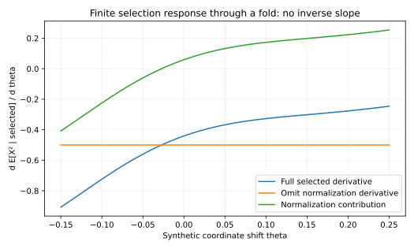
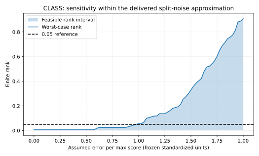
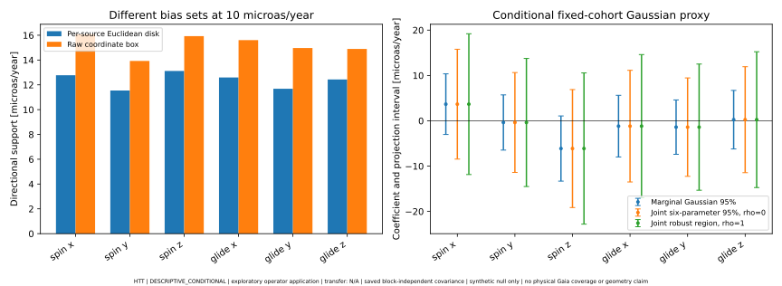
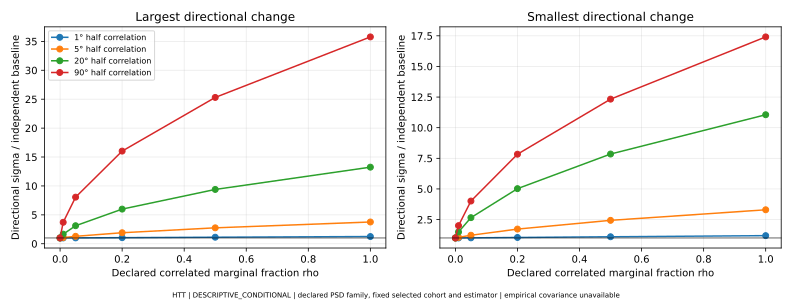
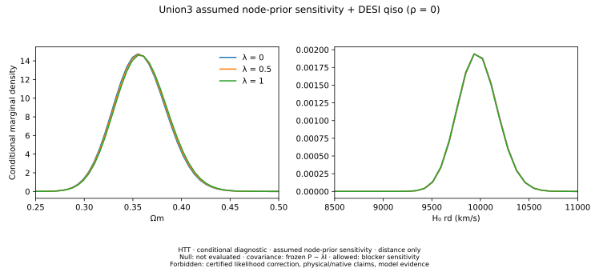

# Solver 없이 진전시킨 관측 통계와 출판 후보

관측 cohort와 공개 제품에서 얻은 결과를 보존하면서, dossier의 유한 관측·선택·오차 이론으로 추가 분석을 했다. 이 보고서의 수치는 각 `results/*/result.json` 또는 `ADDITIONAL_CALCULATIONS.json`에서 생성된다. 모두 HTT conditional/diagnostic 범위이며 native transfer는 사용하지 않는다.

## 1. 선택 경계와 정규화가 response에 미치는 영향

고정 물리 label에서 weight A, 측정오차를 거친 선택 확률 K, latent statistic h를 쓰면 Z=∫AK, μ=∫AKh/Z이고

\[\mu'=Z^{-1}\int[AKh'+(h-\mu)(A'K+AK')]\,dx.\]

이는 quotient rule과 지배수렴에 근거한 식이다. Dossier VI의 finite-bin/current-flux 관점과 VII의 detector-error/physical norm 개념을 함께 사용했다. 측정된 좌표의 hard cut도 Gaussian 오차와 합성하면 K=Φ((u−t)/σ)−Φ((l−t)/σ)로 미분 가능하다. 실제 선택확률이 0에서 떨어져 있다는 전제가 없으면 ratio error bound를 얻을 수 없다. observed-y statistic에는 full joint kernel이 필요하다.

새 유한 계산은 X∼Uniform[−1,1], t=X²+θ, Y=t+Normal(0,.1²), −.1≤Y≤.4의 **합성 fold**다. θ=.05에서 선택확률 .57232352, E[X²|선택]=.12390208, 전체 미분 −.36756946이다. 정규화 미분을 빼면 −.50000000이며 누락 항은 +.13243054다. 128/256 quadrature 및 central difference를 대조했으며 미분 차이는2.21e−10 이하이다. 이는 실제 CF4 selection 추정이 아니다. ODE나 역 redshift slope를 계산하지 않았다.

## 2. CLASS finite rank가 어느 오차까지 유지되는가

기존 40 training/160 calibration과 6개 feature의 고정 변환에서 zmax=4.77874251, rank=1/161이다. 관측·각 null의 max score에 각각 ±ε 오류를 허용하고 모든 interval 조합에 대한 rank의 하한/상한을 계산했다. 이 방식은 legacy compendium §20의 interval-rank 원리를 실제 저장 score에 적용한 것이다.

동일 ε=**.98933611 standardized-score units**에서 최악 rank가8/161=.0496894에서9/161=.0559006으로 넘어간다. 이는 measured systematic-error limit가 아니라 가정한 score-error sensitivity다. training 변환의 오차도 포함하려면 그 오차를 score bound로 따로 전파해야 한다. exchangeability·실제 split law·signal leakage는 이 계산으로 수용되지 않는다.

IID reference score를 추가 가정한 fixed-threshold tail probability의95% binomial 구간은[0,.02279175]이다. 참조법칙과 실제법칙의 total variation 거리가 εTV 이하라는 추가 보증이 있다면 upper tail은 이 상한+εTV로 제한된다. .05까지 여유는 .02720825이나 실제 εTV는 측정하지 않았다. 이 구간을 realized rank의 오차막대로 부르지 않는다.

## 3. Gaia: 기저 불변 bias set과 동시 confidence geometry

실제 4,756개 source의 저장된6×9512 operator를 사용했다. 각 source의 tangent-vector error가 ||b_i||₂≤bbar일 때 방향 u의 정확한 support는 bbar Σ_i||M_iᵀu||₂다. 각 source의 tangent basis를 독립 회전하고 attaining witness를 계산해 검산했다. 기존 box와 disk는 다른 admissible set이다. disk의 작은 수치를 동일 가정에서의 정밀도 향상으로 주장하지 않는다.

bbar=10µas/year에서 spin/glide 여섯 component support는 **[12.7749,11.5432,13.1219,12.5970,11.6854,12.4345] µas/year**다. 기존 fixed-coordinate box는[16.0821,13.9264,15.9274,15.6091,14.9711,14.8981]이다.

V=KKᵀ인 고정 Gaussian proxy에서 whitened total error budgetρ의 image는 Mahalanobis ball이다. 6개 모수의95% 동시 confidence ball을 bias set만큼 확장하면 반지름은 sqrt(χ²₆,.95)+ρ=3.54846266+ρ다. 저장 계수의 Mahalanobis 반지름은1.89966055이므로 **ρ=0에서도 영벡터가 영역 안에 있다**. 이것은 새 Gaia 검출이 아니다. 같은 상관 Gaussian 가정에서 방향 전체를 동시에 다룬 region이며 outcome selection·실제 cross-source covariance를 검증한 경험적95% coverage도 아니다.

20,000회 known-law stress test와 analytic triangle/support proof를 함께 보존했다. ρ=0의 빈도 .9476은 이 생성 실험의 check이며 Gaia의 실제 coverage 추정이 아니다. 별도의 Bonferroni rectangle 비교도 ADD03에 있다.

### SF07: 하늘 방향 상관을 가정한 실제 4,756-source 민감도

각 source의 2×2 주변 공분산을 그대로 두고 ICRS tangent projection과 PSD spherical Gaussian kernel로 source 간 상관을 선언했다. 저장된 추정 연산자 M을 유지하여 V=MCMᵀ를 block 계산했다. 상관 주변분산 비율 ρ=.01에서 최대 방향 표준편차 비율은 반상관각 1°/5°/20°/90°에 대해 각각 1.0028/1.0637/1.6567/3.7134였다. 24개 사전 고정한 ρ·각도 조합의 참조 Gaussian 6차원 영역은 모두 영벡터를 포함했다. 이는 선언한 family의 조건부 민감도이며 실제 Gaia의 cross-source covariance, 선택 후 coverage, 물리 bias 크기를 추정하지 않는다. 참조 평균 법칙과 PSD 증명, 작은 dense 대조, 전체 결과는 [SF07 보고서](SF07_GAIA_CORRELATION.md)에 있다.

## 4. Union3: node-prior 출처 문제를 수치 sensitivity로 전환

원저자 Kim(2024)의 [설명](https://arxiv.org/html/2412.14181v1)은 Gaussian node product를 prior가 포함된 posterior로 다룬다. 공개 `stan_code_fixed.txt`의 cosmo_model=2 분기는 다르게 보인다. 어느 코드가 정확한 FITS를 만들었는지는 아직 대응되지 않았다. 그러므로 다음을 certified correction이 아닌 **가정 비교**로 계산했다.

Pλ=P−λI, μλ=Pλ⁻¹(Pμ−λμref), λ∈{0,.5,1}. μref는 Ωm=.3,H0=70의 flat-LCDM node modulus, 가정 prior 폭은1mag이다. 전부 rho=0, 동일 DESI qiso와 proper Ωm/H0rd/M priors를 사용했다. 원자료 likelihood evidence나 λ의 posterior odds를 만들지 않았다.

| 가정 | Ωm | H0rd [km/s] |
|---|---:|---:|
| 원래 Gaussian을 그대로 사용, λ=0 | .35745647±.02708430 | 9974.6253±204.1810 |
| 가정 prior 전체 제거, λ=1 | .35911685±.02730194 | 9970.0772±204.2732 |

이동은 baseline SD 단위로 Ωm +.06130, H0rd −.02227이다. 같은 grid posterior의 total variation은 .02436이다. Gaussian division의 독립 logpdf 항등식과128/256 quadrature를 검증했다. source binding을 기다리는 동안 계산할 수 있는 구체적 sensitivity이며 H0와rd의 독립 측정은 아니다.

## 5. CF4 두 선택법칙의 교차 생성·적합

동일한24개 fixed-slot design에서 PRE와 POST 법칙별16개씩, 총32개 조건부 모의 카탈로그를 생성하고 각각 두 법칙으로 적합했다. 총64개 fit가 모두 사전에 정한 수치 기준을 통과했고 제외된 카탈로그는 없다. 기존32개 주입 실험과 별도 표본이며 새 관측자료가 아니다.

| 생성법칙 | POST−PRE의 paired H 이동 ± MCSE [km/s/Mpc] | 맞는 법칙 H bias / RMSE | 다른 법칙 H bias / RMSE |
|---|---:|---:|---:|
| PRE | +2.09633 ± .01670 | −.23785 / 2.40071 | +1.85848 / 3.07794 |
| POST | +2.04813 ± .02027 | +.00998 / 2.98957 | −2.03815 / 3.55372 |

이 차이의 기작은 공유 보정 η의 선택조건 분포다. PRE에서는 p(η)∏Zᵢ(η), POST에서는 p(η)를 사용하므로 PRE의 η 평균은 −.0601939mag로 이동한다. 단순 magnitude-scale 근사가 예측한 H 이동 +2.05189가 실제 paired 이동의 크기를 설명한다. 이는 보정 prior를 선택 전/후 어디에 놓는지가 서로 다른 관측법칙을 정의한다는 구체적인 수치 사례다. 작은16/law campaign의 bias/RMSE는 descriptive이며 실제 survey의 법칙을 결정하거나 방법의 보편적 우월성·경험적 coverage를 입증하지 않는다.

정확한 생성식, 모든 seed와 fit, quadrature refinement와 retained execution source는 [CF4 보고서](results/cf4_crosslaw/report.md)에 연결했다.

## 6. 기존 실자료 결과에서 추가로 확인한 것

CF4 최신 quadrature refinement를 반영한 동일 preselection scenario의 endpoint-H MLE 범위는67.2919183–74.7612064 km/s/Mpc이다. calibration 폭 .05→.1mag 변화의 이동은−5.7202807이다. 반면 한 group을 제외한 범위는72.1995103–73.4321050이다. scenario law 변경과 한 객체 삭제가 다른 질문임을 보여준다. 두 selection semantics의 baseline fit 차이는+2.098066이지만 이것만으로 어느 law가 실제 표본을 생성했는지 결정하지 않는다.

CF4의32개 조건부 주입 중 H의 nominal95% Wald coverage가32/32였더라도 binomial95% 구간은[.8911,1]이다. 이를 정확한95% coverage 검증으로 선언하지 않는다. 새 cross-law 실험의 결과와 해석은 [CF4 cross-law](results/cf4_crosslaw/report.md)에 별도로 기록한다.

## 출판 해석과 남은 실제 입력

가장 유망한 방향은 shared-calibration selection law, 처리 선택을 포함한 finite-null 재평가, Gaia robust operator 응용이다. 위 수식의 기본 대수나 finite rank 보정 자체의 독창성을 주장하지 않는다. 방법론 원고에는 기존 구현 대비 어떤 실제 오류를 막는지와 그 조건을 보여줘야 한다. 현재 새 Bianchi family 검출, global tilt 측정, cosmological H0, physical MES/Jacobi bound를 얻었다는 근거는 없다.

기존 방법론4개와 실제 결과11개는 PUBLICATION_CANDIDATES에, 향후 추가분석은 FUTURE_ANALYSES에 분리했다. 각 candidate의 실자료 validation·novelty·source obligation이 충족되지 않으면 READY_TO_SUBMIT로 변경하지 않는다. 원시계통·selection·공분산 정보를 구하기 전에도 위의 구체적인 solver-free 연구는 진행할 수 있다.
