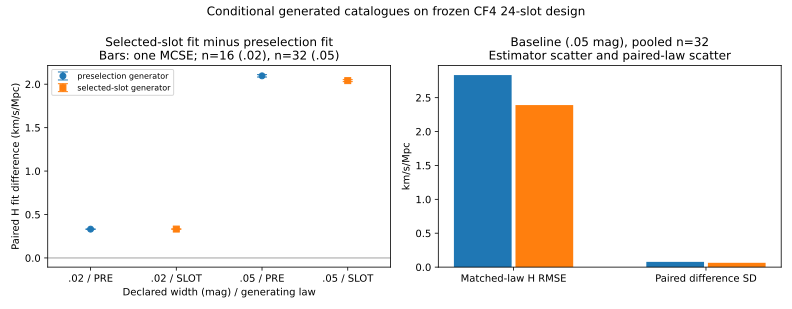

# SF08: fixed-count CF4 selection-law precision experiment

This result extends the existing 24-group, conditional CF4 design. The previous 16 catalogues per generating law and their raw records are reused unchanged. A target Monte Carlo standard error (MCSE) of 0.015 km/s/Mpc for the **mean paired endpoint-H law difference** was set from the previous maximum 0.02026723: `ceil(16*(0.02026723/0.015)^2)=30`, rounded to 32 total catalogues per law in complete eight-catalogue batches. The extension therefore generated 16 new catalogues per law at calibration width 0.05 mag. A separately fixed width 0.02 mag case generated 16 per law. All 64 valid new catalogues and 128 paired fits were completed, with no outcome-dependent stopping.

| Declared calibration width | Generating law | Catalogues | Mean paired POST−PRE H ± MCSE (km/s/Mpc) |
|---|---|---:|---:|
| 0.05 mag | PRE | 32 pooled | 2.09622275 ± 0.01364405 |
| 0.05 mag | SLOT | 32 pooled | 2.04112523 ± 0.01128588 |
| 0.02 mag | PRE | 16 new | 0.33159135 ± 0.00247528 |
| 0.02 mag | SLOT | 16 new | 0.33252830 ± 0.00185296 |

The MCSE target was achieved for both baseline generating laws. The width change moves the paired H contrast by 1.76463 ± 0.01387 for PRE generation and 1.70860 ± 0.01144 for SLOT generation, using disjoint seeds and estimated independent campaign variances. These uncertainties quantify finite simulation means; the fits' scatter and bias, empirical CF4 selection uncertainty, and physical H0 uncertainty are separate. No real survey law is selected by this experiment.

The initial predeclared seed namespace collided with two width profile catalogues. A later check also found 20 new baseline seeds matching the frozen original 32 catalogues. Both failures and the interrupted run are retained in `evidence/sf08/`. After parent-approved bounded repair, the final 64 seeds are pairwise distinct and disjoint from the original 32. The 12 unaffected baseline and 32 corrected-width raw catalogues were retained byte-for-byte; only the 20 overlapping new baseline catalogues were replaced with independent seeds. The two initial width and 20 overlapping baseline catalogues remain excluded evidence, not silently deleted. Counts, truth, scenario, law definitions and numeric tolerances did not change.

The first failure receipt sealed an early two-row `campaign/baseline/checkpoint_summary.json`; a resumed run later overwrote that derived summary with a 32-row summary at the same scratch path. The two-row bytes were deterministically reconstructed from the retained initial profile rows and original summarizer, yielding the receipt's exact 3,062-byte SHA-256 `911c3005dfe0b28cbeae24dfa261d1cc788983f1b56ddb59599a113eb353efcf`. Both versions are preserved: the first at `evidence/sf08/first_failure_profile_checkpoint_summary.json`, the later at `evidence/sf08/first_attempt/baseline/checkpoint_summary.json`. The raw profile rows and later full rows were unchanged.

All 128 primary fits met the frozen conditional criterion. The maximum truth/fit-point quadrature difference was 3.75118×10⁻⁸ in log likelihood, below 10⁻⁶. Eight higher-order refit controls passed; maximum measured H and B shifts were 2.84217×10⁻⁶ km/s/Mpc and 0.00113687 km/s. These are numerical spot checks, not a global optimization or approximation theorem. Six existing affected tests passed. Exact catalogue-level rows, generated NPZ arrays, controls, source/design pins and numerical result are in [the final campaign](results/cf4_precision/result.json), with [worker analysis](results/cf4_precision/report.md) and [artifact hashes](results/cf4_precision/ARTIFACT_MANIFEST.json).

A fresh read-only reviewer independently regenerated all 64 catalogue arrays and recomputed the paired statistics, checked 128 fit and eight refit-control records, and verified the retained/excluded identities and 139 archived artifact hashes. It returned [scoped PASS](evidence/sf08/INDEPENDENT_REVIEW.md) after the historical two-row summary repair. The parent also ran the checked-in wrapper on four profile catalogues under a fresh contract; all four fitted parameter arrays matched the archived final rows exactly. This is an entrypoint parity check, not a second full campaign.



The archived final contract is sealed to its execution driver's bytes and source HEAD. It can be inspected with the archived raw rows and manifest; this seal should not be edited to make a later HEAD pass. For a fresh execution from the current checkout, first declare a new contract with the checked-in wrapper, then run its fixed batch in a new output directory:

```bash
OPENBLAS_NUM_THREADS=1 python scripts/run_solver_free_cf4_precision.py --repo . --declare /tmp/htt_sf08_new_contract.json
OPENBLAS_NUM_THREADS=1 python scripts/run_solver_free_cf4_precision.py --repo . --contract /tmp/htt_sf08_new_contract.json --output /tmp/htt_sf08_new_run
```

The new declaration checks the previous result and planned seed disjointness. It creates a new source and driver seal, so output bytes and environment metadata may differ from the archived campaign. The archived `evidence/sf08/run_cf4_precision_final.py` and `PREDECLARED_FINAL.json` preserve the actual 2026-10-14 execution identity. A restart of a partially completed new run uses the same `--contract` and `--output`, retaining its checked rows. Requested worker runtime was `gpt-6.1-sol/high`; independently observed model/effort remain `UNKNOWN`.

The selection and calibration laws are declared scenarios on 24 fixed group summaries. Empirical CF4 inclusion probabilities, shared method-calibration covariance and source-motion/overlap remain external inputs. The endpoint H is not admitted as cosmological H0; no native Bianchi solver or ODE was used.
