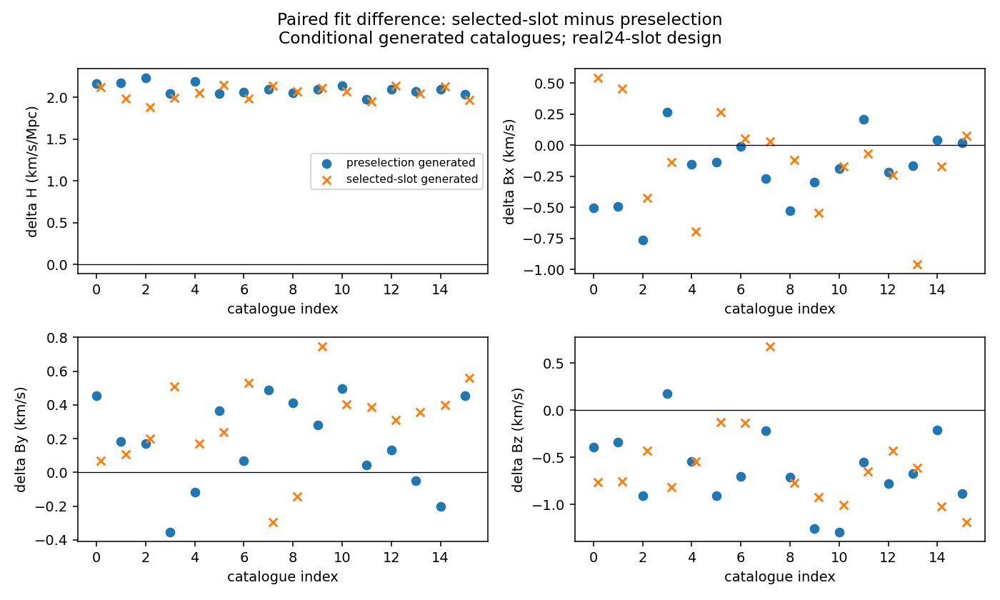

# CF4 선택 관측법칙의 교차 생성·적합 결과

같은 CF4 24개 fixed-slot design에서 공유 zero point prior의 선택 조건화 시점을 바꾸면 endpoint H 추정값이 약2.05–2.10 km/s/Mpc 이동한다. 이 결과는 선택 정규화를 공유 nuisance 적분 안에서 어디에 적용하는지가 실제 추정에 영향을 준다는 조건부 방법론 사례다. 생성법칙을 명시한 두 모형은 각각 정상화된 별도 관측법칙이며, 이번 생성 실험으로 실제 CF4의 법칙을 선택하지는 않는다.

Owner: HTT. Claim tier: CONDITIONAL_DIAGNOSTIC. Artifact mode: finite experiment. Transfer source: solver independent. Null status: 두 선언한 generative laws. Covariance: 실제24slot의 고정 modulus-error proxy와 동일 Gaussian velocity/measurement scenario, 공유eta. Allowed use: paired law sensitivity 및 conditional bias/RMSE. 원자료 제품의 empirical selection/coverage, physical H0/globaltilt, nativeBianchi 결과, logL contrast의 Bayes odds 승격은 이번 scope에 들어가지 않는다.

## 생성·적합 계약

Source base HEAD는 `89621f4c9a6f63449813587a0fadeb13287f8e10`이다. 실제 frozen24 groupID, direction, sigma_mu를 원래 intake/SHA 검사로 가져왔다. truth H/B=[73,100,−200,50], alpha2, s_u250 km/s, s_spec30 km/s, s_eta.05mag, kappa.725를 두 law에 동일하게 사용했다. 각 law16개, 총32개 catalogue를 생성하고 같은 catalogue에 두 law를 적합했다. seed는2026101402+100000×generating_law_index+catalogue_index다. 원래32injection 배열은 변경하지 않았다.

preselection law는 `L_pre = ∫p(eta)Πfi / ∫p(eta)ΠZi`이고, selected-slot law는 `L_slot = ∫p(eta)Π(fi/Zi)`다. 전자의 선택조건 eta 분포는 `p(eta)ΠZi`에 비례하며 후자는eta prior `p(eta)`를 그대로 사용한다. 그 뒤 x|selected,eta, truncated marginalmu와 conditionalt/y 생성은 같다. 새PRE 생성기는 원래 `run_reboot_cf4_injections.generate`의 같은seed 출력과 bit-exact 일치한다. 원래 생성기는POST semantics를 자동 지원하지 않아 명시적인eta 분기를 추가했다.

## 실제 결과

| 생성 법칙 | PRE fit의 H bias / RMSE | POST fit의 H bias / RMSE | paired POST−PRE H 평균±MCSE |
|---|---:|---:|---:|
| PRESELECTION_SHARED_PRIOR | −0.2378527 / 2.4007051 | +1.8584813 / 3.0779386 | +2.0963340±0.0167019 |
| SELECTED_SLOT_PRIOR | −2.0381482 / 3.5537175 | +0.0099823 / 2.9895713 | +2.0481305±0.0202672 |

H 단위는 km/s/Mpc다. 각 줄의 paired 차이는 동일한16개 catalogue를 두 번 적합한 차이의 평균이며 MCSE는 차이의 sampleSD/√16이다. bias/RMSE는 이 유한 conditional campaign의 기술량이다. matched-law fit의 bias와 RMSE가 더 작게 나왔지만n=16으로 보편적 우월성이나 실제survey coverage를 주장하지 않는다. Bx,By,Bz의 paired mean 변화는 PRE-generated에서[−.1999601,+.1769098,−.6376150]km/s, POST-generated에서[−.1321819,+.2847585,−.5944496]km/s다. H/B의 전체 배열, 모든 fit과 generated catalogue는 `result.json` 및 같은 폴더의 JSON/NPZ에서 확인한다.

## 메커니즘과 정밀도

같은 truth에서24slot의 선택을 동시에 조건화하면eta mean은 −0.060193886mag, SD는.049776157mag다. selected-slot law의eta mean0,SD.05mag와 다르다. `mu=25+A ln(dA)+eta`, `A=5/ln10`에서 velocity slope와 observedmu를 고정한 단순 scale 근사는 `H_post/H_pre≈exp((eta_post−eta_pre)/A)`이므로 +2.0518907km/s/Mpc 이동을 예측한다. 이는 finite-distance term, velocity/latent posterior shape를 생략한 근사이며 위의 실제 paired fit 값과 구별한다.

generator moment의256/64 대384/96 최대scaled 차이는PRE6.7502×10⁻¹⁴,POST1.4211×10⁻¹⁴였다. 모든 fit의192/40 대256/64 truth/fitpoint 검사와 각 law 첫2catalogue의384/96 대512/128 감사에서 최대|ΔlogL|는1.81784×10⁻⁸이었다. 원래1e−6 criterion을 유지했고64fit가 모두 수용되어 탈락은0개다. 동일truth의법칙logL contrast는512/128에서 계산했으며 평균은PRE-generated−.3582718,POST-generated+.5447212다. 이 contrast에model prior/evidence를 붙이지 않는다.



[정확한 SVG](paired_crosslaw.svg)는 같은result rows를 사용한다. 파란원은PRE-generated, 주황×는POST-generated이고 모든 패널은POSTfit−PREfit다. preview를 시각 확인했으며 axis/legend/data clipping 없이 읽을 수 있었다.

## 실행·재현·통합

실제 generating command와 `__file__` 대응은 다음과 같다.

```bash
/usr/bin/python3 /tmp/htt-r2-selection-20261014/run_selection_crosslaw.py --repo /home/cosmosapjw/Dropbox/bianchi/htt_base --output /tmp/htt-r2-selection-20261014/campaign16 --catalogues 16
```

Generating file: `/tmp/htt-r2-selection-20261014/run_selection_crosslaw.py`. Exact execution copy: `execution_run_selection_crosslaw.py`, SHA256 `c8b882305a6caa986d46af12c74e40430d4ef93b5f6f3c891d1ae7022577e80a`. Scientific run436.483초, process447.20초, exit0. `/usr/bin/python3`3.12의numpy2.4.2/scipy1.17.0/matplotlib3.10.8을 사용했다. requestedgpt-6.1-sol/high, observedUNKNOWN이다. `execution_receipt.json`과 `INTEGRATION_PROVENANCE.json`이 명령·원본 source copy·각 artifact hash를 연결한다.

통합용 `run_selection_crosslaw.py`는 수치 코드와 기준을 유지하고 replay identity만 교정했다. base HEAD의ancestor 관계와 실제 imported law/intake/catalogue-loader/original-generator hash를 고정하며, 기존 출력이 있는 directory를 거부한다. 이미 생성된 catalogue를 새 code/law 결과로 재표기하는 resume path를 제거했다. 통합 scientific/guard tests6개가6.989초에PASS했고1catalogue/law의smallsmoke4fit도 통과했다. 큰32catalogue campaign을 반복하지 않았다.

통합 스크립트는 `scripts/run_solver_free_cf4_crosslaw.py`, 검사는 `tests/htt/test_solver_free_cf4_crosslaw.py`에 있다. 기존 결과 폴더와 다른 빈 directory를 지정한다.

```bash
OPENBLAS_NUM_THREADS=1 /usr/bin/python3 scripts/run_solver_free_cf4_crosslaw.py --repo . --output /tmp/htt-r2-selection-replay-20261014 --catalogues 16
/usr/bin/python3 tests/htt/test_solver_free_cf4_crosslaw.py --repo . -v
```

실제 campaign의 source copy는 현재 replay guard가 추가된 script와 구분한다. 기존 결과를 재계산하지 않고 원래 실행 byte/hash와 source binding을 보존했다. 부모의 통합 및 독립 검토는 상위 `DELIVERY.json`에 기록한다.

## 방법론 기여의 진전과 남은 비교

이 실험은 M01의 최소criterion인같은physicalscenario에서두eta semantics를교차생성·적합하는부분을실행했다. 선택조건이공유calibrationmean을이동시키고같은catalogue의endpointscale을바꾸는구체적mechanism과pairedMCSE를얻었다. Cf3/CF4원논문의hierarchicalforwardmodel·methodcalibration과비교하여이법칙구성이어떤기존처리차이를해결하는지수식별로대응하는문헌신규성의무는남는다. 실제24design을사용한conditionalmethoddemonstration으로원고를구성할수있고nativeBianchi solver는이방법론검증의전제가아니다.
