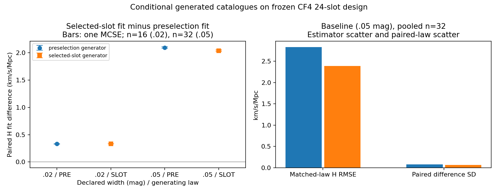

# SF08 CF4 paired Monte Carlo precision and calibration width

The fixed extension generated64newcatalogues and128pairedprimaryfits. Previous32catalogues remain unchanged. OwnerHTT; claimtierCONDITIONAL_DIAGNOSTIC. This is a conditional methods experiment on the frozen24-slot design.

## Predeclared design

The prior n=16 maximum paired H MCSE was0.020267233 km/s/Mpc. Target pooled MCSE .015 required30pairs perlaw; complete8-pair batches fixed32total (16old+16new). Before any new generation, target, counts, truth, laws and width case were declared in original PREDECLARED.json (b61b816d8c26ce0c263af6ee95fe7cbc8fd77861acad967e4df44076bd090d45). Seed repairs retained that design; the final replacement contract is PREDECLARED_FINAL.json (2132be1b0b0eb014263bc601784c1d7a4f9af345a3a8abaec7c9eb5edb3a0b03), sealed before its replacement catalogues were generated. Widthcase count16perlaw was fixed and its precision is measured rather than guaranteed from baseline SD.

Generator law stays fixed within each case/law. Truth H/B=[73,100,-200,50], alpha2,s_u250km/s,s_spec30km/s,kappa.725. Baseline etaSD.05mag; newwidth.02mag. Seeds baseline 2026601408+100000*g+i for i0..9 and retained 2026101408+100000*g+i for i10..15, corrected width 2026401408+100000*g+i; these64seeds are disjoint from original32. Early profiles established runtime. Corrected width profile catalogues remain in the final fixed count; profiles affected by seed defects are excluded and preserved.

## Results

| case / generating law | accepted pairs | paired H mean | paired H MCSE | matched-law H bias | matched-law H RMSE |
|---|---:|---:|---:|---:|---:|
|original .05 / PRE|16/16|+2.09633403|0.01670186|-0.23785273|2.40070509|
|original .05 / SLOT|16/16|+2.04813049|0.02026723|+0.00998229|2.98957135|
|new .05 / PRE|16/16|+2.09611147|0.02214742|-0.23858885|3.20721695|
|new .05 / SLOT|16/16|+2.03411996|0.01044814|-0.47915183|1.57989879|
|pooled .05 / PRE|32/32|+2.09622275|0.01364405|-0.23822079|2.83281005|
|pooled .05 / SLOT|32/32|+2.04112523|0.01128588|-0.23458477|2.39098484|
|new .02 / PRE|16/16|+0.33159135|0.00247528|-0.78806059|2.36280994|
|new .02 / SLOT|16/16|+0.33252830|0.00185296|-0.23375440|1.70454091|

H quantities have units km/s/Mpc. Paired statistics are computed from two fits to each identical generated catalogue. MCSE is sampleSD/sqrt(n); it describes simulation precision conditional on this law and design. It is separate from the much larger bias/estimator-scatter uncertainty.

Observed baseline target achieved: True. All fixed samples were executed irrespective of interim outcomes. No extra samples were generated to meet the target.

## Width comparison and mechanism

PRESELECTION_SHARED_PRIOR: pooledbaseline minus.02width pairedHshift = 1.76463139 ± 0.01386676 (MCSE). The two case estimates use disjoint seeds; error propagation uses the sum of their estimated variances.
SELECTED_SLOT_PRIOR: pooledbaseline minus.02width pairedHshift = 1.70859692 ± 0.01143699 (MCSE). The two case estimates use disjoint seeds; error propagation uses the sum of their estimated variances.
Declaredwidth0.05: conditional PRE eta mean=-0.0601938860mag; first scale approximation73*(exp(-eta_mean/A)-1)=2.05189068km/s/Mpc. This approximation omits finite-distance and velocity/latent-shape corrections; actual fits above use the full frozen law.
Declaredwidth0.02: conditional PRE eta mean=-0.0097037292mag; first scale approximation73*(exp(-eta_mean/A)-1)=0.32694744km/s/Mpc. This approximation omits finite-distance and velocity/latent-shape corrections; actual fits above use the full frozen law.

PRE likelihood integrates shared eta numerator and joint-selection denominator separately; SLOT integrates per-eta normalized slotdensities with its own eta prior. These are distinct normalized generatorlaws. Width sensitivity follows from the change in PRE selection-conditioned eta weights, without selecting an empirical CF4 law.

## Numerical controls and execution

Primaryfits accepted128/128; failure rows0. Max truth/fitpoint quadrature |delta logL|=3.75117679e-08, below frozen1e-6. Eight384/96 reoptimization controls checked512/128, statusPASS; maxHshift=2.84217273e-06, maxBshift=0.00113686838. These measured controls are smaller than pairedMCSE and compare grids/optimization; they are not rigorous global error bounds.

An initial seed overlap was reproduced and parent-approved for bounded correction. The original contract/driver, failed execution log, and two excluded width profile catalogues are preserved in FIRST_FAILURE_SEED_OVERLAP.json. A second overlap with the original campaign duplicated 20 baseline raw arrays exactly; PRIOR_SEED_OVERLAP_FALSIFIER.json preserves this failure. Parent approved replacing only those 20 baseline catalogues from independent seeds. The 12 nonoverlapping baseline catalogues and all 32 corrected width catalogues were retained by exact row/raw identity. Two initial width and 20 duplicated baseline catalogues remain preserved but excluded; one interrupted fit is retained in the exit130 log. Thus 64 valid catalogues contribute 128 primary fits, plus 22 excluded historical catalogues with 44 completed primary fits and an interrupted attempt whose partial optimization count is not measured. Counts, target, truth, generator laws and scientific tolerances are unchanged. All raw NPZ were written before fitting, and each row seals its raw SHA and predeclaredcontract. Resume preserves completed rows; raw-only interrupted checkpoints are compared against exact generator replay. Six affected crosslaw tests passed. Profile and extension process receipts, stdout/stderr logs and original executioncopy are retained. Requestedgpt-6.1-sol/high; observedUNKNOWN. Independent review is pending the parent.



## Scope and continuation

This conditional experiment does not provide empirical CF4 selection/completeness, physical H0/globaltilt, coverage of an observed survey, native solver output, or Bayes odds. Actual empirical selection and calibration covariance remain SF13 input requirements. The next useful method step is a source-based correspondence with existing hierarchical selection implementations; do not rerun this completed fixed campaign for assurance.

The archived result remains bound to its actual scratch execution driver and original source heads. Its raw files and result can be verified byte for byte against the archive manifest. A repository wrapper declares a new source-bound contract for fresh computation after commit; it does not retroactively change the archived contract. A fresh rerun uses the same finite scientific design and seeds, with a new execution/source binding. Commands for a fresh output directory:

```bash
OPENBLAS_NUM_THREADS=1 /usr/bin/python3 -B scripts/run_solver_free_cf4_precision.py --repo . --declare /tmp/NEW_PREDECLARED.json
OPENBLAS_NUM_THREADS=1 /usr/bin/python3 -B scripts/run_solver_free_cf4_precision.py --repo . --contract /tmp/NEW_PREDECLARED.json --output /tmp/NEW_CAMPAIGN
```
